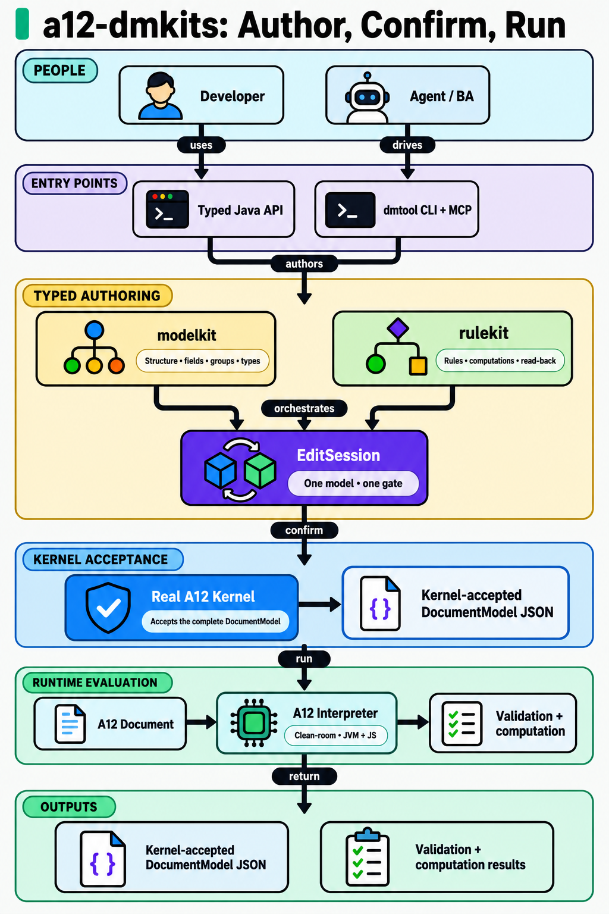
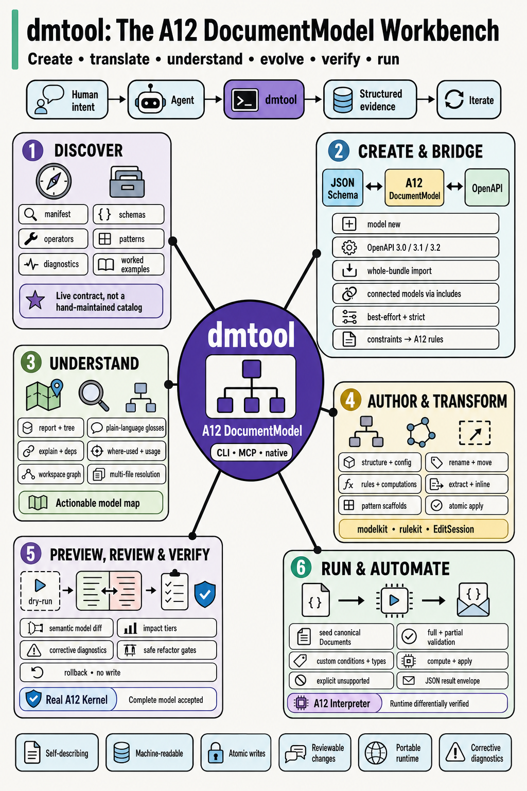
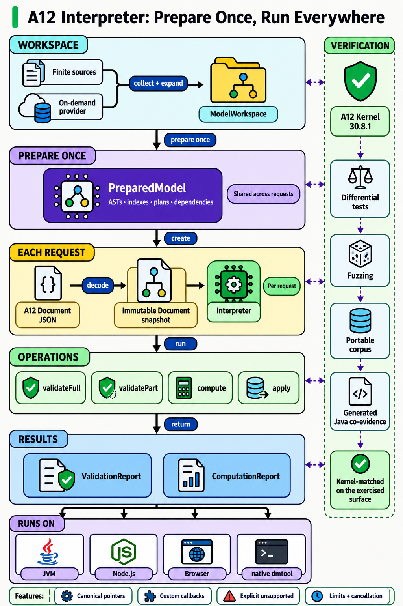
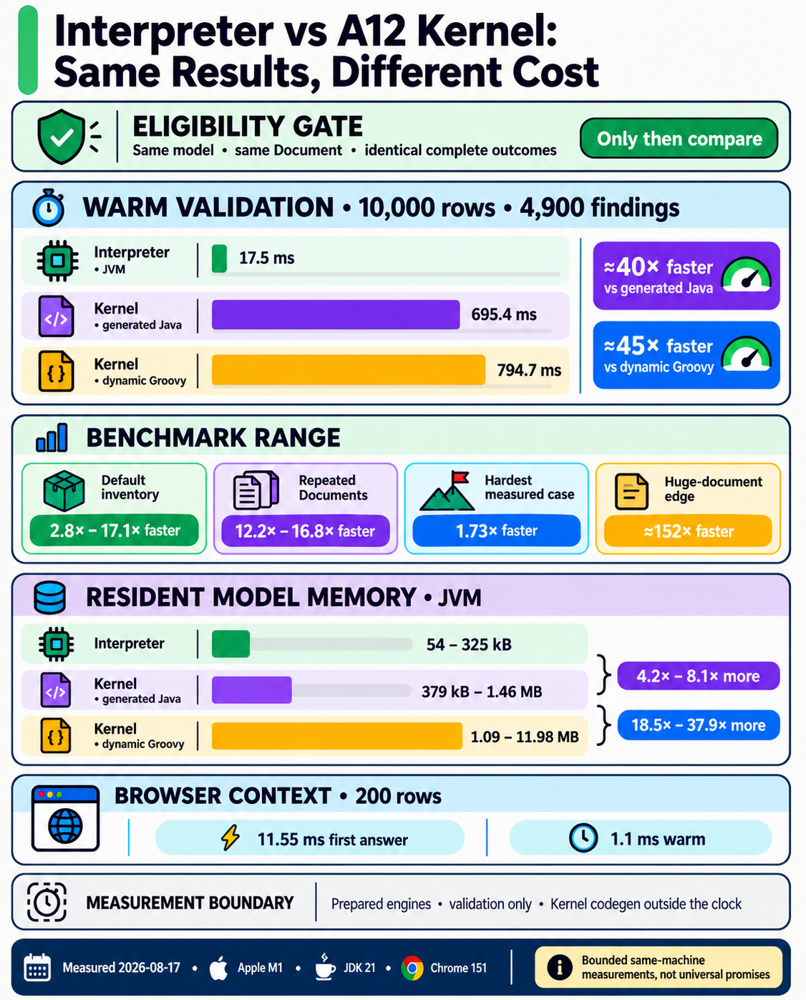

# README infographics

This document is the regeneration and refinement source for the four raster infographics embedded in the main and public-release READMEs. It owns the content maps, exact generation prompts, asset registry, factual sources, placement map, visual acceptance gates, and refinement log. The PNG files are presentation artifacts derived from this document.

## Asset registry and README placement

The full-resolution source assets live under `assets/infographics/`. Public-release README copies use the same relative `assets/infographics/` path inside their own source roots so the Markdown remains valid after mirror assembly.

| Infographic | Canonical asset | Release-source copies | README sections |
|---|---|---|---|
| A12 dmkits toolchain | `assets/infographics/a12-dmkits-toolchain.png` | none | root introduction, after “What's in the box” |
| dmtool DocumentModel workbench | `assets/infographics/dmtool-model-workbench.png` | `plugin/assets/infographics/dmtool-model-workbench.png` | root and dmtool release “Why dmtool” |
| Interpreter runtime | `assets/infographics/a12-interpreter-runtime.png` | `interpreter/public-release/assets/infographics/a12-interpreter-runtime.png` | root “The interpreter” and Interpreter release “What ships” |
| Interpreter vs Kernel | `assets/infographics/interpreter-vs-kernel.png` | `plugin/assets/infographics/interpreter-vs-kernel.png`, `interpreter/public-release/assets/infographics/interpreter-vs-kernel.png` | root and Interpreter release “Performance”, dmtool release “Runtime performance and memory” |

Every README embeds a scaled preview using an HTML `img` element inside a link to the same full-resolution PNG. The preview width is `720`, the image has descriptive alt text, and the adjacent caption tells the reader that the full image opens on click.

The canonical assets and their release-source copies must be byte-identical. The public dmtool mirror already copies the complete `plugin/` tree. The Interpreter mirror assembler copies `interpreter/public-release/assets/infographics/` beside its generated root README.

## Shared visual system

- Use case: `infographic-diagram`.
- Audience: software engineers, A12 model developers, technical decision-makers, and coding-agent users with general software architecture knowledge.
- Format: original ByteByteGo-inspired information design without ByteByteGo branding or copied compositions.
- Canvas: high-resolution portrait with a warm off-white background. Use 4:5 by default and 2:3 for the denser layered architectures and dmtool workbench.
- Header: large left-aligned title with a short mint vertical accent bar and a clean upper-right corner.
- Typography: bold geometric sans-serif, horizontal text only, short labels, no paragraphs inside the image.
- Shapes: dark outlined rounded rectangles, pills, compact circular stage numbers, pale grouping fields, and saturated focal nodes.
- Palette: near-black ink, mint accent, pale cyan, pale lavender, pale green, pale yellow, and one saturated purple or blue focal color.
- Connectors: solid arrows mean direct flow; dashed arrows mean verification, evidence, or an indirect relationship. Every arrow has a clear source, target, and action.
- Branding: product names such as `a12-dmkits`, `dmtool`, `modelkit`, `rulekit`, and `A12 Interpreter` are text labels, not logos. Do not add the ByteByteGo logo, mgm branding, an A12 logo, a watermark, or an invented project mark.
- Text fidelity: use only the exact content listed for each infographic. Do not add claims, product names, steps, statistics, or decorative pseudo-text.
- Quality threshold: the takeaway, title, main path, and output must remain clear at README preview width. All exact labels and measurements must be readable at full size.

## Factual sources and freshness triggers

| Claim family | Current source | Regenerate when |
|---|---|---|
| Module roles, boundaries, entry points, and dependency direction | [ARCHITECTURE.md](ARCHITECTURE.md), [API-GUIDE.md](API-GUIDE.md), root [`README.md`](../README.md) | a module, public product name, dependency edge, entry point, or authoring/runtime boundary changes |
| dmtool discovery, model exchange, comprehension, authoring, review, runtime, result, and MCP mechanisms | [CLI-SPEC.md](CLI-SPEC.md), [CLI-CONFORMANCE-SPEC.md](CLI-CONFORMANCE-SPEC.md), root [`README.md`](../README.md), public dmtool [`README.md`](../plugin/README.md) | a featured mechanism, contract, or product positioning changes |
| Interpreter preparation, request lifecycle, targets, and public features | [INTERPRETER-API-SPEC.md](INTERPRETER-API-SPEC.md), [INTERPRETER-ARCHITECTURE.md](INTERPRETER-ARCHITECTURE.md), public Interpreter [`README.md`](../interpreter/public-release/README.md) | the public lifecycle, target set, concurrency contract, or supported result family changes |
| Kernel-conformance claims | [TESTING-SPEC.md](TESTING-SPEC.md), [CONFORMANCE-CORPUS-SPEC.md](CONFORMANCE-CORPUS-SPEC.md), [INTERPRETER-SPEC.md](INTERPRETER-SPEC.md) | the semantics target, oracle hierarchy, differential policy, or portable corpus contract changes |
| Performance and resident memory | public [PERFORMANCE.md](../interpreter/public-release/PERFORMANCE.md), [INTERPRETER-PERFORMANCE.md](INTERPRETER-PERFORMANCE.md), [INTERPRETER-PERFORMANCE-RESULTS.md](INTERPRETER-PERFORMANCE-RESULTS.md) | a qualifying benchmark rerun changes any displayed number, machine/runtime identity, timing boundary, or eligibility rule |

The performance poster is dated evidence. Its current figures were measured on 2026-08-17 on Apple M1, JDK 21, and Chrome 151. Re-run the owning benchmark protocols before replacing a number. Do not infer a new ratio from unrelated results or turn a bounded scenario into a universal claim.

## Synchronization contract

The public Interpreter [`PERFORMANCE.md`](../interpreter/public-release/PERFORMANCE.md) owns every mutable measurement printed in the performance poster. [`check-infographic-freshness.sh`](../scripts/check-infographic-freshness.sh) extracts the current values from the report's named table rows and evidence footer, then exact-matches the corresponding lines in the compiled ImageGen prompt below. The check contains no second numeric snapshot, so changing an owning table cell makes the prompt check fail immediately.

GitHub CI runs that shell-only check as the first step after the rulekit checkout already required by every build, before it checks out the Kernel bootstrap kit or installs Java and Gradle. Stale claims, broken previews, missing assets, or drifted public copies therefore stop the workflow before the expensive work begins. Keeping the check in the existing build job avoids paying for a second runner startup and duplicate repository checkout on every successful run. The committed [pre-push hook](../.githooks/pre-push) runs the same check locally and then runs `actionlint`, so any Git client gets the same pre-push verdict after `core.hooksPath` is configured. `InfographicAssetGuardTest` repeats the source-to-prompt and asset checks in the ordinary documentation suite, while `GateTierWiringTest` locks the early ordering and prevents a separate preflight job from being introduced silently.

The PNG is intentionally not treated as machine-readable data. CI can prove that the report and the exact generation prompt agree, but reliable raster-text verification would require brittle OCR. When this guard fails after a benchmark refresh, update the content map and prompt, regenerate the performance image with built-in ImageGen, inspect it at full resolution, synchronize both public copies, and add a dated refinement-log row. The binary-copy check then proves that every public repository receives the accepted pixels.

## Infographic 1: A12 dmkits toolchain

### Accepted output

<p align="center">
  <a href="../assets/infographics/a12-dmkits-toolchain.png">
    
  </a>
</p>
<p align="center"><sub>1024 × 1536 PNG. Click the preview to open the full-resolution image.</sub></p>

### Content map

- Ten-second takeaway: modelkit and rulekit author a DocumentModel, the real A12 Kernel confirms it, and the clean-room Interpreter evaluates Documents across runtimes.
- Exact title: `a12-dmkits: Author, Confirm, Run`
- Primary layout: layered architecture.
- Reading direction: top to bottom.
- Focal mechanism: the authoring layer containing modelkit, rulekit, and EditSession.
- Major regions: consumers, entry points, typed authoring, Kernel acceptance, runtime evaluation, outputs.
- Final output: a kernel-accepted DocumentModel plus validation and computation results.

### Exact relationships

- Developer -> uses -> Typed Java API.
- Agent / BA -> drives -> dmtool CLI + MCP.
- Typed Java API -> authors through -> modelkit + rulekit.
- dmtool CLI + MCP -> orchestrates -> modelkit + rulekit.
- modelkit -> defines -> structure.
- rulekit -> defines -> rules + computations.
- modelkit + rulekit -> meet in -> EditSession.
- EditSession -> submits -> Real A12 Kernel.
- Real A12 Kernel -> accepts -> DocumentModel JSON.
- DocumentModel JSON + A12 Document -> run on -> A12 Interpreter.
- A12 Interpreter -> returns -> validation + computation.

### Generation prompt

```text
Use case: infographic-diagram
Asset type: GitHub README technical infographic
Primary request: Create an original, polished portrait technical infographic about the a12-dmkits toolchain, using a clean ByteByteGo-inspired information-design language without copying an existing poster or using the ByteByteGo logo or wordmark.

Communication goal:
- Audience: software engineers, A12 model developers, technical decision-makers, and coding-agent users.
- Ten-second takeaway: modelkit and rulekit author a DocumentModel, the real A12 Kernel confirms it, and the clean-room Interpreter evaluates Documents across runtimes.
- Exact title: "a12-dmkits: Author, Confirm, Run".
- Tone: technically precise, compact, approachable, and visually scannable.

Canvas and header:
- Tall 2:3 portrait composition at high resolution.
- Very light warm-gray background.
- Large bold sans-serif title at the top left.
- Short mint-green vertical bar immediately left of the title.
- Leave the opposite header corner clean.
- Reserve a clear gap between the header and the diagram body.

Primary information structure:
- Use a layered architecture as the single dominant layout skeleton.
- Primary reading direction: top to bottom.
- Focal mechanism: the typed authoring layer containing modelkit, rulekit, and EditSession.
- Major regions in reading order: PEOPLE, ENTRY POINTS, TYPED AUTHORING, KERNEL ACCEPTANCE, RUNTIME EVALUATION, OUTPUTS.
- Final output: a kernel-accepted DocumentModel plus validation and computation results.

Exact content:
- Use these labels exactly as written and add no other text.
- Title: "a12-dmkits: Author, Confirm, Run"
- Region: "PEOPLE"
- Nodes: "Developer" and "Agent / BA"
- Region: "ENTRY POINTS"
- Nodes: "Typed Java API" and "dmtool CLI + MCP"
- Region: "TYPED AUTHORING"
- Node: "modelkit"
- Caption under modelkit: "Structure • fields • groups • types"
- Node: "rulekit"
- Caption under rulekit: "Rules • computations • read-back"
- Central node: "EditSession"
- Caption under EditSession: "One model • one gate"
- Region: "KERNEL ACCEPTANCE"
- Node: "Real A12 Kernel"
- Caption: "Accepts the complete DocumentModel"
- Output node: "Kernel-accepted DocumentModel JSON"
- Region: "RUNTIME EVALUATION"
- Input node: "A12 Document"
- Node: "A12 Interpreter"
- Caption: "Clean-room • JVM + JS"
- Final output node: "Validation + computation"
- Arrow labels: "uses", "drives", "authors", "orchestrates", "confirm", "run", "return"

Semantic mapping:
- People = simple person or agent icon + pale cyan + rounded card.
- Entry points = terminal or code icon + lavender + rounded card.
- modelkit = model-tree icon + pale yellow + rounded card.
- rulekit = condition-tree icon + pale green + rounded card.
- EditSession = interlocking model-and-rule icon + saturated purple + rounded card.
- Real A12 Kernel = shield-check icon + saturated blue + rounded card.
- A12 Interpreter = compact evaluator chip icon + mint + rounded card.
- Direct action = solid near-black arrow with the exact action label.

Layout-specific composition:
- Align the primary data path vertically.
- Make each major layer a wide labeled container.
- Expand TYPED AUTHORING to show modelkit and rulekit side by side, converging on EditSession.
- Place auxiliary explanatory captions inside their owning nodes, not on the primary route.
- Put the accepted model and runtime results in a conclusive bottom region.

Visual language:
- Heavy near-black outlines, rounded rectangles, pill labels, and generous gutters.
- Flat, colorful technical icons with consistent dark outlines and no realistic shading.
- Neutral canvas with a mint accent, pale cyan, pale lavender, pale green, pale yellow, saturated purple, and saturated blue.
- Keep equivalent concepts aligned and visually identical wherever they repeat.
- Keep all text horizontal and fully legible.

Avoid:
- No ByteByteGo logo, wordmark, watermark, A12 logo, mgm branding, or copied poster composition.
- No photorealistic imagery, 3D icons, gradients, neon glow, glassmorphism, blurred shadows, decorative textures, or generic stock art.
- No tiny paragraphs, illegible text, invented labels, duplicated words, random arrows, unlabeled crossings, ambiguous line endings, excessive nesting, inconsistent icons, or decorative charts.
```

## Infographic 2: dmtool DocumentModel workbench

### Accepted output

<p align="center">
  <a href="../assets/infographics/dmtool-model-workbench.png">
    
  </a>
</p>
<p align="center"><sub>1024 × 1536 PNG. Click the preview to open the full-resolution image.</sub></p>

### Content map

- Ten-second takeaway: one self-describing tool covers the complete DocumentModel lifecycle, from plain-language intent or external schemas to verified models and executable Documents.
- Exact title: `dmtool: The A12 DocumentModel Workbench`
- Exact subtitle: `Create • translate • understand • evolve • verify • run`
- Primary layout: hub-and-spoke workbench.
- Reading direction: agent loop at the top, central hub, six numbered capability regions, then the bottom evidence rail.
- Focal mechanism: `dmtool` around an `A12 DocumentModel`, available through `CLI • MCP • native`.
- Major regions: discover, create and bridge, understand, author and transform, preview/review/verify, run and automate.
- Visual priority: CREATE & BRIDGE gets the largest capability card because bidirectional JSON Schema/OpenAPI exchange distinguishes the originating workflow; the Kernel and Interpreter remain small assurance badges rather than dominant stages.
- Density limit: at most six short feature labels in each capability region. Exact commands and detailed caveats stay in the READMEs.
- Final output: a kernel-accepted DocumentModel, canonical A12 Documents, and structured evidence for the next agent iteration.

### Exact relationships

- Human intent -> is interpreted by -> Agent.
- Agent -> invokes -> dmtool.
- dmtool -> returns -> Structured evidence.
- Structured evidence -> drives -> Agent iteration.
- dmtool -> operates on -> A12 DocumentModel.
- CLI + MCP + native -> expose -> dmtool.
- DISCOVER -> supplies -> manifests, schemas, operators, patterns, diagnostics, and examples.
- CREATE & BRIDGE -> originates -> a new DocumentModel.
- JSON Schema -> imports through -> dmtool -> A12 DocumentModel.
- OpenAPI 3.0 / 3.1 / 3.2 -> imports through -> dmtool -> A12 DocumentModel.
- A12 DocumentModel -> exports through -> dmtool -> JSON Schema or OpenAPI.
- Whole-bundle import -> creates -> connected models through includes.
- Unsupported or ambiguous source semantics -> produce -> explicit decisions, with strict mode available.
- Source constraints without a field-config home -> become -> A12 rules.
- UNDERSTAND -> maps -> report + tree, plain-language glosses, dependencies, usage, and workspace graph.
- AUTHOR & TRANSFORM -> evolves -> structure, configuration, rules, computations, patterns, and references.
- rename + move -> rewrite -> affected references.
- extract + inline -> refactor -> reusable model structure.
- PREVIEW, REVIEW & VERIFY -> evaluates -> dry-run, semantic model diff, impact tiers, corrective diagnostics, safe refactor gates, and rollback.
- Real A12 Kernel -> confirms -> complete model acceptance.
- RUN & AUTOMATE -> creates and consumes -> canonical A12 Documents.
- model seed -> creates -> canonical A12 Document JSON.
- full or partial validation + compute/apply -> returns -> structured JSON result envelope.
- A12 Interpreter -> provides -> runtime behavior differentially verified against the Kernel.

### Generation prompt

```text
Use case: infographic-diagram
Asset type: GitHub README technical infographic
Primary request: Create an original, polished portrait technical infographic presenting dmtool as the complete A12 DocumentModel workbench, using a clean ByteByteGo-inspired information-design language without copying an existing poster or using the ByteByteGo logo or wordmark.

Communication goal:
- Audience: coding-agent users, business analysts, model developers, software engineers, and technical decision-makers.
- Ten-second takeaway: one self-describing tool covers the complete DocumentModel lifecycle, from plain-language intent or external schemas to verified models and executable Documents.
- Exact title: "dmtool: The A12 DocumentModel Workbench".
- Exact subtitle: "Create • translate • understand • evolve • verify • run".
- Tone: technically precise, dense but orderly, approachable, and visually scannable.

Canvas and header:
- Tall 2:3 portrait composition at high resolution, preferably 1536 x 2304 or larger.
- Fully opaque warm off-white background extending to every canvas edge.
- Large bold sans-serif title at the top left.
- Short mint-green vertical bar immediately left of the title.
- Leave the opposite header corner clean.
- Put the subtitle directly below the title in smaller bold type.
- Reserve a clear gap between the header and the diagram body.

Primary information structure:
- Use a hub-and-spoke workbench as the single dominant layout skeleton.
- Primary reading direction: the agent loop at the top, then the central dmtool hub, then six numbered capability cards arranged around it, then the evidence rail at the bottom.
- Put a compact horizontal loop immediately below the subtitle: Human intent → Agent → dmtool → Structured evidence → Iterate.
- Make the central saturated-purple hub the visual anchor. It contains "dmtool", "A12 DocumentModel", and the access pill "CLI • MCP • native".
- Arrange six large rounded capability cards around the hub, three on the left and three on the right, with short clean spokes from the hub. Number them 1 through 6.
- Give CREATE & BRIDGE visibly more area than the other cards. Its bidirectional exchange is the key differentiator.
- Keep the two conformance assurances as small badges inside their owning cards. Do not make the Kernel or Interpreter separate stages or dominant nodes.
- Final output: a kernel-accepted DocumentModel, canonical A12 Documents, and structured evidence that drives the next agent iteration.

Exact content:
- Use these labels exactly as written and add no other text.
- Title: "dmtool: The A12 DocumentModel Workbench"
- Subtitle: "Create • translate • understand • evolve • verify • run"
- Agent-loop labels: "Human intent", "Agent", "dmtool", "Structured evidence", "Iterate"
- Central hub label: "dmtool"
- Central hub object: "A12 DocumentModel"
- Central access pill: "CLI • MCP • native"
- Card 1 title: "1  DISCOVER"
- Card 1 labels: "manifest", "schemas", "operators", "patterns", "diagnostics", "worked examples"
- Card 1 callout: "Live contract, not a hand-maintained catalog"
- Card 2 title: "2  CREATE & BRIDGE"
- Card 2 main bridge: "JSON Schema ⇄ A12 DocumentModel ⇄ OpenAPI"
- Card 2 labels: "model new", "OpenAPI 3.0 / 3.1 / 3.2", "whole-bundle import", "connected models via includes", "best-effort + strict", "constraints → A12 rules"
- Card 3 title: "3  UNDERSTAND"
- Card 3 labels: "report + tree", "plain-language glosses", "explain + deps", "where-used + usage", "workspace graph", "multi-file resolution"
- Card 3 output pill: "Actionable model map"
- Card 4 title: "4  AUTHOR & TRANSFORM"
- Card 4 labels: "structure + config", "rules + computations", "pattern scaffolds", "rename + move", "extract + inline", "atomic apply"
- Card 4 foundation pill: "modelkit • rulekit • EditSession"
- Card 5 title: "5  PREVIEW, REVIEW & VERIFY"
- Card 5 labels: "dry-run", "semantic model diff", "impact tiers", "corrective diagnostics", "safe refactor gates", "rollback • no write"
- Card 5 assurance badge: "Real A12 Kernel"
- Card 5 assurance caption: "Complete model accepted"
- Card 6 title: "6  RUN & AUTOMATE"
- Card 6 labels: "seed canonical Documents", "full + partial validation", "compute + apply", "custom conditions + types", "explicit unsupported", "JSON result envelope"
- Card 6 assurance badge: "A12 Interpreter"
- Card 6 assurance caption: "Runtime differentially verified"
- Bottom evidence pills: "Self-describing", "Machine-readable", "Atomic writes", "Reviewable changes", "Portable runtime", "Corrective diagnostics"

Semantic mapping:
- Human intent and Agent = speech-bubble and agent icons + pale cyan.
- dmtool hub = workbench or command-terminal icon + saturated purple.
- A12 DocumentModel = model-tree icon nested inside the hub.
- DISCOVER = compass and catalog icons + pale lavender.
- CREATE & BRIDGE = bidirectional schema/document arrows + pale cyan and pale yellow, with the main bridge set as the largest text inside the card.
- UNDERSTAND = map, magnifier, and dependency-tree icons + pale green.
- AUTHOR & TRANSFORM = model-tree, rule-node, and refactor icons + pale yellow.
- PREVIEW, REVIEW & VERIFY = before/after panels, checklist, and shield-check icons + pale lavender.
- RUN & AUTOMATE = document, evaluator chip, and result-envelope icons + mint.
- Direct dmtool capability = one short solid near-black spoke from the central hub to the owning card. Spokes carry no text.
- Kernel assurance = small saturated-blue shield badge inside card 5.
- Interpreter assurance = small saturated-purple evaluator badge inside card 6.

Layout-specific composition:
- Use a narrow top agent-loop rail, a strong central hub, and six capability cards balanced around it.
- Keep card headings, label positions, icon sizes, padding, and borders consistent.
- Make cards 1, 3, and 5 the left column; cards 2, 4, and 6 the right column. Give card 2 extra height and rebalance the others without crowding.
- Render feature labels as compact chips or short one-line rows, never paragraphs.
- In card 2, make "JSON Schema ⇄ A12 DocumentModel ⇄ OpenAPI" a clear bidirectional horizontal bridge, with the supporting labels beneath it.
- In card 5, show dry-run feeding a two-panel semantic diff, then the safety and Kernel assurance badge.
- In card 6, show a canonical Document entering validation and computation, then a JSON result envelope leaving.
- Use only six hub spokes. Avoid connections between capability cards.
- Finish with one aligned bottom rail of six evidence pills.

Visual language:
- Heavy near-black outlines, rounded rectangles, pill labels, simple circular region numbers, and generous gutters.
- Flat, colorful technical icons with consistent dark outlines and no realistic shading.
- Neutral canvas with a mint accent, pale cyan, pale lavender, pale green, pale yellow, saturated purple, and saturated blue.
- Use bold geometric sans-serif type. Keep titles prominent, card labels medium, and captions compact but fully readable at full resolution.
- Preserve a strong hierarchy despite the density: title, hub, card headings, main bridge, labels, evidence pills.
- Keep all text horizontal and fully legible.

Avoid:
- No ByteByteGo logo, wordmark, watermark, A12 logo, mgm branding, or copied poster composition.
- No photorealistic imagery, 3D icons, gradients, neon glow, glassmorphism, blurred shadows, decorative textures, or generic stock art.
- Do not present dmtool as only a safe editor, only a semantic-diff tool, or mainly a Kernel-versus-Interpreter wrapper.
- No shell commands, source code, invented CLI verbs, invented diagnostics, invented versions, tiny paragraphs, illegible text, duplicated words, random arrows, unlabeled crossings, ambiguous line endings, excessive nesting, inconsistent icons, or decorative charts.
```

## Infographic 3: A12 Interpreter runtime

### Accepted output

<p align="center">
  <a href="../assets/infographics/a12-interpreter-runtime.png">
    
  </a>
</p>
<p align="center"><sub>1024 × 1536 PNG. Click the preview to open the full-resolution image.</sub></p>

### Content map

- Ten-second takeaway: a workspace becomes one reusable PreparedModel, while each request gets its own Interpreter and immutable Document snapshot across JVM, Node.js, browser, and native dmtool.
- Exact title: `A12 Interpreter: Prepare Once, Run Everywhere`
- Primary layout: layered architecture.
- Reading direction: top to bottom.
- Focal mechanism: the PreparedModel and per-request Interpreter boundary.
- Major regions: workspace, preparation, request, operations, results, targets, verification.
- Final output: ValidationReport and ComputationReport across four consumers.

### Exact relationships

- Workspace sources -> collect + expand -> ModelWorkspace.
- ModelWorkspace -> prepare once -> PreparedModel.
- PreparedModel -> creates -> per-request Interpreter.
- A12 Document JSON -> decodes to -> immutable Document snapshot.
- Interpreter + Document -> run -> validate + compute + apply.
- Operations -> return -> ValidationReport + ComputationReport.
- PreparedModel -> serves -> concurrent requests.
- Differential verification -> compares with -> A12 Kernel 30.8.1.
- One common engine -> runs on -> JVM + Node.js + browser + native dmtool.

### Generation prompt

```text
Use case: infographic-diagram
Asset type: GitHub README technical infographic
Primary request: Create an original, polished portrait technical infographic explaining the A12 Interpreter preparation and request lifecycle, using a clean ByteByteGo-inspired information-design language without copying an existing poster or using the ByteByteGo logo or wordmark.

Communication goal:
- Audience: TypeScript, Kotlin, Java, browser, and server developers evaluating the A12 Interpreter.
- Ten-second takeaway: a workspace becomes one reusable PreparedModel, while each request gets its own Interpreter and immutable Document snapshot across JVM, Node.js, browser, and native dmtool.
- Exact title: "A12 Interpreter: Prepare Once, Run Everywhere".
- Tone: technically precise, compact, approachable, and visually scannable.

Canvas and header:
- Tall 2:3 portrait composition at high resolution.
- Very light warm-gray background.
- Large bold sans-serif title at the top left.
- Short mint-green vertical bar immediately left of the title.
- Leave the opposite header corner clean.
- Reserve a clear gap between the header and the diagram body.

Primary information structure:
- Use a layered architecture as the single dominant layout skeleton.
- Primary reading direction: top to bottom.
- Focal mechanism: the boundary between the reusable PreparedModel and a per-request Interpreter.
- Major regions in reading order: WORKSPACE, PREPARE ONCE, EACH REQUEST, OPERATIONS, RESULTS, RUNS ON.
- Place a narrow VERIFICATION rail beside the main path.
- Final output: ValidationReport and ComputationReport across four consumers.

Exact content:
- Use these labels exactly as written and add no other text.
- Title: "A12 Interpreter: Prepare Once, Run Everywhere"
- Region: "WORKSPACE"
- Nodes: "Finite sources" and "On-demand provider"
- Node: "ModelWorkspace"
- Arrow label: "collect + expand"
- Region: "PREPARE ONCE"
- Focal node: "PreparedModel"
- PreparedModel caption: "ASTs • indexes • plans • dependencies"
- PreparedModel pill: "Shared across requests"
- Region: "EACH REQUEST"
- Input node: "A12 Document JSON"
- Node: "Immutable Document snapshot"
- Node: "Interpreter"
- Interpreter pill: "Per request"
- Region: "OPERATIONS"
- Operation pills: "validateFull", "validatePart", "compute", "apply"
- Region: "RESULTS"
- Output nodes: "ValidationReport" and "ComputationReport"
- Region: "RUNS ON"
- Target pills: "JVM", "Node.js", "Browser", "native dmtool"
- Side rail title: "VERIFICATION"
- Side rail node: "A12 Kernel 30.8.1"
- Side rail labels: "Differential tests", "Fuzzing", "Portable corpus", "Generated Java co-evidence"
- Side rail conclusion: "Kernel-matched on the exercised surface"
- Feature pills: "Canonical pointers", "Custom callbacks", "Explicit unsupported", "Limits + cancellation"
- Main arrow labels: "collect + expand", "prepare once", "create", "decode", "run", "return"

Semantic mapping:
- Workspace = folder and dependency-tree icon + pale cyan + rounded container.
- PreparedModel = reusable model chip icon + saturated purple + large rounded container.
- Document snapshot = document tree icon + pale yellow + rounded node.
- Interpreter = evaluator chip icon + mint + rounded node.
- Operations = compact dark-outlined pills with pale green fill.
- Results = report icons + saturated blue + rounded nodes.
- Runtime targets = platform icons in one pale lavender band.
- Verification = shield and comparison icon + pale green rail + dashed purple connectors.

Layout-specific composition:
- Align the primary lifecycle vertically.
- Make each major layer a wide labeled container.
- Expand PREPARE ONCE and EACH REQUEST to make their ownership boundary unmistakable.
- Place the VERIFICATION rail beside, not on, the main lifecycle.
- Put runtime targets and reports in a conclusive bottom region.

Visual language:
- Heavy near-black outlines, rounded rectangles, pill labels, and generous gutters.
- Flat, colorful technical icons with consistent dark outlines and no realistic shading.
- Neutral canvas with a mint accent, pale cyan, pale lavender, pale green, pale yellow, saturated purple, and saturated blue.
- Keep all text horizontal and fully legible.

Avoid:
- No ByteByteGo logo, wordmark, watermark, A12 logo, mgm branding, or copied poster composition.
- No photorealistic imagery, 3D icons, gradients, neon glow, glassmorphism, blurred shadows, decorative textures, or generic stock art.
- Do not imply that PreparedModel and Interpreter have the same lifetime or thread-sharing contract.
- Do not claim universal equivalence with every possible Kernel input.
- No tiny paragraphs, illegible text, invented labels, duplicated words, random arrows, unlabeled crossings, ambiguous line endings, excessive nesting, inconsistent icons, or decorative charts.
```

## Infographic 4: Interpreter vs A12 Kernel

### Accepted output

<p align="center">
  <a href="../assets/infographics/interpreter-vs-kernel.png">
    
  </a>
</p>
<p align="center"><sub>1126 × 1397 PNG. Click the preview to open the full-resolution image.</sub></p>

### Content map

- Ten-second takeaway: after exact-result preflight, the measured Interpreter scenarios use less time and less resident memory than both compared Kernel strategies.
- Exact title: `Interpreter vs A12 Kernel: Same Results, Different Cost`
- Primary layout: split-screen comparison with shared measurement cards.
- Reading direction: top to bottom.
- Focal mechanism: a cross-engine warm-validation bar comparison over the same 10,000-row Document.
- Major regions: eligibility gate, warm validation, benchmark range, resident model memory, browser context, measurement boundary.
- Final output: a bounded evidence statement, not a universal benchmark claim.

### Exact relationships

- Exact result preflight -> admits -> timed comparison.
- Interpreter JVM -> validates -> 10,000-row Document in 17.5 ms.
- Kernel generated Java -> validates -> same Document in 695.4 ms.
- Kernel dynamic Groovy -> validates -> same Document in 794.7 ms.
- PreparedModel -> retains -> 54 to 325 kB.
- Kernel generated Java -> retains -> 4.2× to 8.1× more memory.
- Kernel dynamic Groovy -> retains -> 18.5× to 37.9× more memory.

### Generation prompt

```text
Use case: infographic-diagram
Asset type: GitHub README technical benchmark infographic
Primary request: Create an original, polished portrait technical infographic comparing measured A12 Interpreter performance and resident memory with two A12 Kernel evaluation strategies, using a clean ByteByteGo-inspired information-design language without copying an existing poster or using the ByteByteGo logo or wordmark.

Communication goal:
- Audience: software architects, performance engineers, and developers evaluating the A12 Interpreter.
- Ten-second takeaway: after exact-result preflight, the measured Interpreter scenarios use less time and less resident memory than both compared Kernel strategies.
- Exact title: "Interpreter vs A12 Kernel: Same Results, Different Cost".
- Tone: evidence-led, technically precise, compact, approachable, and visually scannable.

Canvas and header:
- Light 4:5 portrait composition at high resolution.
- Very light warm-gray background.
- Large bold sans-serif title at the top left.
- Short mint-green vertical bar immediately left of the title.
- Leave the opposite header corner clean.
- Reserve a clear gap between the header and the diagram body.

Primary information structure:
- Use a split-screen comparison with shared horizontal benchmark cards as the single dominant layout skeleton.
- Primary reading direction: top to bottom.
- Focal mechanism: a warm-validation bar comparison over the same 10,000-row Document.
- Major regions in reading order: ELIGIBILITY GATE, WARM VALIDATION, BENCHMARK RANGE, RESIDENT MODEL MEMORY, BROWSER CONTEXT, MEASUREMENT BOUNDARY.
- Final output: a bounded evidence statement, not a universal benchmark claim.

Exact content:
- Use these labels and numbers exactly as written and add no other text.
- Title: "Interpreter vs A12 Kernel: Same Results, Different Cost"
- Top gate title: "ELIGIBILITY GATE"
- Top gate text: "Same model • same Document • identical complete outcomes"
- Top gate pill: "Only then compare"
- Section title: "WARM VALIDATION • 10,000 rows • 4,900 findings"
- Bar label: "Interpreter • JVM"
- Bar value: "17.5 ms"
- Bar label: "Kernel • generated Java"
- Bar value: "695.4 ms"
- Bar label: "Kernel • dynamic Groovy"
- Bar value: "794.7 ms"
- Callout: "≈40× faster vs generated Java"
- Callout: "≈45× faster vs dynamic Groovy"
- Section title: "BENCHMARK RANGE"
- Card label: "Default inventory"
- Card value: "2.8× – 17.1× faster"
- Card label: "Repeated Documents"
- Card value: "12.2× – 16.8× faster"
- Card label: "Hardest measured case"
- Card value: "1.73× faster"
- Card label: "Huge-document edge"
- Card value: "≈152× faster"
- Section title: "RESIDENT MODEL MEMORY • JVM"
- Memory label: "Interpreter"
- Memory value: "54 – 325 kB"
- Memory label: "Kernel • generated Java"
- Memory value: "379 kB – 1.46 MB"
- Memory callout: "4.2× – 8.1× more"
- Memory label: "Kernel • dynamic Groovy"
- Memory value: "1.09 – 11.98 MB"
- Memory callout: "18.5× – 37.9× more"
- Section title: "BROWSER CONTEXT • 200 rows"
- Browser value: "11.55 ms first answer"
- Browser value: "1.1 ms warm"
- Bottom boundary: "Prepared engines • validation only • Kernel codegen outside the clock"
- Bottom evidence: "Measured 2026-08-17 • Apple M1 • JDK 21 • Chrome 151"
- Bottom qualifier: "Bounded same-machine measurements, not universal promises"

Semantic mapping:
- Eligibility gate = shield-check icon + pale green + rounded banner.
- Interpreter = mint fill + evaluator chip icon.
- Kernel generated Java = pale lavender fill + compiled-code icon.
- Kernel dynamic Groovy = pale yellow fill + dynamic-code icon.
- Time = horizontal bars sharing one exact scale, with values printed beside the bars.
- Resident memory = three aligned container icons sharing one visual scale.
- Browser context = compact browser icon + pale cyan callout.

Layout-specific composition:
- Divide comparative regions into aligned Interpreter, Kernel generated Java, and Kernel dynamic Groovy lanes.
- Keep equivalent metrics at matching vertical positions and use the same icon scale and label hierarchy.
- Make the 10,000-row warm-validation bars the largest region.
- Keep benchmark-range cards and resident-memory comparisons compact but fully legible.
- Put the timing boundary, machine identity, and bounded qualifier in a clear bottom evidence band.

Visual language:
- Heavy near-black outlines, rounded rectangles, pill labels, and generous gutters.
- Flat, colorful technical icons with consistent dark outlines and no realistic shading.
- Neutral canvas with a mint accent, pale cyan, pale lavender, pale green, pale yellow, saturated purple, and saturated blue.
- Keep all text horizontal and fully legible.
- Use bars proportional to the printed timing values and do not visually reverse the comparison.

Avoid:
- No ByteByteGo logo, wordmark, watermark, A12 logo, mgm branding, or copied poster composition.
- No photorealistic imagery, 3D icons, gradients, neon glow, glassmorphism, blurred shadows, decorative textures, or generic stock art.
- Do not time Kernel code generation, imply that code generation is a per-request cost, compare unequal results, or present these bounded scenarios as universal performance promises.
- No invented measurements, rounded substitutions, missing units, tiny footnotes, illegible text, duplicated words, decorative axes, random arrows, or inconsistent scales.
```

## Regeneration workflow

1. Revalidate every factual input against the sources in the freshness table. Runtime behavior claims require the real Kernel differential; performance and memory figures require the owning measurement protocol and results record.
2. Update the relevant content map and exact prompt in this file before generating. The prompt is the reviewable source, while the PNG is derived output.
3. Generate each poster separately with the built-in ImageGen tool. Do not batch distinct posters into one prompt.
4. Inspect the full-resolution result for exact text, hierarchy, reading order, connector meaning, repeated-entity consistency, color discipline, mobile legibility, and unauthorized branding.
5. Refine with focused image edits that name only the failed gate and preserve all unaffected layout, copy, palette, and icons.
6. Save the accepted image to its canonical path under `assets/infographics/`, then synchronize the release-source copies named in the registry.
7. Verify every README preview and click target, the byte identity of release copies, the dmtool shared README region, the Interpreter mirror assembly, and the documentation guards.

## Refinement log

Add one row per accepted generation or targeted edit. Record rejected attempts only when the reason changes how a future regeneration should be prompted.

| Date | Infographic | Generation or edit | Accepted outcome and reusable refinement note |
|---|---|---|---|
| 2026-08-28 | A12 dmkits toolchain | Initial built-in ImageGen generation, then a background-only edit | Accepted at 1024 × 1536. Keep the 2:3 layered architecture, all exact labels, and the fully opaque warm off-white outer canvas. |
| 2026-08-28 | dmtool safe editing | Initial built-in ImageGen generation, then a background-only edit | Superseded by the broader workbench concept. The sequential workflow overemphasized safe editing and hid schema exchange, comprehension, semantic review, structural refactors, and runtime automation. |
| 2026-08-28 | dmtool DocumentModel workbench | Fresh built-in ImageGen generation, then a focused RUN & AUTOMATE edit | Accepted at 1024 × 1536. Keep the hub-and-spoke lifecycle, the larger bidirectional schema bridge, each runtime capability listed once, small Kernel and Interpreter assurance badges, and the fully opaque warm off-white canvas. |
| 2026-08-28 | A12 Interpreter runtime | Initial built-in ImageGen generation, then a background-only edit | Accepted at 1024 × 1536. Keep the 2:3 prepare-once and request-many architecture, verification rail, and fully opaque warm off-white outer canvas. |
| 2026-08-28 | Interpreter vs A12 Kernel | Initial built-in ImageGen generation, then a background-only edit | Accepted at 1126 × 1397. Preserve every printed measurement and date, the timing-proportional bars, the comparison boundaries, and the fully opaque warm off-white outer canvas. |
