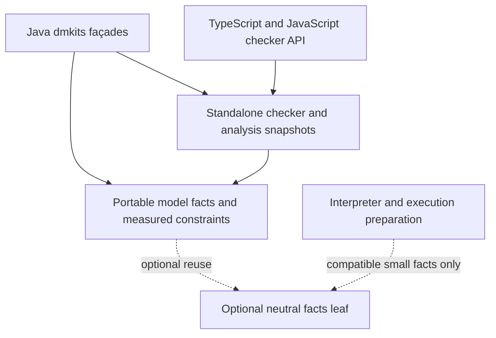
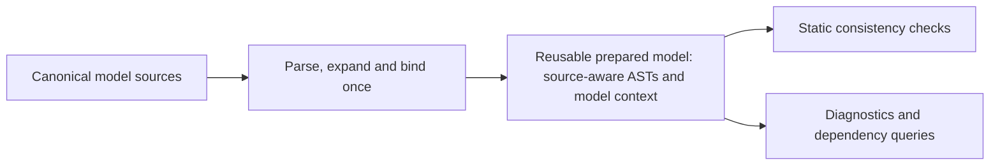

# Portable static validation of A12 rules and computations

> **Revised proposal — 2026-09-10.** High-performance, standalone Kernel-free consistency checking for TypeScript, browser JavaScript, Node.js and Java/Kotlin. Selectively port the relevant dmkits foundations into Kotlin Multiplatform, share measured semantic constraints, and give the checker its own source-aware preparation and representation. Preserve the optimized interpreter independently. Cold-review corrections are incorporated; fresh implementation follows owner approval of this design and a new bounded plan.

**Restart boundary.** The owner restored `main` to the proposal-only commit `c8e3b99795fe9c2ce3e9db32632a6dd8f6537043`. The abandoned implementation, unfinished changes and performance evidence are preserved on `archive/portable-consistency-attempt-2026-09-10`, ending at `6b4c6838737b5db7ad264ba7e207446b3cfcb27d`. Its implementation plan and portable API guide are historical references, not active contracts. This revision incorporates the standalone-checker approach discussed on 2026-09-10; it does not carry the abandoned module graph or migration harness into the new implementation.

**Lifecycle.** As each required slice ships, graduate its public contract into the owning specifications in the same commit. Archive this proposal once all required slices and the final availability gate N are complete, retaining it as the design/evidence record under the [documentation lifecycle](DOC-DISCIPLINE.md).

## 1. User requirements and the decision being proposed

The requested operation is: **given a DocumentModel containing rules and/or computations, determine whether those declarations are valid under A12's authoring semantics.** The user explicitly excludes executing rules against Documents: this is model consistency checking, not data validation.

**The primary deliverable is a standalone Kernel-free implementation of that operation for JavaScript/TypeScript.** Model preparation, parsing, binding and checking must work in-process without a Kernel installation, dmtool process, JVM or remote Kernel service. Retaining dmtool's existing Kernel path does not satisfy or replace this deliverable.

### Owner-confirmed component and path boundaries

| Component / path | Responsibility | Kernel boundary |
|---|---|---|
| Interpreter | Evaluate rules/computations against Documents using independently optimized execution preparation and representations | Kernel-free; ordinary evaluation has no checker dependency |
| New portable validator | Check a DocumentModel's declarations using shared original dmkits semantics and checker-owned analysis preparation | Kernel-free and independent of interpreter implementation throughout preparation, checking and standalone production dependency closure |
| Default dmtool `model check` / `rule check` | Preserve access to the real Kernel oracle in JVM and native distributions | Kernel-backed and enabled by default |
| Proposed second dmtool checking path | Expose the same portable validator used by JS applications | No Kernel calls; disabled by default and selected explicitly by the caller |

The optional CLI mode is another consumer of the standalone validator, not how a JS application accesses it. Neither checking path silently falls back to the other, and results identify the engine that actually answered. Missing portable coverage cannot be concealed by consulting Kernel. H1–H5 and F1's packaged tests define the acceptance obligations below.

The new validator must be Kernel-free; the whole dmtool distribution need not be. Future removal of dmtool's Kernel path is neither required nor assumed. All agreed §12 features and cleanups remain required final deliverables, implemented as separate slices with finite acceptance matrices.

**Relationship to Scope B.** This proposal opens a bounded rule/computation-consistency part of the existing deferred “Scope B” question. It does not reopen Scope A's evaluator replacement or authorize complete Kernel removal from dmtool. The existing scope boundaries remain in [INTERPRETER-SPEC §8a](INTERPRETER-SPEC.md), [the drop-in certificate](INTERPRETER-DROPIN-CERTIFICATE.md), [IF122](INTERPRETER-FINDINGS.md#if122), and [the interpreter instructions](../interpreter/CLAUDE.md).

**Recommended consumer priority:** external TypeScript/JavaScript applications first; dmtool gains an explicitly selected portable checking path while retaining its Kernel oracle under H3. Existing A12 Tools models supply the compatibility target and corpus, not a producer restriction: equivalent supported models receive the same result regardless of which tool authored them. A corpus guides priorities and measurement; the declared contract determines acceptance.

The discussion established these requirements:

| Requirement | Consequence |
|---|---|
| Validate existing DocumentModels containing rules and computations | Accept canonical A12 DM-JSON, including raw condition and operation text; do not require the caller to recreate the model through builders |
| Use no Kernel code in the portable checker or standalone consumer artifacts — hard owner constraint | Zero direct or transitive Kernel runtime code or delegation on those paths, including bundled, generated, translated, or remotely invoked Kernel implementations; dmtool's separately selected Kernel path remains required by H3 |
| Integrate easily into existing TypeScript applications on Node.js — hard owner constraint | Install a normal package, import its typed API, supply model JSON, and consume diagnostics in-process; reuse the existing JavaScript packaging infrastructure without requiring Kotlin/JVM tooling, a CLI, or a service |
| Avoid duplicating the Java implementation's knowledge | Prefer a selective port and shared ownership of constraints over a separately maintained Kotlin checker |
| Preserve both performance goals — hard owner constraint | Deliver high-performance first and incremental checking independently of interpreter performance; neither product may trade away the other's budget |
| Explain the role of the interpreter and BoundModel | Reuse original source and tests without depending on interpreter runtime objects; preserve BoundModel as the Java authoring façade over shared model knowledge |
| Deliver design and implementation detail | Specify the scope, public guarantees, component boundaries, bounded implementation slices, and tests that establish the guarantees |
| Deliver all §12 synergies, application features and supporting cleanups — owner scope decision, 2026-09-08 | Implement them as separate required slices with finite acceptance matrices; intermediate releases may deliver subsets, but the final product must make every feature available to consumers |
| Preserve dmtool as a Kernel-backed oracle, including native — hard owner constraint | Keep the Kernel path bundled, exposed and default on the oracle surface in both JVM and native distributions; portable checking is additive and never silently substitutes for it |

**Recommendation:** create a standalone portable dmkits consistency capability in Kotlin Multiplatform. Move relevant model-query and validation responsibilities into shared code used by Java authoring and the checker. The checker owns analysis syntax, binding views and cache lifetimes; the interpreter owns execution syntax, lowering and lifetimes. Existing original parser/workspace source, tests and JavaScript delivery tooling are reuse candidates, not mandatory production dependencies. Shared code does not imply shared objects. Neither component must prepare the other's representation.

### Hard acceptance conditions confirmed by the owner

**H1 — zero Kernel code or delegation in the portable artifacts and checking path.** The portable checker, its initialization/model-preparation path, and the complete production dependency closure of its standalone JVM/JS/Node packages must contain no Kernel runtime implementation. This excludes direct imports, transitive Kernel dependencies, Kernel-generated validators, copied/transliterated Kernel implementation code, dynamically loaded fallbacks, and local or remote calls into Kernel. Porting this project's own original dmkits code and reproducing independently established semantics remains the recommended route. A capability gap must yield an explicit incomplete result; it must never trigger Kernel fallback. A host such as dmtool may separately bundle Kernel under H3, but the selected portable path must never invoke it. This is a per-artifact and per-path product constraint, not a claim that changing a language or packaging format changes a license.

The portable implementation module remains Kernel-free in its own tests as well as production. Its Kernel differentials live in `:adapter` tests. Installing or building the standalone consumer package must not fetch, build, launch, or require Kernel. This isolation does not prohibit dmtool's production Kernel oracle or its packaged CLI acceptance tests: H3 requires that separate distribution to retain Kernel. Artifact-specific dependency-closure checks, standalone consumer tests and selected-path invocation guards enforce the distinction; source-import checks alone are insufficient.

**H2 — ordinary TypeScript/Node library consumption.** A consumer must be able to install the published package with its existing package manager, import a documented API with shipped TypeScript declarations, supply canonical DM-JSON, and receive structured diagnostics in the same Node process. A self-contained model needs one documented check call after import. Includes/typedef dependencies use a supplied source collection or the existing provider abstraction. Neither path requires the application to recreate the model through builders or understand Kotlin classes, Java collections, backend discovery, evaluator setup, or `BoundModel`.

The consumer needs no JVM, Kotlin compiler, Gradle build, CLI subprocess, or validation service. The package uses the existing JavaScript delivery infrastructure and declares supported Node versions and module entry points. The API exposes native JavaScript values and standard `Promise` behavior where source acquisition is asynchronous. A packed-package acceptance test must exercise installation, TypeScript compilation, and rule/computation checking from a separate ordinary Node project without workspace aliases, repository internals, or Kernel present.

**H3 — dmtool preserves its default Kernel oracle; portable checking is opt-in.** `dmtool model check` and `dmtool rule check` must continue to offer the Kernel path, enabled by default, in the JVM and native distributions. This preserves dmtool as a route to the real Kernel oracle for a12-kernel-lean. The proposed second path uses the same standalone Kernel-free checker delivered to JS; it is disabled by default and requires explicit caller selection. It never becomes a Kernel-backed answer, and no capability gap or failure in either engine may silently select the other. Each issued consistency receipt positively identifies the engine that actually ran and its semantic identity, following §6. The Kernel path might be removed in the future, but this proposal neither requires nor assumes that outcome. Removal from either distribution would require a separate owner decision and client verification.

**Documented route versus exercised client usage:** [prepare-dmtool-source.sh](../scripts/prepare-dmtool-source.sh) lines 2–4 and [CLI-SPEC §9](CLI-SPEC.md) describe a clean-source JVM launcher and explicitly exclude native selection. That establishes this repository's intended evidence route, not every artifact the sibling actually invokes. The unresolved question to send to the sibling is: “Do you consume only the JVM launcher from `prepare-dmtool-source.sh`, or also a native binary or released distribution directly, and which engine/provenance checks do those callers require?” No answer is inferred here. H3 already binds both artifacts by the owner's explicit instruction; the answer informs client qualification, not permission to drop native Kernel support. Any conflict with the client's exercised contract or stop/verify rules must return to the client before the affected run or contract change.

**Existing wording to synchronize in F1:** [interpreter/CLAUDE.md](../interpreter/CLAUDE.md), license-boundary bullets, calls the consistency path JVM-only and the native runtime Kernel-free, whereas [NATIVE-IMAGE-GRAALVM §4](NATIVE-IMAGE-GRAALVM.md) explicitly retains Kernel `checkConsistency` for native `rule check`/`model check`. Distinguish the Kernel-free evaluator/portable library from the Kernel-bundling dmtool distribution; the older wording must not narrow H3.

**H4 — preserve the optimized interpreter independently.** The checker must impose no analysis preparation, retained source graph or checker dependency on ordinary evaluation. Preserve interpreter behavior, public contracts, latency, memory and delivered size against the fixed restart baseline above. Retain the existing permanent correctness, differential, performance and release gates. During the migration, the owner's 5% maximum increase applies separately to each comparable interpreter measurement row; a faster checker or another faster row cannot compensate. Missing or inconclusive required evidence cannot pass.

**What anchors those rows after N.** The 5% allowance is not a new permanent tolerance and does not relax any permanent bar, but it also must not simply lapse: at final gate N the **restart baseline `c8e3b99795fe9c2ce3e9db32632a6dd8f6537043` becomes the standing comparison anchor for the frozen H4 row set**, and the per-row rule converts into that permanent bar rather than expiring. The reason is measured and recorded in [INTERPRETER-PERFORMANCE.md](INTERPRETER-PERFORMANCE.md): "nothing in the estate fails on a uniform constant-factor regression below ~4×, and most bars need 10×–1000×" (the blind-band paragraph), and a uniform regression below **1.65×** on a large lane still passes, with the slack-dominated small lanes reaching 2.1×–3.5×. So "the permanent bars take over at N" is not an available reading: two migration phases at +4.9% per row would satisfy every checkpoint including N and then sit permanently inside a band no existing gate can see. Whether that converted anchor is later re-based is a separate owner decision with its own evidence, not a consequence of finishing this proposal.

Use the existing measurement owners to cover JVM, plain Node and browser consumers: cold load/preparation through first result, warm validation/computation/single-rule operations, retained/peak memory where the host supports measurement, release behavior and delivered dependency size. Freeze the finite workload/collector matrix before affected implementation; compare matching inputs, runtimes and launch conditions. An unchanged interpreter production/build closure needs no repeated performance sweep for a checker-only edit — but "unchanged" is decided mechanically, never by judgement: Slice A names the comparison that settles it (the interpreter's resolved production dependency set plus the digest of its built artifacts), and the sweep is required whenever that comparison differs. Changes to shared facts or build/package dependencies can affect that closure and require the corresponding comparison. Final qualification must account for the full matrix; no new migration-specific benchmark framework or hook/CI evidence machinery is required by this proposal.

**H5 — high-performance standalone checking.** First analysis and incremental analysis are hard product requirements alongside H4. Set explicit, measured release budgets for cold first result, prepared checking, after-edit analysis, memory and package size on JVM, plain Node and browser under §8 before performance qualification. Unset or missed required budgets block F/L/N; a cached report lookup cannot qualify first-analysis or after-edit latency. No numerical checker budget is asserted without a measured workload basis.

**A checker budget becomes a release bar the same way an interpreter number does.** This project already owns a protocol for exactly this class of claim and the checker does not get a second, weaker one: each budget passes IF137's six-point per-number gate as recorded in [INTERPRETER-SPEC.md](INTERPRETER-SPEC.md) — (1) scenario and estimator fixed, (2) runner/runtime pinned, (3) the required p95/median sampling performed, (4) semantic preflight passes, (5) the measurement is reproducible, (6) **the owner ratifies it as a release bar**. A budget must also be fixed *before* the implementation it gates is measured. Without that ordering the gate is self-confirming: measuring the finished checker and then writing that measurement plus a margin into the profile manifest satisfies every other sentence in H5 while proving nothing, and it would hold the checker to a standard this repository refuses for the interpreter's own candidate numbers, which remain informative until per-number certified. An unratified budget is an unset budget for the purpose of the blocking rule above.

**Standalone also means interpreter-independent.** The checker's compiled implementation and installed JVM/JavaScript production closure must exclude the interpreter implementation, even if unused evaluator code could be tree-shaken in a browser. A neutral leaf shared by both is permitted under §5.1; a repackaged interpreter is not. Build-only test/tooling reuse is allowed. Installing or building the standalone checker must not require building the interpreter artifact. Boundary and packaged-consumer controls must detect a forbidden production dependency, not merely an evaluation call.

**The obligation is over shipped files and their provenance, not only over the dependency closure.** A closure guard sees dependency edges; it does not see a *copy*. The abandoned attempt coupled the two products without any edge at all: `consistency/gradle/npm-package.gradle` at `6b4c683873` read `sharedTypeScript = rootProject.file('interpreter/typescript')`, `Sync`ed `limits.ts` and `workspace-source.ts` out of it into the checker package's own `src`, compiled them into the shipped `dist`, and recorded their owner through `embedTypeScriptDeclarationSources(…, ['limits.ts': 'interpreter', 'workspace-source.ts': 'interpreter'])`. That arrangement contains no interpreter *implementation*, needs no interpreter *artifact* to build, and would pass every sentence in the paragraph above while the checker's public TypeScript surface stays interpreter-owned — and the archived `consistency/api/consistency.api` shows the same shape reaching the JVM API through `interpreter/ModelPreparationLimits` in `check`/`prepare`. So the guard **enumerates every file the published package ships — sources, type declarations and generated output — with the owner of each, and fails on a file owned by the interpreter**, in addition to the compiled and installed closure checks.

**Interpreter installations are guarded in the same direction.** The boundary in §1 and §5.1 is symmetric, so its evidence must be too: the interpreter's published JVM and JavaScript production closure contains no checker implementation, under the same enumeration-plus-closure guard with its own forbidden-dependency positive control. F3's preflight façade is the concrete risk — an integration surface that may depend on both products must not be folded into either core's published package, and the `api project(…)` edge that produced the archived coupling works equally well in reverse.

## 2. Research basis and limits

The source assessment used the a12-rulekit checkout at commit `2631dfaf6e1b8d41fc37bea006b6f81f521ef5b9`, inspected on 2026-09-08, and selected source files in the sibling a12-kernel checkout. The project's referenced semantic baseline is Kernel 30.8.1. A future implementation must pin the actual oracle artifact and model/metamodel versions in its conformance manifest.

This proposal distinguishes **source observations**, **existing documented evidence**, and **design recommendations**. The initial draft was source-only. During review on 2026-09-08, `ShortNameTierLawsTest` (2 tests) and `UndeclaredReferenceTest` (13 tests) were executed successfully, and a four-case JVM probe compared Kernel acceptance classifications with the interpreter's static reference helper; its matrix is recorded in §3.4. No new Node/browser qualification or performance measurement was performed. Other cited test classes remain leads and reusable evidence assets, not claims of newly executed green tests. No percentage of complete rule validation or implementation-time estimate has been established.

The inspected loci are listed in [Sources](#11-sources). This was a bounded architectural inspection, not an exhaustive enumeration of callers, constraints, model carriers, or grammar coverage. In particular, the selected operator and builder sources demonstrate where checks live; they do not establish coverage of their siblings.

Links are relative to this document. Project sources resolve within this checkout; Kernel-source citations require the sibling `a12-kernel` checkout.

### Restart research and blast radius — 2026-09-10

The September 8 observations above describe the retained baseline. The abandoned attempt supplies additional evidence, not current implementation claims. Its source/publication inspection found `:consistency` exposing `api project(':interpreter')`, interpreter-owned source/limit types in its JVM API, checker retention of workspace/source-parse objects, and npm/Maven assembly tied to interpreter sources/artifacts. Its boundary test explicitly allowed parser dependencies and did not establish interpreter-free installed closure. These findings explain why restoring the baseline is a cleaner starting point than changing one dependency declaration.

**One archive observation does not transfer, and it is the encouraging one.** The attempt had separated `model-facts` and `model-semantics` modules, with semantics depending on facts, the interpreter using facts directly, and no interpreter imports found in either module's common production source — read at the time as a promising ready-made neutral boundary. **Those modules are the abandoned attempt's and are not in the restored baseline**: `settings.gradle` on `main` declares neither, and what remains on disk under those paths is orphaned `build/` output from the attempt, not source. So the facts leaf of §5.1 is something to create under its own evidence, not something already available to adopt — which is why extraction stays optional there rather than assumed. Anything else carried over from a read of the abandoned tree needs the same check against `main` before it is relied on.

Reproduce those bounded reads without changing branches using `git show 6b4c683873:consistency/build.gradle`, the same revision's `consistency/api/consistency.api`, `consistency/src/commonMain/kotlin/io/github/mbackschat/a12/dm/consistency/ConsistencyChecker.kt`, and its `consistency/gradle/{npm-package,maven-publication}.gradle` files. The inspection covered their contents and direct imports across checker inspections; it did not establish the complete extraction/caller closure. At the restored baseline, the [parser](../interpreter/src/commonMain/kotlin/io/github/mbackschat/a12/dm/interpreter/parse/Parser.kt) and [AST](../interpreter/src/commonMain/kotlin/io/github/mbackschat/a12/dm/interpreter/ast/Ast.kt) still import interpreter decimal/model types. A neutral parser is therefore not a proven file-only move.

The archive's full rerun records 23 measured comparison rows above 5%: 12 JVM, eight Node and three browser. Retrieve the evidence with `git show 6b4c683873:perf-results/h4/2026-09-10-full-rerun/complete/regressions-above-five-percent.json` and its explanation with `git show 6b4c683873:docs/INTERPRETER-PERFORMANCE-RESULTS.md`. Failed and inconclusive qualification remains recorded. These are observations of the abandoned candidate, not regressions asserted of restored `main`, proof that representation sharing caused every increase, or a performance result for the proposed checker. No new performance run is part of this proposal revision.

| Surface | Required treatment in the fresh approach |
|---|---|
| Checker preparation and inspections | Reuse useful original code and established expectations, with checker-owned source-aware state; do not restore interpreter workspace/AST imports as the architecture |
| Shared semantics and Java façades | Selectively translate original responsibilities, retain existing Java tests and deliberate authoring policies; recover independently useful archived fixes only with their owning evidence |
| JVM/TypeScript API and delivery | Own checker source/limit types outside the interpreter while retaining canonical fields; review signatures, package closure, ABI and actual consumer use together. Do not assume a third-party runtime dependency disappears with the evaluator: `big.js` is the JS actual of the decimal primitive ([interpreter build](../interpreter/build.gradle), [INTERPRETER-ARCHITECTURE](INTERPRETER-ARCHITECTURE.md)), and the parser/AST this checker ports already carries `Dec`, so a checker that reads numeric field configuration and numeric literals most likely keeps it. Measure the shipped closure; never infer its contents from what was removed |
| Interpreter | Start from the restored baseline and retain its existing harness; no separate repair of the abandoned implementation is a prerequisite |
| Fixtures and tooling | Reuse baseline owners and selected archived evidence; migration-only comparators, hooks and orchestration stay retired |
| Documentation | This proposal owns the new design. Write a new implementation plan after review and an API guide with executable examples as the new API is implemented; update living architecture/API docs when their code actually changes |

The archive's preview signatures are not a compatibility obligation for the fresh checker. Existing baseline Java/interpreter APIs are. Useful small shared-fact boundaries from the archive remain candidates, not a requirement to recreate its module names or graph. Exact extraction size and a delivery estimate remain unestablished.

## 3. Findings that determine the design

### 3.1 Kernel-free dmkits does not mean Kernel-free consistency checking

The Java kits already isolate Kernel behind `ConsistencyOracle`. `ModelLoader.loadAndCheck` uses that oracle when available; without one, it expands the model and returns `STRUCTURAL_ONLY`. `RuleValidator` performs add-time prechecks, injects a candidate into DM-JSON, and asks the same oracle for the substantive verdict. Its no-backend branch provides an advisory and structural-only evidence.

The current `ConsistencyOracle` javadoc calls this gate “not re-implementable” without Kernel. That wording describes the existing Kernel-authoritative seam and is not a demonstrated impossibility theorem. This proposal defines a narrower, separately evidenced rule/computation profile rather than claiming the entire MVK gate. The slice publishing the first portable verdict must amend that javadoc to preserve this distinction explicitly.

Consequently, porting `RuleValidator` alone would port the delegation mechanism, not implement the missing validator. The existing `NoBackendLaneTest` describes and tests the intentionally limited no-backend contract. Sources: [ModelLoader](../core/src/main/java/io/github/mbackschat/a12/dm/core/ModelLoader.java), [RuleValidator](../rulekit/src/main/java/io/github/mbackschat/a12/dm/rulekit/validate/RuleValidator.java), [NoBackendLaneTest](../src/noBackendTest/java/io/github/mbackschat/a12/dm/NoBackendLaneTest.java).

### 3.2 Java already contains valuable validation knowledge, embedded in authoring

`Rule.Builder.build` checks declaration requirements and intentionally leaves some semantics advisory. `Computation.Builder.build` checks alternative shape, target compatibility, and selected self-reference and precondition restrictions. Expression constructors such as `CountAggregate` enforce further operand constraints. These are relevant assets to port, not rules to independently rediscover in the interpreter.

However, a builder's contract and A12 acceptance are not identical. Some restrictions are deliberate authoring policies, and some illegal input shapes have no Java type at all. A validator of existing DM-JSON must distinguish both from a measured A12 rejection. Sources: [Rule](../rulekit/src/main/java/io/github/mbackschat/a12/dm/rulekit/dsl/Rule.java), [Computation](../rulekit/src/main/java/io/github/mbackschat/a12/dm/rulekit/dsl/Computation.java), [CountAggregate](../rulekit/src/main/java/io/github/mbackschat/a12/dm/rulekit/dsl/CountAggregate.java), [MVK conformance discussion](MVK-LEDGER.md).

### 3.3 The interpreter bridge demonstrates reuse, but is not a portable validator

`ConditionBridge` parses through the interpreter and reconstructs rulekit conditions, exercising Java checks during construction. Its published `ConditionReadBack` provider reads stored validation-rule conditions. It does not expose a whole-model computation-validation contract. The module is Kotlin/JVM and depends on Java rulekit and Jackson.

Its tolerant public result converts unsupported mappings and runtime rejections into `ReadResult.Opaque`. That is useful for inspection, but cannot distinguish invalid from unexamined input. The internal distinction between parse failure, unsupported mapping, and builder rejection is a useful starting point. Sources: [bridge build](../interpreter-bridge/build.gradle), [ConditionBridge](../interpreter-bridge/src/main/kotlin/io/github/mbackschat/a12/dm/bridge/ConditionBridge.kt), [read-back provider](../interpreter-bridge/src/main/kotlin/io/github/mbackschat/a12/dm/bridge/InterpreterConditionReadBack.kt).

**Bounded SPI inventory, not a whole-image claim:** `rg --files core/src/main/java/io/github/mbackschat/a12/dm/core/spi adapter/src/main/resources/META-INF/services rulekit/src/main/java/io/github/mbackschat/a12/dm/rulekit/spi interpreter-bridge/src/main/resources/META-INF/services` enumerates the selected port/provider directories. The adapter registers `BackendInfo`, `ConsistencyOracle` and `ConditionReadBack`; all three descriptors and the two core interfaces were read. `BackendInfo` reports metadata; the bridge supplies a Kernel-free `ConditionReadBack` provider, subject to the `Opaque` limits above. Of these three service roles, `ConsistencyOracle` is the Kernel-exclusive consistency port; this does not enumerate every direct Kernel use in dmtool or prove which dependencies could leave a native image. H3 makes removal irrelevant to the current delivery decision. Sources: [BackendInfo](../core/src/main/java/io/github/mbackschat/a12/dm/core/spi/BackendInfo.java), [ConsistencyOracle](../core/src/main/java/io/github/mbackschat/a12/dm/core/spi/ConsistencyOracle.java), [adapter service registrations](../adapter/src/main/resources/META-INF/services), [bridge service registration](../interpreter-bridge/src/main/resources/META-INF/services/io.github.mbackschat.a12.dm.rulekit.spi.ConditionReadBack).

### 3.4 Reuse existing static reference checking; distinguish it from execution preparation

The interpreter has portable workspace expansion, condition/expression parsing, and model facts. Its `supportAudit` assesses evaluator capabilities and registered implementations. That is a different contract from A12 authoring validity: an unregistered custom implementation can prevent evaluation without making a declaration illegal.

`ModelWorkspace.expand` stops before evaluator-only restrictions; `prepare` proceeds through them. The current runtime loader also applies defaults and variant filtering. For example, its rule branch defaults absent severity to `ERROR`, and both rule and computation branches consult `acceptedByVariantFilter`. These source observations mean that the execution projection cannot simply become the entire input denominator for a checker promising to inspect all declarations. They do not, by themselves, establish whether an omitted severity is Kernel-invalid.

**Existing static check, initially missed in this proposal:** `DmInterpreter.undeclaredReferences()` examines rule conditions and computation common/alternative preconditions and operations without Document values. It is tested by `UndeclaredReferenceTest`; the CLI uses its reports for a pre-evaluation refusal. `DmInterpreter` is explicitly outside the stable published root contract, and the published `InterpreterApi` exposes a support report rather than this query. Reuse the implementation, but give a public consistency operation its own explicit result contract and consumer tests.

**Reference classification — standing Kernel laws and an executed 2026-09-08 probe.** A model declares root `Note`, `Warehouse/Code`, and either `Store/Other` or `Store/Code`. The root rule uses the same `FieldFilled(Note) And FieldFilled(Code)` condition in every row. One axis changes only the second leaf's name; the other changes only `fieldRefByShortNameAllowed`.

| Model-wide `Code` declarations | Short-name fallback | Kernel verdict, executed in probe | Helper result, observed 2026-09-08 |
|---|---|---|---|
| One | Off | `MVK_INVALID_ENTITY` | Unresolved `/Catalog/Code` |
| One | On | Accepted | Empty |
| Two | Off | `MVK_INVALID_ENTITY` | Unresolved `/Catalog/Code` |
| Two | On | `MVK_FIELDNAME_NOT_UNIQUE` | Unresolved `/Catalog/Code` |

**Oracle attribution:** the pre-existing `ShortNameTierLawsTest.theFlagGatesTheModelWideTierOnly` locks the ambiguous-name flag pair (`MVK_INVALID_ENTITY` versus `MVK_FIELDNAME_NOT_UNIQUE`) and declaring-group precedence; it does not contain this table's unique-name pair. The 2026-09-08 `StaticReferenceReviewProbe` executed all four rows against both `RuleValidator.check` with Kernel 30.8.1 and `new DmInterpreter(ModelLoader.load(expanded)).undeclaredReferences()`. Its output reports `/Catalog/Code` in the three rejected rows and an empty helper list in the accepted row; all four assertions passed. Thus both columns were executed, and the helper column was not inferred from `ParsedModel` source. This probe is session evidence, not a committed regression lock; B0 must add the helper-classification cases to the permanent portable and consumer tests. Existing eval-path ambiguity tests do not establish what this static query reports.

The helper distinguishes a resolved reference from an unresolved one but collapses absence and ambiguity into the same path report. `ParsedModel` uses `singleOrNull() ?: candidate` for model-wide lookup, and the helper carries no diagnostic classification. The new acceptance matrix must include both Kernel codes and the accepted unique-name control. No broad “near-zero risk” claim is needed: these rows state exactly what was exercised. Sources: [DmInterpreter](../interpreter/src/commonMain/kotlin/io/github/mbackschat/a12/dm/interpreter/DmInterpreter.kt), [ParsedModel](../interpreter/src/commonMain/kotlin/io/github/mbackschat/a12/dm/interpreter/ParsedModel.kt), [short-name tier laws](../src/test/java/io/github/mbackschat/a12/dm/rulekit/validate/laws/ShortNameTierLawsTest.java), [portable reference tests](../interpreter/src/commonTest/kotlin/io/github/mbackschat/a12/dm/interpreter/UndeclaredReferenceTest.kt).

The validator must retain the authored declaration and source association before any default, filtering, or normalization loses information needed by a check. Reuse expansion only with an explicit account of what it transforms. Sources: [API specification](INTERPRETER-API-SPEC.md), [runtime ModelLoader](../interpreter/src/commonMain/kotlin/io/github/mbackschat/a12/dm/interpreter/load/ModelLoader.kt), [PreparedEvaluationPlan](../interpreter/src/commonMain/kotlin/io/github/mbackschat/a12/dm/interpreter/PreparedEvaluationPlan.kt).

### 3.5 BoundModel is context plus a Java façade, not a complete proof

`BoundModel` wraps `ModelIndex`, creates typed handles, and retains source/resolver information for authoring. Its construction paths distinguish a gated bind (`ofJson`), an ungated bind (`ofJsonLenient`), and wrapping an index (`of(ModelIndex)`). Successful binding alone is not proof that rules are valid.

For static validation, the relevant responsibilities are indexing, reference resolution, and model-aware constraints. Editing, persistence, and the whole fluent authoring API need not be ported for the first product. Preserve the Java façade and have its relevant behavior delegate to shared portable code. The checker must prepare potentially inconsistent input without recursively invoking the consistency gate it implements. Source: [BoundModel](../rulekit/src/main/java/io/github/mbackschat/a12/dm/rulekit/dsl/BoundModel.java).

### 3.6 The known MVK inventory is a starting point, not the complete denominator

The MVK ledger describes 300 entries across four sources for its pinned baseline, and explicitly records further sources outside that classification. Its definition of `erased` is **unrepresentable in the typed API**, not unrepresentable in DM-JSON. Enumerated on 2026-09-08 at `76ca750fb`, **re-derived and corrected 2026-09-11 against the ledger at `54b5bbbed`: 60 rows contain an erased classification — 55 `erased`, two `erased + kernel-delegated`, one `erased + pre-checked`, and two `erased / pre-checked`.** All 60 matched rows were read using `rg -n '^\| \x60MVK_[A-Z_0-9]+\x60 \| [^|]*erased' docs/MVK-LEDGER.md`, which matches the whole classification cell. The original search anchored on `erased( \|| \+)` and returned 58: it silently dropped the two rows whose classification is joined with ` / ` (`MVK_ONLY_STRING_ENUM_NUMBER_ALLOWED`, `MVK_VARYING_TYPES_NOT_ALLOWED`), both value-list operand-type laws and therefore squarely in the raw-DSL-reachable class this enumeration exists to find. The recall limit was the separator alternation, which the original's stated limits did not name. This anchored search counts table rows in the four-source ledger, not laws, firing sites, other buckets, or the additional diagnostic tiers.

**Worked witness:** `MVK_FIELDNAME_NOT_UNIQUE` is `erased` because typed handles render qualified references; §3.4's fourth row reaches that exact code through stored raw DSL. Therefore every erased row re-enters Slice A's inventory for explicit disposition. This does **not** establish that all 60 are reachable or applicable to the selected product profile: the set also contains legacy forms, transport limitations and generated-calculation restrictions, whose actual carriers must be examined individually. The ledger's existing unaudited-erasure warning remains relevant. Slice A1 records each row's source section, actual constrained shape, DM-JSON reachability evidence, profile disposition and witness or anchored exclusion; a builder's inability to emit it cannot discharge the row. The raw-input boundary was already required in §1; this enumeration makes its discovery workload explicit without silently adding 60 promised checks.

The Kernel's `DocumentModelConsistencyRulesProvider` registers `CodeGenerationRule`, whose `checkModel` calls `generateValidationCode`. Matching the current consistency verdict therefore includes applicable generation-path restrictions even though a replacement can check them statically without generating or executing a program. Name both additional tiers in Slice A: `NoMetaModelCheckErrorType` declares 26 codegen error codes, whose applicable consistency constraints cannot be excluded wholesale; `DynEnumErrorType` declares 12 dynamic-enumeration derivation error codes and is a candidate explicit exclusion because its dedicated derivation operation is a different job. Neither count by itself establishes the number of applicable rule/computation laws. Disposition each source against the chosen contract rather than treating “not in the four-source ledger” as “out of scope.” Sources: [MVK ledger](MVK-LEDGER.md), [rules provider](../../a12-kernel/kernel-md/kernel-md-model/src/main/java/com/mgmtp/a12/kernel/md/model/internal/service/consistency/DocumentModelConsistencyRulesProvider.java), [CodeGenerationRule](../../a12-kernel/kernel-md/kernel-md-model/src/main/java/com/mgmtp/a12/kernel/md/model/internal/service/consistency/rules/CodeGenerationRule.java).

## 4. Required functionality and scope boundaries

### Required end-state

- Read canonical A12 DocumentModel JSON and resolve supplied includes and imported typedefs using the existing workspace contracts.
- Validate stored rules, computation expressions, common and alternative preconditions, targets, relevant messages, and their model context.
- Check relationships across declarations where validity depends on them, including computation dependencies.
- Provide the same semantic result from Java/Kotlin, TypeScript/browser, and Node consumers.
- Report structured diagnostics and explicit incomplete coverage; never turn an unsupported construct into a positive validity claim.
- Keep one implementation for each shared semantic constraint, used by both the Java authoring façade and the portable checker where their contracts coincide; this does not require shared prepared objects with the interpreter.
- Deliver the independent checker performance and interpreter preservation obligations in H4/H5, with interpreter-free standalone checker production closure.
- Preserve A12 model shapes, reference syntax, and relevant JSON behavior. Use original portable implementations, following the project's source-reading and no-transliteration discipline.
- Deliver the required §12 application features: Node CI integration, candidate-edit checks before saving, interactive editor diagnostics, change-impact reports, context-aware completion, incremental checking, and compatibility comparisons.
- Complete §12's shared-ownership and cleanup slices and qualify every application feature through its documented packaged API and a working consumer example. A–F establish the validator foundation; they do not complete the full proposal.
- Preserve both dmtool oracle artifacts under H3, provide explicit additive engine selection with positive provenance, and maintain the consistency differential over reusable canonical input fixtures.

The first compatibility target is **rule/computation consistency within a declared A12 profile**, not an unqualified replacement of every whole-model `checkConsistency` result. The checker must validate the structural prerequisites it relies on. A malformed or unsupported prerequisite produces a diagnostic and prevents a complete positive verdict. It must not require the caller to obtain a Kernel-valid model first.

A full whole-model consistency replacement would additionally cover unrelated header, field, attachment, and metamodel laws. That wider product is excluded from this proposal unless needed as a prerequisite for rule/computation validity. This distinction must remain visible in the API and documentation.

### Outside the required delivery scope

- Automatic fixes beyond the required editor diagnostics and completion capabilities.
- A portable typed authoring API for TypeScript consumers.
- Exact Kernel diagnostic wording, multiplicity, and ordering.
- Removing Kernel from the JVM dmtool distribution: excluded under H3; this proposal retains the downstream oracle without a removal milestone.
- Removing Kernel from native dmtool: also excluded under the owner's explicit H3 instruction. A very distant, separate decision would need its own artifact scope and client verification; completing portable coverage does not authorize it.

The required editor features are reusable library capabilities with a working editor integration example. A standalone editor product or language-server protocol implementation is not required. Incremental checking and compatibility comparisons are required even when delivered after the first usable validator release.

**Native removal supplies no payoff to this proposal.** The two reflection-registration packages in [NATIVE-IMAGE-GRAALVM §3.4](NATIVE-IMAGE-GRAALVM.md), the five historical native-only defects in §3.5, the documented residual in §3.6 (line 118), and unconditional metadata recapture in §5.1 remain relevant while the native distribution embeds Kernel. Retiring those obligations is not a goal, benefit or acceptance criterion of any slice here. F1 instead preserves and qualifies the Kernel path under the existing native capture/build/gate requirements. The portable checker earns its place by delivering Kernel-free JS/library validation, not by making Kernel removal inevitable.

### Excluded

- Document instances, execution of conditions or computations, and runtime callbacks.
- Proving business intent, rule satisfiability, absence of logical contradictions, or existence of an accepted Document.
- A wholesale port of model editing, rendering, review, CLI, and publishing facilities.
- Hidden network access or Kernel fallback in the deployed checker.
- Porting constraints belonging only to unrelated Kernel derivation services without a rule-consistency requirement.
- A universal AST or workspace, mandatory shared checker/interpreter preparation, or resurrection of the abandoned migration harness.

## 5. Recommended design

### 5.1 Standalone checker with independent preparation

**Choose a standalone KMP consistency component with no production dependency on `:interpreter`.** It owns source admission, source-aware parsing, binding, analysis and reusable snapshots. Portable model facts and measured constraints serve the checker and designated Java façades below their public surfaces; they depend on neither consumer. Module names are an implementation choice; the dependency direction is the contract.



Java's checking entry points may consume the checker; its existing authoring checks consume the applicable shared constraints without constructing an analysis snapshot for every builder operation. The interpreter may reuse a compatible small facts leaf, but never the checker, diagnostic layer or its prepared graph. Neither checker installation nor ordinary evaluation pulls in the other implementation.

**Hard module boundary:** the new KMP module and its own test source sets remain Kernel-free. Kernel acceptance/rejection differentials live in `:adapter`, mirroring the interpreter's existing oracle split. Java integration tests may exercise the Java façade but do not put Kernel into the portable module's test dependencies.

**Default: checker-owned infrastructure, translated or adapted from our existing source.** Reuse the existing parser/workspace algorithms and their test expectations where applicable, while allowing analysis syntax to retain information execution does not need. This is permission to port this project's original code, not to transliterate upstream Kernel code or independently rediscover measured constraints. Name the owner of any copied mechanics and reuse its conformance expectations so fixes can be assessed across consumers.

**Optional neutral syntax reuse:** extract a small dependency only when its actual closure is bounded, ownership is clear and both performance contracts survive. Neutral syntax may feed different analysis and execution representations. It must not mandate common prepared objects, eager parsing, lowering or cache lifetimes. Extraction is not a prerequisite; prefer a checker-owned port if a shared implementation forces interpreter changes or analysis costs. Installed JVM/Node/browser closure is qualified independently of browser tree-shaking.

"Small" and "bounded" are not judgements left to the extraction: **Slice A publishes the leaf's permitted contents as an explicit type allowlist**, and the closure guard fails on a type outside it. Without that list a guard cannot tell a neutral leaf from a repackaged interpreter, because both look like one permitted dependency edge — and the leaf that grows to hold most of the parser is the failure this boundary exists to prevent. Widening the allowlist is a reviewed change with its own H4/H5 evidence, not a side effect of an extraction.

### 5.2 Port responsibilities, not entire public classes

| Existing responsibility | Proposed disposition |
|---|---|
| ModelIndex's model queries, effective kinds, repetition and category facts | Port the required behavior into a portable context, using the existing expanded JSON and A12 shapes |
| Java ModelReader expansion | Reuse original expansion behavior within checker-owned preparation and reconcile designated Java queries; preserve A12 sources without forcing evaluator preparation to change |
| BoundModel's reference binding | Delegate the relevant Java behavior to the portable context; keep authoring convenience and write APIs on the JVM |
| Rule/computation/expression constructor checks | Extract shared semantic predicates or check functions; Java builders may continue to fail fast while model checking accumulates diagnostics |
| Interpreter condition/expression parser | Port/adapt our original source and reuse its tests for checker-owned syntax; a neutral extraction is optional under §5.1 |
| Interpreter undeclared-reference query | Reuse relevant original lookup logic and expectations in the checker; preserve missing-versus-ambiguous classification and declaring-group precedence without calling DmInterpreter |
| Diagnostic vocabulary | Project the existing code/severity/location/fix concepts into portable results; do not scrape exception messages as the new semantic interface |
| RuleValidator/ConsistencyOracle integration | Preserve the Kernel oracle and default under H3; expose portable checks through a distinct, explicit result/selection path, never as an automatically discovered substitute provider |

An extraction does not force Java callers to accept Kotlin collection types, nullability conventions, or renamed public classes. Java API compatibility is a separate guard, not a reason to maintain two semantic implementations.

### 5.3 Retain invalid input long enough to diagnose it

A builder AST is designed to represent authorable objects. Static analysis must also represent a parsed expression with a wrong argument kind, unresolved reference, or forbidden scope. Feed those cases to explicit checks instead of relying on whether the expression can be reconstructed as a Java object.

Reuse the existing parser's useful syntax concepts in the checker-owned representation. Preserve original text, grouping, reference spelling, and source locations where normalization would erase a discriminator. No interpreter AST identity or execution lowering is required. Do not render a candidate through the typed DSL and then validate the repaired output: the contract concerns the caller's original declaration.

Similarly, retain declaration presence and original source ownership alongside effective model facts. Included content and normalized ids must remain attributable to the supplied source. Any additional internal bookkeeping serves diagnostics; it must not invent a parallel public A12 model or pointer format.

### 5.4 Separate three kinds of checks

| Check category | Treatment |
|---|---|
| Measured A12 acceptance constraint | Shared consistency check; may justify INVALID |
| Deliberate dmkits authoring policy | Keep as an authoring policy or clearly labeled advisory; never silently assert it is a Kernel rejection |
| Runtime support limitation | Report as evaluator support when evaluating; include in static analysis only if it actually prevents an authoring check, in which case it limits completeness |

No new rejection is justified solely by a Java type restriction, a generic parser exception, a diagnostic name, or analogy with a neighboring operator. Follow the project's requirement for a measured Kernel basis and accepted controls.

### 5.5 Check stages and responsibility boundaries

1. **Admission and workspace:** obtain the supplied source closure, preserve identity, parse A12 JSON, and resolve the dependencies needed for checking.
2. **Declaration context:** identify every rule/computation and the model facts each needs; preserve unsupported declarations in the coverage report rather than silently omitting them.
3. **Syntax and binding:** parse conditions/operations and resolve references with their declaring scopes, categories, indices, and source locations.
4. **Local semantics:** check operand signatures, kinds, declaration requirements, target compatibility, and message references.
5. **Scope and cross-declaration semantics:** check iteration/filter restrictions and computation dependencies using the measured A12 laws.
6. **Aggregate result:** combine definite errors with coverage gaps and publish the exact profile and engine that ran.

These are diagnostic dependencies, not permission to continue nonsensical analysis after a prerequisite failed. Report independent findings where possible; suppress dependent noise. A single uncheckable rule prevents whole-input VALID, but need not stop checking unrelated declarations.

### 5.6 Reuse analysis within checker-owned snapshots

**Recommended TS contract:** prepare an immutable model snapshot once, then run static checks directly over its source-aware syntax and bound model context. There is no required interpreter-AST → dmkits-AST conversion in the TS validation path. Port dmkits' relevant constraints, not the requirement to reconstruct every expression through its Java builders.

The checker snapshot contains declarations, model facts, source associations and retained syntax. Binding/type information and dependency indexes are derived views, not additional DSL parses. “Prepare once” applies within that analysis owner; it imposes no common representation on the Java authoring AST or interpreter execution model.



**Ownership and lifetime:** the prepared handle owns parsed source trees, syntax, and bound declarations. Rechecking that handle must not reparse JSON or DSL, rebuild a dmkits AST, or repeat workspace expansion. Callers providing new source/configuration/dependency snapshots create a new handle; the required incremental-checking Slice L reuses unchanged state across revisions through an explicit API while keeping each snapshot immutable. A one-shot check remains available for simple integrations and internally prepares once per call. There is no promise of automatic caching across repeated calls with raw JSON.

**Input fidelity:** parse each source document and authored condition/expression once within a prepared snapshot and its declared language, including retention of failed parse attempts. Preserve raw spelling, grouping and locations alongside syntax. An included declaration mounted at different scopes may need different binding instances; reuse its syntax while resolving each mount separately. Expansion/remapping must operate on retained trees and bindings instead of rendering DSL or model JSON and reparsing it. Separate syntax from context-dependent resolution inside checker preparation where needed. Interpreter normalization must never determine the checker's input denominator.

**Existing behavior versus required work:** [ParsedModel](../interpreter/src/commonMain/kotlin/io/github/mbackschat/a12/dm/interpreter/ParsedModel.kt) caches execution ASTs lazily; `ConditionBridge` constructs a separate typed rulekit AST. Those owners remain independent. The baseline [ReferenceAssembly](../interpreter/src/commonMain/kotlin/io/github/mbackschat/a12/dm/interpreter/workspace/ReferenceAssembly.kt), [ModelWorkspace](../interpreter/src/commonMain/kotlin/io/github/mbackschat/a12/dm/interpreter/ModelWorkspace.kt) and [ModelLoader](../interpreter/src/commonMain/kotlin/io/github/mbackschat/a12/dm/interpreter/load/ModelLoader.kt) contain a JSON serialization/reparse path. Checker-owned preparation must meet its parse-once contract rather than inherit that round trip. This requirement does not mandate modifying the interpreter's creation/loading path.

Java's typed authoring AST remains for source compatibility. An application choosing both consistency and evaluation may hold two prepared representations and pay for two parses. Measure that combined cost separately; no zero-copy integration, shared-program adapter or elimination of all cross-component duplicate parsing is promised. A preflight can pass a consistency result alongside canonical sources at an explicit integration boundary without sharing prepared objects.

## 6. Public contract

### Inputs

Use the existing finite-source/provider workspace concepts: an entry model identity and caller-supplied model sources. Offer both a one-shot check for simple integrations and an explicit reusable preparation handle for repeated checks/queries, following §5.6. No AST conversion or Kotlin-specific representation is exposed to the TS caller. No Document argument is accepted. Source acquisition can be asynchronous; checking an already available immutable workspace need not require callbacks, filesystem access, or network access.

Preserve the established source fields and A12 JSON/pointer contracts while owning checker-facing types outside the interpreter. In the JVM API, a source/limit type or compatibility adapter must not reintroduce an interpreter dependency. Review proposed one-shot/preparation names and signatures as a fresh public API; the archived preview does not freeze them. Existing baseline Java authoring and interpreter APIs remain subject to their compatibility guards.

The supported profile is a shipped, versioned, machine-readable manifest identifying the pinned A12 semantics, relevant model versions, grammar productions, required check families, and explicit exclusions. Runtime completeness calculation must consult it. CI reconciles its declared checks with the implementation registry and executed accepted/rejected/incomplete witnesses; a label or an example count alone cannot establish coverage. Out-of-profile syntax produces a located coverage gap and prevents VALID; if a separate definite violation is found, INVALID with incomplete coverage remains appropriate. Variants and custom constructs need explicit disposition. The runtime loader's variant filtering must not determine which declarations count as checked. If a variant configuration or custom declaration cannot be checked, report that limitation rather than silently certify a filtered model.

The required companion operations in §12 use those same sources, prepared snapshots and profiles. Candidate checks and impact reports additionally identify the candidate snapshot; editor diagnostics/completion accept partial source and cursor/revision context; incremental checking takes an earlier snapshot; compatibility comparison selects the two published profiles. These are typed library capabilities with the per-operation contracts in §12, not requirements to manipulate internal ASTs. Their final export names and result schemas are reviewed in their owning slices. A completion list or dependency report does not itself constitute a consistency verdict.

### Outcomes

| Outcome | Meaning |
|---|---|
| VALID | All required checks for this input and the named profile completed, with no ERROR findings |
| INVALID | At least one established acceptance constraint is violated; other portions can still be unexamined |
| INCONCLUSIVE | No definite rejection was established, but a missing dependency, unsupported construct, resource limit, or unavailable analysis prevents a complete verdict |

Completeness remains separate from rejection: an INVALID result may be incomplete. Warnings do not make a model invalid. Implementation defects remain operational failures, not disguised domain rejections.

**Every consistency check returns a full structured diagnostic report.** `ConsistencyStatus` is only the report's summary; returning an outcome string or this status object alone does not satisfy the public contract. This applies equally to VALID, INVALID and INCONCLUSIVE, including an INVALID result with incomplete coverage.

A minimal proposed TypeScript shape for that summary is below. It is one part of our result envelope, not a new A12 domain type or an existing exported API:

```ts
type ConsistencyStatus =
  | { readonly outcome: "VALID"; readonly complete: true }
  | { readonly outcome: "INVALID"; readonly complete: boolean }
  | { readonly outcome: "INCONCLUSIVE"; readonly complete: false };
```

The report has the following required content. A full report describes the analysis actually performed; it does not imply that coverage is complete.

| Report content | Required semantics |
|---|---|
| Status | Outcome and completeness under the rules above |
| Compatibility and provenance | The compatibility profile and its version, portable engine/version, and checked source/snapshot identity |
| Diagnostics | All findings from completed applicable checks, with `severity`, stable `code`, `summary`, source/declaration location (`where`), explanation (`explain`) and applicable corrective guidance (`fix`). Preserve rule/computation identity and available source spans; identify model/source-level failures at that level instead of inventing a rule location. When no corrective is known, represent that explicitly rather than fabricate one |
| Coverage evidence | The required checks that completed and located gaps for every unexamined portion, with the reason it could not be checked. A failed prerequisite identifies the dependent analysis it prevented |

Accumulate independent findings across declarations and check families; finding the first ERROR must not end the whole check. Suppress findings that depend on a failed prerequisite as specified in §5.5, while recording the resulting coverage gaps. Resource limits must be visible as incomplete coverage, never silent truncation. VALID still returns the report with any warnings and completed-check evidence; an empty diagnostics collection is explicit. INCONCLUSIVE preserves every finding already obtained alongside the gaps. A consumer must be able to understand what failed, where, why, what corrective is available, and what remains unchecked without parsing a log or issuing another diagnostic request.

Reuse the existing diagnostic concepts and non-throwing API projection conventions, with the shared ownership required by A2/C2 in §12. Final names and wire fields require an explicit API/schema review before publication; this document fixes the semantics rather than declaring an unverified export. D owns finding accumulation and source attribution, C2 owns diagnostic enrichment, and F owns the public report projection/schema and its consumer acceptance matrix below.

**F — full diagnostic report acceptance matrix.** Run these cases through actual Java, packed Node and browser consumers. A status-only projection, first-error short circuit, dropped location/corrective or silently omitted coverage gap must each make the relevant guard fail.

| Case | Required report assertion |
|---|---|
| Supported valid input, with a separate warning-bearing control | VALID, complete coverage, profile/engine/source identity and explicit diagnostics collection; preserve the control's warning without changing validity |
| Two independently invalid declarations, covering a rule and a computation | INVALID and both classified, located, explained findings with their known correctives; retaining only the first fails |
| A definite violation beside an unsupported declaration or missing dependency | INVALID with `complete: false`, the established diagnostic and the located gap with its blocked checks |
| Uncheckable input without a definite violation | INCONCLUSIVE, explicit diagnostics collection and located reasons for incomplete analysis; no fabricated rejection |
| Failed prerequisite beside an independently checkable declaration, plus a resource-limit control | Retain independent findings, identify blocked dependent checks, suppress dependent noise and expose the limit as a coverage gap |

**The first one-check slice cannot emit VALID by construction.** Its result type contains only INVALID and INCONCLUSIVE, both with `complete: false` for full rule/computation consistency. A clean reference check is recorded as completed evidence and still yields INCONCLUSIVE while other required checks remain unimplemented. It must not expose the final VALID result factory. The completed engine gains that construction path only through internal coverage evidence that the required, applicable checks for the named profile actually ran. This requirement concerns results emitted by the implementation, not whether an application can hand-author a similar JSON object.

A report must never claim `KERNEL_CONFIRMED` merely because its checks were developed against Kernel. The current `ConsistencyOracle`, `Verification`, and caller behavior encode Kernel-specific assumptions. A portable provider cannot safely be installed into that seam unchanged. Keep result provenance explicit, including whether a gate actually ran.

### Coexistence and oracle identity — required by H3

`model check` and `rule check` keep Kernel as their default path. F1's proposed additive portable mode is disabled by default and executes only on explicit selection; callers can also explicitly request Kernel. The portable mode invokes the same Kernel-free implementation shipped to JS, not a CLI-specific reimplementation. That is an identity claim and needs an identity oracle: dmtool's portable path must **resolve the same published checker artifact — coordinate and version — that the JS package ships**, asserted mechanically against the build, with the receipt's engine identity derived from that resolved artifact rather than from a constant in CLI source. Agreement on a finite corpus cannot establish it, since a reimplementation that agrees on the corpus passes, and a self-reported identity string is exactly what such a reimplementation would also emit. Final selector spelling belongs to F1's CLI contract review. Availability, discovery order, capability coverage, result completeness or an exception must never choose the engine. If the selected engine cannot answer, report its failure/incomplete outcome with that selection preserved; do not run the other engine as fallback. Portable INCONCLUSIVE is not an invitation to consult Kernel, and a Kernel failure cannot become a portable answer. This is a coexistence contract for the delivered artifacts, not a promise that two engines must exist forever.

Every issued consistency receipt must name the engine that actually ran, its implementation/version identity, and the semantic scope of the answer: the portable engine names its profile and coverage; the Kernel engine names the actual Kernel identity and exercised operation. The result also preserves the requested engine so the consumer can reject a mismatch. An unavailable or failed-before-check engine cannot receive a fabricated completed-check receipt; the failure envelope identifies the requested engine and the failed stage. These obligations extend the existing receipt/envelope conventions, with final fields and schemas reviewed in F1. They apply to valid, invalid and inconclusive answers, not just successful examples.

The portable result type stays distinct because downstream oracle identity depends on this distinction. Do not reinterpret `KERNEL_CONFIRMED` or relabel an old client receipt silently. F1 must preserve the client's accepted contract, document any additive receipt fields and update `CommandContracts`, manifest/help/schema projections and packaged public-contract tests together. Its controls must fail when an explicitly requested engine is substituted, including when the other engine could produce a plausible answer. Review the existing [ConsistencyEvidence](../cli/src/main/java/io/github/mbackschat/a12/dm/cli/ConsistencyEvidence.java) and [ResultEnvelope](../cli/src/main/java/io/github/mbackschat/a12/dm/cli/ResultEnvelope.java) stage distinctions explicitly; backend presence is not invocation evidence, and admission evidence cannot silently become evidence that all consistency checks completed.

The diagnostic compatibility target is correct acceptance/rejection and stable, corrective classifications. Reuse a Kernel code where its exact discriminator has been measured. Exact Kernel messages and collection order are not required. The portable checker must produce deterministic ordering across hosts under its own documented rule.

## 7. Implementation slices and finite acceptance matrices

Implement one bounded slice at a time. Each slice identifies its immutable constraint set, sources, positive controls, applicable contexts, and explicit exclusions before coding. The final product remains rules **and** computations; earlier slices may return INCONCLUSIVE on the remainder.

**Delivery commitment:** every slice listed here is required, including the §12 consolidation and application slices below. A–F may establish an intermediate usable validator release. Completion of the proposal requires their acceptance matrices plus B1–B3, C1–C2, F1–F3, G–M and the final availability gate N. Sequencing does not make a slice optional, and a feature cannot be dropped because a foundation release already works.

| Slice | Deliverable | Acceptance and oracle | Explicit non-goals |
|---|---|---|---|
| A — dependency and constraint inventory | Enumerated standalone port boundary, grammar dispositions, versioned constraint manifest and named A1–A4 deliverables | Record searches, matches found/read, current enforcement, authoring-policy distinctions, Kernel firing source and existing test owner for every selected item; disposition legacy grammar and additional diagnostic tiers. Name checker-owned infrastructure, the neutral leaf's permitted type allowlist if one is extracted, and the mechanical comparison that decides an unchanged interpreter closure. Freeze the H4/H5 workloads before affected implementation **and name the existing measurement owner for each of §8's six boundary rows** — an owner that does not yet cover a boundary is a named missing observation, not an invitation to build a framework; no unclassified item counts as covered | No speculative full-kit port, universal parser prerequisite, new benchmark framework, or percentage inferred from MVK counts |
| B0 — static reference vertical slice | Reused reference check behind the first portable API | Permanently lock §3.4 row 2 as the positive control: one model-wide `Code`, fallback on, Kernel ACCEPT and no unresolved-reference finding; pair with row 1, changing only the flag. Include absent reference, ambiguous fallback with `MVK_FIELDNAME_NOT_UNIQUE`, and declaring-group precedence. Require completed reference-check evidence for the control while the overall B0 verdict remains INCONCLUSIVE (`complete: false`); the slice's type cannot emit VALID, which an API-surface check establishes by the absence of the VALID factory. Execute on JVM and in portable `commonTest`; the packed Node/browser replay of these same cases belongs to F, which owns the delivery tooling, so B0 does not silently depend on a later slice's deliverable | No claim of complete rule/computation validity, no evaluator API exposed as the new contract, no packaging estate built inside B0 |
| B — portable model context | Reusable prepared model and shared queries, preserving authored source associations and §5.6 parse-once ownership | Canonical self-contained and include/typedef fixtures agree between current Java queries and portable queries; invalid-context controls remain diagnosable; JVM/Node/browser results agree | No public TypeScript authoring DSL, no editing/persistence |
| C — shared local constraints | First frozen families translated from Java and used from both consumers | Reuse retained Java cases and independent Kernel evidence; add red/green cases only for an uncovered behavior, defect or platform difference. Preserve admitted twins and inbound invalid DSL, Java behavior and separately justified policy separation | No rediscovery of covered constraints, implied coverage of unported families or global computation laws |
| D — stored rules and computations | Complete declaration parsing, binding, local checks, and located results for the selected profile | Exercise rules, operations, common preconditions, every alternative, targets, and relevant messages; unknown/unsupported cases stay distinct from invalid; never require a Document | No execution, no repair by rendering through builders |
| E — relational constraints | Frozen families for repetition/filter/index semantics and computation relationships | Discriminating Kernel accept/reject grids, including cross-group and cross-computation controls; each family exposes its remaining coverage boundary | No SAT solver or business-intent analysis |
| F — public delivery and qualification | Standalone checker package using existing delivery tooling where suitable, JVM integration, documented profile and complete reports | Run the same accepted/rejected/inconclusive corpus through Java, packed Node and browser; verify Kernel/interpreter-free production closure, Java API compatibility, deterministic diagnostics and receipts. Meet the first-check/memory/size budgets under H5 independently of H4 | No automatic Kernel removal, inherited evaluator qualification or assumed tree-shaking |

### Required engine coexistence and consumer integration

These separate slices complete F's integration obligations. They preserve the portable dependency boundary while keeping dmtool's production Kernel oracle available.

| Slice | Required deliverable | Finite acceptance and oracle | Explicit non-goals |
|---|---|---|---|
| F1 — dmtool oracle preservation and engine identity | JVM/native `model check` and `rule check` retain default Kernel checking and add the same standalone portable checker as a second path, disabled by default, with §6 receipts | Through both packaged artifacts, check default Kernel, explicit Kernel and explicit portable requests on accepted/rejected fixtures; add portable-incomplete, selected-engine-unavailable and failed-before-check controls. Assert actual invocation, requested/executed identity and profile/version provenance; substitution mutants must fail even when the other engine returns the same verdict. Assert artifact identity mechanically — the coordinate/version the CLI resolves for its portable path equals the one the JS package publishes, and the receipt derives its engine identity from it — then compare the portable path with standalone JS results on the same corpus; the corpus comparison is a behavior check and cannot carry the identity claim. Update CLI contracts and synchronize source-vs-artifact wording in the affected docs. Native qualification uses the mandatory recapture/build/gate sequence | No engine auto-selection, no change to interpreter-only runtime evaluation, no Kernel removal or native-tax reduction |
| F2 — durable consistency differential | A4's reusable corpus continuously compares independent Kernel and portable consistency implementations | Execute each frozen family's admitted/rejected controls against the pinned Kernel in `:adapter` and the portable API; compare only the profile's measured decision/classification obligations and retain the full Kernel observation separately. Include incomplete/out-of-profile cases without demanding false whole-model parity. Reuse the same inputs through JVM/Node/browser; F1 replays an oracle-identity subset through the packaged JVM/native commands. A changed portable verdict/classification and a wrong-engine receipt must each make a targeted guard fail | No production fallback or automatic reconciliation; no claim that finite corpus agreement proves every A12 law |
| F3 — published-library consistency integration | Published dmkits expose portable profile verdicts; schemakit can use that gate under its purity guard; interpreter consumers can obtain an explicit consistency preflight | With Kernel absent, a supported accepted model yields portable VALID, a measured rejection yields INVALID, and unsupported input yields INCONCLUSIVE through each named consumer. Do not leave complete supported checking labeled merely STRUCTURAL_ONLY. Assert no KERNEL_CONFIRMED provenance, source preservation, published closure purity and `verifySchemakitPurity`; distinguish preparation/support success from a completed consistency gate. Preserve legacy API contracts through explicit additive entry points | No blanket VALID for unported laws, no widening of schemakit scope, no automatic change to evaluator admission or dmtool's Kernel default |

### Required consolidation and application slices

The finite acceptance matrices for B1–B3, C1–C2 and G–M are maintained once in §12. These are separate feature commits and review scopes. A supporting cleanup lands before a consumer builds on that responsibility; it is not deferred merely because its registry entry follows A–F here.

| Slice | Required deliverable | Dependency / sequencing |
|---|---|---|
| B1 | Shared binding with explicit resolved, missing and ambiguous outcomes | Part of portable context B; required by B0's final classified reference path |
| B2 | Separate admission, binding, consistency, authoring policy and evaluator eligibility | Part of B; required before D can diagnose invalid input faithfully |
| B3 | Checker-owned preparation, reconciled Java query semantics, source fidelity and parse reuse | Part of B; supplies analysis state used by D and L without constraining interpreter preparation |
| C1 | Shared structured semantic findings beneath Java builders | Lands with each selected constraint family in C, before its D consumer |
| C2 | Shared diagnostic facts and portable resource delivery | Follows A2's ownership decision; required by diagnostic-producing B0/D paths |
| G | Node CI integration | Uses F's published validator contract |
| H | Candidate-edit checks before saving | Uses immutable preparation and complete static results |
| I | Interactive editor diagnostics | Uses H's candidate snapshots and source-aware findings |
| J | Change-impact reports | Uses shared binding and E's dependency relationships |
| K | Context-aware completion | Uses I's partial-source context and shared model/operator facts |
| L | Incremental checking | Uses B3's immutable state and J's dependency facts; measurements guide strategy, not inclusion |
| M | Compatibility comparisons | Uses versioned profiles; A3 must pin the two initial real A12 versions |
| N | Final availability and combined qualification | All preceding required slices are implemented |

**N — final availability acceptance matrix.** The oracle is the shipped package plus the per-slice guards, not repository imports or an unexecuted example.

| Required integration | Acceptance and oracle |
|---|---|
| Every application feature G–M is available | Each is exported through the documented typed package surface and exercised from a separate packed-package Node project |
| Editor capabilities work together | The integration example exercises H/I/K/L in a real browser, including a rejected candidate and a superseded request |
| Consolidation serves both consumers | B1–B3/C1–C2 pass their dependency, fidelity and behavior controls through the retained Java APIs and portable consumers |
| Final delivery honors H1/H2/H3 | Artifact-specific guards prove standalone packages are Kernel-free while packaged JVM/native dmtool retain the explicitly selected Kernel oracle; F1–F3 pass, the combined suite verifies source ownership, and every emitted receipt identifies the selected/executed engine |
| Checker independence and both performance goals hold | Independence holds in both directions and over shipped files as well as closures: the installed checker contains no interpreter implementation and the published interpreter contains no checker implementation, each with its provenance enumeration and positive control. H4 preserves the interpreter against the restart baseline that becomes its standing anchor here, and H5 meets every required checker budget — each one IF137-ratified before its implementation was measured — including L's after-edit workloads. Missing, inconclusive or unratified evidence does not pass; permanent interpreter gates remain unchanged |
| Compatibility comparison is usable | M ships both A3-pinned real profiles with their independent evidence and executes the comparison example |

N cannot pass with a required feature represented only by documentation, a stub, an internal-only API or a deferred task. Non-goals remain those in §4; N qualifies the listed features together without adding another product.

**B0's positive control is mandatory, not a missing coverage cell.** Row 2 is the four-row matrix's only Kernel acceptance and proves that this fixture can resolve the legal reference. The [testing specification](TESTING-SPEC.md), “all-refusals matrix,” explains why rejection rows alone cannot establish that. A resolver that always reports unresolved must fail this control; a skipped checker must fail the completed-check evidence assertion. B0 must lock Kernel acceptance independently in `:adapter`; that acceptance does not authorize B0 to claim complete model validity.

Slice A must cover more than individual codes: one diagnostic code can represent several laws, and one law can fire from several sources. Use the MVK and grammar ledgers as discovery instruments and test locators, not as an automatically complete product scope. Inventory non-MVK diagnostics and conversion failures as well as relevant generation-path rejections.

The following are separate, bounded inventory deliverables. Finish each against its own acceptance matrix; their discovery findings do not automatically expand B0 or any frozen implementation family.

| Slice A deliverable | Finite acceptance and oracle | Non-goals |
|---|---|---|
| A1 — raw-input disposition of the erased bucket | Reproduce the dated 60-row enumeration in §3.6 with its classification-cell search, and re-derive the count rather than carrying it forward; give every row a source-section identity, constrained shape, raw-input/profile disposition, and evidence or explicit unresolved item. Test reachability and acceptance with the relevant Kernel oracle where claimed; legacy/transport exclusions require an anchored basis. No row may be excluded solely because a builder cannot emit it; unresolved rows cannot count as covered | No claim that 60 rows equal 60 applicable laws; no automatic implementation of every row |
| A2 — diagnostic ownership and portable resource delivery | Map each selected diagnostic's classification owner, meaning/corrective source, and consumer projection under §12. Decide direct catalog-resource packaging versus a deterministic portable projection and verify it through a packed Node consumer. Account separately for `StructuralKernelFix` and `RkCode`; check generated-resource freshness and source parity where generation is used. Preserve an acyclic build/production graph and H1/H2 | No fourth hand-maintained diagnostic dictionary; no universal taxonomy migration; no inference of rejection from catalog membership |
| A3 — compatibility comparison baseline | Pin exactly two initial real A12 semantic/model-version profiles: the 30.8.1 baseline and one additional version selected from available oracle artifacts. Record both artifact identities, supported scope, evidence access and a finite witness matrix before M implementation. An unresolved second version blocks M and final completion; it does not turn compatibility comparison into optional work | No invented version identity, no unbounded promise to support all A12 versions, no synthetic profile as a substitute for a second real version |
| A4 — reusable consistency corpus | Give every selected semantic fixture a stable identity, canonical model/source inputs, profile applicability, oracle artifact identity and accepted/rejected/incomplete expectation. Build typed valid controls and minimal raw-input mutations once for reuse by B0, later families and F2; retain original source context. List the finite family/witness set before each slice and record execution evidence separately from expectations | No per-slice throwaway copies as the evidence owner; no embedded Kernel implementation or automatic coverage inferred from fixture/file counts |

Extracting a shared constraint is complete only when its designated Java caller uses that implementation. Enforce the bounded claim with a registry of shared predicates and their façades, compiled-dependency checks for those façades, and targeted mutation controls showing that both Java and portable results depend on the shared predicate. Do not advertise a general semantic-duplicate detector: these guards establish specific dependency and behavior obligations, not absence of every possible equivalent reimplementation. Temporary scaffolding may exist within an unfinished slice; it must not become two long-lived owners. Existing Java law fixtures should be reused, while new internal fixtures follow the typed modelkit/edit authoring discipline. Malformed-input tests start from a typed valid model and make the smallest explicit mutation necessary to create the invalid shape.

## 8. Verification strategy

### Retain Java tests and distinguish the test oracles

**Start from existing source and tests.** Directly translate the implementation bodies of the selected responsibilities, with their useful comments, instead of rediscovering established behavior; per §5.2 this ports responsibilities, not the public class surfaces that carry them. Retain Java API tests against the migrated implementation; translate existing tests when portability requires it, without treating translation as independent evidence. Before adding any test or fixture, identify its existing owner and the specific uncovered requirement, translation defect or platform difference. Reuse cases, fixtures and expectations first. New behavior and real defects use red/green TDD and the appropriate Kernel oracle; already-covered ports do not need a fresh test matrix. A changed expectation requires a separately justified contract correction. This discipline also applies when recovering useful work from the archive.

| Test lane | Execution and oracle | What it establishes / owning slices |
|---|---|---|
| Java regression and contract tests | Existing and new Java tests invoke the retained Java APIs and assert established expectations, including fail-fast presentation and deliberate authoring policy | C/C1: compatibility of the Java consumer after extraction; these tests remain in their existing owning test lanes |
| Independent consistency differentials | Java tests in `:adapter` submit the same canonical sources and applicable configuration separately to the pinned real Kernel and the portable checker | B0/C/E/F2: agreement on independently measured acceptance constraints and diagnostic classifications within the declared profile |
| Portable unit and report-contract tests | Kernel-free Kotlin `commonTest` cases assert explicit expectations for shared checks, invalid raw input, accumulation, locations, correctives and coverage | B–E/C2: portable semantics and the full diagnostic contract from §6; Kernel-semantic expectations trace to the independent witnesses |
| Cross-platform consumer parity | Actual Java, packed Node and browser consumers check A4's same fixtures; compare the portable report fields under their published projection contract | F: bindings, packaging, source attribution, deterministic diagnostics and coverage survive delivery across hosts; §6's expected-report assertions also run through these consumers |

**Java façade versus Kotlin/JS is not an independent semantic oracle once both invoke the shared check.** It is a useful parity check, but both paths can agree on the same defect. Likewise, expected findings generated by the implementation under test cannot establish correctness. Keep explicit expected-result assertions and the real Kernel differential after the Java implementation has been replaced; do not retain a second production Java implementation merely to manufacture a comparator. The shared-predicate mutation controls in §7 must demonstrate both consumer dependence and detection of the resulting semantic error by an independent expectation or Kernel observation, even when cross-platform parity still passes.

F2's harness must not require portable preparation or Java builder admission to succeed before invoking Kernel. Both engines receive the original canonical sources; a rejection or normalization by the portable path must not remove the very input the oracle needs to assess. Reuse typed valid fixtures, then apply the minimal raw-input mutations for shapes the builders cannot represent. The rejected and malformed witnesses must reach each engine's own admission path. Neither the test language nor execution on the JVM makes a test Kernel-backed: the differential records actual Kernel invocation and artifact identity.

**Kernel comparison and full-report checking have different denominators.** Compare only F2's measured acceptance/classification obligations with Kernel, retaining its complete observation separately. Check our required diagnostic accumulation, locations, explanations, correctives, completeness and coverage against explicit report expectations under §6, then compare those portable reports across hosts. An empty portable gap list is not justified by Kernel acceptance, and portable INCONCLUSIVE is not required to match a Kernel verdict. Any comparison projection must declare its exclusions; it must not discard a required diagnostic or coverage field merely to make the reports agree.

### Claim-specific oracles

| Claim | Required evidence |
|---|---|
| A12 accepts/rejects an input | Execute the pinned real Kernel consistency path in JVM test scope |
| A specific condition causes rejection | Within-model control differing on that axis; a rival explanation must predict a different result |
| Java constraint extraction preserves behavior | Retained and extended Java tests assert established expectations through the Java API; compiled public API comparison where relevant; shared implementation agreement alone is insufficient |
| JS matches JVM | Execute the same fixtures through Java, packed Node and real-browser consumers, comparing the full portable report contract; this establishes cross-platform parity, not an independent semantic oracle |
| A scope is complete | Enumerated constraint/grammar/context manifest with anchored exclusions, witnesses, and no unresolved entry inside the claimed scope |
| Standalone portable production artifacts are Kernel-free | Compiled dependency and publication/package closure guards with positive controls; do not apply this claim to dmtool, which deliberately bundles Kernel under H3 |
| Standalone checking is interpreter-independent | Compiled and installed JVM/JavaScript closure guards detect a forbidden interpreter dependency, including unused artifacts; **plus a shipped-file provenance enumeration over the published package — sources, type declarations and generated output — failing on any file the interpreter owns**, because a copied file carries no dependency edge for a closure guard to see. Packed Node/browser and external JVM consumers install and run without the interpreter artifact. Do not equate absence of evaluation calls with this claim |
| Ordinary evaluation is checker-independent | The mirrored guard on the interpreter's published JVM/JavaScript production closure and shipped files, with its own forbidden-dependency positive control; F3's preflight façade lives outside both cores' packages. The claim is asserted in §1, H4 and §5.1, so it carries its own detector rather than relying on H4's delivered-size row |
| The dmtool portable path is the shipped checker | Mechanical artifact identity: the coordinate/version the CLI resolves equals the published JS package's, and the receipt's engine identity derives from it. Corpus agreement with the JS results is a behavior check and cannot establish identity |
| A report describes checks that ran | Does-fire controls for skipped stages, missing sources, unsupported syntax, early failures, and partial diagnostics |
| Preparation parses once and checks reuse it | Instrument JSON/DSL parser entry points and expansion ownership; check self-contained input, includes mounted twice, rules plus every computation fragment, malformed syntax, and repeated queries. Counts must not increase when rechecking one handle; controls must detect a serialize/reparse round trip. Exercise the counters through JVM and packed JS consumers |
| H1: portable artifacts/path contain no Kernel implementation or delegation | Standalone dependency/package closure guards with forbidden-dependency positive controls; provenance review for generated/copied material; actual packed-consumer execution without Kernel or fallback services; invocation guards for the portable path inside dmtool |
| H2: easy TypeScript/Node library use | A separate ordinary TypeScript project installs the packed package, compiles against shipped declarations, and checks valid, invalid, and unsupported rule/computation models in Node through the documented API, with no JVM/CLI/toolchain setup |
| H3: dmtool retains the requested Kernel oracle in both artifacts | F1's actual JVM/native launcher tests establish default and explicit Kernel selection, positive receipts and no substitution on selected-engine failure; the client-facing contract remains compatible with the verified consumer pin |
| H4/H5: both performance goals hold independently | Existing collectors compare the affected interpreter rows with the fixed restart baseline; checker cold, prepared, incremental, memory and delivery observations meet their separately frozen budgets. Controls expose missing evidence and stale incremental results; a cached report cannot satisfy first-analysis measurements |
| Portable and Kernel consistency agree within a declared profile | F2 reuses A4's admitted/rejected corpus with independent Kernel observations and explicit incomplete/excluded cases; mutation controls detect semantic disagreement and wrong-engine receipts |

For each new or widened Kernel-semantic claim, write the project's witness grid before fixtures: hypothesis, rival mechanism, varied axis, held-constant controls, carriers, and oracle. Include both legal and illegal twins. Exercise stored DM-JSON as well as typed authoring so constructor restrictions cannot conceal over-rejection.

The corpus should include deliberate incomplete-analysis cases, not only accepted/rejected models: unsupported syntax, a dependency that was not supplied, an unevaluated variant configuration, and a known-invalid rule beside an uncheckable computation. The last case must remain INVALID with `complete: false`.

A4 owns these reusable fixtures from the start. F2 remains a durable coexistence guard for as long as dmtool offers both paths; it has no assumed removal milestone. Corpus growth follows named constraint families and independent oracles. Counts of handwritten law classes or runtime differential files are not a measure of consistency coverage and do not set its acceptance denominator.

A guard against evaluation must prove that checking does not require a Document or invoke custom runtime callbacks. A support limitation is not a static rejection unless the actual acceptance law requires it.

Run targeted tests per slice under the repository's [run discipline](AGENT-RUN-DISCIPLINE.md). Review high-risk foundational changes and the final public contract using the project's cold-review rules. Freeze each review's acceptance matrix; independent findings enter a later slice unless they violate that matrix.

### Performance

**H4 and H5 are independent completion gates.** No numerical checker release budget has yet been qualified. Measure representative workloads before setting those budgets, and set each budget before measuring the implementation it gates; leaving them unset — or fitting them afterwards to whatever the implementation produced — cannot qualify a high-performance checker. Use model size, declaration count, expression size, include depth and dependency topology to select bounded workloads from existing fixtures, not a new Cartesian fixture collection.

| Boundary | Required observation |
|---|---|
| Cold standalone use | Installed package load through preparation and first complete consistency result, on JVM, plain Node and browser |
| Prepared use | Initial analysis work and repeated same-snapshot queries reported separately, including any cached-report reuse |
| After-edit use | L's rule/computation, field configuration, include/typedef, removal and profile changes; compare complete reports with fresh analysis and prove unaffected work is reused |
| Resources and delivery | Retained memory, release behavior, supported peak observations and installed/downloaded production closure size — enumerated from the shipped package, since dropping the evaluator does not by itself drop its third-party dependencies |
| Interpreter-only use | H4's fixed-baseline comparisons plus unchanged permanent correctness/performance/release gates |
| Combined application | Actual cost of using both components; no shared-graph or zero-duplicate-parsing claim without implementation and measurement |

Freeze explicit checker latency/memory/size budgets, workload identities and host/collector rules before performance qualification, and take each budget through IF137's six-point per-number gate including owner ratification, as H5 requires — a budget fitted to an already-measured implementation gates nothing. Report cold, prepared and incremental numbers separately; a returned cached report says nothing about fresh analysis cost. Reuse existing measurement and consumer owners; add only a missing observation needed for these named contracts. Archived measurements can inform workload selection, but do not qualify new code. Resource limits yield incomplete/operational outcomes, never false positive verdicts. Incremental checking remains required regardless of its measured speedup; scheduling, cancellation and supersession retain their §12 contracts.

## 9. Risks and design decisions

| Issue | Recommendation and rationale |
|---|---|
| Selective port versus a new interpreter checker | Selective port: preserves existing knowledge and creates one maintenance owner |
| Selective port versus all of dmkits | Port the dependency closure required for consistency and the committed §12 capabilities; candidate/editor integration does not require a wholesale port of editing, rendering or CLI facilities |
| Module and representation ownership | Standalone checker-owned preparation and syntax; shared constraints below Java/checker consumers. Independence avoids compulsory analysis costs on the interpreter and compulsory evaluator delivery to checker consumers |
| Neutral syntax extraction versus original-code port | Prefer a checker-owned port unless a bounded neutral dependency demonstrably benefits both consumers; shared source need not imply shared prepared objects |
| Two performance goals | Enforce H4/H5 independently. Defer numerical checker budgets until workloads are measured, then ratify each through IF137's existing gate rather than inventing a second promotion path; block performance completion while a required budget is unset, unratified or missed. H4's per-row rule converts into a standing anchor at N instead of lapsing into gates measured blind below ~1.65× |
| Kernel-derived material | Reuse original project code/catalogs and independently recorded facts; source reading for understanding is allowed. Assess a concrete copied/generated artifact before incorporating it, and escalate unresolved provenance/licensing questions about that artifact. This is an engineering process rule, not an actionable legal conclusion |
| Runtime ModelDef as the sole validation input | Retain source-aware authoring context; runtime defaults, projections, and filters can erase evidence |
| Typed builder restrictions mistaken for Kernel laws | Classify policy versus semantics before sharing a refusal; protect inbound legal shapes with tests |
| Existing Java APIs | Keep façades where practical and guard compiled compatibility; escalate any necessary break with an explicit before/after contract |
| Existing provenance enums and downstream oracle identity | Keep the explicit portable result separate; preserve dmtool's default/explicit Kernel path and positively identify the executed engine under H3; never overload KERNEL_CONFIRMED |
| Native maintenance payoff | None claimed: both dmtool artifacts retain Kernel, and native capture/registration/gating remains required |
| Full Kernel diagnostic identity | Start with decision/classification parity in the declared scope; exact text/order/multiplicity is a separate requirement |
| Completeness confidence | Use source inventories plus discriminating negative cases; neither an operator count nor a green valid-model corpus proves rejection coverage |
| Development without Kernel available | Portable unit/consumer tests can run independently; new A12 acceptance claims require pinned Kernel-oracled tests in `:adapter`, never in the portable module |

Direct Java-to-Kotlin translation is the default for reusable original behavior. Jackson-backed trees, public Java numeric/optional types, exception-driven construction and type-level exclusions still need deliberate boundaries. There is insufficient evidence for a calendar estimate; distinguish translation, new semantics and public compatibility work rather than counting fixtures or probes as implementation progress.

The recommendation is architectural rather than a claim that a smaller port boundary has already been proven. A port that unexpectedly pulls in editing or the entire typed renderer should trigger repartitioning before implementation expands.

## 10. Completion criteria

The proposal's product is complete only when all required slices in §7 and §12 pass their finite acceptance matrices and N's final availability gate passes. This includes A–F, F1–F3, B1–B3/C1–C2 and every application feature G–M. The declared profiles must have finite, reviewed acceptance denominators and independent evidence. Java and JS share relevant semantics; standalone consumers receive truthful results without Kernel, interpreter implementation, Documents or evaluation callbacks. H4 preserves the interpreter independently, H5 qualifies high-performance checking, and JVM/native dmtool retain their Kernel oracle under H3.

**Available at the end means delivered and usable:** Node CI integration, candidate-edit checking, editor diagnostics, impact reports, completion, incremental checking and two-profile compatibility comparison must all be documented, exported and exercised through the packed consumer package. The editor integration example and Java/portable ownership guards must pass as specified in N. An intermediate validator release is allowed, but it is not completion of this proposal. Performance measurements, sequencing decisions, missing version evidence or a remaining internal helper cannot waive a required feature; unresolved acceptance work keeps the proposal incomplete.

A model outside that profile remains an explicit INCONCLUSIVE result unless a definite violation is already established. That mechanism enables incremental delivery; it does not discharge an unfinished requirement inside the promised final scope.

H3 prohibits replacing dmtool's Kernel oracle as part of this proposal, in both JVM and native artifacts. Any future removal needs its own owner decision and verified client contract; no coverage milestone here triggers it, and no benefit or completion claim depends on it. Broadening the portable claim to every whole-model metamodel law is also a separate acceptance decision.

## 11. Sources

### Project contracts and inventories

- [Architecture](ARCHITECTURE.md) — current modules and Kernel boundary.
- [Kernel-decoupling proposal](KERNEL-DECOUPLING-PROPOSAL.md) — historical role split and SPI design; current source takes precedence over partially graduated wording.
- [MVK ledger](MVK-LEDGER.md) — constraints, typed-surface distinctions, and explicit denominator limits.
- [Grammar ledger](GRAMMAR-LEDGER.md) — syntax inventory; classification is not proof of portable parser acceptance parity.
- [Interpreter API specification](INTERPRETER-API-SPEC.md) — workspace expansion/preparation and cross-platform surface.
- [Testing specification](TESTING-SPEC.md) — oracle tiers and witness-grid discipline.

### Java model binding and validation

- [ModelIndex](../core/src/main/java/io/github/mbackschat/a12/dm/core/ModelIndex.java).
- [ModelLoader](../core/src/main/java/io/github/mbackschat/a12/dm/core/ModelLoader.java).
- [BoundModel](../rulekit/src/main/java/io/github/mbackschat/a12/dm/rulekit/dsl/BoundModel.java).
- [Rule](../rulekit/src/main/java/io/github/mbackschat/a12/dm/rulekit/dsl/Rule.java), [Computation](../rulekit/src/main/java/io/github/mbackschat/a12/dm/rulekit/dsl/Computation.java), and [CountAggregate](../rulekit/src/main/java/io/github/mbackschat/a12/dm/rulekit/dsl/CountAggregate.java) — selected enforcement loci read during research, not an exhaustive check inventory.
- [ConsistencyOracle](../core/src/main/java/io/github/mbackschat/a12/dm/core/spi/ConsistencyOracle.java), [Verification](../core/src/main/java/io/github/mbackschat/a12/dm/core/Verification.java), and [ValidationResult](../rulekit/src/main/java/io/github/mbackschat/a12/dm/rulekit/validate/ValidationResult.java) — current verdict and provenance assumptions.
- [Diagnostic](../rulekit/src/main/java/io/github/mbackschat/a12/dm/rulekit/validate/Diagnostic.java) — existing diagnostic vocabulary.

### Portable parsing and the bridge

- [Parser](../interpreter/src/commonMain/kotlin/io/github/mbackschat/a12/dm/interpreter/parse/Parser.kt).
- [Runtime model definitions](../interpreter/src/commonMain/kotlin/io/github/mbackschat/a12/dm/interpreter/model/Model.kt).
- [ParsedModel](../interpreter/src/commonMain/kotlin/io/github/mbackschat/a12/dm/interpreter/ParsedModel.kt).
- [Bridge build](../interpreter-bridge/build.gradle) and [ConditionReadBack contract](../rulekit/src/main/java/io/github/mbackschat/a12/dm/rulekit/spi/ConditionReadBack.java).

### Kernel source consulted

- [Consistency rules provider](../../a12-kernel/kernel-md/kernel-md-model/src/main/java/com/mgmtp/a12/kernel/md/model/internal/service/consistency/DocumentModelConsistencyRulesProvider.java).
- [CodeGenerationRule](../../a12-kernel/kernel-md/kernel-md-model/src/main/java/com/mgmtp/a12/kernel/md/model/internal/service/consistency/rules/CodeGenerationRule.java).

These links identify the layers inspected. The proposal does not reproduce Kernel implementation code or metamodel rule bodies.


## 12. Project synergies, additional features, and focused cleanups

**Required implementation scope — owner-confirmed 2026-09-08.** Every synergy, application feature and supporting cleanup below is part of the completed proposal. They are separated into bounded implementation slices for delivery and review; none is merely potential or conditional on a later decision to include it. §7 records their sequencing and §10 requires all of them to be available at completion.

The value beyond JavaScript delivery is consolidation: one maintenance owner for shared A12 constraints and model binding. These gains require Java callers to adopt the shared implementation; a permanent parallel Java/Kotlin checker would increase the inconsistency risk.

### Core synergies to include in acceptance

| Area | Required improvement | Owning slices and evidence of completion |
|---|---|---|
| Typed authoring and incoming DSL | Shared A12 semantics regardless of authoring route, with deliberate dmkits policy kept distinct | B2/C1: paired Java/TS cases plus the designated-façade dependency and mutation controls |
| Reference binding | One owner **across the designated Java façades and the checker** for local lookup, short-name fallback, missing/ambiguous resolution, and applicable index/category context — not repository-wide; the interpreter's own resolver stays a separate owner under H4 | B1: both designated consumers depend on the shared resolver; its full selected witness grid runs on JVM/JS. A records which façades are designated and the residual owners that remain |
| Diagnostics | Checks own measured violation/context classification; existing catalog and diagnostic sources own reusable meanings and correctives | A2/C2: equivalent classified diagnostics across consumers, resource delivery and source/projection parity |
| Preparation | Reuse source trees, syntax and model facts within an immutable checker owner, independent of execution preparation | B3: §5.6 parser/expansion counts and same-owner reuse controls |
| Compatibility knowledge | Connect profiles, registered checks, catalog facts and witnesses | A/F/M: runtime completeness consumes the profile; CI detects a claim without a registered check and executed evidence |
| Preserved downstream oracle | JVM/native dmtool retain Kernel with explicit engine identity; portable checking remains additive | F1: packaged selection/provenance tests and substitution controls |
| Durable consistency differential | Two independent consistency implementations are continuously compared on the reusable selected corpus | A4/F2: admitted/rejected controls, profile-scoped comparisons and semantic/identity mutation checks |
| Published-kit verdicts | Supported Kernel-free library checks can return an evidenced portable verdict instead of only structural evidence | F3: accepted/rejected/incomplete cases through published-library entry points without Kernel |
| Schemakit validity gate | Schemakit uses the shared portable consistency gate while preserving its compiled/publication purity boundary | F3: gate fixtures plus `verifySchemakitPurity` and published closure guards; the purity guard remains a build guard, not the runtime validator |
| Interpreter consistency preflight | A consumer can request an honest static precondition separately from execution preparation and support checking | F3: explicit completed/invalid/incomplete preflight results; preparation alone cannot claim consistency and existing evaluation admission is not silently widened |

F3's interpreter-consumer preflight lives in an explicit integration façade or application that may depend on both products. Neither standalone core depends on the other. The consumer requests a static result separately from execution preparation/support; no common prepared graph or automatic evaluator admission change is required. The optional dmtool mode uses the same standalone checker.

A concrete current duplication is bare-reference lookup in [ConditionBridge](../interpreter-bridge/src/main/kotlin/io/github/mbackschat/a12/dm/bridge/ConditionBridge.kt) and [ParsedModel](../interpreter/src/commonMain/kotlin/io/github/mbackschat/a12/dm/interpreter/ParsedModel.kt). Both implement declaring-group precedence and optional unique short-name fallback. B1 consolidates the designated Java authoring and checker binding semantics. Interpreter reuse of a small facts leaf is optional and subject to H4; it must not turn into a requirement to merge AST traversal, binding views or preparation lifetimes across different semantic domains.

**Say plainly what that leaves, so the duplication is not read as closed.** `ParsedModel`'s resolver is inside the interpreter and stays where it is unless the optional facts leaf lands, so B1 does not reduce this pair to a single implementation — with `ConditionBridge` designated it holds the count at two, and without that designation it raises the count to three. **A must therefore rule explicitly on whether `ConditionBridge` is a designated façade** and record every resolver that remains a separate owner after B1, with the behavior each still owns. This is the price of standalone independence and it is worth paying; what would not be acceptable is booking a consolidation the slice cannot deliver.

**Diagnostic classification and corrective ownership.** The portable check identifies the measured violation and supplies structured context (including the operator when known). The existing [operator catalog](../rulekit/src/main/resources/catalog/operators.json) remains the data source for operator meanings and code-specific correctives; the checker consumes that resource directly or through a deterministic generated projection, never a second hand-authored dictionary. Catalog membership is not a classifier or proof of rejection: one code can have several triggers, and the catalog is a partial map. Do not infer an operator merely because it is the only catalog entry documenting a code.

The catalog alone is insufficient. [DiagnosticEnricher](../rulekit/src/main/java/io/github/mbackschat/a12/dm/rulekit/validate/DiagnosticEnricher.java) consults [StructuralKernelFix](../rulekit/src/main/java/io/github/mbackschat/a12/dm/rulekit/validate/StructuralKernelFix.java) first for code-level and cross-context guidance; for example, `MVK_INVALID_ENTITY` has its corrective there. [RkCode](../rulekit/src/main/java/io/github/mbackschat/a12/dm/rulekit/validate/RkCode.java) separately owns RK meanings and repair guidance. Applicable knowledge from those sources needs the same single-owner portable data/shared-function treatment. Schema-owned input facts stay in their existing schema lane. New diagnostic facts go into the appropriate existing owner, with Java, portable results and documentation deriving from it. The portable path must not reconstruct classifications from localized Kernel messages or inherit evaluator/CLI-only guidance without checking its applicability to the library contract.

**Packaging basis and A2 decision:** on 2026-09-08, Node v24.18.0 read the existing JSON through `node:fs` and `JSON.parse`, finding 110 operator entries and 20 entries with plural correctives. That proves the source resource is directly readable as Node data; it does not qualify inclusion in the shipped package. Prefer direct resource reuse when the existing packaging supports it; use a deterministic projection when module delivery, size, or the Java-owned guidance requires one. A2 must settle the package/build dependency boundary without pulling Java or Kernel into consumer installation. A source edit must reach both consumers, with freshness/parity controls detecting a stale projection and contextual diagnostic tests detecting a wrong corrective. The existing sources retain ownership; generation is a delivery mechanism, not a fourth authoring lane.

### Required application features — finite acceptance matrices

Each row is a separate required slice. Its listed cases form the minimum finite acceptance matrix for the declared profile; bind them to named fixtures before implementation and freeze the matrix before review. Every feature needs a typed public entry point and an executed example using the packed package. The examples are delivery evidence, not substitutes for the reusable capability.

| Slice / feature | Required public behavior | Acceptance cases and oracle | Explicit non-goals |
|---|---|---|---|
| G — Node-based CI checks | A working Node pipeline example checks supplied canonical model sources through the library and reports structured findings | A separate Node project installs the package: a valid fixture passes, an invalid fixture fails with its classified diagnostic, an inconclusive fixture prevents a successful validation claim, and an operational failure remains distinct. Compare reports with direct library calls; no JVM or CLI subprocess | No new CLI verb or hosted CI service |
| H — Candidate-edit checks before saving | Check an immutable candidate source snapshot against the selected profile and expose its findings before the consumer persists it | In the consumer example, a valid candidate can be saved; invalid and inconclusive candidates leave the original source unchanged. Cover rule text, computation text, a field-kind change and an included-source edit. Candidate findings equal a fresh full check; checking itself never writes | No portable editing DSL, automatic repair or persistence backend |
| I — Interactive editor diagnostics | Analyze partial rule/computation text in model context with source locations, revision identity and cancellation/supersession behavior | Exercise a condition, operation, common precondition and alternative precondition through incomplete → invalid → valid edits. Preserve diagnostics for independent declarations; verify source locations, cancellation and that an older result cannot replace the latest revision. Completed text agrees with full checking; execute the sequence in the browser editor example | No standalone editor product or language server |
| J — Change-impact reports | Report affected rules/computations and their reference/dependency reasons for a candidate field, group or type change, including newly invalid declarations | Named fixtures cover rename/removal, numeric-to-textual kind change, group-scope change, typedef/include change, and a transitive computation dependency. Assert affected and unaffected controls, dependency reasons and agreement of candidate validity with a fresh check. Unresolved dependencies expose incomplete analysis | No claim of business-intent or runtime-behavior equivalence |
| K — Context-aware completion | Offer model-reference and operator completions appropriate to the cursor's declaration scope and expected kind, using the shared model/catalog facts | Cover condition, operation and precondition positions; local and included references; scalar/list and category/index contexts where the profile admits them. Assert expected candidates and incompatible-candidate exclusions, deterministic ordering, and canonical A12 syntax after insertion into complete control expressions. Exercise the public API and browser editor example | No AI ranking service or full TS authoring DSL |
| L — Incremental checking | Explicitly update analysis from an earlier immutable snapshot, reuse unaffected work, and invalidate every affected dependency | For rule/computation edits, field-kind/configuration changes, includes/typedefs, source removal and profile changes, compare status, diagnostics and coverage with fresh full checking. Counters must show reuse on an independent-declaration edit and recomputation of affected declarations; an always-full-recheck implementation fails the reuse control. Verify old-snapshot stability and a stale-cache mutation that the equivalence guard catches | No implicit global raw-JSON cache or unmeasured universal speedup claim |
| M — Compatibility comparisons | Check the same sources against both A3-pinned real A12 profiles and report per-profile status, diagnostics, coverage and their differences | Independently oracle accepted/rejected witnesses for each version. Compare the public report with separate checks under each profile; exercise unchanged and differing results/coverage, deterministic difference reporting and an unknown-profile outcome. Synthetic profiles may test difference plumbing but cannot qualify either real profile. Ship both real profiles and the comparison example | No support claim for unpinned versions, no Kernel runtime or automatic model migration |

The required impact report includes the numeric-to-textual field-change case: identify affected computations and comparisons and show their candidate consistency results before evaluating any Document. Static validity still does not prove business intent or equivalence of behavior.

### Required supporting cleanups — finite acceptance matrices

These are independently verified changes within the foundation's selected responsibilities, not a repository-wide cleanup campaign. Each row has one owner; the feature slices consume that owner rather than reproducing its logic.

| Slice / cleanup | Required change | Acceptance cases and oracle | Explicit non-goals |
|---|---|---|---|
| C1 — Structured semantic findings | Extract selected constructor checks into shared finding-producing functions; Java builders retain their fail-fast presentation | For each frozen C family, paired legal/illegal stored-input and Java-builder cases agree on shared semantics; deliberate authoring policy remains separately classified. Dependency and mutation controls prove both consumers use the shared check; retained Java API compatibility passes | No new rejection without Kernel evidence, no simultaneous port of all constructors |
| B1 — Explicit binding outcomes | One shared owner preserves resolved, missing and ambiguous outcomes with scope context | §3.4's four rows plus declaring-group precedence, relative/absolute references and applicable indexed/category references run through Java and portable callers. Assert the resolved target as well as diagnostics; missing and ambiguous controls remain distinct, and the legal control resolves | No universal merger of AST traversals with different semantic domains |
| B2 — Separate analysis phases | Separate loading, binding, consistency, authoring policy and evaluator eligibility | A malformed source gives an admission diagnostic; a parseable invalid declaration remains inspectable; a policy-only restriction is not an A12 rejection; an evaluator-only support gap cannot invalidate a statically checkable declaration; independent declarations remain analyzable after a local failure. Use phase does-fire controls and Kernel acceptance controls where validity is claimed | No evaluator execution or bypass of required admission checks |
| C2 — Shared diagnostic data | Deliver catalog, code-level correctives and applicable RK meanings from their existing owners through the portable API | Execute an operator corrective, an orphan code, a cross-context code, a multi-owner code and an applicable RK diagnostic through both consumers. Source/projection parity and freshness controls fail on stale generated data; structured context selects appropriate guidance without message scraping | No second operator registry or fourth diagnostic dictionary |
| B3 — Checker preparation and source fidelity | Reuse original preparation behavior under a checker owner, reconcile required Java query semantics, retain authored values/origins and avoid reparsing within analysis | Compare self-contained, include/typedef, repeated-mount and malformed-input fixtures through Java and checker consumers; assert effective facts and original source ownership. Run §5.6 counters for repeated queries, mounts and malformed syntax. Preserve A12 shapes and the applicable JSON fidelity contract on the read path — a numeric field configuration such as a bound or scale must reach a check exactly as authored, since parse-stage loss is unrecoverable downstream — and unchanged old snapshots | No interpreter preparation rewrite, shared runtime object requirement, universal AST merger or independent rediscovery of expansion semantics |

A whole-kit port, a universal AST merger and a language server remain separate decisions. Kernel removal from either dmtool artifact is prohibited within this proposal by H3 and supplies no claimed native-image benefit. Every synergy, application feature and supporting cleanup listed above is required for final delivery; §7's N gate verifies that they are implemented, integrated and available together.
