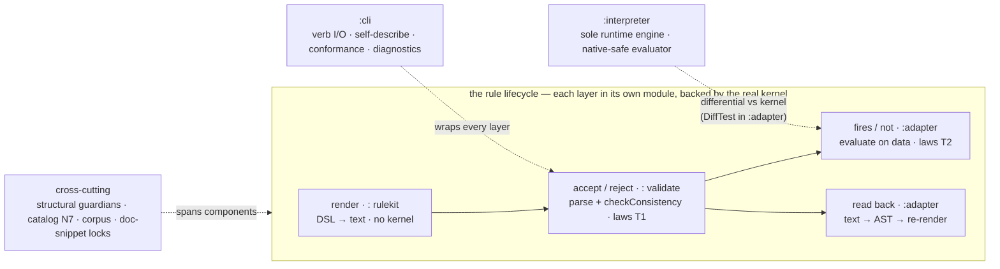

# Testing spec — the testing-approach map

The map of *how* a12-dmkits is tested — the kinds of test, what each one is for, where it lives, and which oracle backs it. This is the navigation layer; the enforced conventions stay in [`../CLAUDE.md`](../CLAUDE.md) ("Testing strategy") and the per-area detail stays in its own doc (linked below). Read this when you need to place a new test or recover the big picture without hunting across five files.

## The testing landscape — the four tiers

a12-dmkits is tested at four tiers. The first two are **deterministic gates** (red/green, in CI); the last two are **experience instruments** — they measure how an LLM agent fares with the tool, and the durable guards their findings earn graduate *down* into tier 1.

| tier | the question it answers | form & where it lives | run / spec |
|---|---|---|---|
| **1. Kernel-oracle tests** (JUnit) | does the DSL render, the kernel accept, the runtime evaluate, and the CLI describe itself — correctly? | the `:` + `:adapter` + `:cli` suites (**the rest of this doc**) | `./gradlew test :adapter:test :cli:test` |
| **2. Doc-drift demos** (showboat) | do the published `examples/` CLI demos still match the live CLI? | `examples/*.md` (showboat) + the `CliTourFreshnessTest` local lock | `uvx showboat@0.6.1 verify examples/<demo>.md` — [`CLI-TOUR-SPEC.md`](CLI-TOUR-SPEC.md) |
| **3. Self-sufficiency eval** (N6) | can a **cold** agent author/read rules from the bare surface (± skill)? — **scored, repeatable** | the Workflow runner over `eval/` | the `run-dmtool-eval` skill — [`EVAL-SPEC.md`](EVAL-SPEC.md) / [`EVAL-PRIMER.md`](EVAL-PRIMER.md) |
| **4. DX probe** | how does a **real multi-prompt session on the shipped product** actually go? — **deep, n=1** | the probe pipeline over `probe/` | `probe/*.sh` + main loop — [`PROBE-SPEC.md`](PROBE-SPEC.md) |

Tiers 1–2 are machine-enforced (a break fails the build/CI). Tiers 3–4 are **run-and-read**: an agent is in the loop, the deliverable is a measurement/report, and a finding's lasting guard graduates back into tier 1.

### Inside tier 1 — the JUnit layers & components

Tier 1 is not one thing. It mirrors a **rule's lifecycle** — *render → accept → fire → read back* — as a chain of layers, each living in its own **component (Gradle module)** and backed by the real kernel at the stage that needs it. `:cli` wraps the lot behind verbs; `:interpreter` is a **second** evaluator implementation checked against the kernel; and a band of guardians/catalog/corpus tests cuts across all components.



#### The layers — a rule's lifecycle (what each proves)

| layer | proves | component · oracle | representative tests |
|---|---|---|---|
| **render** | the DSL emits the right kernel text — composition, parenthesization, quoting, handle kind-checks | `:` rulekit · *no kernel* | `dsl/RenderConditionTest` + `dsl/operators/*` |
| **accept / reject** | the kernel *accepts* a valid condition and *rejects* a bad one with the right `MVK_*` (+ F4 injection mechanics) | `:` validate · *real kernel* `checkConsistency` | `validate/laws/…LawsTest` (T1) · `validate/RuleValidatorTest` |
| **fires / does-not-fire** | a *valid* rule *evaluates* as intended on real data — polarity, empty-as-0, null compares | `:adapter` · *real runtime* `validateFull` | `adapter/…/laws/…LawsTest` (T2) |
| **read back** | render → kernel-parse → convert → render round-trips (F10) | `:adapter` · *real parser* + converter | `ReadRoundTripTest` + per-construct `…ReadTest` |

Two parts of tier 1 are **not** lifecycle stages: **modelkit structure** (the field/group/type-def/include builders + the structure ops, in `:`) and the **cross-cutting** guardians / catalog-N7 / corpus / doc-snippet locks (each has its own section below).

#### The components — Gradle modules (which *implementation* each exercises)

| module | implementation under test | tests live in |
|---|---|---|
| **the kits** (`:core`/`:rulekit`/`:modelkit`/`:edit` main) + root `:` (test host) | the DSL renderer/handles + modelkit structure + edit; accept/reject + the structural guardians against the real kernel. Stage-4 module cut: the kits' *main* moved to per-kit modules, but the cross-kit integration tests stay at root `src/test` (they span all four kits + share `Fixtures`/`ModelDrafts`), running with `testImplementation` on the kits + the `:adapter` oracle | `src/test/…` (root, the test host) |
| **`:adapter`** (opt-in) | the kernel-coupling **read** path + **runtime** behavior; kernel canaries; corpus | `adapter/src/test/…` |
| **`:interpreter`** | dmtool's **sole runtime eval engine**, clean-room and native-safe—validated differentially against the kernel on the exercised surface; its actual packed tarball is bundled independently and, under real Chrome at the Pages-relative base, replays all 33 portable corpus cases, the exact raw include/typedef workspace through finite and asynchronous collection, host-sensitive decimal/regex/timezone locks, and the fixed B1 first-answer semantics | `interpreter/src/commonTest/…` + the Kotlin `*DiffTest.kt` in `adapter/src/test/…` + `interpreter/consumer-tests/browser` |
| **`:cli`** | the `dmtool` verb surface — I/O contract, self-describe, conformance, diagnostics | `cli/src/test/…` |

Since the Stage-4 module cut the kits are their own modules (`:core`/`:rulekit`/`:modelkit`/`:edit`), but their *main* is what moved — the cross-kit integration tests stay at root `src/test`, so root `:` is the test host. The aggregate `./gradlew test` runs that root suite (over all four kits, via the `:adapter` oracle at test scope); the kit modules' own `:test` are no-source; **`:adapter:test` and `:cli:test` are separate** (the adapter is the opt-in kernel-coupling tier, kept out of the root suite). The full per-kind breakdown + oracle is the kinds-of-test table below.

### eval vs probe — same agents, opposite questions

Both put an LLM agent in front of the tool, but they ask different things and must not be conflated:

- **The eval asks "*can it succeed?*"** — is the **self-describing surface** teaching enough that a cold agent reaches a correct artifact, *repeatably*? It scores the **final artifact** (kernel-valid AND gold-equivalent), runs **single-shot** tasks on the freshly-built **JVM** CLI, repeats **pass@k**, and yields a **number** that can gate CI. It discards the trajectory.
- **The probe asks "*how did it go — and is the success real?*"** — when a real agent drives the **shipped product** (the **native** binary + skill) across a **multi-prompt** session, where does it hit a **false success, friction, or get misled**? It reads the **trajectory** (an objective shim log + the produced models), runs **one deep session** (no k, no score), and yields a **diagnostic report**.

The gap that justifies two instruments: a model can **score eval-PASS yet have terrible DX** — the same task the eval marks correct may have leaked a stack trace or burned 50 recovery calls, invisible to a final-artifact score. The eval guards *capability of the surface*; the probe guards *experience of the delivered product*. (PROBE-SPEC's "why a second instrument" lists the three shipped defects the eval was structurally blind to: a native-only crash, the delivery layer, a multi-step silent drop.)

> **Terminology trap:** "probe" is overloaded. In **EVAL-SPEC** a *probe* is **one eval attempt** (the pass@k unit). The **probe harness** (`probe/`, PROBE-SPEC) is the **separate DX instrument** in tier 4. Same word, different things.

## The one principle: the real kernel is the oracle

There is **no mock kernel**. Every claim about how the A12 kernel parses, validates, or *evaluates* a rule is locked by a test that runs the **real engine** (`30.8.1`, pinned). A feature isn't done when the DSL renders the right string — it's done when the kernel *accepts* that string (F4) and, where behavior matters, *evaluates* it as intended (F-LAW). Tests are example-based and TDD-first (red/green): readable, intent-revealing cases drive each feature.

Consequence: the kernel is an unstable dependency, so the suite is also an **early-warning system** for kernel upgrades — many tests are deliberately "guardians" that fail loudly when a kernel bump shifts something. See [`KERNEL-UPGRADE.md`](KERNEL-UPGRADE.md).

## The kinds of test

| kind | question it answers | where | backing oracle |
|---|---|---|---|
| **Example / unit** | does the DSL render the right text, parenthesize, quote, type-check handles? | `dsl/RenderConditionTest` + one file per family under `dsl/operators/` (`PatternConditionTest`, `AggregateConditionTest`, …) | pure rulekit (no kernel) |
| **Modelkit structure** | do the field/group/type-def/include builders + structure ops (add·remove·rename·move, the safe-delete gate) produce kernel-consistent structure? | `modelkit/…` + `edit/EditSessionTest` (root `:`) | real kernel `BasicConsistencyCheck` / `checkConsistency` |
| **F4 mechanics** | does injection → validate → problem-mapping work? | `validate/RuleValidatorTest` | real kernel `checkConsistency` |
| **Law tier 1 — accept / reject** | does the kernel *accept* this condition (and reject the bad one with which `MVK_*`)? | `validate/laws/…LawsTest` (`NumberLawsTest`, `BooleanConfirmLawsTest`, …) via the `KernelLaws` harness | real kernel parse + `checkConsistency` |
| **Law tier 2 — fires / does-not-fire** | does a *valid* rule *evaluate* as intended on data? | `adapter/…/laws/…LawsTest` (`PolarityLawsTest`, `EmptyValueLawsTest`) via the `RuntimeLaws` oracle | real kernel `IDocumentRtService.validateFull` |
| **Read round-trip** | does render → kernel-parse → convert → render round-trip (F10)? | `adapter/…/ReadRoundTripTest` + per-construct `…ReadTest` | real kernel parser + the converter |
| **Interpreter differential** | does the native-safe `:interpreter` evaluate a rule *identically to the kernel*? | Kotlin `adapter/…/laws/*DiffTest.kt` (`PolarityDiffTest`, `ParserDiffTest`, `InterpreterDiffTest`, …) | real kernel runtime, as the differential oracle |
| **Parser coverage sweep** | does the interpreter parser accept the legal DSL the kernel actually stores? | `adapter/…/laws/ParserCorpusSweepTest` — catalog `validExample`/`computationExample` + `PerfCatalog.fuzzConditions` **always-on 100%**; the `a12-kernel-mm` + A12 Tools corpora **opt-in 100%** (`assumeTrue`-skip). A residual failure must fix the parser or record a reason (IF55) | the pinned corpora as the population; parse = `parseCondition`/`parseExpression` |
| **Codegen tri-differential** | does the interpreter match the Groovy-dynamic runtime and static-JAVA generated validator on the generated cases? | the differential **fuzz** nets run a third engine (`RuntimeLaws.JavaKernelEngine`) via `FuzzDiagnostics`: `interp == kernel-groovy-dynamic == kernel-java-static` at `code|type|pointer` | real kernel; the ratified oracle (IF136) anchors on Groovy-dynamic — a static-Java split is recorded via the corpus `divergences` mechanism, never adopted; the module instructions and corpus contract now agree |
| **Conformance corpus replay** | does every committed case in the `corpus/cases` tree (semantics-as-data) replay identically across the interpreter, kernel groovy-dynamic, and kernel java-static — **and on both interpreter targets, JVM and JS**? | `adapter/…/laws/CorpusReplayTest` + `CorpusSchemaGuardTest` (the `corpusReplayTest` task) is the **3-engine** JVM leg; `interpreter/commonTest/…/conformance/CorpusReplayCommonTest` is the **interpreter-only** leg that runs under `:interpreter:check` on **jvm + js** (`jsNodeTest` — the first kernel-grounded JS oracle, WI-6), replaying via the shared kernel-free `InterpreterReplay`. Both declare the corpus files as inputs; cases authored/re-captured via `CorpusScenarios` → `CorpusCapture` → `CorpusGenerator` (`-PrunCorpusCapture`) | the committed cases; the groovy-dynamic leg re-runs the real kernel (also the freshness guard). A JS-vs-JVM interpreter split surfaces as a JS FAIL. Contract: [`CONFORMANCE-CORPUS-SPEC.md`](CONFORMANCE-CORPUS-SPEC.md) |
| **Property pack (kernel-free ∀-laws)** | does the interpreter obey the ∀-quantified invariants the differential can't *state* — laws over *sampled* inputs, not pinned cases? | `interpreter/commonTest/…/property/*PropertyTest` (seeded, hand-rolled, no framework) via [`PropertySupport`](../interpreter/src/commonTest/kotlin/io/github/mbackschat/a12/dm/interpreter/property/PropertySupport.kt); runs under `:interpreter:check` on **jvm + js** | **no kernel** — these are self-consistency / equivalence laws of the interpreter (lazy≡eager typing, Kleene monotonicity, row-permutation equivariance, empty-row IF53/IF54, aggregate identities, hash-join≡nested-loop, determinism). See "Property pack" below |
| **Structural-law guardians** | did the kernel *add/move/rename* a construct, code, slot, or category we must track? | see the guardian table below | reflective parity vs the kernel's own enums/accessors |
| **CLI self-describing & conformance** | does the CLI describe its own verbs/params/I-O, and does every mutating verb refuse misuse with a *structured* diagnostic (not a bare fail)? | the `cli` conformance suite — see below | the live picocli tree + a derived fuzzer |
| **Coverage harnesses** (opt-in) | what fraction of real foreign rules do we read? | `KernelMmReadCoverageTest`, `Corpus1ReadCoverageTest` | real corpora (gated; commit nothing) |
| **Catalog examples (N7)** | is every catalog `validExample` actually kernel-valid? | `catalog/CatalogExamplesAreKernelValidTest` (incl. the correctives' reject probes — each rejected with its code) | real kernel |
| **Catalog facet probes** | is every catalog *facet claim* (the `semantics` machine tier + the `emptyOperandDefaults` header) true on the kernel **runtime**? Every claim carries embedded probes; each is (1) kernel-ACCEPTED and (2) fires ⟺ declared — so a facet value cannot rot ([CATALOG-SPEC §5](CATALOG-SPEC.md)) | `adapter/…/laws/CatalogFacetProbesTest` (execution) + `catalog/OperatorCatalogTest` (structural: a claim without a probe fails) | real kernel runtime (`RuntimeLaws`) |
| **Self-sufficiency eval (N6)** | can a cold LLM author/read rules from the CLI + skill alone? | the Workflow runner | clean subagent + judge — [`EVAL-SPEC.md`](EVAL-SPEC.md) |

### Systematic semantic matrices before fuzzing

A defect class that spans a semantic pipeline is tested as one finite model, not as an accumulating list of anecdotes. First name the stages and the meaningful equivalence partitions at each stage. For an index identity relation, the lifecycle is `stored cell -> formal admission -> canonical key -> collision or ambiguity policy -> row selection or parallel join -> three-valued result -> message pointer`.

The worked partition is constrained rather than a blind Cartesian product:

| axis | representative partitions | claim owner and oracle |
|---|---|---|
| cell | absent · present-empty · admitted · parseable-invalid · unparseable-invalid · custom-invalid · over-limit | admission is kernel-owned; tri-engine differential, with authorability checked first where needed |
| interpreter degrade | registered custom validator unavailable | project-owned host-failure policy; JVM/Node lock plus a direct-reading rule that separates CELL-only unsupported from CELL+ELEMENT unsupported |
| kind | Number · String · date family · enum | kernel-owned whenever kind changes admission or equality |
| relation | distinct · text-equal · value-equal/text-different · duplicate ×2 · duplicate ×3 · admitted+inadmissible twin | kernel-owned collision and ambiguity behavior; `value-equal/text-different` is Number-only unless a date-family relation is separately defined |
| consumer | semantic read · semantic presence · contained-field scan · parallel join · `uniqueIndex` auto-check · starred `IndexColumn` · computation | kernel-owned; each consumer is a separate observation site |
| mode | full · partial relevance · computation | kernel-owned because the kernel changes index-cache membership by mode |
| relevance × admission | invalid+relevant · invalid+non-relevant · admitted+non-relevant | kernel-owned; this cross separates two ways a column becomes unavailable |
| position | invalid-before-valid · valid-before-invalid · invalid-only · valid peer on the other side · over-limit-after-limit | kernel-owned whenever order changes the selected row, ambiguity, or pointer |
| key form | literal · field-valued · empty field-valued | authorability plus runtime are kernel-owned |
| observable | code multiset · polarity/type · pointer · negative-operator 3VL over an unmatched reference · custom-validator invocation count | compare at the narrowest channel that discriminates the mechanism |

The constraint list is a reviewed artifact. It names infeasible pairs such as `value-equal/text-different × non-Number`, `duplicate ×3 × fewer than three rows`, `custom-invalid × no registered custom type`, and `parallel join × one group`; it never silently counts an infeasible pair as covered. Use bounded exhaustive enumeration when the reduced state space is small. Otherwise generate a constrained pairwise covering array and name the excluded higher-order interactions.

An axis is kernel-owned unless a discriminator establishes that only the interpreter implementation can vary along it. Canonical-key data structures, cache shape, and hash-join versus scan are interpreter implementation details only after a kernel differential has established admission, equality, ambiguity, and 3VL. A fast property is never a replacement for a differential on an owner-semantic axis merely because it quantifies over more inputs.

Every equivalence class carries a paired firing control on the same model and rule, differing only in the partition under test. A silence row does not need to fire itself; its paired control proves the rule and oracle can fire. A classifier or coverage meter has direct laws, including shapes the generator cannot produce. Inputs owned by production semantics, such as effective relevance, come from the exact production implementation through an engine-internal seam rather than a mirror. The meter independently implements only the classification it is meant to audit, such as admission and collision, and a direct law locks that implementation. This avoids both drift and a classifier that merely reports production's own bugs back as coverage. Agreement between a differential and a mirror that can drift is not coverage evidence, and a test instrument does not justify a new supported user-facing API.

Metamorphic relations complement the concrete matrix. Each relation states preconditions, permitted changes, forbidden changes, and its oracle:

| relation | preconditions | allowed to change | must not change | oracle |
|---|---|---|---|---|
| admitted Number spelling | both spellings are formally admitted under the declared scale, sign, and charset rules, and both are inside the index cache | nothing in code, type, or pointer | any identity result | one kernel anchor, then kernel-free only while admission itself remains kernel-locked |
| insert a formally invalid row | every pre-existing row remains inside declared repetition limits; observe the identity relation rather than the complete message multiset | the inserted cell's formal errors, its own per-row firings, and no-match becoming UNKNOWN | any existing admitted key, collision, or match | kernel differential |
| permute rows | no `FirstFilledValue`, `CurrentRepetition`, positional aggregate, or other order/repetition-number dependency; move whole rows with their index cells | pointers permute | code multiset | property-pack property 3 after one kernel anchor; do not create a second owner |
| add an unrelated admitted key | distinct under the canonical projection on every joined side, inside declared limits; observe messages attributable to pre-existing keys | new unmatched join contexts and new-row/group aggregate effects | any existing match or join result | one kernel anchor |
| duplicate an admitted key | both twins admitted, same group, inside the index cache, and relevant in the current mode; observe unavailability through a negative operator over an unmatched reference | consumers become UNKNOWN, the group becomes invalid, and `uniqueIndex` reports both cells | silently selecting either twin | kernel differential |
| admission transition | fixed model, row coordinates, and all other cells while one stored cell changes admitted -> inadmissible; observe the identity stage separately from that cell's formal error | the cell's formal result and removal from identity; collision/selection for canonical-equal peers; downstream column-wide unavailability, including an unrelated no-match changing from definite absence to UNKNOWN or computation poison | selecting the inadmissible row, letting it participate in a collision, or changing membership, collision, or selected row for a distinct canonical key | kernel anchors for the one-peer and two-peer cases, then a bounded kernel-free exhaustive checker |

Dynamic Groovy is normative and generated Java is co-evidence. A `kernel-groovy != kernel-java-static` split is recorded through the conformance corpus `divergences` mechanism and is never adopted; a metamorphic prediction violated only by Java-static is not a failure of the relation. The oracle-strength order is `tri-engine differential > Groovy differential > kernel-free forall property > interpreter self-consistency > render-only`. For an owner-semantic claim, a property remains below a differential regardless of sample count.

Fuzzing is the breadth layer after this deterministic foundation. It explores compositions, model shapes, and combinations no curator chose; it is not proof that a named semantic partition is reached. A fuzz regime that advertises a denominator therefore needs a deterministic seed-shape matrix, a direct classifier law, a classifier mutation check, and a kernel-fired control for every `(rule shape, promised relevance shape)` pair independently of random agreement.

The matrix design, relation preconditions, and consolidation evidence below are review-time obligations unless an owning row names a mechanical guard. A concrete matrix earns a coverage claim only when it names its tri-engine differential and bounded exhaustive checker; a fuzz classifier earns one only through its named `*ShapeTest`. Test-oracle cache identity and bounds are enforced now by `RuntimeLawsEngineReuseTest` and `BoundedLruCacheTest`.

### Consolidating expensive tests without losing coverage

The target is fewer distinct kernel model compilations and kernel-service constructions, not fewer test methods. `RuntimeLaws` therefore reuses a bounded dynamic-Groovy engine per exact model JSON while rebuilding each document and `DocumentProcessingConfig` per call; fuzz and corpus code share a separate bounded exact-model Java-static cache. Exact JSON is load-bearing because models derived from one base retain the same A12 header id. `RuntimeLawsEngineReuseTest` locks same-id model isolation, locale, clock, custom-condition invocation, and the cache limit; `CustomFieldTypeContextDiffTest` locks the custom-validator per-call context and count. `BoundedLruCacheTest` locks access-order eviction.

Model-level axes such as scale, repeatability, index-field set, locale set, time zone, and legal codepoints always get distinct model JSON. Per-call axes such as locale, clock, custom-condition factory, custom-field-type factory, and relevant set stay on each row. A computation row gets a fresh immutable input document. An invocation-count claim may use a shared engine only when a direct guard proves one callback per reached value per call; it never shares mutable callback or document state.

Measured 2026-08-09: `SemanticIndexComputeNoMatchDiffTest`, ten tri-engine assertions over one model, fell from 36.09 seconds to 4.084 seconds after exact-model dynamic-engine reuse. No assertion or test was removed.

The 2026-08-09 index-estate consolidation audit cleared no whole test or class for removal. It removed one assertion-identical duplicate parameter row from `RepetitionNotUniqueReferenceBoundaryLawsTest`. `SemanticIndexDiffTest` and `SemanticIndexFieldKeyedDiffTest` exercise different literal-key and field-key AST paths; `SemanticIndexPresenceDiffTest` adds polarity/type observables; `SemanticIndexComputeNoMatchDiffTest` already shares one model, so merging its methods saves no compilation; the adapter and common `RepetitionNotUnique` tiers own kernel semantics versus JVM/Node host parity; and the parallel-iteration classes own structurally distinct plans. Engine reuse removed the measured repeated setup without erasing any of those claims. Re-open deletion only with the six artifacts below, not because the method count is large.

A test may be removed as redundant only when all of the following evidence exists in the same change:

1. A retained test states the same claim at an oracle level that is not lower in the order above. A kernel-free property is never at least as strong as a differential for owner semantics.
2. The retained test is run against the historical revision that carried the defect and is observed red.
3. The shared enforcement locus is deliberately broken by hand, the retained test is observed red, and the source is restored. There is no mutation framework in this repository; this manual procedure is the enforcement evidence.
4. The removed test carries no unique claim at the same engine, host, public-contract, diagnostic, pointer, polarity, or partial-relevance granularity. A pointer assertion repeated by the retained table is not unique merely because it was in another method.
5. A dated before/after timing is recorded in the owning document and shows that the change reduces repeated expensive work. A headline class or test count is not evidence.
6. Every findings/spec reference to the removed test is amended in place to the retained enforcement locus.

Consolidation must not combine cases whose setup isolation is load-bearing, hide a paired control behind a shared flag, or replace a kernel differential with interpreter self-consistency. The six removal conditions are review-time obligations, not advertised build enforcement. If historical replay, the manual break, assertion provenance, or the timing artifact cannot show subsumption and savings, keep the test. Engine reuse comes before deletion because it removes the dominant cost without reducing coverage.

## The two law tiers — the distinction people conflate

A rule can be **kernel-valid yet behave wrong** (the inverted-polarity trap is the canonical case). So "is it accepted?" and "does it do the right thing?" are *different questions* and get *different tiers*:

```
                    ┌─────────────────────────────┐      ┌──────────────────────────────────┐
   a condition  ──▶ │  TIER 1  accept / reject     │ ──▶  │  TIER 2  fires / does-not-fire     │
                    │  structural validity         │      │  runtime behavior on real data     │
                    │  validate/laws/  (KernelLaws) │      │  adapter/…/laws/  (RuntimeLaws)    │
                    │  parse + checkConsistency     │      │  IDocumentRtService.validateFull   │
                    └─────────────────────────────┘      └──────────────────────────────────┘
        catches: "this rule is well-formed"        catches: "this well-formed rule means what we think"
```

- **Tier 1 (accept/reject)** embeds a condition as a rule's `errorCondition` and asserts the kernel accepts it, or rejects it with a named `MVK_*` code. Harness: `KernelLaws.accepts/rejects`.
- **Tier 2 (fires/does-not-fire)** builds a **document instance** with specific field values, runs the kernel's runtime validation, and reads back *which rules fired* (`IMessage.getErrorCode()` / `getRulePath()`). Harness: `RuntimeLaws`. This is the only way to lock behavioral semantics — polarity, empty-as-0, null comparisons, path walk-up. Wiring + the V1 document-construction contract are in [`KERNEL-INTEGRATION-NOTES.md`](KERNEL-INTEGRATION-NOTES.md) ("Runtime behavioral-law oracle"). The same runtime is now also a **public seam** — `KernelAdapter.evaluate`/`compute` behind the `model eval`/`model compute` verbs — and `EvalDocSeamLawsTest` pins its nested-document walk against `RuntimeLaws`' known-good row pointers (and locks validate≠compute, the number-empty-→0-in-computation case, …).

Both tiers are the **executable form of [`KERNEL-FINDINGS.md`](KERNEL-FINDINGS.md)**: every findings § (and MVK-ledger row) points at the `…LawsTest` that locks it, so a kernel upgrade that changes a documented behavior fails loudly instead of silently drifting.

### The property pack — the third kind: kernel-free ∀-laws (WI-4)

The two law tiers pin **cases** against the **kernel** oracle. The **property pack** (`interpreter/commonTest/…/property/`) is a distinct third kind: **∀-quantified laws** over *sampled* inputs, with **no kernel oracle** — they hold by the interpreter's own structure, so they compile and run on **JVM *and* JS** (the kernel is JVM-only; a case differential can't run on JS at all). Where a differential says "on THIS input, interp == kernel," a property says "on EVERY sampled input, this invariant holds."

They quantify over a deterministic seed stream × a few diverse models ([`PropertySupport`](../interpreter/src/commonTest/kotlin/io/github/mbackschat/a12/dm/interpreter/property/PropertySupport.kt): flat · single-repeatable · nested, fill/empty/malformed values) — never wall-clock/platform randomness, so JVM and JS sweep identical samples. Hand-rolled `kotlin.test` (no property framework, no new dependency — the module is purity-linted). Each pins a fact the differential **cannot state**:

| Property | The ∀-law | Seam |
|---|---|---|
| **1 · lazy ≡ eager** | the production lazy-polarity walk (`firedType`) == the full eager typed walk on every (cond, doc) — truth, and polarity when firing | `Interpreter.lazyEagerConsistent` (internal) |
| **2 · Kleene monotonicity** | routing any operand to UNKNOWN never flips TRUE↔FALSE (⇒ branch-scoped suppression); the [`Kleene`] table + the `invalid` mechanism | public `eval` + `invalid` |
| **3 · row-permutation equivariance** | permuting a group's rows permutes the pointers; the code multiset is invariant | public `validate` + placement relabel |
| **4 · empty-row append** | IF53 (instantiated-empty row is content — per-row fires per row), IF46 (instantiated-count delta), IF54 (partial phantom fires) | public `validate`/`validatePart` |
| **5 · aggregate identities** | empty `Sum`/`Max`/`Min`/`NumberOfDifferentValues` = 0; operand-list substitutes empty, star skips it | public `Aggregates` + `evalExpression` |
| **6 · indexed correlation ≡ general scan** | each keyed/ordered `$`-correlation plan produces exactly the same tally as the naive nested scan on every sample | `Interpreter.correlationTallyBothWays` (internal) |
| **7 · determinism** | `validate`/`compute` twice ≡ once (reused *and* fresh engine) | public `validate`/`compute` |

The seams are the only concession: three `private`→`internal` methods on `Interpreter`/`Document`-adjacent code (annotated "WI-4 property seam"), so a property can compare two internal strategies (lazy vs eager, hash vs scan) the public surface hides. Two properties are deliberately scoped and say so in-test: property 2 excludes the **counting quantifiers** (there "operand UNKNOWN" is a tally change, not a Kleene leaf), and property 4 covers the settled IF53/IF54/IF46 deltas but not the *declared-range* clamp (IF49, locked by its own `:adapter` differential). The **exploratory polarity-soundness** property (an OMISSION implies a fill exists that changes the outcome) is out of scope — its statement needs a BEST_MODEL boundary first (proposal §8).

## The structural-law guardians (anti-whack-a-mole)

Rather than discover kernel constraints by tripping over them, these sweep the kernel's *enumerable* surfaces and fail when something new appears:

| guardian | what it pins |
|---|---|
| `SlotParityTest` | every public `IRule`/`IComputation` accessor is supported or explicitly deferred (the **authoring** side) |
| `adapter.InterpreterFieldConstraintParityTest` | every kernel `IStringType`/`INumberType` constraint accessor is classified for the **interpreter** model (modeled / deferred / out-of-scope) — the forcing-function whose absence let IF20 hide; catches a kernel-added field-type constraint the interpreter would otherwise silently drop |
| `adapter.InterpreterModelElementParityTest` | the companion over the **rule/computation/group** slots (`IRule`/`ICalculationInfo`/`IGroup`) — every accessor classified for the interpreter model (IF21 alternatives, IF23 severity, sort-info → eval-irrelevant (authoring shipped, finding 51), rounding-mode, custom-ref entities); catches a kernel-added model-element slot the interpreter would silently drop |
| `MvkLedgerTest` | every `MVK_*` code is classified (erased / pre-checked / delegated / pending) — [`MVK-LEDGER.md`](MVK-LEDGER.md) |
| `SerializerTierParityTest` | the `BasicDocumentModelConsistencyCategory` write-gate enum (F6) is fully classified |
| `KernelConstructParityTest` | every parsetree construct-name enum member is cataloged or excluded (catches operators the kernel *adds*) |
| `adapter.RtSemanticsLedgerTest` | every runtime evaluation-core class is classified in [`RT-SEMANTICS-LEDGER.md`](RT-SEMANTICS-LEDGER.md) (catches evaluation semantics the kernel *adds*) |
| `GrammarProductionLedgerTest` | every condition-grammar parser production is classified in [`GRAMMAR-LEDGER.md`](GRAMMAR-LEDGER.md) (catches syntax *shapes* — opt-in, needs the sibling `../a12-kernel` checkout, skips when absent) |
| `KeywordParityTest` / `OperatorCatalogTest` | the operator catalog's keywords/shape stay aligned with the kernel bundle |
| `DslCatalogBridgeTest` | the catalog's `dslEntry` map stays in bidirectional set-equality with the code-side `catalog:<Id>` authoring markers (G3) — every member resolves to a real DSL method, every operator is mapped or explicitly noted-empty; a stale/absent mapping fails, and the guard dumps the marker-derived projection to re-author from |
| `adapter.laws.CapabilityEvidenceMatrixTest` | the interpreter's capability × strategy × coverage-tier inventory (IF140): operator cells derive from the live catalog; the formal, computation, configuration, customization, platform, and assembly universe is independently closed; every cell names compile-resolving dynamic/static evidence or an explicit reasoned exclusion; omission fails, exclusions never inflate evidence, and the certificate summary is generated from the matrix |
| `KernelVersionTest` | the running kernel version vs the catalog's `verifiedAgainst` floor (F11 skew INFO) |
| `ModelIndexNamePathTest` | element keying is by name-path (the F-IDX fix foreign-model read depends on) |
| `adapter.ModelIndexParityTest` | the kernel-free `dm.core` reader's index == the kernel's, over fixtures + both opt-in corpora — the decoupling-Stage-2 parity net (kernel-free assembly/index vs the preserved `KernelModelOracle`); `core.ModelReaderTest` unit-tests the reader's expand/typedef/id-normalize |
| `ModelDocumentAuthoredFieldRuleStateTest` + `adapter.review.ModelDiffFieldCompletenessTest` / `ModelDiffRuleEnvelopeTest` / `ModelDiffReaderRiskTest` | Semantic-diff field/rule completeness: one typed authored-tree walk exposes every field type/requirement/metadata slot and rule metadata; the diff locks field constraint direction, rule targets/messages, and one inverse reader map for referenced removal/retype impact |
| `ModelDocumentAuthoredReferenceStateTest` + `adapter.review.ModelDiffTypedefTest` / `ModelDiffIncludeTest` | Semantic-diff reusable declarations/references: typed typedef config/metadata and authored include/import alias→reference state; exact-only typedef rename pairing, resolver-backed include retargets, and mount rewires stay distinct from expanded content |
| `adapter.review.ModelDiffConfigTest` | Semantic-diff model configuration: one stable `CONFIG model` element covers identity/version projection, locales, every scalar setting, supported characters, base year, labels, comment, annotations, and canonical roles; set-order noise and widening/tightening direction are locked |
| `adapter.review.RelocationMatcherCandidateTest` + `ModelDiffSimilarityTest` / `ModelDiffRenameTest` / `ModelDiffRefactorTest` | Semantic-diff relocation safety and cost: exact and rename-plus-edit matching remain conservative, fuzzy candidates require rename/move locality, oversized ambiguous buckets are refused before Cartesian scoring, and referrer grouping remains a non-destructive overlay |
| `adapter.review.ModelDiffLoadingTest` | Semantic-diff loading cost: each includes-bearing side performs one core index expansion plus one checked adapter preparation; a separate consistency preflight cannot silently restore the former duplicate kernel deserialize/expand |
| `adapter.review.ModelDiffTypedDeltaTest` + `cli.ModelDiffTypedDeltaCliTest` + `cli.DataSchemaConformanceTest` | Semantic-diff value contract: stable rendered strings remain unchanged while booleans, integers, decimals, and string lists expose sealed headless values and schema-valid tagged CLI objects; absent or malformed sides degrade safely |
| `adapter.review.ModelDiffSideResolverTest` + `cli.ModelDiffWorkspaceCliTest` / `ModelDiffSinceTest` | Semantic-diff workspace contract: base/head bind against distinct snapshots; two-file folder fallback and `--since` Git-ref dependencies are executable, while a self-contained diff proves it never indexes an unused workspace |
| `cli.StaleGapReferenceGuardTest` + `StaleGapReferenceClassifierTest` (`:cli:staleGapGuardTest`) | the deleted-interpreter-gap comment class (IF141): the live IG set derives from the ledger; source/build roots derive across the root and every current module; present-tense references to a deleted IG fail while explicit provenance/history remains legal; focused canaries lock clause-local classification, wrapped comments, mixed references, capitalization, and live/deleted ids |
| **`verifyKitPurity`** (Gradle task on root `:`, wired into `check` — *not* a JUnit test; peer of `verifyInterpreterPurity`/`verifySchemakitPurity`) | the four kit modules' `src/main` (`:core`/`:rulekit`/`:modelkit`/`:edit`) import or FQ-reference **no** `com.mgmtp.*` type — the kernel-decoupling regression net. Since the Stage-4 module cut the single root guard scans all four kit `src/main/java` trees. Comments (incl. Javadoc that explains the boundary) are stripped first, so only a real code reference fails. The kernel lives behind the SPI ports (`dm.core.spi.*` / `dm.rulekit.spi.*`) that `:adapter` implements |
| **`NoBackendLaneTest`** (the root `noBackendTest` source set + Gradle `Test` task, classpath = the kit modules `:core`/`:rulekit`/`:modelkit` (+ their transitive Jackson at runtime) + JUnit, and **NOT** `:adapter`/kernel) | the §2c degraded-mode contract, row by row, with no backend on the classpath: authoring/load/prechecks full; the consistency gate degrades to `STRUCTURAL_ONLY` + one `RK_NO_KERNEL_BACKEND` advisory and **never a fake green** (`ok()` can't read as `KERNEL_CONFIRMED` without a backend); condition read-back fails fast with `BackendRequiredException` — the Stage-3 acceptance bar |
| **`guardInputs`** non-empty assertion (root `:` `ext` helper on every `.optional()`-fileTree guard: root/cli `docGuardTest`, cli `evalGuardTest`/`semanticsMapGuardTest`, adapter `corpusReplayTest` — a `doFirst`, *not* a JUnit test) | **no guard runs against an empty input.** A moved/renamed folder silently empties an `.optional()` fileTree input, and the guard then goes green while checking nothing — the *silent-empty-fileTree false-green class* (kernel-decoupling §3b #17). The helper declares the inputs AND fails the build loudly when any named tree is empty/missing, so a future folder move is caught by a build failure, not a silent pass (it caught the Stage-4 cli catalog re-point) |
| **`PublicApiGuardTest`** + the `dumpKitApi` fixer (root `:`, in the `apiGuardTest` task; reflection dumper `PublicApiDumper` — *this* is a JUnit test, unlike the four rows above) | the five published kits' **public API surface** is frozen to a committed golden (`api/dmkits-<kit>.api`, one per kit). A 0.x **visibility** guard, not a japicmp no-break gate: any change to a `public`/`protected` type or member of `dmkits-{core,rulekit,modelkit,edit,schemakit}` fails the build with a "regenerate via `./gradlew dumpKitApi` and review the diff" message, so a surface change is deliberate and reviewed before first publish freezes consumer expectations. The dump is **deterministic** (types/members sorted, generic types rendered, implementation-only modifiers masked) so it can't flake; verifier + fixer share one dump path, and CI never runs the fixer, so a forgotten regenerate still fails. **Plus one HARD rule over the same type walk (Set W)**: `noThirdPartyTypeOnAnyPublishedSignature` — no `public`/`protected` kit signature may reference a type outside `java.*`/`javax.*`/`io.github.mbackschat.*` (does-fire-proven), so an `implementation`-scoped dep (Jackson) can never leak onto a consumer's compile classpath. [`RELEASE-SPEC.md`](RELEASE-SPEC.md) §11 || **`-Xlint:removal -Werror`** (build config on the kernel-facing compilations — root `:` **TEST** (root has no main since the Stage-4 cut; its test compiles the kernel-oracle code) + `:adapter` + `:cli`, main+test — *not* a JUnit test) | a kernel API **marked for removal cannot compile** — the anti-recurrence ratchet for the retired A12K-3589 surface (`validateFull`/`compute`/`validatePart(IDocument, …)`, `CustomFieldTypeService`, …). Only the `removal` lint is promoted to an error, so the deliberately-retained plain-`@Deprecated` V1 document-construction API (its V2-native-builder migration is separate) still compiles. Kotlin diff tests reach the kernel only through the Java `RuntimeLaws` oracle, so the Java ratchet covers them. Surface + replacements: [`KERNEL-INTEGRATION-NOTES.md`](KERNEL-INTEGRATION-NOTES.md) "A12K-3589 kernel-API removal surface" |

When any of these fails after a kernel bump, [`KERNEL-UPGRADE.md`](KERNEL-UPGRADE.md) maps the failure to its meaning and realignment.

## A guard must be able to fail — the vacuity shapes, and the two habits that avoid them

The 2026-07/08 result-contract work produced **six** guards that were green because they *could not fail*, several written by the same author who had just documented the previous one. They are collected here because the shapes recur, they read as coverage, and only a deliberate attempt to break the guard exposes them.

| shape | the instance | why the green meant nothing |
|---|---|---|
| **presence-shaped, not property-shaped** | `CliConformanceMatrixTest`'s columns were all `assertFalse(...isBlank())` / `hasNonNull` / exit-0 | a *false* description passes as easily as a true one; only a *missing* one fails |
| **filtered before it counted** | `CatalogExamplesAreKernelValidTest` filters `e.invalidExample() != null` | a `@TestFactory` that filters before generating produces no test to skip, so "0 skipped" is structurally always true — and a **missing** example is the thing that needed catching |
| **enforcement stopped at a `$ref`** | `SpecKeys` had no `$ref` handling, so a node consisting of one yielded "nothing to enforce" | silently unenforced in 9 of 28 bundled schemas — the walk terminated where the content began |
| **the oracle was the implementation** | the pointer column asserted `value.equals(A12Pointers.canonical(value))` | neuter the converter and every assertion is trivially true — green in exactly the scenario it was written for |
| **phrased in terms of the shape it was catching** | the `--text` guard asked "is this the JSON *envelope*", to catch verbs that emit something else | a bare array and a bespoke object both answer *no* and satisfy it — the two shapes it existed to reject |
| **scoped to a surface the defect avoids** | receipt-totality ran over demonstrated branches; the three offending verbs are demonstrated without `-o` | totality over the demonstrations is not totality |

Two habits, both cheap:

1. **Break the fix and re-run — every new guard, no exceptions.** Neuter the production function, re-introduce the shape, empty the input tree; a guard that stays green is not a guard. This caught the self-oracle above *before* it shipped, and it is the only technique on this list that catches a shape nobody has named yet.
2. **Derive the denominator from a live source; never enumerate it by hand.** Hand-kept sets fail exactly when something new is added, which is when the guard is needed. `WitnessTypesAreUnforgeableTest` reads the witness set from `ConsistencyEvidence`'s own `of(…)` signatures and immediately found a receipt type nobody had listed; `DemoOutputIsRealTest` reads every block in `examples/`. Where a set genuinely must be listed (a reasoned exemption), **guard the ledger too** — assert every row still names something real, so a stale exemption fails instead of quietly widening the hole.

A corollary on **denominator assertions**: guarding against an empty scan is right (`assertTrue(found > 50)`), but asserting that a *violation* still exists is not — it turns a clean surface into a failure and pressures the next author to delete the guard. Put the positive control on the **scanner** instead (`VerbDemonstrationTest.theClaimScannerRecognisesTheFormThatWentStale`), so a clean surface stays green while the machinery is still proven to work.

## CLI self-describing surface & conformance ([`CLI-CONFORMANCE-SPEC.md`](CLI-CONFORMANCE-SPEC.md))

The `dmtool` CLI is the agent's entire interface (the N6 eval drives the bare binary), so it must be **self-describing** — an agent discovers the verbs, their params, each verb's I/O shape, and a worked example *in action*, all *from the tool* — and **diagnostic** — a misuse returns a structured, corrective envelope, never a bare stack trace or terse exit. These tests enforce both, and most are **derived from the live picocli command tree**, so they can't drift from the actual verbs:

| test | what it pins |
|---|---|
| `ManifestVerbTest` | every verb is in `manifest` with a description (`EXPECTED_VERBS` is the canonical set — a rename/removal can't silently drop a verb) |
| `ManifestTreeTest` | nested `target op` verbs resolve; bare target groups aren't runnable; `-m` is global |
| **`CliConformanceMatrixTest`** — the per-verb **matrix** | the single **derived** gate (folds the old `ManifestCompletenessTest`): one row per verb, one column per obligation — *described*, *params-described*, *schema-resolves* (every directional-contract verb's `schema` pointer resolves to real JSON; result-envelope and registered artifact contracts are both covered, while verbs without a contract form the reasoned `CONTRACT_EXEMPT` ledger), and *demonstrated*. No skip — this is exactly how `meta` (no schema pointer) slipped past the old check. A new column codifies the next anti-pattern. |
| `ParamKindManifestTest` | each `@ParamKind`-tagged param surfaces its kind in `manifest` (an agent learns "a FIELD_PATH that must exist" vs "a NEW_NAME you choose") — spot-checks the disambiguating kinds (`rename --to` = NEW_NAME vs `move --to` = GROUP_PATH) |
| `SchemaVerbTest` | `schema result`/`diagnostic` serve the structures; `schema <verb>` serves every leaf's operational contract, including an operational-only response for directionally exempt artifact/catalog verbs; directional contracts additionally carry `docInput` (the `--instance` `DocumentInstance` shape) and `dataSchema` (its read payload, e.g. `Explanation`/`ModelCard`) where they exist; sampled effective envelope outputs conform to `result.schema.json` (the F11 drift guard) |
| `SchemaExamplesGuardTest` | every published schema `examples` block is **CI-executed through the tool** (the `add` rule/computation specs and the `field-add` field spec via `--dry-run`, the `apply`/`batch` frames, the `document-instance` example via `model eval`) or statically conformed (`result`/`diagnostic`) — a stale example can't ship |
| **`VerbDemonstrationTest`** — the **demonstration** gate | every verb's worked example in `verb-examples.json` (the read-only invocation `manifest` surfaces as the verb's `example`, so a cold agent sees it *in action*) is **executed through the tool** against a fixture and must produce its documented outcome — the "in action" demo can't rot |
| `CommandContractsTest` | every live leaf and argument-dependent mode has one complete operational profile; parsed semantic selectors are total/disjoint over the finite multi-mode matrix; manifest, schema, and generated help render the same typed owner; the finite mutation denominator stays 49 writes/39 previews, and the argument-dependent profile count exceeds the live-leaf denominator derived from `ManifestVerbTest.EXPECTED_VERBS` |
| `DmtoolPublicContractTest` | against the exact packaged executable: the complete manifest denominator, an operational-schema pointer for every live leaf (both counts derived from `ManifestVerbTest.EXPECTED_VERBS`, never pinned twice), every published worked invocation, the global text view, result-envelope shape, and static/runtime provenance agree; the served result-schema description and canonical skill must explain matching `returns.views[]` before primary `returns.kind`, with packaged `model seed` and `field read --text=true` as raw artifact/view positive controls |
| `DmtoolMutationSafetyTest` | every declared mutating profile: byte-identical rejection/dry-run, a real-write positive control, persisted `model check`, unknown-key refusal, and discriminating rollback/partial-write cases |
| `PackagedDmtoolJourneyTest` | the cold public journey—`model new` → `apply` setup → computation preview/add/read → `model check` → `model compute`—works through the installed launcher |
| `CommandRouteEquivalenceTest` / `ApplyReadPayloadParityTest` | equivalent direct/batch/apply/read routes agree on envelopes, persisted model trees, and payloads |
| `RkCodeParityTest` | the single-source `RkCode` registry (served by the `diagnostics` verb) stays bidirectionally in sync — every emitted code is registered, no dead rows |
| `NotFoundRefusalTest` | a not-found entity-ref on a mutating verb refuses with the structured `RK_NO_SUCH_*`, not a bare error |
| **`DiagnosticConformanceFuzzTest`** — the conformance **fuzzer** | derived from the live tree, it probes every mutating verb with a **bogus value for each entity-ref param** and asserts a **structured** envelope comes back (a code + a fix), not a bare fail. A new verb can't escape it, and it catches real regressions — e.g. it caught a `rule modify` change whose precondition *ordering* let a missing-rule slip through as a terse "nothing to change" instead of the structured `RK_NO_SUCH_RULE`. |

The bar (CLI-CONFORMANCE-SPEC): a cold agent given only the binary can self-serve. Two active enforcers make a new verb hold the contract automatically — the **matrix** proves it's fully surfaced (described, contract-discoverable, demonstrated), and the **fuzzer** proves its misuse is structured-diagnosed.

The packaged classes run in the dedicated `:cli:publicContractTest` task, not the broad in-process `:cli:test`. The task builds `installDist`, passes its exact launcher through `dmtool.executable`, is part of `:cli:check`, and is named explicitly in push/PR CI so that CI cannot bypass it by invoking `:cli:test` directly; `-PdmtoolContractExecutable=<native>` reuses the identical suite for a freshly built native artifact. Process stdout/stderr go to per-invocation files, the environment-selecting repo shim is never involved, and each process has a bounded timeout. The four current classes each own an independent `@TempDir` and `PackagedDmtool`, so they explicitly opt their methods into a task-local fixed pool capped at four. This overlaps process wait time while preserving every command, assertion, file isolation boundary, and packaged-process oracle. A new class remains serial until its state ownership is reviewed and it opts in. The native metadata capture re-hosts these same classes inside its single traced `:cli:test` fork; the three JUnit pool properties are explicitly classified as scheduling-only and omitted there, while the configuration-time absorption guard still requires every real runtime input such as `dmtool.executable`. The 2026-08-09 measurement reduced this lane from 409.8 s of serial testcase time to 281 s end-to-end including the launcher build. `GateTierWiringTest.packagedPublicContractOverlapsOnlyReviewedProcessOwners` pins the task configuration, reasoned capture classification, and four reviewed opt-ins.

## Locked doc snippets (no-rot for the `java` code in docs)

A `java` code block shown to a reader in the markdown docs is hand-authored prose with no compiler behind it — so it drifts silently as the API moves, and a stale snippet actively *misleads*. `DocSnippetFreshnessTest` removes the rot for the **canonical** snippets in [`API-GUIDE.md`](API-GUIDE.md): each locked block must be byte-identical — after indent/trailing-whitespace normalization — to a **tagged region of a real test that compiles and runs against the kernel**. Same two levers as the CLI side (`CliTourFreshnessTest`): **compiled + run ⇒ no-rot; locked-to-source ⇒ no-drift.**

This is *not* extract-and-compile of every fence. The README and many study blocks are deliberate **teasers** — `…` elisions, prose interleaving, `✅`/`🔮` annotations, or deliberately *non-compiling* illustrations (§2's "what you cannot write") — they stay hand-maintained. Only the *clean, canonical, runnable* snippets get a verbatim lock; pick the one example per shipped capability that is a real compile unit.

**Completeness — no snippet escapes.** `everyDocSnippetIsLockedOrTeaserMarked` walks `API-GUIDE.md` and fails if **any** `java` block is *neither* `<!-- snippet: <id> -->` locked *nor* `<!-- teaser -->` marked. `everySnippetMarkerHasExactlyOneLock` then derives every snippet id from those live markers and requires exact equality with the unique `LOCKS` ids, so merely writing a marker cannot masquerade as registration and a stale registry row cannot survive. Both checks are independent of heading status markers — the guide's user-facing titles carry no `✅`/`🔮` (the project no longer tracks per-feature status; `API-FINDINGS.md` holds design rationale, not a status board) — so a new snippet can't silently dodge the lock; the same "every X accounted for" discipline as the CLI conformance matrix. The locked set earns its keep: locking the §6c rule-template pipeline surfaced three real defects in a snippet no one had run (missing `.name()`, missing message, missing the `de` locale of a bilingual model) — all now fixed in the doc.

**Source of truth = the test region; the doc block is a verified mirror.** That direction is the whole point: "the doc shows it" and "the kernel accepts it" cannot diverge.

```
  test method (compiles + runs vs kernel)            markdown doc
  // tag::transform[]                                <!-- snippet: transform -->
  Condition widened = …tier.is("PRO")…   ──sync────▶ ```java  (what the reader sees)
  // end::transform[]                     ◀═verify══  …tier.is("PRO")…   byte-equal
```

**Verification vs. sync — two triggers, never confused**

- **Verify** is the default: `DocSnippetFreshnessTest` is assert-only, runs in `:test` (locally *and* CI), edits nothing. Drift → build fails.
- **Sync** is autonomous and on demand: `./gradlew syncDocSnippets` re-runs the class with `-Dsnippets.fix=true`, flipping it to the *fixer*, which rewrites every locked doc fence in place from its canonical test region — no hand-copy. CI never runs the fixer, so a forgotten sync still fails the verify. Both share one extraction/normalization path, so they can't disagree.

**Lifecycle**

1. **Author** the snippet *as a real test* (a `…LawsTest`/feature test in the suite), wrapping the showable lines in `// tag::<id>[]` … `// end::<id>[]`. `javac` compiles it; the kernel runs it — proven, not plausible. Use the *real* API in the tagged lines (this lock turned the §5.1 example's private `tierIs(...)` test-helper into the genuine `tier.is(...)` API, so the doc now shows runnable code).
2. **Mark** the doc fence: put `<!-- snippet: <id> -->` on the line directly above the ```java fence (the fence body can start empty — the sync fills it).
3. **Register** a `Lock(id, docFile, testSourceFile)` row in `DocSnippetFreshnessTest`, then run `./gradlew syncDocSnippets` to populate the fence.
4. **Maintain**: change the API → edit the snippet *in the test*, then `./gradlew syncDocSnippets`. Two independent guards fire if you forget: the test fails to compile/pass (the API broke) or the verify fails (the doc is stale). **The test is canonical** — if the snippet itself is wrong, fix the test first, then sync; never hand-edit the doc to go green while the test is red.

| concern | mechanism |
|---|---|
| **doc marker** | `<!-- snippet: <id> -->` immediately above the ```java fence; the guard takes the first fence after it |
| **test marker** | `// tag::<id>[]` … `// end::<id>[]` around the showable lines of a passing test |
| **normalization** | drop blank edge lines, strip the common leading indent (so an 8-space method body equals a column-0 fence), trim trailing whitespace |
| **registry** | `DocSnippetFreshnessTest.LOCKS` — one `Lock` row per locked snippet |
| **verify** | `./gradlew test` (assert-only; CI) — fails on drift |
| **sync** | `./gradlew syncDocSnippets` (autonomous; rewrites fences from test regions in place) |
| **completeness** | `everyDocSnippetIsLockedOrTeaserMarked` classifies every `java` block; `everySnippetMarkerHasExactlyOneLock` derives every marker and reconciles it one-to-one with the lock registry |

## Doc-drift demos (showboat / `examples/`) — tier 2

The `examples/*.md` files are **runnable CLI demos**: each interleaves prose, a `dmtool` command, and its **captured output**, and `showboat verify` re-runs every command and **exact-matches** the output against the live CLI. So a demo is documentation *and* a doc-drift regression test — a verb rename or output-shape change not carried into the demo fails. The demos cover the target-first verb surface end to end (read/inspect · rulekit edit · modelkit structure · `apply` · runtime eval · JSON-Schema interop · custom types · versions); the per-demo verb inventory is [`../examples/README.md`](../examples/README.md) and the method is [`CLI-TOUR-SPEC.md`](CLI-TOUR-SPEC.md).

**Two levers, because the showboat gate is CI-only:**
- **CI** runs `scripts/verify-demos.sh` (`.github/workflows/ci.yml`) — the **same** script developers run locally, and the authoritative drift gate. It builds the launcher, **discovers** every `examples/*.md` demo (so the set can't drift from a hand-kept CI list), and `uvx showboat@0.6.1 verify`s them **in parallel** (bounded by `VERIFY_JOBS`, default 6).
- **A high-churn value a demo *pins* can still drift in a *local* commit with CI red but unnoticed** (it happened — two new `RkCode`s shifted the tour's `diagnostics` count 31→33). So every live-derived value a demo pins also gets a **local `:cli:test` lock**: the verb list in `ManifestVerbTest.EXPECTED_VERBS`, and the `diagnostics` count + `manifest` list + `schema rule add` keys in `CliTourFreshnessTest` (runs the real verb in-process, fails naming the regen command). Add such an inner-loop guard whenever a demo starts pinning a new live value.

**`showboat verify` proves the capture is CURRENT, never that the demo WORKS — so it has a second guard (2026-08-01).** The gate diffs each block's output against what is committed, and **a captured error re-runs identically**. Regenerating the demos after a breaking output change duly wrote `jq: error (at <stdin>:66)` into `cli-edit-loop.md` *as the expected output*, and the gate stayed green over it for a full phase while the prose beneath described verdicts the command never printed. `DemoOutputIsRealTest` asks the other question: no captured block may contain a **pipeline tool failure** (a `jq` error, a stack trace, `command not found`), and every `null` in a demo must be named in its ledger with the reason it is real — because a projection whose key moved is textually identical to a key that is legitimately absent, and four stale filters were hiding among five genuine nulls. Run the two together: one keeps the capture honest about the tool, the other keeps it a demonstration.

Audience note: these are **not** for cold-agent discoverability — the N6 eval agent never sees `examples/` (that's the self-describing surface's job). They serve the **CI drift-guard** and a **repo-equipped reader** learning a verb end to end.

## Opt-in corpus harnesses (gated, commit nothing)

These read the **real** model corpora to measure coverage; they skip when their volume/clone is absent, print a report, and never commit corpus content (proprietary A12 Tools workspaces; EUPL `a12-kernel-mm`):

| harness | corpus | gate | asserts |
|---|---|---|---|
| `KernelMmIntegrationTest` | `../a12-kernel-mm` | sibling clone present | all canonical metamodels load/expand/`checkConsistency`; every field classifies |
| `KernelMmReadCoverageTest` | `../a12-kernel-mm` | sibling clone present | read coverage ≥ a floor (regression gate) |
| `Corpus1ReadCoverageTest` | A12 Tools workspaces | `-Da12.corpus1.dir=…` | prints coverage only (proprietary) |
| `ParserCorpusSweepTest` (corpus half) | `../a12-kernel-mm` + A12 Tools workspaces | sibling clone / `-Da12.corpus1.dir=…` | every distinct stored condition/operation **parses** (100% — a residual fails, forcing triage; IF55). Its catalog+fuzz half is always-on |
| `RealCorpusSweepTest` (WI-7 tri-engine sweep) | `../a12-kernel-mm` + A12 Tools workspaces | `@Tag("corpus-sweep")` + `-PrunCorpusSweep` + sibling clone / `-Da12.corpus1.dir=…` | **report-and-triage** (not a green gate): pre-expand (`CorpusModelPreparer`) → `ModelLoader` → seeded instances → interpreter vs kernel groovy-dynamic (java-static best-effort) on `validateFull`+`compute`. Excludes+tallies unsupported rules, prints a license-safe class histogram; asserts only that it ran. Findings → INTERPRETER-GAPS (IG37–IG41; IG37 & IG38 since graduated to IF58–IF62), bounced to WI-T. The S2 prerequisites are locked by the CI fixtures `CorpusModelPreparerTest` + `ValidValuesConstraintTest` |

### Differential drill tools

`adapter.laws.RawAtomShrinkTest` (`-Datom.kernel/interp/model/seed/dump`) hunts compute KIND atoms, and `-Datom.valuediff=true` hunts the kind-equal VALUE-vs-VALUE class. `adapter.laws.ValidateUnitShrinkTest` (`-Dvf.side=kernel-only|interp-only`, `-Dvf.model/seed/sig/dump`, `-Dvf.kernelmm=true` for the kernel-mm corpus) hunts `validateFull` fired-code units with the sweep's unsupported-rule exclusion. `adapter.laws.MinimalReplayTest` (`-Dreplay.model=<scratch>`, `-Dreplay.op=validate|compute`) replays a dumped minimal through both engines; `CrashProbeTest` locates crash classes; `ModelShrinkTest` (`-Dig44.vcv`) remains the granularity-projected hunt. All honor `-Dcorpus.hostile=true`; `HostileValues` in adapter `CorpusSeeding.kt` deterministically makes roughly every fourth NUMBER cell violate one operand-validity class. The tools print only license-safe redacted shapes.

**A hunt's stop rule is *until dry*, never a count.** A discovery sweep (looking for further instances of a class, rather than fixing a named one) stops after **N consecutive hunts yield nothing new**; a fixed target such as "find 10" stops in the middle of the tail, which is exactly where the remaining instances live. It pairs with the root-cause rule in [`../CLAUDE.md`](../CLAUDE.md): the sweep is how the class gets enumerated before anyone calls it fixed, and the histogram delta afterwards is how you show the siblings did not survive.

## Layout conventions (so hotspots never grow)

- **One file per operator family**; a new increment adds a *new* small file, it does not pile onto a monolith. `dsl/` keeps only the renderer/handle core; each family lives under `dsl/operators/`.
- **`validate/` keeps only F4 mechanics**; the kernel-law locks live under `validate/laws/` (tier 1) and `adapter/…/laws/` (tier 2).
- **Fixtures load once** via the shared `Fixtures` util (`subscription()`/`order()`/…) — `BoundModel` is an immutable snapshot (F0), safe to share, so a new file costs a few lines.

## Test tiers — the fast default vs. the heavy perf/fuzz lanes

The perf lane and differential fuzzers dominate the kernel-backed suite's wall time, so both categories are tagged and excluded from the default run (`adapter/build.gradle`). Runner load, Gradle cache state, kernel code-generation work, and fixture growth make elapsed-minute promises unsuitable as a tier contract. The perf lane is itself two tiers: `PerfGateTest`—sub-quadratic growth guards + targeted tri-engine ratio canaries, `scripts/perf.sh gate`, required in the maintainer landing process and isolated in nightly/manual CI—and `PerfBenchTest`—the closed B-series dynamic-Groovy/generated-Java ratio sweep, `scripts/perf.sh bench`, for perf-relevant checkpoints. A change to a constant per-cell hot path needs fixed-size comparison against both kernel strategies; a growth curve alone cannot see that cost. IF275's Number-index validation and computation rows apply that rule, with exact result agreement first and growth only as secondary catastrophe evidence. Isolation is part of the measurement contract: `gate` targets the dedicated `:adapter:perfGateTest` task, which is single-fork, always executes, and refuses build-cache restoration; compilation and dependencies may restore, but observations never do. Running the broad `:adapter:test -PrunPerf` task under its normal parallel forks lets unrelated heavyweight benchmark classes compete with a gate's interleaved small/large observations and can manufacture a false growth failure. The declared inventory includes firing/low-firing validation and VALUE/CLEARED/ERRORED computation cases; `ScenarioInventoryTest` fails on omission or fingerprint drift and locks the targeted Number scenarios to the touched kind/operation envelope, while common `PreparationWorkCounterTest` proves model-static AST/plan/dependency work stays once-per-engine on JVM+Node (IF171). `gate` accepts an optional method pattern; `bench` accepts one exact scenario id and rejects an unknown id. `scripts/perf.sh js` runs the compiled multiplatform tests directly under Node/Mocha and propagates that process's exit (IF170); the input-declared `perfScriptGuardTest` keeps the shell contract fresh without rerunning the whole adapter suite. These are diagnostic/catastrophic-regression lanes, not NFR certification. IF172's separate `scripts/interpreter-performance.sh` invokes exact typed-fixture/eligibility guards, independent JVM/Node/native first-answer processes, warm absolute/paired throughput, and fair-Java reporting into structured informative artifacts; it has no default-test or CI dependency and promotes no candidate number. IF173's delivery collector additionally unpacks the measured packed JVM runtime and compiles/runs an external Java consumer against only its `lib/*.jar`, binding both JVM byte bases to an executable public-library outcome.

| run | command | what runs |
|---|---|---|
| **default** (inner loop) | `./build.sh :adapter:test :cli:test` | everything **except** perf + fuzz |
| + fuzzers | `./build.sh :adapter:test -PrunFuzz` | adds the differential fuzzers |
| routine performance gate | `./scripts/perf.sh gate` | isolated `PerfGateTest`; single-fork and non-cacheable |
| + perf | `./build.sh :adapter:test -PrunPerf` | adds the perf lane (BOTH tiers — gate + bench) |
| profile fixture/fidelity guard | `./build.sh :adapter:profileFixtureGuardTest` | validates the three committed profiles and their fixed-seed exact guarantees |
| profile synthesis growth canary | `./build.sh :adapter:profileSynthesisPerfTest` | opt-in in-process N/4N synthesis guard; typed target-model authoring and profile extraction stay outside timing, then the shared paired estimator applies the ratified `<9×` catastrophe floor |
| synthesized-model interpreter curve | `./build.sh :adapter:synthesizedModelPerfTest -Dperf.synth.profile=compact -Dperf.synth.op=validate` | opt-in exact N/4N interpreter/dynamic-Groovy/generated-Java curve over one registered committed synthesis profile, used as a diagnostic stress shape until fidelity is certified; synthesis and exact semantic preflight stay outside timing; reports load, prepare, first-answer, warm, and paired growth regimes |
| profile-shaped CLI canary | `./build.sh :adapter:profileCliPerfTest` | opt-in installed-JVM-process `model describe`, default JSON `model report`, `model report --tree --text`, and identical-model `model diff` paired catastrophe checks over the three committed profiles; synthesis and exact-cardinality preflight stay outside timing, work/cardinality counts come from the typed synthesized model rather than duplicated profile-JSON keys, and every child retains the 180-second liveness fuse |
| everything | `./build.sh :adapter:test -PallTests` | both |
| kernel measurement probes | `./build.sh -Pfast -PrunKernelProbe :adapter:test --tests "*EngineFootprintReportTest*" -Da12.engine.footprint=true` | `EngineFootprintReportTest` / `JavaEngineHeapHistogramReportTest` — resident-footprint and heap-attribution reports (IF253); see below |

**The heavy gates have explicit, separate triggers:** `.github/workflows/ci.yml` runs fuzzers on **every push/PR** (`-PrunFuzz` — correctness nets, interpreter == kernel); `.github/workflows/nightly-performance.yml` runs only the isolated routine gate **nightly + on `workflow_dispatch`** through `scripts/perf.sh gate`. The nightly does not repeat the deterministic correctness, fuzz, plugin, or Showboat gates already exercised for the same main SHA. `PerfBenchTest` remains the manual perf-relevant checkpoint tier. `GateTierWiringTest` locks the push/nightly split, persistent Gradle cache, and workflow → launcher → non-cacheable `perfGateTest` chain in the input-declared `docGuardTest`, so a workflow/script/build-file-only edit cannot restore a stale green result. **Tagging rule:** a new perf benchmark gets `@Tag("perf")`, a new differential fuzzer `@Tag("fuzz")`, and a **kernel measurement probe** `@Tag("kernel-probe")`.

**Perf coverage is enforced by reconciling two derived sets (IF254, IF263).** `InterpreterPerfCoverageTest` reflects every public `DmInterpreter` method taking a `Document`; independently, it asks JUnit to discover the live adapter test plan and reads `@TimesInterpreterEntryPoint` from the perf-tagged `@Test` methods that own the timing claims. The exact signature sets must match. There is no side map with a class/method pointer, so renaming a timing test cannot leave a stale claim and a new overload needs its own typed parameter list. The coverage test is deliberately **untagged**: the coverage question must be answered in the ordinary lane, not only under `-PrunPerf`. Adding an evaluation entry point therefore means adding its timing guard in the same commit. The four entry points the `PerfOp`-driven sweep cannot reach live in `EntryPointPerfTest`; `validatePart` lives in `laws/PartialSumOfProductsPerfTest`, which sits in `laws` only because the kernel's `messagesPart` oracle is package-private there. The annotation and `perf` tag, not the directory, decide coverage and execution lane.

**`kernel-probe` is a third category, and its point is that it is NOT a regression gate.** A probe measures the kernel rather than guarding our own commits: its result changes when the *kernel* changes, so re-running it per push buys nothing and it asserts nothing beyond its own validity. It is therefore excluded even under `-PallTests` and `-PrunPerf` — a perf checkpoint has no reason to re-run kernel probes — and additionally gated on an explicit `-Da12.*` property, so the class returns on its first line even when the tag is enabled. Verify a new probe is inert by asking for it *without* the flag: `--tests "*YourProbe*"` must fail with Gradle's "No tests found for given includes". Refresh probes on a **kernel upgrade** ([KERNEL-UPGRADE](KERNEL-UPGRADE.md)), and record their output as dated measurements ([INTERPRETER-PERFORMANCE](INTERPRETER-PERFORMANCE.md)), never as a threshold. Today's probes are `EngineFootprintReportTest` (per-model resident footprint, three strategies) and `JavaEngineHeapHistogramReportTest` (which classes hold a kernel engine's heap).

**The fuzz lane is a codegen tri-differential (WI-1).** Every fuzz net (`InterpreterKernelFuzzTest`, `FullMessageFuzzDiffTest`, `ModelFuzzDiffTest`, `SiblingGroupFuzzDiffTest`, `ComputationFuzzDiffTest`, `PartialValidationFuzzDiffTest`) compares **three** engines: the interpreter, the kernel's Groovy-dynamic service, and the kernel's static-JAVA generated validator (`RuntimeLaws.JavaKernelEngine`, wired via `FuzzDiagnostics`). It asserts `interp == kernel-groovy-dynamic == kernel-java-static` at `code|type|pointer` for `validateFull`, `validatePart`, and `compute`. This gates the per-language **codegen** the runtime differential structurally cannot see. Both kernel strategies reuse bounded exact-model engines within a JVM fork: dynamic Groovy no longer regenerates and recompiles once per assertion, and Java-static no longer retains an unbounded generated-classloader map. Per S3 the Groovy-dynamic service is the **parity anchor**: an `interp != kernel` split is an interpreter bug; a `kernel-groovy != kernel-java-static` split is recorded and quarantined through the corpus `divergences` mechanism, never adopted as expected. `JavaStaticPartialBaselineDiffTest` and `KernelJavaBaselineDiffTest` pin that the static path fires, including `validatePart`, identically to Groovy on their anchors.

**A fuzz seed count is not structural coverage.** `PartialValidationFuzzDiffTest` therefore meters the semantic shapes its starred-relevance gates require: at least one explicit wildcard, mixed wildcard/concrete coordinates within an identifier, and multiple wildcard patterns for one path. Its deterministic three-class relevant-seed generator preserves the old concrete-only subset lane and adds two reproducible wildcard patterns; the fuzz catalog separately asserts a nested single-star `SumOfProducts`, a legal multi-star aggregate, and — since [IF264](INTERPRETER-FINDINGS.md#if264) found the net had no value-list rule at all — a starred `No` and a values-side `NotAll`, the two quantifiers that ride the extent gate. The structural meter verifies the generator, while the 180-case tri-differential is the behavior oracle. This split is what made the IG112 acceptance check fail before the interpreter fix rather than merely running more values through the branch that was already covered ([IF262](INTERPRETER-FINDINGS.md#if262)).

**Parallelism keeps the per-push fuzz lane affordable.** `:adapter:test` sets `maxParallelForks` (cores-capped: `max(2, min(4, cores))`, override with `-PtestForks=N`), so the kernel-differential + fuzz classes run across **isolated JVM forks** (each fork loads its own kernel — no shared state to race, heap left at the default). That's what lets the fuzzers stay **per-push** rather than being deferred to nightly. The default interpreter-only `CharsetPerfTest` and `CustomTypePerfTest` algorithmic factor/growth floors use current-thread CPU time, not wall-clock, so another fork's scheduler preemption cannot masquerade as interpreter work; browser latency and cross-engine throughput remain wall-clock. The native-agent reflection capture runs `:cli:test` (which pins `maxParallelForks=1`), not `:adapter`, so the adapter fork setting needs no capture guard.

## Tests that read repo files at runtime → slim, task-specific inputs

A few guards read repo files Gradle can't infer as inputs: `CliTourFreshnessTest` reads `examples/*.md`; `CommandReferencesResolveTest` reads the source + public READMEs, `skill/SKILL.md`, the Codex `AGENTS.md`, and the operator catalog; `SharedReadmeRegionTest` reads both public READMEs; `DocsIndexGuardTest` reads the whole `docs/` (+ `docs/archived/`) md tree and its index [`docs/README.md`](README.md), failing the build if a doc isn't linked from the index or an index link doesn't resolve; `DirectoryIndexGuardTest` applies that same audit to the two sibling indexes outside `docs/` — `scripts/README.md` against every file in `scripts/`, `examples/README.md` against every `examples/*.md` demo. If those files aren't declared inputs, the test task goes **up-to-date / restores from the build cache** on a docs-only change — a **false green locally** while CI (a fresh checkout) fails. It bit us: a stale `cli-discover.md` capture passed locally in `1s` (cached) and only CI caught the drift.

The fix is **not** to widen the main `test` task's inputs — that re-runs all ~620 tests on *any* `.md` edit. Instead these guards run in a dedicated **`docGuardTest`** task (`cli/build.gradle`) with exactly those files declared as **its** inputs, and `test dependsOn docGuardTest`. Result: a docs/demo edit re-runs **only** these guard classes; a code edit doesn't touch them; and `:cli:test` (CI, local, and the `-PrkNativeAgent` capture — via the dependency) always drives them. **Standing rule:** when a test reads a repo file at runtime, declare that file as an input on a task scoped to *just* that test — never on the broad suite. Keep test dependencies slim and specific.

The **conformance corpus** guards apply the same pattern in `:adapter`: `CorpusReplayTest` + `CorpusSchemaGuardTest` read the `corpus/cases` tree at runtime, so they run in a dedicated **`corpusReplayTest`** task (`adapter/build.gradle`) with the corpus tree declared as its inputs and are excluded from the forked main `:adapter:test` (which `dependsOn` it). A case edit re-runs only those guards — and can't restore from the cache into a false green. `PerfScriptContractTest` follows the same pattern in `perfScriptGuardTest`, whose sole runtime input is `scripts/perf.sh`. The profile lane does likewise: `profileFixtureGuardTest` declares the three committed profile artifacts and runs their canonical-format and fixed-seed fidelity checks.

The **semantics-map resolve-guard** applies the same pattern in `:cli`: `SemanticsMapResolveTest` reads [`docs/SEMANTICS-MAP.md`](SEMANTICS-MAP.md) plus every surface the map derives from — KERNEL-FINDINGS' `§n`-tagged headings, the operator catalog's `semantics` dimensions, the `corpus/cases` tree's `meta.sections`, and the **three lock-test source trees** — so it runs in the dedicated **`semanticsMapGuardTest`** task (`cli/build.gradle`) with exactly those files as its inputs (`test` dependsOn it). Editing the map, a findings heading, a corpus case, or a lock tree re-runs only this guard — and a **new `*Test` class in a lock tree fails the build until the map places it** (in a section row or the outside-the-taxonomy table), which is what keeps the map derivable rather than hand-curated.

The eval backbone has its own **`evalGuardTest`** for the same reason. `EvalGoldOracleTest` and `EvalSuiteLedgerTest` read `eval/tasks/**/*.json`, `eval/benchmark.workflow.js`, and `eval/gap-finder.workflow.js` directly, so those three surfaces are the task's declared inputs and `:cli:test` depends on it while excluding the classes from the broad suite. The guard derives human-readable runtime facts from the task's machine oracle, renders the computation-preflight prompt with a closed interpolation set, and requires the gap-finder's manifest-derived target denominator plus per-target receipts. Its positive controls remove a runtime text fact, introduce an indirect prompt interpolation, and remove audit reconciliation; the corresponding guard must fail.

The same task carries the **kernel-docs fold contract**: `KernelDocsFoldContractTest` reads [`docs/KERNEL-FINDINGS.md`](KERNEL-FINDINGS.md) + [`docs/KERNEL-SEMANTICS.md`](KERNEL-SEMANTICS.md) (already declared inputs of the task) and enforces the two-doc layer split mechanically — every finding heading carries a valid fold-status line (`folded → §n` / `not-foldable — reason` / `pending — reason`), every folded target names an existing canonical section, and the `§`-mirror between the two docs stays intact — so the fold-lag that once accreted 3:1 cannot silently re-accrete ([`DOC-DISCIPLINE.md`](DOC-DISCIPLINE.md) §1). It also pins the **canonical anchor set**: the 14 numbered sections' GitHub heading slugs (+ the field-types table) must exist and every intra-doc `](#…)` link must resolve — deleting **or renaming** a canonical heading fails the build naming the exact missing anchor, protecting everything that keys on the slugs (the fold markers, SEMANTICS-MAP, the doc's cross-links, a downstream semantic-export consumer's pinned references — DOC-DISCIPLINE §1).

The same lane also carries the **basis contract**: `KernelDocsBasisContractTest` fails the build when a paragraph in either doc asserts a **mechanism against a rival** ("the cause is X, not Y", "not because …") without naming how it was established — an oracle from a closed vocabulary (measured / probed / differential / source-verified / locked / N7 / …) or an explicit hypothesis/prediction marker that withdraws the claim from actionable status. This guards the costliest defect class of the 2026-07-25 kernel exchange: **four wrong mechanisms shipped while every measurement was right**, because a causal story borrowed the confidence of the observation it explained (CLAUDE.md "Before you STATE a finding: match the oracle to the claim kind"). The contrast form is targeted deliberately — it is where a causal claim is load-bearing, and it was rare enough (4 paragraphs across both docs at landing) to be a near-zero-noise check. **Deliberately NOT guarded:** glossary citation for digit counts — measured at 11 of 12 paragraphs failing, nearly all legitimate prose about unrelated digit concepts (the scale-19 rescale, the 50-digit arithmetic cap), and a guard that fails honest content gets disabled, which is worse than none.

The **root project** applies the same pattern to every repo-file-reading guard it owns, in its own **`docGuardTest`** task (root `build.gradle`, `test` dependsOn it and excludes them from the broad filter): `DocSnippetFreshnessTest` reads `docs/API-GUIDE.md` and the raw tagged test sources; the task derives the latter denominator from every repository `src/test` Java/Kotlin tree because moving only a tag comment leaves compiled bytecode unchanged. `BuildPerformancePolicyTest` and `GateTierWiringTest` read the build files, workflows, and perf launcher; `VersionMentionFreshnessTest` reads the kernel/distribution pins out of `build.gradle` plus every README, plugin manifest, and CHANGELOG that states them in prose; and `DslCatalogBridgeTest` reads the dsl package's `catalog:<Id>` **Javadoc markers**, the same sharp trap: a marker-only edit compiles to **identical bytecode**, so without the declared source-tree input the plain `test` task goes up-to-date and silently skips the very guard the edit needs.

**The broad task's excludes are DERIVED from the owning lanes, never mirrored by hand.** Every lane above only works if the broad `test` also *excludes* what the lane owns, and those two lists were kept in parallel by hand until they drifted — measurably: root's `SourceStatisticsReleaseBoundaryTest` and four `cli` `docGuardTest` classes (`DocumentShapeSingleSource`, `DemoOutputIsReal`, `ProbeRepeatedComputationIdentity`, `InterpreterGapIdRegistryGuard`) each had a result XML in **both** lanes. The root `ext.routeExclusivelyHostedTests` helper (the exclusive-ownership counterpart of `guardInputs`) now computes `test`'s excludes from the owning tasks' `includeTestsMatching` sets, so the two cannot disagree and adding a class to a lane removes it from the broad suite in the same edit. It also converts the trap that ownership creates: filtering the broad task for an owned class used to fail as Gradle's bare *"No tests found for given includes"*, naming neither the exclusion nor the owner, and it now fails with the exact command to run instead. **Three checks make that enforced rather than advertised**, all inside the helper so no text-matching guard can pass a gutted derivation (a cold review demonstrated exactly that): an owner contributing **zero** include patterns fails the build, the same silent-empty class `guardInputs` covers on the input side; every `Test` task filtering classes out of the **same compiled output** must be an owner or a **classified non-owner with a reason** (root classifies `dumpKitApi` and `syncDocSnippets` as regenerators over already-owned classes), which is what makes "a new exclusively owning task must be added to the owners list" a build failure naming the task; and an `afterTest` collector fails the lane if an owned class **actually executes** there, which is the effect assertion the previous literal-exclude guards could not make. `BuildPerformancePolicyTest` and `GateTierWiringTest` still check the call site as a cheap structural tripwire. **One deliberate exception, with one carve-out of its own:** under `-PrkNativeAgent` the exclusion is lifted (and the leak check stands down), because the native-image reflection capture traces only the broad lane — excluding a class that drives the CLI in-process would shrink the traced surface, the failure mode [`NATIVE-IMAGE-GRAALVM.md`](NATIVE-IMAGE-GRAALVM.md) §3.5/§5.1 says no cheap detector can see. Absorbing a lane's classes means absorbing its **runtime inputs** too: `publicContractTest`'s four classes need `-Ddmtool.executable`, which the traced lane now supplies (without it all 13 cases exec the module directory), and a configuration-time assertion fails the build when an absorbed lane declares a system property this one lacks. The single lane classified `untracedDuringCapture` is **`mutationTailGuardTest`**: `MutationTailSingleSourceTest` invokes javac, whose resource traffic is build tooling rather than dmtool reachability, and tracing it fails `NativeImageMetadataHygieneTest`. **Scope:** exclusive owners only, and a task using a separate source set is out of scope automatically. `:adapter` keeps hand-written excludes: its genuinely *additive* lanes are `perfGateTest` and `performanceEligibilityTest`, whose classes the broad suite also runs; its ten excluded fixture guards are the exclusive-owner shape paired with a `sync*` regenerator twin, so converting that module is a separate change, not a scope claim.

The role-based **A12 JSON-construction enumeration** uses the same split at root in `jsonConstructionGuardTest`: `A12JsonConstructionGuardTest` scans every production Java/Kotlin source tree in core, modelkit, rulekit, edit, schemakit, cli, adapter, and the interpreter's common/JVM/JS source sets, so those trees are declared as that task's exact inputs and the class is excluded from broad `test`. Every Jackson mapper construction and default kotlinx `Json` use must appear in an exact reasoned allowlist; a new site, a stale row, or a blank reason fails. This is intentionally role-based rather than module-based: an A12 DM-JSON / Document-JSON parser or emitter must carry A12's I/O behavior, while a dmtool-owned envelope/catalog/profile may state why the default is correct.

The content-bound **catalog prose review** follows the same rule in `catalogProseReviewGuardTest`: `CatalogProseReviewGuardTest` resolves authored evidence identifiers by scanning the root, adapter, interpreter common/JVM/JS, and CLI test-source trees. All six trees are declared as task inputs and rejected when empty; the class is excluded from broad `test`, which depends on the dedicated task. Renaming or deleting a cited test therefore executes this guard and fails at the stale evidence link instead of preserving an UP-TO-DATE false green.

The **delivery script guards** run in root `deliveryGuardTest`, with the canonical installer, its fake-release self-test, the native no-Java smoke, publisher/assembler boundaries, and the release asset manifest declared as inputs. `EnsureDmtoolCacheTest` proves version-aware reuse, same-version legacy-cache revalidation, the sandbox-temp fallback, and truthful readiness. `NativeNoJavaSmokeTest` proves that a script synthesizing discovery responses is not an admissible native artifact; the release gate supplies the positive control by running the actual ELF/Mach-O/PE artifact through a real model check with Java unavailable. `CodexPluginActivationEvidenceTest` proves that each evidence command remains exact after removing at most one approved shell executor wrapper, rejecting chained, non-JSON, and commented-command lookalikes. `SourceStatisticsReleaseBoundaryTest` requires both publishers to run the local Tokei check before public state can be created, proves each predicate fails when that call is removed, and forbids the updater from both portable assemblers. The broad root test depends on the task and excludes these classes, so a shell-only change cannot retain a cached green.

The release-open-work boundary has its own root `releaseGapGuardTest`. `ReleaseGapBlockerTest` invokes the same [`check-release-gaps.sh`](../scripts/check-release-gaps.sh) used by both publishers against temporary, derived `*-GAPS.md` estates: all-drained and deferred-only states pass; a newly added open ledger and an empty denominator fail. The task declares both the checker and the live ledger tree as inputs, and broad `test` depends on it while excluding the class.

The CLI's **shared mutation ending** has its own `mutationTailGuardTest`. `MutationTailSingleSourceTest` walks the live picocli leaves and reconciles every `--dry-run` route with independently authored preview demonstrations, rich-input editors derived from `SchemaCommand.INPUT_OPS`, and a small reasoned multi-mode/custom-tail ledger. It parses every reachable production Java source with the JDK compiler API. A shared-tail disposition is the direct terminal return of the command's `call()` method—`emitMutation(ModelWrite.of(...))`—not a whole-file substring: planted comments, unused constructions/helpers, and unreachable returns fail. The production Java tree and `verb-examples.json` are declared directly on the focused task because a comment-only source mutation can compile to byte-identical classes; broad `:cli:test` depends on the guard and excludes its class.

The **public-API lock** applies the same pattern at root `:` in its own **`apiGuardTest`** task (root `build.gradle`, `test` dependsOn it): `PublicApiGuardTest` reads the committed goldens under `api/` at runtime, so `api/*.api` is declared as *that* task's inputs (never on the broad suite) — a golden edit re-runs only this guard and can't restore from the build cache into a false green. A kit's *public API changing* is picked up by a different mechanism: the guard dumps each kit's compiled `build/classes/java/main`, and those class dirs are already on `sourceSets.test.runtimeClasspath` via the `testImplementation project(':<kit>')` deps, so a signature change invalidates the task automatically. `guardInputs` (root `ext`, §3b #17) also fails the build loudly if `api/` empties. The fixer `dumpKitApi` regenerates the goldens in place (`-Dapi.fix=true`, `outputs.upToDateWhen { false }`).

The **interpreter's own** corpus replay (`CorpusReplayCommonTest`, WI-6) reads the same tree at runtime from **both** JVM and JS — but `:interpreter` has no repo-path convention and the Node test's working directory is not the repo root. So `interpreter/build.gradle` sets the corpus location via a **`CORPUS_DIR` environment variable** (the robust Gradle-provided path) on **both** `jvmTest` and `jsNodeTest`, and declares the corpus files as **inputs of those tasks** — so a case edit re-runs the replay on both targets and a no-change run stays cached. (The JVM actual also walks up to `settings.gradle` as an IDE fallback; the JS actual relies on the env var.)

The NFR-F1 production dependency boundary is a build-graph guard, not a JUnit concern. `:interpreter:check` runs `interpreterRuntimeClosurePolicyTest`, `interpreterRuntimeClosure`, and `interpreterJsRuntimeClosure`: detached Gradle graphs force real project/module identifiers and actual file/directory dependencies through the classifier/reconciler/policy path, while focused synthetic fixtures lock every forbidden class, exact-once reconciliation, and recursive production dependency/optional/peer npm declarations. The host tasks reconcile the live JVM/JS runtime files, account graph-only components, and write separate reports. `:adapter:kernelRuntimeClosureReport` first executes a minimal fresh kernel validation consumer, then derives and reconciles the informative comparison graph from that source set's necessary compile/runtime dependencies; it gates no numerical ratio.

The NFR-F2 cache-lifetime boundary is a deterministic JVM structural guard, separate from retained-heap calibration. `CacheLifetimeGuardTest` observes logical entries through an internal nullable seam on the actual `Document`, `ParsedModel`, and computation-step `OverlayViews` owners. It requires an exact post-warm plateau while the reused engine/document remain fenced and live, then uses weak references plus a reference queue to prove many discarded owners release and the weak observer returns to zero. Planted one-entry-per-evaluation and global-document retention controls must fail, so sensitivity to both leak classes is executable. It promotes no heap slack or numerical NFR bar.

The NFR-F2 host measurement is a local opt-in lane, not part of `check` or CI. [`scripts/interpreter-footprint.sh`](../scripts/interpreter-footprint.sh) requires a clean commit and at least five independent JVM plus five independent Node processes, then drives `:interpreter:interpreterFootprint` at exact `N, 2N, 4N, 8N` scales. Each worker must establish explicit GC, complete runtime/method metadata, positive retained and allocation observations, exact scenario semantics/cardinality, logical cache counts, and weak owner release. The three shared model artifacts are authored through modelkit/EditSession/rulekit; `:adapter:footprintFixtureGuardTest` reads only those committed files as its declared task-specific inputs and rejects drift, while `:interpreter:generateFootprintFixtureSource` embeds the same serialization into common tests for both hosts. The aggregate rejects missing/duplicate/inconsistent evidence and writes the raw forks plus informative median curves to `interpreter/build/reports/interpreter-footprint/footprint-report.json`; it applies no numerical threshold.

The NFR-F1 delivery measurement is another clean-commit local opt-in lane, not part of `check` or CI. [`scripts/interpreter-delivery-footprint.sh`](../scripts/interpreter-delivery-footprint.sh) injects one collector into the current and archived previous-release sources, rebuilds seven functional bases, executes the native and native-equivalent trimmed-JVM CLIs against the same typed low-firing model/instance, and writes exact bytes/SHA identities plus previous-release deltas. The bases are thin/packed JVM, JS KLIB, native CLI, trimmed JVM app, the real npm tarball after its strict TypeScript consumer, and the exact clean staged Maven tree after standalone Kotlin/JVM plus Kotlin/JS consumers. Collector, runner, revision, and host/toolchain disagreement fail the comparison. Protocol v2 labels every base `MEASURED` or `NOT_AVAILABLE_IN_BASELINE`; the latter produces `NO_PREVIOUS_MEASUREMENT` with a reason and never a fake zero, ratio, or review signal. All ratios/signals remain informative.

## Running

Build with an isolated, public-repos-only Gradle home on JDK 21 (the kernel must first be in `mavenLocal` via the sibling bootstrap kit — see the README "Build & test"):

```sh
ROOT="$(cd .. && pwd)"; export GRADLE_USER_HOME="$ROOT/.gradle-isolated"; export JAVA_HOME="$(/usr/libexec/java_home -v 21)"
./gradlew :interpreter:check test :schemakit:test :cli:test  # the four non-perf lanes (root `test` pulls its 7 guard tasks)
./gradlew :adapter:test                                      # the fifth, ALONE — it carries the perf/profile lanes
./gradlew :adapter:test --tests "*.PolarityLawsTest"        # one class
./gradlew :adapter:test --tests "*.KernelMmReadCoverageTest" -Da12.kernel.mm.dir=../a12-kernel-mm   # opt-in
./gradlew :adapter:test --tests "*.Corpus1ReadCoverageTest" -Da12.corpus1.dir="…/workspaces"        # opt-in
./build.sh :cli:publicContractTest                          # exact installDist public-contract + mutation suite
./gradlew syncDocSnippets                                   # rewrite drifted locked doc snippets (autonomous; never CI)
```

The repository-level [`gradle.properties`](../gradle.properties) enables Gradle's local build cache and sizes the Kotlin compiler daemon for overlapping cold JVM, JS, and adapter test compilation. The isolated Gradle home is intentionally shared across clean worktrees: [`build.sh`](../build.sh) anchors its default at Git's common directory/primary checkout, not the linked worktree's filesystem parent, so a worktree under `/private/tmp` does not create a second cache. Identical relocatable compiler outputs therefore survive a landing or worktree switch. The push and nightly workflows give the official `gradle/actions/setup-gradle` action that same isolated home, persisting dependencies, transforms, and the local build cache across hosted runners; the dedicated `perfGateTest` opts out of both up-to-date reuse and build-cache restoration, so only preparation is reusable. [`scripts/verify-build-cache.sh`](../scripts/verify-build-cache.sh) is the structural smoke for the local side: a successful cold prime in one clean worktree, followed by a second worktree at the same commit where every named expensive compiler task must restore `FROM-CACHE`. Both builds use `--offline`, and no remote cache is configured, so network access cannot supply the result. It gates outcomes, not machine-dependent elapsed seconds. A truly cold full correctness run still owes the complete work; automation with a per-command time budget must invoke the lanes separately rather than hiding them behind one timeout. Note that **root `test` and `:schemakit:test` are lanes as well** — root `test` carries the `validate/laws` accept/reject tier plus the guard tasks it `dependsOn`, and the kits (`rulekit`/`modelkit`/`core`/`edit`) have no test source of their own, so their coverage lives there. CI reaches root, `:schemakit`, `:cli`, and `:adapter` through the **unqualified** `test` name; `:interpreter` is Kotlin Multiplatform and has **no `test` task**, so nothing selects it that way.

**Tier 2 — doc-drift demos (showboat).** One command verifies them all — `./scripts/verify-demos.sh` builds the launcher, discovers every demo, and verifies them in parallel (exactly what CI runs). To exact-match a single demo by hand, put `bin/` on PATH so `dmtool` resolves:

```sh
./scripts/verify-demos.sh                                   # build + verify EVERY demo (parallel) — the CI gate
# — or a single demo by hand:
export JAVA_HOME="$(/usr/libexec/java_home -v 21)"; export PATH="$PWD/bin:$PATH"
./gradlew :cli:installDist                                  # the launcher the demos call
uvx showboat@0.6.1 verify examples/cli-tour.md              # exit 0 = still matches the live CLI
```

**Tiers 3–4 — the experience instruments are run-and-read, not a plain command:**

- **eval (N6)** — use the `run-dmtool-eval` skill (it loads the protocol guardrails at run time); method [`EVAL-SPEC.md`](EVAL-SPEC.md), results [`../eval/RESULTS.md`](../eval/RESULTS.md).
- **probe** — the main-loop pipeline: re-capture metadata + rebuild native + native-gate → `probe/prep-probe.sh` → spawn the subagent → `probe/audit-probe.sh` (STOP if SUSPECT) → `probe/digest-probe.sh` → analyze vs gold → `probe/reports/<date>-<task>.md`. **Never probe a stale native binary** (`prep-probe.sh` enforces it). Method [`PROBE-SPEC.md`](PROBE-SPEC.md), how-to [`../probe/README.md`](../probe/README.md).
