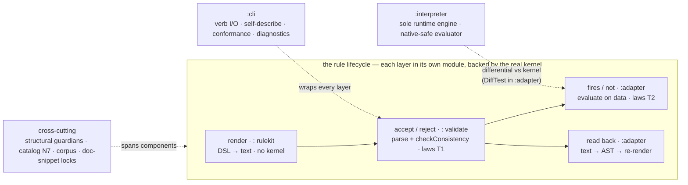

# Testing spec — the testing-approach map

The map of *how* a12-dmkits is tested — the kinds of test, what each one is for, where it lives, and which oracle backs it. This is the navigation layer; the enforced conventions stay in [`../CLAUDE.md`](../CLAUDE.md) ("Testing strategy") and the per-area detail stays in its own doc (linked below). Read this when you need to place a new test or recover the big picture without hunting across five files.

## The testing landscape — the four tiers

a12-dmkits is tested at four tiers. The first two are **deterministic gates** (red/green, in CI); the last two are **experience instruments** — they measure how an LLM agent fares with the tool, and the durable guards their findings earn graduate *down* into tier 1.

| tier | the question it answers | form & where it lives | run / spec |
|---|---|---|---|
| **1. Kernel-oracle tests** (JUnit) | does the DSL render, the kernel accept, the runtime evaluate, and the CLI describe itself — correctly? | the `:` + `:adapter` + `:cli` suites (**the rest of this doc**) | `./gradlew test :adapter:test :cli:test` |
| **2. Doc-drift demos** (showboat) | do the published `examples/` CLI demos still match the live CLI? | `examples/*.md` (showboat) + the `CliTourFreshnessTest` local lock | `uvx showboat@0.6.1 verify examples/<demo>.md` — [`CLI-TOUR-SPEC.md`](CLI-TOUR-SPEC.md) |
| **3. Self-sufficiency eval** (N6) | can a **cold** agent author/read rules from the bare surface (± skill)? — **scored, repeatable** | the Workflow runner over `eval/` | the `run-dmtool-eval` skill — [`EVAL-SPEC.md`](EVAL-SPEC.md) / [`EVAL-PRIMER.md`](EVAL-PRIMER.md) |
| **4. DX probe** | how does a **real multi-prompt session on the shipped product** actually go? — **deep, n=1** | the probe pipeline over `probe/` | `probe/*.sh` + main loop — [`PROBE-SPEC.md`](PROBE-SPEC.md) |

Tiers 1–2 are machine-enforced (a break fails the build/CI). Tiers 3–4 are **run-and-read**: an agent is in the loop, the deliverable is a measurement/report, and a finding's lasting guard graduates back into tier 1.

### Inside tier 1 — the JUnit layers & components

Tier 1 is not one thing. It mirrors a **rule's lifecycle** — *render → accept → fire → read back* — as a chain of layers, each living in its own **component (Gradle module)** and backed by the real kernel at the stage that needs it. `:cli` wraps the lot behind verbs; `:interpreter` is a **second** evaluator implementation checked against the kernel; and a band of guardians/catalog/corpus tests cuts across all components.



#### The layers — a rule's lifecycle (what each proves)

| layer | proves | component · oracle | representative tests |
|---|---|---|---|
| **render** | the DSL emits the right kernel text — composition, parenthesization, quoting, handle kind-checks | `:` rulekit · *no kernel* | `dsl/RenderConditionTest` + `dsl/operators/*` |
| **accept / reject** | the kernel *accepts* a valid condition and *rejects* a bad one with the right `MVK_*` (+ F4 injection mechanics) | `:` validate · *real kernel* `checkConsistency` | `validate/laws/…LawsTest` (T1) · `validate/RuleValidatorTest` |
| **fires / does-not-fire** | a *valid* rule *evaluates* as intended on real data — polarity, empty-as-0, null compares | `:adapter` · *real runtime* `validateFull` | `adapter/…/laws/…LawsTest` (T2) |
| **read back** | render → kernel-parse → convert → render round-trips (F10) | `:adapter` · *real parser* + converter | `ReadRoundTripTest` + per-construct `…ReadTest` |

Two parts of tier 1 are **not** lifecycle stages: **modelkit structure** (the field/group/type-def/include builders + the structure ops, in `:`) and the **cross-cutting** guardians / catalog-N7 / corpus / doc-snippet locks (each has its own section below).

#### The components — Gradle modules (which *implementation* each exercises)

| module | implementation under test | tests live in |
|---|---|---|
| **the kits** (`:core`/`:rulekit`/`:modelkit`/`:edit` main) + root `:` (test host) | the DSL renderer/handles + modelkit structure + edit; accept/reject + the structural guardians against the real kernel. Stage-4 module cut: the kits' *main* moved to per-kit modules, but the cross-kit integration tests stay at root `src/test` (they span all four kits + share `Fixtures`/`ModelDrafts`), running with `testImplementation` on the kits + the `:adapter` oracle | `src/test/…` (root, the test host) |
| **`:adapter`** (opt-in) | the kernel-coupling **read** path + **runtime** behavior; kernel canaries; corpus | `adapter/src/test/…` |
| **`:interpreter`** | dmtool's **sole runtime eval engine**, clean-room and native-safe—validated differentially against the kernel on the exercised surface; its actual packed tarball is bundled independently and, under real Chrome at the Pages-relative base, replays all 33 portable corpus cases, the exact raw include/typedef workspace through finite and asynchronous collection, host-sensitive decimal/regex/timezone locks, and the fixed B1 first-answer semantics | `interpreter/src/commonTest/…` + the Kotlin `*DiffTest.kt` in `adapter/src/test/…` + `interpreter/consumer-tests/browser` |
| **`:cli`** | the `dmtool` verb surface — I/O contract, self-describe, conformance, diagnostics | `cli/src/test/…` |

Since the Stage-4 module cut the kits are their own modules (`:core`/`:rulekit`/`:modelkit`/`:edit`), but their *main* is what moved — the cross-kit integration tests stay at root `src/test`, so root `:` is the test host. The aggregate `./gradlew test` runs that root suite (over all four kits, via the `:adapter` oracle at test scope); the kit modules' own `:test` are no-source; **`:adapter:test` and `:cli:test` are separate** (the adapter is the opt-in kernel-coupling tier, kept out of the root suite). The full per-kind breakdown + oracle is the kinds-of-test table below.

### eval vs probe — same agents, opposite questions

Both put an LLM agent in front of the tool, but they ask different things and must not be conflated:

- **The eval asks "*can it succeed?*"** — is the **self-describing surface** teaching enough that a cold agent reaches a correct artifact, *repeatably*? It scores the **final artifact** (kernel-valid AND gold-equivalent), runs **single-shot** tasks on the freshly-built **JVM** CLI, repeats **pass@k**, and yields a **number** that can gate CI. It discards the trajectory.
- **The probe asks "*how did it go — and is the success real?*"** — when a real agent drives the **shipped product** (the **native** binary + skill) across a **multi-prompt** session, where does it hit a **false success, friction, or get misled**? It reads the **trajectory** (an objective shim log + the produced models), runs **one deep session** (no k, no score), and yields a **diagnostic report**.

The gap that justifies two instruments: a model can **score eval-PASS yet have terrible DX** — the same task the eval marks correct may have leaked a stack trace or burned 50 recovery calls, invisible to a final-artifact score. The eval guards *capability of the surface*; the probe guards *experience of the delivered product*. (PROBE-SPEC's "why a second instrument" lists the three shipped defects the eval was structurally blind to: a native-only crash, the delivery layer, a multi-step silent drop.)

> **Terminology trap:** "probe" is overloaded. In **EVAL-SPEC** a *probe* is **one eval attempt** (the pass@k unit). The **probe harness** (`probe/`, PROBE-SPEC) is the **separate DX instrument** in tier 4. Same word, different things.

## The one principle: the real kernel is the oracle

There is **no mock kernel**. Every claim about how the A12 kernel parses, validates, or *evaluates* a rule is locked by a test that runs the **real engine** (`30.8.1`, pinned). A feature isn't done when the DSL renders the right string — it's done when the kernel *accepts* that string (F4) and, where behavior matters, *evaluates* it as intended (F-LAW). Tests are example-based and TDD-first (red/green): readable, intent-revealing cases drive each feature.

Consequence: the kernel is an unstable dependency, so the suite is also an **early-warning system** for kernel upgrades — many tests are deliberately "guardians" that fail loudly when a kernel bump shifts something. See [`KERNEL-UPGRADE.md`](KERNEL-UPGRADE.md).

## The kinds of test

| kind | question it answers | where | backing oracle |
|---|---|---|---|
| **Example / unit** | does the DSL render the right text, parenthesize, quote, type-check handles? | `dsl/RenderConditionTest` + one file per family under `dsl/operators/` (`PatternConditionTest`, `AggregateConditionTest`, …) | pure rulekit (no kernel) |
| **Modelkit structure** | do the field/group/type-def/include builders + structure ops (add·remove·rename·move, the safe-delete gate) produce kernel-consistent structure? | `modelkit/…` + `edit/EditSessionTest` (root `:`) | real kernel `BasicConsistencyCheck` / `checkConsistency` |
| **F4 mechanics** | does injection → validate → problem-mapping work? | `validate/RuleValidatorTest` | real kernel `checkConsistency` |
| **Law tier 1 — accept / reject** | does the kernel *accept* this condition (and reject the bad one with which `MVK_*`)? | `validate/laws/…LawsTest` (`NumberLawsTest`, `BooleanConfirmLawsTest`, …) via the `KernelLaws` harness | real kernel parse + `checkConsistency` |
| **Law tier 2 — fires / does-not-fire** | does a *valid* rule *evaluate* as intended on data? | `adapter/…/laws/…LawsTest` (`PolarityLawsTest`, `EmptyValueLawsTest`) via the `RuntimeLaws` oracle | real kernel `IDocumentRtService.validateFull` |
| **Read round-trip** | does render → kernel-parse → convert → render round-trip (F10)? | `adapter/…/ReadRoundTripTest` + per-construct `…ReadTest` | real kernel parser + the converter |
| **Interpreter differential** | does the native-safe `:interpreter` evaluate a rule *identically to the kernel*? | Kotlin `adapter/…/laws/*DiffTest.kt` (`PolarityDiffTest`, `ParserDiffTest`, `InterpreterDiffTest`, …) | real kernel runtime, as the differential oracle |
| **Parser coverage sweep** | does the interpreter parser accept the legal DSL the kernel actually stores? | `adapter/…/laws/ParserCorpusSweepTest` — catalog `validExample`/`computationExample` + `PerfCatalog.fuzzConditions` **always-on 100%**; the `a12-kernel-mm` + A12 Tools corpora **opt-in 100%** (`assumeTrue`-skip). A residual failure must fix the parser or record a reason (IF55) | the pinned corpora as the population; parse = `parseCondition`/`parseExpression` |
| **Codegen tri-differential** | does the interpreter match the Groovy-dynamic runtime and static-JAVA generated validator on the generated cases? | the differential **fuzz** nets run a third engine (`RuntimeLaws.JavaKernelEngine`) via `FuzzDiagnostics`: `interp == kernel-groovy-dynamic == kernel-java-static` at `code|type|pointer` | real kernel; the ratified oracle (IF136) anchors on Groovy-dynamic — a static-Java split is recorded via the corpus `divergences` mechanism, never adopted; the module instructions and corpus contract now agree |
| **Conformance corpus replay** | does every committed case in the `corpus/cases` tree (semantics-as-data) replay identically across the interpreter, kernel groovy-dynamic, and kernel java-static — **and on both interpreter targets, JVM and JS**? | `adapter/…/laws/CorpusReplayTest` + `CorpusSchemaGuardTest` (the `corpusReplayTest` task) is the **3-engine** JVM leg; `interpreter/commonTest/…/conformance/CorpusReplayCommonTest` is the **interpreter-only** leg that runs under `:interpreter:check` on **jvm + js** (`jsNodeTest` — the first kernel-grounded JS oracle, WI-6), replaying via the shared kernel-free `InterpreterReplay`. Both declare the corpus files as inputs; cases authored/re-captured via `CorpusScenarios` → `CorpusCapture` → `CorpusGenerator` (`-PrunCorpusCapture`) | the committed cases; the groovy-dynamic leg re-runs the real kernel (also the freshness guard). A JS-vs-JVM interpreter split surfaces as a JS FAIL. Contract: [`CONFORMANCE-CORPUS-SPEC.md`](CONFORMANCE-CORPUS-SPEC.md) |
| **Checker fact-base reconciliation** | does `:consistency`'s prepared fact base place the same declarations, at the same paths, that the real kernel's `expand` produces — over includes, imported typedefs, a repeated mount, opaque element ids and a seven-source diamond? | `consistency/commonTest/…/WorkspaceMatrixReconciliationTest`, on **jvm + js**, reading the shared raw-workspace matrix that `:consistency:generateWorkspaceMatrix` embeds from the committed fixtures | the matrix's expanded facts, locked against the real kernel **and** the JVM reader by `adapter/…/WorkspacePreparationParityTest`. This is how a **Kernel-free module gets a kernel oracle at all**: the oracle arrives as committed DATA, so no classpath edge is needed — with the corollary that its FRESHNESS lives in `:adapter`'s lane, which re-derives the matrix from its typed author, so a green `:consistency:check` alone does not mean the oracle is current. A mount directive the checker does not implement is an expected row naming the suspended mount and the directive that suspended it, never a silent absence |
| **Checker consumability** | can a plain Node project install the checker and get a report — as opposed to the checker merely being correct on the JVM? | `:consistency:nodeConsumerTest`, which `npm pack`s the compiled JS library, clean-installs that tarball into a staged copy of `consistency/consumer-tests/node`, and imports it BY PACKAGE NAME | the packed artifact itself. Correctness tests cannot see this and the two failed independently: the JS target compiled green for the module's whole life while emitting nothing importable, because `binaries.library()` was absent. A relative import into `build/` would prove only that a file exists, where package-name resolution is what a consumer performs. Needs node and npm, so it is NOT on `:consistency:check` — run it by name; it reaches no network, the packed package declaring no runtime dependency. Its CASES are not in this arm: they live once under [`consumer-tests/shared/`](../consistency/consumer-tests/shared), host-neutral and importing nothing, so F's "the same corpus through packed Node and browser" is one corpus two arms run rather than two files nothing compares. Each arm supplies only a host — Node reads the fixture off disk and projects each verdict into `node:test`. What legitimately stays Node-only is what does not transfer: the impact row, and the read of the installed package's own `a12-consistency.d.ts`, which a bundled page cannot reach |
| **Checker browser consumability** | does the SAME corpus the Node arm runs also pass in a real browser, against the same packed tarball? | `:consistency:browserConsumerTest` — `pnpm add`s the packed tarball into a staged copy of `consistency/consumer-tests/browser`, bundles it with Vite, and a Playwright driver replays every suite in [`consumer-tests/shared/`](../consistency/consumer-tests/shared) in system Chrome, reading each verdict back out of the DOM. Since 2026-09-18 that includes [`editor.ts`](../consistency/consumer-tests/shared/editor.ts), the only suite running a SEQUENCE rather than independent cases — N's row 2 asks whether H, I and L work together, which no single-call case can answer | the packed artifact in a browser's own module loader. F's acceptance names all three of Java, packed Node and browser, and the third could not have run before 2026-09-17 because the module declared no `browser()` target. `jsBrowserTest` is NOT this guard and is disabled: Karma would exercise the compiler's output, where the clause names the tarball. Needs pnpm and a system Chrome, so it is off `:consistency:check` AND off push CI — the same footing as `:interpreter`'s browser consumer gate, which no workflow names either. Run it by name; a missing browser is a FAILURE, never a skip ([the landing](PORTABLE-CONSISTENCY-RESULTS.md#browser-2026-09-17)) |
| **Checker published ABI** | can the checker's report types change shape without any published surface noticing? | `:consistency:checkLegacyAbi` (Kotlin's ABI validation) byte-compares the committed [`api/consistency.api`](../consistency/api/consistency.api) and [`api/consistency.klib.api`](../consistency/api/consistency.klib.api); regenerate with `./build.sh :consistency:updateLegacyAbi` and review the diff | the MEMBERS of the types two published Java APIs expose. Both façade goldens already name `ModelSource`/`ConsistencyReport`/`CheckOutcome`, but only by REFERENCE — a name in a signature is all that pins, so `ConsistencyReport` could lose `getFindings()` with both goldens byte-identical. Kotlin does not put `checkLegacyAbi` on `check`, so it is wired there explicitly; without that the committed `api/` directory reads as pinned and is verified by nobody. Deliberately UNFILTERED, which keeps the dump's own finding visible — 183 public classes against a shipped TypeScript surface of two functions, almost all public by omission ([the disposition](PORTABLE-CONSISTENCY-IMPLEMENTATION-PLAN.md#stage-8-abi)). **The DEPTH claim has its own guard, because `checkLegacyAbi` structurally cannot make it:** that task compares each golden with its own dump, so a dump that collapsed to bare type headers is recorded faithfully and reported green — which IRG3 measured on a KLIB dump whose JVM twin kept every member. `CheckerAbiGoldenDepthTest` (in `:apiGuardTest`, the always-on tier for committed artifacts bound to their source) refuses any type carrying JVM members and none in KLIB, and pins `ConsistencyReport.getFindings`/`findings` by parsed member set in each carrier rather than by substring, since the file text names `findings` on the accessor line too. It asserts cross-carrier member PRESENCE and deliberately not name equality — that would need a model of how one declaration renders into two formats, which the sibling `InterpreterAbiGoldenDepthTest` also refuses to build. A floor of 40 matched types answers "did the comparison happen", and a parser mutant drops it to 0. `GateTierWiringTest` separately requires the push workflow to name `:consistency:check`, which Kotlin does not put `checkLegacyAbi` on by itself |
| **Cross-arm report parity** | do Java, packed Node and a real browser produce the SAME full report document for the same inputs — every member, not the ones an assertion happens to name? | one corpus, three readers: [`consumer-tests/shared/parity`](../consistency/consumer-tests/shared/parity) (a manifest, the input BYTES, and the expected report per case), compared by `consistency/commonTest/…/ParityCorpusTest` on **jvm + js** from a generated embedding of those same bytes, and by `parity.ts` inside both packaged arms | the corpus, which is generated from the PACKED package by `:consistency:syncCheckerParityCorpus` — so the JVM arm compares against what the shipped artifact produced, which is the direction [F's claim-specific oracle](PORTABLE-CONSISTENCY-PROPOSAL.md) names for "JS matches JVM". It states no semantic expectation and cannot: every value in it came from the checker. What it sees that a named assertion cannot is every member nobody named. Inputs are stored rather than derived, so a mismatch can never be one arm having built a slightly different model. Comparison is over PARSED documents — key order is not in the contract, array order is ([the landing](PORTABLE-CONSISTENCY-RESULTS.md#parity-2026-09-17)) |
| **B0's reference grid, packaged** | does the artifact a CONSUMER installs carry §3.4's reference behaviour — resolution, absence, ambiguity and declaring-group precedence? | [`consumer-tests/shared/references.ts`](../consistency/consumer-tests/shared/references.ts) over five committed `catalog-reference-*.dm.json` models, run by both packaged arms | the packed tarball's own report. It is **not** a copy of `ReferenceBindingTest`: that suite drives `prepare(...).resolve(base, name)`, an internal API no consumer can reach, so a green grid there says nothing about the artifact — which is why B0's acceptance hands this replay to F by name. Two transfers were not mechanical: B0's "the type cannot emit VALID" is a Kotlin-API claim no JSON string carries, so the packaged form is that no row reports `VALID` and every row reports `complete: false`; and the positive control had to be made accepting, its first version being INVALID for an unrelated reason (`MVK_ERROR_FIELD_NOT_REFERENCED`). The mutant is the over-rejection direction — remove the declaring-group tier and a model A12 accepts reports `MVK_FIELDNAME_NOT_UNIQUE` ([the landing](PORTABLE-CONSISTENCY-RESULTS.md#b0-replay-2026-09-17)) |
| **Consumer TypeScript is type-CHECKED** | is every authored `.ts` in a browser consumer project read by a compiler, or only required to be TypeScript? | `ConsumerTypeScriptCoverageGuardTest` in `:docGuardTest`, over both browser consumer projects, with their sources, tsconfigs and `package.json` declared as inputs | the tsconfig `include` lists of the configs a project's `check` script actually **invokes** — a config nobody runs leaves every symptom of the defect this guard exists for. The sibling Gradle guards (`verifyConsistencyBrowserTypeScriptSources` and its interpreter twin) refuse authored JavaScript, which asserts what the sources ARE and says nothing about coverage: `vite.config.ts`, the file deciding which HTML entries Vite emits, sat outside every `include` until 2026-09-17, so a typo in `rollupOptions.input` would have dropped a page and surfaced as a 404 mid-measurement |
| **Checker delivery ceiling** | has the artifact a browser or Node consumer downloads grown past what the owner ratified? | `:consistency:verifyConsistencyDeliveryCeiling` — the packed npm tarball's byte count against 1 MiB; named in push CI beside the consumer test, whose pack it reuses | the packed artifact's own length. This is **one of the checker's two absolute bars** — its JVM twin is the row below — and both are absolute precisely because bytes are machine-independent where a latency is not ([the ratification](PORTABLE-CONSISTENCY-IMPLEMENTATION-PLAN.md#h5-ratification)). It certifies bounded growth from the measured 634 443 bytes, never smallness — so a breach is answered by finding what entered the package, not by raising the number. The cross-revision trend stays informative and stays in `scripts/interpreter-delivery-footprint.init.gradle`; a ratchet and a trend are different instruments |
| **Checker JVM jar ceiling** | has what a MAVEN consumer downloads grown past what the owner ratified? | `:consistency:verifyConsistencyJvmJarCeiling` on `:consistency:check` — the `jvmJar` byte count against 2 MiB, ratified 2026-09-18 | the jar's own length, and deliberately **not** the resolved closure. The closure is 3 638 410 bytes of which our jar is 1 190 483, so a closure bar would spend most of its authority on the Kotlin stdlib and kotlinx-serialization and would fire on a stdlib bump — an alarm whose remedy is never in this repository. Set at 1.76× the measurement, the posture the tarball row above carries at 1.65×. `consistencyJvmClosureReport` keeps printing the closure total informatively, which is the quantity the owner left unbounded on purpose |
| **Checker shipped-file provenance** | is every file the checker PUBLISHES one that something decided to ship — in both carriers? | `:consistency:verifyConsistencyShippedFiles`, named in push CI beside the consumer test whose pack it reuses: a CLOSED enumeration of the npm tarball's entries and of the jvm jar's class-package roots, plus the package's licence, entry points and empty dependency set | the packed and jarred bytes. It exists because the other two instruments are blind to it by construction — `verifyConsistencyPurity` reads what classes LINK, `verifyConsistencyDependencies` reads what a consumer RESOLVES, and a COPIED file declares neither, which is why [F's oracle](PORTABLE-CONSISTENCY-PROPOSAL.md) asks for a third. **Closed, not a required-set**: "is what I expect present" stays green while an extra file rides along, and closing it found a shipped `devDependencies` and a package with no licence at all. Three positive controls, and the interpreter-owned check is ordered FIRST so it is reachable rather than dead behind the generic one ([the landing](PORTABLE-CONSISTENCY-RESULTS.md#shipped-2026-09-17)) |
| **Shipped-POM coordinate closure** | can a Maven consumer RESOLVE every in-repo coordinate a shipped POM names? | `:verifyPublishedPomsResolveInRepoCoordinates` on root `check` and in push CI: it generates every publication's POM and refuses an `io.github.mbackschat.a12.dm` dependency outside the set of coordinates this build publishes | the GENERATED POMs, never the build scripts — a project dependency's coordinate is decided by the TARGET project's publication, so a build script says nothing about what a consumer will be asked to resolve. It exists because the class shipped twice invisibly: `dmkits-consistency-gate` and `dmkits-interpreter-preflight` both declared `consistency-jvm` at compile scope while `:consistency` published nothing, and the rule was already written in `predicates/build.gradle` and [RELEASE-SPEC](RELEASE-SPEC.md) §3 with nothing enforcing it ([the landing](PORTABLE-CONSISTENCY-RESULTS.md#pom-closure-2026-09-17)) |
| **Change-impact containment** | does the checker's dependency graph reach every declaration the CHECK finds newly invalid — that is, can `impactOf` tell an author a declaration is unaffected when it broke? | `consistency/commonTest/…/ImpactTest.everyNewlyInvalidDeclarationIsAlsoReportedAsAffected`, over six candidate changes at once (rename, removal, field-kind change, group rescope, type-definition rename, removal of a computed field) | **the check itself**, which makes this the rare property with an oracle stronger than its claim: the graph predicts, `checkEdit` decides, and a carrier the graph misses fails rather than under-reporting quietly. Its twin is `aDeclarationTheChangeCannotReachIsNotReported`, without which reporting every declaration would pass. One row is deliberately the OTHER way round — a namesake declared in a reading group rebinds a bare reference while both models stay acceptable, so nothing in any verdict marks it and only the graph can |
| **Checker identity across packagings** | is the checker a consumer INSTALLS the checker it REPORTS being — one published id, one byte contract? | `:consistency:verifyCheckerArtifactIdentity`, named in push CI beside the consumer test: the npm name and version out of the packaged `package.json`, the resolved version out of the jvm jar's own coordinate, and `CHECKER_VERSION` out of that jar's compiled class by reflection | three build OUTPUTS, never `project.version` read three times — and the jar rather than the generated source, because an artifact can lag its source and silently did once here. What it establishes is narrow and worth stating: the three projections still agree. It cannot say the version is the right one, and no build-time oracle can. `CheckerIdentityTest` says in as many words that a test inside the artifact cannot make this comparison, since a constant agrees with itself |
| **Checker CI consumption** | can a Node CI job act on a checker that cannot emit VALID, without manufacturing a pass? | `consistency/consumer-tests/node/ci-gate.test.mjs` over [`ci-gate.mjs`](../consistency/consumer-tests/node/ci-gate.mjs), inside `:consistency:nodeConsumerTest` | the gate's own four outcomes, each reachable from the packed package — plus a SUBPROCESS row, because an exported `ExitCode` constant is a claim about a running pipeline and is settled by reading what the process exits with. The discriminating row is one unreadable DECLARATION beside a completed run: keying the tool-failure outcome on "a diagnostic arrived" rather than on an empty `checksCompleted` fails the build for the wrong reason, which is an over-rejection in the consumer |
| **Checker incremental equivalence** | does an analysis a caller UPDATES say what a fresh full check says, while actually reusing something? | `consistency/commonTest/…/SnapshotTest`, whose equivalence table runs five change kinds (a condition, a field's kind, the model config, a type definition, the include's own mount) incremental against fresh in one row | **a fresh full check** for the answers, and OBJECT IDENTITY for the reuse. The two pull against each other on purpose: a full recheck satisfies equivalence alone and a stale cache satisfies the counters alone, so neither property is load-bearing without the other. The counters must be measured rather than derived — a count assembled from the source size agrees with itself however much work was redone — and the draft rows need one case no other row can see: a draft resolving a reference into the MOUNTED provider, since a fact base prepared without its providers passes everything else |
| **Checker verdict in dmkits shape** | does a published-dmkits caller with no kernel get the checker's verdict in the type it already handles, with provenance that is its own? | `consistency-gate/test/…/PortableConsistencyGateTest`, on `:consistency-gate:check` | the checker itself for the verdict — the façade maps and never re-derives, so this suite deliberately does NOT retest A12 semantics. What it holds is the mapping: the receipt is `PORTABLE_CHECKED` on every arm that ran, the origin is `PORTABLE_CHECKER` (both neighbours being false claims — `KERNEL` says a kernel arbitrated, `PRECHECK` says a rulekit heuristic refused), an advisory stays WARNING so it cannot reject, and an accepted model is `ok()` beside a status of Inconclusive rather than a pass. The include rows need their own positive controls, because a walk that resolved nothing passes a row asserting no findings |
| **Preflight is not preparation** | can an interpreter consumer tell "A12 accepts this" from "the interpreter can run this", which answer first and look alike? | `interpreter-preflight/test/…/ConsistencyPreflightTest`, on `:interpreter-preflight:check` | **the interpreter itself**, in the same test: a model A12 rejects is PREPARED successfully and the preflight still refuses it, which is the defect the façade exists to prevent measured rather than asserted. The converse row shows the preflight changes nothing about what the interpreter admits, with a liveness control so "unchanged" cannot be satisfied by a model that never prepared |
| **Checker over-rejection gate** | does any of `:consistency`'s syntax families report a verdict about DSL the real kernel ACCEPTS? | `consistency/commonTest/…/ConditionCorpusTest`, on **jvm + js**, over the catalog's 154 conditions and 8 operations plus their German localizations, generated in by `:consistency:generateConditionCorpus` | the catalog examples themselves, which CI executes against the kernel — so a finding here is a condition A12 admits and the checker refuses. Each row must also SAY the syntax families ran, or a silent row could mean nothing checked it; the German half is held to its English original's token shape, because its localizer is a second implementation |
| **Property pack (kernel-free ∀-laws)** | does the interpreter obey the ∀-quantified invariants the differential can't *state* — laws over *sampled* inputs, not pinned cases? | `interpreter/commonTest/…/property/*PropertyTest` (seeded, hand-rolled, no framework) via [`PropertySupport`](../interpreter/src/commonTest/kotlin/io/github/mbackschat/a12/dm/interpreter/property/PropertySupport.kt); runs under `:interpreter:check` on **jvm + js** | **no kernel** — these are self-consistency / equivalence laws of the interpreter (lazy≡eager typing, Kleene monotonicity, row-permutation equivariance, empty-row IF53/IF54, aggregate identities, hash-join≡nested-loop, determinism, rule independence). See "Property pack" below |
| **Structural-law guardians** | did the kernel *add/move/rename* a construct, code, slot, or category we must track? | see the guardian table below | reflective parity vs the kernel's own enums/accessors |
| **CLI self-describing & conformance** | does the CLI describe its own verbs/params/I-O, and does every mutating verb refuse misuse with a *structured* diagnostic (not a bare fail)? | the `cli` conformance suite — see below | the live picocli tree + a derived fuzzer |
| **Coverage harnesses** (opt-in) | what fraction of real foreign rules do we read? | `KernelMmReadCoverageTest`, `Corpus1ReadCoverageTest` | real corpora (gated; commit nothing) |
| **Catalog examples (N7)** | is every catalog `validExample` actually kernel-valid? | `catalog/CatalogExamplesAreKernelValidTest` (incl. the correctives' reject probes — each rejected with its code) | real kernel |
| **Catalog facet probes** | is every catalog *facet claim* (the `semantics` machine tier + the `emptyOperandDefaults` header) true on the kernel **runtime**? Every claim carries embedded probes; each is (1) kernel-ACCEPTED and (2) fires ⟺ declared — so a facet value cannot rot ([CATALOG-SPEC §5](CATALOG-SPEC.md)) | `adapter/…/laws/CatalogFacetProbesTest` (execution) + `catalog/OperatorCatalogTest` (structural: a claim without a probe fails) | real kernel runtime (`RuntimeLaws`) |
| **Self-sufficiency eval (N6)** | can a cold LLM author/read rules from the CLI + skill alone? | the Workflow runner | clean subagent + judge — [`EVAL-SPEC.md`](EVAL-SPEC.md) |
| **Kernel-runtime observation probe** *(not a gate — a measurement)* | what does the real kernel do at runtime on **this** model + document, on both codegen strategies? | `./gradlew :adapter:kernelProbe -Prequest=… -Pout=…` → a byte-reproducible artifact; locked by `adapter/…/laws/KernelRuntimeProbeTest` + `KernelProbeComputeTest` (kernel-backed) and `KernelProbeArtifactTest` + `KernelProbeComputeShapeTest` (shape) | real kernel `validateFull`, and `compute` when the request's `observe` asks for it, on both strategies — [`KERNEL-PROBE-SPEC.md`](KERNEL-PROBE-SPEC.md). Absent from `check`: it asserts nothing, and it exists so a runtime question does not cost a purpose-written test |

### Designing a kernel witness grid <a id="witness-grid-design"></a>

Before building fixtures for a new or widened kernel-semantic claim, put the experiment design in the task's existing acceptance matrix. This applies to static admission checks, runtime differentials, and observation probes. Keep the witnesses that already establish observations; add cases that distinguish explanations. A green grid supports only the distinctions it actually measures.

Use this compact plan:

| Item | Record before the run |
|---|---|
| Claim and rival | The proposed rule, its scope, and a plausible competing explanation that fits the evidence held so far. Source reading may suggest the rival; it does not discharge the behavioral measurement. |
| Discriminator | An authorable input on which the two explanations predict different observable results; write both predictions. Pair it with a control differing only on the intended axis. |
| Axes | Relevant dimensions, their values, and one of the four treatments below. Inspect fixture helpers and defaults as well as visible row arguments. |
| Oracle and acceptance | The exact kernel entry point, engine, ingress route, and result channel needed for the claim; name which observation would support, refute, or leave it unresolved. Use the [claim-kind rules](../CLAUDE.md#kernel-claim-oracles). |

| Axis treatment | What must be explicit |
|---|---|
| **Varied** | Values exercised and the cases/controls that distinguish them. If claiming a complete finite domain, derive its denominator from the owning vocabulary or implementation and connect that denominator to the executed cases. |
| **Held fixed** | The chosen value and the resulting limit on the conclusion. A constant inside a helper is still a fixed axis. |
| **Constrained by valid input** | The coupled values or edits and the kernel evidence requiring them. An authoring limitation or a failed attempt alone does not establish impossibility; an unverified constraint remains unmeasured. Do not attribute an effect independently to factors the legal inputs cannot separate. |
| **Unmeasured** | The missing distinction and the claim it prevents. If that distinction is required for the proposed conclusion, measure it before publishing the conclusion or narrow the conclusion to what was established. |

Choose axes from the claim and its rivals, rather than from the fixture's convenient parameters. In particular, separate declared kind from format components, comparison operator from comparand, coordinate position from repeatability, and document ingress from direct cell construction when those distinctions could change the account. Audit the grid as a whole: a valid one-axis control in one background does not establish the same effect in another. For a suspected two-factor interaction, include the relevant 2×2 combinations; record any unmeasured or constrained corner. This is not a requirement to cross every property with every other property.

For example, the position-versus-repeatability question in [RootOverLimitPositionDiffTest](../adapter/src/test/kotlin/io/github/mbackschat/a12/dm/adapter/laws/RootOverLimitPositionDiffTest.kt) needs a repeatable root and a fixed deeper group: those are the cases where the two accounts disagree. Its bounded descendants and direct document construction remain fixed; adding more rows under those same conditions cannot establish the unbounded-descendant or JSON-ingress arms. This is the distinction between a useful witness and an unsupported extension of its scope ([KF58](KERNEL-FINDINGS.md#kf58)).

Before publishing, reconcile the plan with the inputs actually executed, including any prerequisite rejection that prevented a row from reaching its intended gate. State observed results separately from the explanation, retain the fixed/constrained/unmeasured limits in the owning finding, and name the regression lock. The author and terminal reviewer check this correspondence; a green test or coverage count cannot establish that an omitted rival or axis was considered. The plan belongs with the existing task/review material, and its durable conclusions belong in the existing findings; it creates no additional registry or probe request field.

### Systematic semantic matrices before fuzzing

A defect class that spans a semantic pipeline is tested as one finite model, not as an accumulating list of anecdotes. First name the stages and the meaningful equivalence partitions at each stage. For an index identity relation, the lifecycle is `stored cell -> formal admission -> canonical key -> collision or ambiguity policy -> row selection or parallel join -> three-valued result -> message pointer`.

The worked partition is constrained rather than a blind Cartesian product:

| axis | representative partitions | claim owner and oracle |
|---|---|---|
| cell | absent · present-empty · admitted · parseable-invalid · unparseable-invalid · custom-invalid · over-limit | admission is kernel-owned; tri-engine differential, with authorability checked first where needed |
| interpreter degrade | registered custom validator unavailable | project-owned host-failure policy; JVM/Node lock plus a direct-reading rule that separates CELL-only unsupported from CELL+ELEMENT unsupported |
| kind | Number · String · date family · enum | kernel-owned whenever kind changes admission or equality |
| relation | distinct · text-equal · value-equal/text-different · duplicate ×2 · duplicate ×3 · admitted+inadmissible twin | kernel-owned collision and ambiguity behavior; `value-equal/text-different` is Number-only unless a date-family relation is separately defined |
| consumer | semantic read · semantic presence · contained-field scan · parallel join · `uniqueIndex` auto-check · starred `IndexColumn` · computation | kernel-owned; each consumer is a separate observation site |
| mode | full · partial relevance · computation | kernel-owned because the kernel changes index-cache membership by mode |
| relevance × admission | invalid+relevant · invalid+non-relevant · admitted+non-relevant | kernel-owned; this cross separates two ways a column becomes unavailable |
| position | invalid-before-valid · valid-before-invalid · invalid-only · valid peer on the other side · over-limit-after-limit | kernel-owned whenever order changes the selected row, ambiguity, or pointer |
| key form | literal · field-valued · empty field-valued | authorability plus runtime are kernel-owned |
| observable | code multiset · polarity/type · pointer · negative-operator 3VL over an unmatched reference · custom-validator invocation count | compare at the narrowest channel that discriminates the mechanism |

The constraint list is a reviewed artifact. It names infeasible pairs such as `value-equal/text-different × non-Number`, `duplicate ×3 × fewer than three rows`, `custom-invalid × no registered custom type`, and `parallel join × one group`; it never silently counts an infeasible pair as covered. Use bounded exhaustive enumeration when the reduced state space is small. Otherwise generate a constrained pairwise covering array and name the excluded higher-order interactions.

An axis is kernel-owned unless a discriminator establishes that only the interpreter implementation can vary along it. Canonical-key data structures, cache shape, and hash-join versus scan are interpreter implementation details only after a kernel differential has established admission, equality, ambiguity, and 3VL. A fast property is never a replacement for a differential on an owner-semantic axis merely because it quantifies over more inputs.

Every equivalence class carries a paired firing control on the same model and rule, differing only in the partition under test. A silence row does not need to fire itself; its paired control proves the rule and oracle can fire. A classifier or coverage meter has direct laws, including shapes the generator cannot produce. Inputs owned by production semantics, such as effective relevance, come from the exact production implementation through an engine-internal seam rather than a mirror. The meter independently implements only the classification it is meant to audit, such as admission and collision, and a direct law locks that implementation. This avoids both drift and a classifier that merely reports production's own bugs back as coverage. Agreement between a differential and a mirror that can drift is not coverage evidence, and a test instrument does not justify a new supported user-facing API.

Metamorphic relations complement the concrete matrix. Each relation states preconditions, permitted changes, forbidden changes, and its oracle:

| relation | preconditions | allowed to change | must not change | oracle |
|---|---|---|---|---|
| admitted Number spelling | both spellings are formally admitted under the declared scale, sign, and charset rules, and both are inside the index cache | nothing in code, type, or pointer | any identity result | one kernel anchor, then kernel-free only while admission itself remains kernel-locked |
| insert a formally invalid row | every pre-existing row remains inside declared repetition limits; observe the identity relation rather than the complete message multiset | the inserted cell's formal errors, its own per-row firings, and no-match becoming UNKNOWN | any existing admitted key, collision, or match | kernel differential |
| permute rows | no `FirstFilledValue`, `CurrentRepetition`, positional aggregate, or other order/repetition-number dependency; move whole rows with their index cells | pointers permute | code multiset | property-pack property 3 after one kernel anchor; do not create a second owner |
| add an unrelated admitted key | distinct under the canonical projection on every joined side, inside declared limits; observe messages attributable to pre-existing keys | new unmatched join contexts and new-row/group aggregate effects | any existing match or join result | one kernel anchor |
| duplicate an admitted key | both twins admitted, same group, inside the index cache, and relevant in the current mode; observe unavailability through a negative operator over an unmatched reference | consumers become UNKNOWN, the group becomes invalid, and `uniqueIndex` reports both cells | silently selecting either twin | kernel differential |
| admission transition | fixed model, row coordinates, and all other cells while one stored cell changes admitted -> inadmissible; observe the identity stage separately from that cell's formal error | the cell's formal result and removal from identity; collision/selection for canonical-equal peers; downstream column-wide unavailability, including an unrelated no-match changing from definite absence to UNKNOWN or computation poison | selecting the inadmissible row, letting it participate in a collision, or changing membership, collision, or selected row for a distinct canonical key | kernel anchors for the one-peer and two-peer cases, then a bounded kernel-free exhaustive checker |
| add an unrelated rule | both models are kernel-accepted; the added rule has a unique code; custom callbacks are stateless or absent; compare the original rules' code/type/pointer multiset and unsupported findings | the added rule's own messages | any pre-existing result | `RuleIndependenceDiffTest` kernel anchor, then `RuleIndependencePropertyTest` over deterministic JVM+JS samples |

A **kernel anchor** is a small discriminating differential case that establishes an owner-semantic relation against dynamic Groovy, with generated Java as co-evidence. Kernel-free property tests may then amplify that anchored relation across more inputs and hosts, but they cannot establish, broaden, or repair its semantics.

Dynamic Groovy is normative and generated Java is co-evidence. A `kernel-groovy != kernel-java-static` split is recorded through the conformance corpus `divergences` mechanism and is never adopted; a metamorphic prediction violated only by Java-static is not a failure of the relation. The oracle-strength order is `tri-engine differential > Groovy differential > kernel-free forall property > interpreter self-consistency > render-only`. For an owner-semantic claim, a property remains below a differential regardless of sample count.

Fuzzing is the breadth layer after this deterministic foundation. It explores compositions, model shapes, and combinations no curator chose; it is not proof that a named semantic partition is reached. A fuzz regime that advertises a denominator therefore needs a deterministic seed-shape matrix, a direct classifier law, a classifier mutation check, and a kernel-fired control for every `(rule shape, promised relevance shape)` pair independently of random agreement.

The matrix design, relation preconditions, and consolidation evidence below are review-time obligations unless an owning row names a mechanical guard. A concrete matrix earns a coverage claim only when it names its tri-engine differential and bounded exhaustive checker; a fuzz classifier earns one only through its named `*ShapeTest`. Test-oracle cache identity and bounds are enforced now by `RuntimeLawsEngineReuseTest` and `BoundedLruCacheTest`.

### Consolidating expensive tests without losing coverage

The target is fewer distinct kernel model compilations and kernel-service constructions, not fewer test methods. `RuntimeLaws` therefore reuses a bounded dynamic-Groovy engine per exact model JSON while rebuilding each document and `DocumentProcessingConfig` per call; fuzz and corpus code share a separate bounded exact-model Java-static cache. Exact JSON is load-bearing because models derived from one base retain the same A12 header id. `RuntimeLawsEngineReuseTest` locks same-id model isolation, alternating-document isolation, locale, clock, custom-condition invocation, and the cache limit; `CustomFieldTypeContextDiffTest` locks the custom-validator per-call context and count. `BoundedLruCacheTest` locks access-order eviction.

Model-level axes such as scale, repeatability, index-field set, locale set, time zone, and legal codepoints always get distinct model JSON. Per-call axes such as locale, clock, custom-condition factory, custom-field-type factory, and relevant set stay on each row. A computation row gets a fresh immutable input document. An invocation-count claim may use a shared engine only when a direct guard proves one callback per reached value per call; it never shares mutable callback or document state.

Measured 2026-08-09: `SemanticIndexComputeNoMatchDiffTest`, ten tri-engine assertions over one model, fell from 36.09 seconds to 4.084 seconds after exact-model dynamic-engine reuse. No assertion or test was removed; the comparison held the class at its then ten-method shape, before IF272's additional rows.

The 2026-08-09 index-estate consolidation audit cleared no whole test or class for removal. It removed one assertion-identical duplicate parameter row from `RepetitionNotUniqueReferenceBoundaryLawsTest`. `SemanticIndexDiffTest` and `SemanticIndexFieldKeyedDiffTest` exercise different literal-key and field-key AST paths; `SemanticIndexPresenceDiffTest` adds polarity/type observables; `SemanticIndexComputeNoMatchDiffTest` already shares one model, so merging its methods saves no compilation; the adapter and common `RepetitionNotUnique` tiers own kernel semantics versus JVM/Node host parity; and the parallel-iteration classes own structurally distinct plans. Engine reuse removed the measured repeated setup without erasing any of those claims. Re-open deletion only with the six artifacts below, not because the method count is large.

A test may be removed as redundant only when all of the following evidence exists in the same change:

1. A retained test states the same claim at an oracle level that is not lower in the order above. A kernel-free property is never at least as strong as a differential for owner semantics.
2. The retained test is observed red against the defect-era behavior: restore the defect-era implementation of the enforcement locus into the current tree, or replay the historical revision only when the retained test compiles there unchanged. A revision checkout that cannot compile the retained test is not evidence and is never a reason to skip this condition.
3. The shared enforcement locus is deliberately broken by hand, the retained test is observed red, and the source is restored. There is no mutation framework in this repository; this manual procedure is the enforcement evidence.
4. The removed test carries no unique claim at the same engine, host, public-contract, diagnostic, pointer, polarity, or partial-relevance granularity. A pointer assertion repeated by the retained table is not unique merely because it was in another method.
5. A dated before/after timing is recorded in the owning document and shows that the change reduces repeated expensive work. A headline class or test count is not evidence.
6. Every findings/spec reference to the removed test is amended in place to the retained enforcement locus.

Consolidation must not combine cases whose setup isolation is load-bearing, hide a paired control behind a shared flag, or replace a kernel differential with interpreter self-consistency. The six removal conditions are review-time obligations, not advertised build enforcement. If defect-era restoration or a compatible historical replay, the manual break, assertion provenance, or the timing artifact cannot show subsumption and savings, keep the test. Engine reuse comes before deletion because it removes the dominant cost without reducing coverage.

## The two law tiers — the distinction people conflate

A rule can be **kernel-valid yet behave wrong** (the inverted-polarity trap is the canonical case). So "is it accepted?" and "does it do the right thing?" are *different questions* and get *different tiers*:

```
                    ┌─────────────────────────────┐      ┌──────────────────────────────────┐
   a condition  ──▶ │  TIER 1  accept / reject     │ ──▶  │  TIER 2  fires / does-not-fire     │
                    │  structural validity         │      │  runtime behavior on real data     │
                    │  validate/laws/  (KernelLaws) │      │  adapter/…/laws/  (RuntimeLaws)    │
                    │  parse + checkConsistency     │      │  IDocumentRtService.validateFull   │
                    └─────────────────────────────┘      └──────────────────────────────────┘
        catches: "this rule is well-formed"        catches: "this well-formed rule means what we think"
```

- **Tier 1 (accept/reject)** embeds a condition as a rule's `errorCondition` and asserts the kernel accepts it, or rejects it with a named `MVK_*` code. Harness: `KernelLaws.accepts/rejects`.
- **Tier 2 (fires/does-not-fire)** builds a **document instance** with specific field values, runs the kernel's runtime validation, and reads back *which rules fired* (`IMessage.getErrorCode()` / `getRulePath()`). Harness: `RuntimeLaws`. This is the only way to lock behavioral semantics — polarity, empty-as-0, null comparisons, path walk-up. Wiring + the V1 document-construction contract are in [`KERNEL-INTEGRATION-NOTES.md`](KERNEL-INTEGRATION-NOTES.md) ("Runtime behavioral-law oracle"). The same runtime is now also a **public seam** — `KernelAdapter.evaluate`/`compute` behind the `model eval`/`model compute` verbs — and `EvalDocSeamLawsTest` pins its nested-document walk against `RuntimeLaws`' known-good row pointers (and locks validate≠compute, the number-empty-→0-in-computation case, …).

Both tiers are the **executable form of [`KERNEL-FINDINGS.md`](KERNEL-FINDINGS.md)**: every findings § (and MVK-ledger row) points at the `…LawsTest` that locks it, so a kernel upgrade that changes a documented behavior fails loudly instead of silently drifting.

### The property pack — the third kind: kernel-free ∀-laws (WI-4)

The two law tiers pin **cases** against the **kernel** oracle. The **property pack** (`interpreter/commonTest/…/property/`) is a distinct third kind: **∀-quantified laws** over *sampled* inputs, with **no kernel oracle** — they hold by the interpreter's own structure, so they compile and run on **JVM *and* JS** (the kernel is JVM-only; a case differential can't run on JS at all). Where a differential says "on THIS input, interp == kernel," a property says "on EVERY sampled input, this invariant holds."

They quantify over a deterministic seed stream × a few diverse models ([`PropertySupport`](../interpreter/src/commonTest/kotlin/io/github/mbackschat/a12/dm/interpreter/property/PropertySupport.kt): flat · single-repeatable · nested, fill/empty/malformed values) — never wall-clock/platform randomness, so JVM and JS sweep identical samples. Hand-rolled `kotlin.test` (no property framework, no new dependency — the module is purity-linted). Each pins a fact the differential **cannot state**:

| Property | The ∀-law | Seam |
|---|---|---|
| **1 · lazy ≡ eager** | the production lazy-polarity walk (`firedType`) == the full eager typed walk on every (cond, doc) — truth, and polarity when firing | `Interpreter.lazyEagerConsistent` (internal) |
| **2 · Kleene monotonicity** | routing any operand to UNKNOWN never flips TRUE↔FALSE (⇒ branch-scoped suppression); the [`Kleene`] table + the `invalid` mechanism | public `eval` + `invalid` |
| **3 · row-permutation equivariance** | permuting a group's rows permutes the pointers; the code multiset is invariant | public `validate` + placement relabel |
| **4 · empty-row append** | IF53 (instantiated-empty row is content — per-row fires per row), IF46 (instantiated-count delta), IF54 (partial phantom fires) | public `validate`/`validatePart` |
| **5 · aggregate identities** | empty `Sum`/`Max`/`Min`/`NumberOfDifferentValues` = 0; operand-list substitutes empty, star skips it | public `Aggregates` + `evalExpression` |
| **6 · indexed correlation ≡ general scan** | each keyed/ordered `$`-correlation plan produces exactly the same tally as the naive nested scan on every sample | `Interpreter.correlationTallyBothWays` (internal) |
| **7 · determinism** | `validate`/`compute` twice ≡ once (reused *and* fresh engine) | public `validate`/`compute` |

The seams are the only concession: three `private`→`internal` methods on `Interpreter`/`Document`-adjacent code (annotated "WI-4 property seam"), so a property can compare two internal strategies (lazy vs eager, hash vs scan) the public surface hides. Two properties are deliberately scoped and say so in-test: property 2 excludes the **counting quantifiers** (there "operand UNKNOWN" is a tally change, not a Kleene leaf), and property 4 covers the settled IF53/IF54/IF46 deltas but not the *declared-range* clamp (IF49, locked by its own `:adapter` differential). The **exploratory polarity-soundness** property (an OMISSION implies a fill exists that changes the outcome) is out of scope — its statement needs a BEST_MODEL boundary first (proposal §8).

## The structural-law guardians (anti-whack-a-mole)

Rather than discover kernel constraints by tripping over them, these sweep the kernel's *enumerable* surfaces and fail when something new appears:

| guardian | what it pins |
|---|---|
| `SlotParityTest` | every public `IRule`/`IComputation` accessor is supported or explicitly deferred (the **authoring** side) |
| `adapter.InterpreterFieldConstraintParityTest` | every kernel `IStringType`/`INumberType` constraint accessor is classified for the **interpreter** model (modeled / deferred / out-of-scope) — the forcing-function whose absence let IF20 hide; catches a kernel-added field-type constraint the interpreter would otherwise silently drop |
| `adapter.InterpreterModelElementParityTest` | the companion over the **rule/computation/group** slots (`IRule`/`ICalculationInfo`/`IGroup`) — every accessor classified for the interpreter model (IF21 alternatives, IF23 severity, sort-info → eval-irrelevant (authoring shipped, finding 51), rounding-mode, custom-ref entities); catches a kernel-added model-element slot the interpreter would silently drop |
| `MvkLedgerTest` | every `MVK_*` code is classified (erased / pre-checked / delegated / pending) — [`MVK-LEDGER.md`](MVK-LEDGER.md) |
| **`adapter.laws.CheckerSilenceOnCleanModelsTest`**, **`adapter.laws.CheckerSilenceOnMutatedModelsTest`**, **`adapter.laws.CheckerClassAgreementTest`**, **`adapter.laws.CheckerSilenceOnSynthesizedModelsTest`** (all four in `:adapter:checkerSilenceGuardTest`, which declares the three model trees as its inputs — the fourth reads no repo file and joins them because it is the same claim about the same checker) | the Kernel-free checker's OVER-REJECTION surface: every committed model `BoundModel.ofJson` builds must draw no `A12_CONSTRAINT` ERROR. The Kernel picks the population, so no exclusion list is maintained; the floor keeps it from draining silently. This is the one control the per-family grids cannot supply — a fixture written beside an implementation shares whatever that implementation assumes — and its first run found the reference scanner reading `CustomCondition <Name>`'s host-code name as a field on three models the Kernel accepts. A second arm sweeps the reference corpus (`a12-kernel-mm`, Kernel-expanded then Kernel-built) and the A12 Tools workspaces, each skipping when absent — models nobody here wrote, which is what makes it able to falsify a grid whose fixtures share an origin with the implementation. The two siblings extend that population in the two directions a clean-model sweep cannot reach: `…MutatedModelsTest` perturbs each model and keeps the mutants the Kernel still builds, because every model anywhere was authored to be VALID; `CheckerClassAgreementTest` takes the mutants the Kernel REJECTS and compares classes, the wrong-class direction both silence sweeps pass by construction. Those three read those trees at runtime, which is why they share the task that declares them. `CheckerSilenceOnSynthesizedModelsTest` extends the population along the remaining axis, SIZE: every model in the other three is hand-authored and small, so a family that over-reports only above some declaration count is invisible to all of them, and this one generates 200 and 800 programs through the profile benchmark's own typed synthesizer — asking `BoundModel.ofJson` first, so its silence is a claim about the checker rather than agreement with a rejection |
| `SerializerTierParityTest` | the `BasicDocumentModelConsistencyCategory` write-gate enum (F6) is fully classified |
| `KernelConstructParityTest` | every parsetree construct-name enum member is cataloged or excluded (catches operators the kernel *adds*) |
| `adapter.RtSemanticsLedgerTest` | every runtime evaluation-core class is classified in [`RT-SEMANTICS-LEDGER.md`](RT-SEMANTICS-LEDGER.md) (catches evaluation semantics the kernel *adds*) |
| `GrammarProductionLedgerTest` | every condition-grammar parser production is classified in [`GRAMMAR-LEDGER.md`](GRAMMAR-LEDGER.md) (catches syntax *shapes* — opt-in, needs the sibling `../a12-kernel` checkout, skips when absent) |
| `KeywordParityTest` / `OperatorCatalogTest` | the operator catalog's keywords/shape stay aligned with the kernel bundle |
| `DslCatalogBridgeTest` | the catalog's `dslEntry` map stays in bidirectional set-equality with the code-side `catalog:<Id>` authoring markers (G3) — every member resolves to a real DSL method, every operator is mapped or explicitly noted-empty; a stale/absent mapping fails, and the guard dumps the marker-derived projection to re-author from |
| `adapter.laws.CapabilityEvidenceMatrixTest` | the interpreter's capability × strategy × coverage-tier inventory (IF140): operator cells derive from the live catalog; the formal, computation, configuration, customization, platform, and assembly universe is independently closed; every cell names compile-resolving dynamic/static evidence or an explicit reasoned exclusion; omission fails, exclusions never inflate evidence, and the certificate summary is generated from the matrix |
| `KernelVersionTest` | the running kernel version vs the catalog's `verifiedAgainst` floor (F11 skew INFO) |
| `ModelIndexNamePathTest` | element keying is by name-path (the F-IDX fix foreign-model read depends on) |
| `adapter.ModelIndexParityTest` | the kernel-free `dm.core` reader's index == the kernel's, over fixtures + both opt-in corpora — the decoupling-Stage-2 parity net (kernel-free assembly/index vs the preserved `KernelModelOracle`); `core.ModelReaderTest` unit-tests the reader's expand/typedef/id-normalize |
| `ModelDocumentAuthoredFieldRuleStateTest` + `adapter.review.ModelDiffFieldCompletenessTest` / `ModelDiffRuleEnvelopeTest` / `ModelDiffReaderRiskTest` | Semantic-diff field/rule completeness: one typed authored-tree walk exposes every field type/requirement/metadata slot and rule metadata; the diff locks field constraint direction, rule targets/messages, and one inverse reader map for referenced removal/retype impact |
| `ModelDocumentAuthoredReferenceStateTest` + `adapter.review.ModelDiffTypedefTest` / `ModelDiffIncludeTest` | Semantic-diff reusable declarations/references: typed typedef config/metadata and authored include/import alias→reference state; exact-only typedef rename pairing, resolver-backed include retargets, and mount rewires stay distinct from expanded content |
| `adapter.review.ModelDiffConfigTest` | Semantic-diff model configuration: one stable `CONFIG model` element covers identity/version projection, locales, every scalar setting, supported characters, base year, labels, comment, annotations, and canonical roles; set-order noise and widening/tightening direction are locked |
| `adapter.review.RelocationMatcherCandidateTest` + `ModelDiffSimilarityTest` / `ModelDiffRenameTest` / `ModelDiffRefactorTest` | Semantic-diff relocation safety and cost: exact and rename-plus-edit matching remain conservative, fuzzy candidates require rename/move locality, oversized ambiguous buckets are refused before Cartesian scoring, and referrer grouping remains a non-destructive overlay |
| `adapter.review.ModelDiffLoadingTest` | Semantic-diff loading cost: each includes-bearing side performs one core index expansion plus one checked adapter preparation; a separate consistency preflight cannot silently restore the former duplicate kernel deserialize/expand |
| `adapter.review.ModelDiffTypedDeltaTest` + `cli.ModelDiffTypedDeltaCliTest` + `cli.DataSchemaConformanceTest` | Semantic-diff value contract: stable rendered strings remain unchanged while booleans, integers, decimals, and string lists expose sealed headless values and schema-valid tagged CLI objects; absent or malformed sides degrade safely |
| `adapter.review.ModelDiffSideResolverTest` + `cli.ModelDiffWorkspaceCliTest` / `ModelDiffSinceTest` | Semantic-diff workspace contract: base/head bind against distinct snapshots; two-file folder fallback and `--since` Git-ref dependencies are executable, while a self-contained diff proves it never indexes an unused workspace |
| `cli.StaleGapReferenceGuardTest` + `StaleGapReferenceClassifierTest` (`:cli:staleGapGuardTest`) | the deleted-interpreter-gap comment class (IF141): the live IG set derives from the ledger; source/build roots derive across the root and every current module; present-tense references to a deleted IG fail while explicit provenance/history remains legal; focused canaries lock clause-local classification, wrapped comments, mixed references, capitalization, and live/deleted ids |
| **`verifyKitPurity`** (Gradle task on root `:`, wired into `check` — *not* a JUnit test; peer of `verifyInterpreterPurity`/`verifySchemakitPurity`) | the compiled main classes of `:core`/`:rulekit`/`:modelkit`/`:edit` carry **no dependency edge** to a `com.mgmtp.*` type — the kernel-decoupling regression net. One shared `jdeps -verbose:class` guard inspects all four modules, requires at least one class and a compiled `java.lang.Object` positive control, and is insensitive to comments or string constants by construction. The kernel lives behind the SPI ports (`dm.core.spi.*` / `dm.rulekit.spi.*`) that `:adapter` implements |
| **`verifySchemakitPurity`** (Gradle task on `:schemakit`, wired into `check`; the same shared `jdeps` guard) | the compiled `main` classes of `:schemakit` carry no dependency edge to `com.mgmtp.*`/`groovy.*` — its own code reaches the kernel only through the mediated modules (SCHEMAKIT-SPEC §1). Test scope is out of scope on purpose: `:adapter` is a test dependency there precisely so the kernel can be the oracle. It was an `import`-line regex until 2026-09-05 (DG45), which read only `.java` files and only lines beginning with `import` |
| **`verifyPublishedClasspathsAreKernelFree`** (Gradle task on root `:`, wired into `check`) | **the half no purity guard can reach.** All six published artifacts (`dmkits-core`/`-rulekit`/`-modelkit`/`-edit`/`-schemakit`/`-interpreter-bridge`) resolve `compileClasspath` + `runtimeClasspath` — the configurations `from components.java` builds each POM from — with no `com.mgmtp.*` module on either. A dependency reaches a POM by being **declared**, not by being imported, so a kernel jar that is present and unused is invisible to `jdeps` and to any source scan while still landing on every consumer's classpath. The positive control runs the *same* group-prefix predicate against a group known present, so a matcher that stopped matching cannot pass as "nothing forbidden" |
| **`verifyInterpreterBridgePurity`** (Gradle task on `:interpreter-bridge`, wired into `check`; peer of the three above) | the module's compiled `main` **and `test`** classes carry no dependency edge to `com.mgmtp.*`/`groovy.*` — the kernel-free linkage claim of the second `ConditionReadBack` provider. The shared `jdeps` guard requires a non-empty class denominator plus the test plant's compiled `java.util.UUID` positive control; a forbidden-looking string constant remains harmless while a real forbidden type edge fails |
| **`CatalogReadBackParityTest`** (`:adapter`, the same lane; the MOVING-denominator half) | the same two-provider parity, over **every** operator-catalog `validExample` rather than a hand-kept list — each spliced into the N7 fixtures as a rule and read by both providers, so a new catalog entry joins the net the moment its example lands. Two-sided: wherever the bridge converts, its typed AST must render identically to the kernel's; and the set of ids it canNOT convert is pinned, so coverage cannot regress silently. The placed/unplaced split is pinned exactly, because an example dropping out of the denominator is coverage lost with nothing to show for it. Its first run found two live bridge defects a hand-kept corpus had missed for its whole life ([API-FINDINGS 140](API-FINDINGS.md)) |
| **`ConditionReadBackParityTest`** (`:adapter`, the one lane carrying both providers) | the kernel-backed and kernel-free `ConditionReadBack` providers read a condition to the same typed AST. Each corpus case is compared kernel-read vs bridge-read vs **as-authored**, so the test cannot pass by both providers being wrong the same way; the corpus size is pinned exactly and every entry must render distinctly |
| **`:interpreter-bridge:test`** (the module's own lane) | the interpreter AST → rulekit `Condition` mapping, construct by construct, against hand-authored rulekit types. A mapping that is self-consistently wrong is invisible here by construction — that is what the parity differential above is for |
| **`NoBackendLaneTest`** (the root `noBackendTest` source set + Gradle `Test` task, classpath = the kit modules `:core`/`:rulekit`/`:modelkit` (+ their transitive Jackson at runtime) + JUnit, and **NOT** `:adapter`/kernel) | the §2c degraded-mode contract, row by row, with no backend on the classpath: authoring/load/prechecks full; the consistency gate degrades to `STRUCTURAL_ONLY` + one `RK_NO_KERNEL_BACKEND` advisory and **never a fake green** (`ok()` can't read as `KERNEL_CONFIRMED` without a backend); condition read-back fails fast with `BackendRequiredException`, and `ReadBackends.current()` reports `None` rather than an empty `Optional` — the Stage-3 acceptance bar |
| `cli.ReferentDriftGuardTest` (`:cli:referentGuardTest`) | **referent drift** — a rename keeps every link valid while reassigning what the prose around it asserts, so the whole link-checking family is blind to it. Fires when the pre-split name of the performance doc sits within 150 characters of an evidence-home claim (`Checkpoint <year>`, `results log`, `dated evidence`), after resolving markdown links to their targets so a stale *label* over a correct target is not flagged. A pair is exonerated when the results doc is named in the same window — that is the correct repair — and the exoneration is window-local, never file-global, with a control pinning the difference |
| **`guardInputs`** non-empty assertion (root `:` `ext` helper on every `.optional()`-fileTree guard: root/cli `docGuardTest`, cli `evalGuardTest`/`semanticsMapGuardTest`/`referentGuardTest`, adapter `corpusReplayTest` — a `doFirst`, *not* a JUnit test) | **no guard runs against an empty input.** A moved/renamed folder silently empties an `.optional()` fileTree input, and the guard then goes green while checking nothing — the *silent-empty-fileTree false-green class* (kernel-decoupling §3b #17). The helper declares the inputs AND fails the build loudly when any named tree is empty/missing, so a future folder move is caught by a build failure, not a silent pass (it caught the Stage-4 cli catalog re-point) |
| **`PublicApiGuardTest`** + the `dumpKitApi` fixer (root `:`, in the `apiGuardTest` task; reflection dumper `PublicApiDumper` — *this* is a JUnit test, unlike the four rows above) | the five published kits' **public API surface** is frozen to a committed golden (`api/dmkits-<kit>.api`, one per kit). A 0.x **visibility** guard, not a japicmp no-break gate: any change to a `public`/`protected` type or member of `dmkits-{core,rulekit,modelkit,edit,schemakit}` fails the build with a "regenerate via `./gradlew dumpKitApi` and review the diff" message, so a surface change is deliberate and reviewed before first publish freezes consumer expectations. The dump is **deterministic** (types/members sorted, generic types rendered, implementation-only modifiers masked) so it can't flake; verifier + fixer share one dump path, and CI never runs the fixer, so a forgotten regenerate still fails. **Plus one HARD rule over the same type walk (Set W)**: `noThirdPartyTypeOnAnyPublishedSignature` — no `public`/`protected` kit signature may reference a type outside `java.*`/`javax.*`/`io.github.mbackschat.*` (does-fire-proven), so an `implementation`-scoped dep (Jackson) can never leak onto a consumer's compile classpath. [`RELEASE-SPEC.md`](RELEASE-SPEC.md) §11 || **`-Xlint:removal -Werror`** (build config on the kernel-facing compilations — root `:` **TEST** (root has no main since the Stage-4 cut; its test compiles the kernel-oracle code) + `:adapter` + `:cli`, main+test — *not* a JUnit test) | a kernel API **marked for removal cannot compile** — the anti-recurrence ratchet for the retired A12K-3589 surface (`validateFull`/`compute`/`validatePart(IDocument, …)`, `CustomFieldTypeService`, …). Only the `removal` lint is promoted to an error, so the deliberately-retained plain-`@Deprecated` V1 document-construction API (its V2-native-builder migration is separate) still compiles. Kotlin diff tests reach the kernel only through the Java `RuntimeLaws` oracle, so the Java ratchet covers them. Surface + replacements: [`KERNEL-INTEGRATION-NOTES.md`](KERNEL-INTEGRATION-NOTES.md) "A12K-3589 kernel-API removal surface" |
| `cli.interp.MessageAddressPolicyEquivalenceTest` | the two independent `a12-message-address` publishers agree on the branch selected from the typed pointer. The adapter projector is exported only through `java-test-fixtures`, so `:cli` tests can compare it with the CLI policy owner without reversing production dependencies or publishing the house fallback as interpreter API. One shared table supplies exact, wildcard-above-last, trailing-zero, unresolved-index, and root-with-empty-repetitions cases; there is no duplicate expected-string table that both sides could drift with. A non-root empty-repetition value is unreachable because the typed factory enforces arity. The red control replaced the fixture's unresolved arm with `"(inexact)"` and the wildcard row failed. |

When any of these fails after a kernel bump, [`KERNEL-UPGRADE.md`](KERNEL-UPGRADE.md) maps the failure to its meaning and realignment.

## A guard must be able to fail — the vacuity shapes, and the two habits that avoid them

The 2026-07/08 result-contract work produced **six** guards that were green because they *could not fail*, several written by the same author who had just documented the previous one. They are collected here because the shapes recur, they read as coverage, and only a deliberate attempt to break the guard exposes them.

| shape | the instance | why the green meant nothing |
|---|---|---|
| **all-refusals matrix** | a laws class whose every row asserts a rejection — `TemporalLiteralFormatGateLawsTest` (15 refusals), `BooleanConfirmLawsTest`, `ValueListLawsTest` | a table of nothing but refusals is satisfied **equally by a fixture that can do nothing at all** — a missing field, an unusable model, a misspelled operator all reject too. The fix is one ACCEPT row: the same construction with a legal operand. Pinning a *specific* code helps (a bad entity draws `MVK_INVALID_ENTITY`, not the expected code) but is not a control, and a **bare** reject with no code has nothing at all behind it |
| **presence-shaped, not property-shaped** | `CliConformanceMatrixTest`'s columns were all `assertFalse(...isBlank())` / `hasNonNull` / exit-0 | a *false* description passes as easily as a true one; only a *missing* one fails |
| **filtered before it counted** | `CatalogExamplesAreKernelValidTest` filters `e.invalidExample() != null` | a `@TestFactory` that filters before generating produces no test to skip, so "0 skipped" is structurally always true — and a **missing** example is the thing that needed catching |
| **enforcement stopped at a `$ref`** | `SpecKeys` had no `$ref` handling, so a node consisting of one yielded "nothing to enforce" | silently unenforced in 9 of 28 bundled schemas — the walk terminated where the content began |
| **the oracle was the implementation** | the pointer column asserted `value.equals(A12Pointers.canonical(value))` | neuter the converter and every assertion is trivially true — green in exactly the scenario it was written for |
| **phrased in terms of the shape it was catching** | the `--text` guard asked "is this the JSON *envelope*", to catch verbs that emit something else | a bare array and a bespoke object both answer *no* and satisfy it — the two shapes it existed to reject |
| **scoped to a surface the defect avoids** | receipt-totality ran over demonstrated branches; the three offending verbs are demonstrated without `-o` | totality over the demonstrations is not totality |
| **the precondition nobody ran** | `DateRangeFirstFilledProfileDiffTest` claimed all eight declaration profiles "pass `checkConsistency`"; the file called `BoundModel.ofJson`, which gates the BASE, then spliced the computation in afterwards | a missing precondition cannot FAIL — every runtime row is equally green whether the kernel admits the executed model or would refuse it, and the author sees a gate call in their own code. See "the admission gate" below |

Two habits, both cheap:

1. **Break the fix and re-run — every new guard, no exceptions.** Neuter the production function, re-introduce the shape, empty the input tree; a guard that stays green is not a guard. This caught the self-oracle above *before* it shipped, and it is the only technique on this list that catches a shape nobody has named yet.
2. **Derive the denominator from a live source; never enumerate it by hand.** Hand-kept sets fail exactly when something new is added, which is when the guard is needed. `WitnessTypesAreUnforgeableTest` reads the witness set from `ConsistencyEvidence`'s own `of(…)` signatures and immediately found a receipt type nobody had listed; `DemoOutputIsRealTest` reads every block in `examples/`. Where a set genuinely must be listed (a reasoned exemption), **guard the ledger too** — assert every row still names something real, so a stale exemption fails instead of quietly widening the hole. **And a GLOB counts as hand-kept whenever the shape it matches can change:** the native capture stamp collected each project's `src/main`, which reads as a derivation and in fact encoded the Java layout, so the three Kotlin Multiplatform modules — `src/commonMain`/`src/jvmMain` — contributed zero bytes to a freshness digest that claimed to hash every module's sources (measured 2026-09-16; [NATIVE-IMAGE-GRAALVM](NATIVE-IMAGE-GRAALVM.md) §5.1). It failed where an enumeration would have and was harder to see, because nothing looked like a list. Ask what the pattern assumes, not just whether it is computed.

A corollary on **denominator assertions**: guarding against an empty scan is right (`assertTrue(found > 50)`), but asserting that a *violation* still exists is not — it turns a clean surface into a failure and pressures the next author to delete the guard. Put the positive control on the **scanner** instead (`VerbDemonstrationTest.theClaimScannerRecognisesTheFormThatWentStale`), so a clean surface stays green while the machinery is still proven to work.

### The all-refusals sweep, and why it is NOT mechanically guarded (2026-08-15)

The shape above was raised by a12-kernel-lean, who noticed that the `MVK_NO_GROUPS_ALLOWED` sweeps both projects now hold lean on their ACCEPT rows for exactly this reason and that neither side had said why. Swept here: **63 laws classes assert refusals; 12 had no accept-side assertion detectable by pattern; 3 genuinely lacked a control** and now carry one — the temporal-literal gate (the same construction with a *field* in the extractor slot is admitted), the Boolean/Confirm "compares ONLY to X" laws (X itself is admitted), and the value-list decimal law (an *integer* entry is admitted, which matters most there because that refusal is a grammar-level parse error carrying no `MVK_` code).

**The other 9 were false positives, and that is the reason there is no guard.** Their controls are real but spelled in forms no regex enumerates: an `"ACCEPT"` verdict token, `assertNotNull(BoundModel.ofJson(…))`, `assertEquals(List.of(), diagnostics)` (empty list = admitted), outcome tokens like `"CLEARED"`/`"NONE"`, and tests already *named* as controls. A mechanical rule would fail honest content three times out of four, and a guard that fails honest content gets disabled — the same reason `DocsEvidencePlacementGuardTest` checks only structural forms. So this stays a **review question**, asked when writing a refusal matrix: *would this table still pass if the fixture were broken?*

### The admission gate — a differential's model is gated BEFORE the artifact under test is added (2026-08-19)

`RuntimeLaws.withRule` / `withComputation` / `withTieredComputation` splice the rule or computation into the model as **raw JSON text**, so they land downstream of every gate. The idiom around them is: build the base → `BoundModel.ofJson(base)`, which genuinely gates (`ModelLoader.loadAndCheck` = deserialize → expand → `checkConsistency`, throwing on ERROR), to obtain the typed refs the condition is rendered from → splice → execute. The gate therefore ran on the model **without** the artifact under test: one step too early. That is how "all eight profiles pass `checkConsistency` and all of which compute" sat in a test KDoc and in two findings docs while no line of that test ran the check — and why the omission is invisible on inspection, since the file does call a gating route.

**The rule: a test that claims admission asserts it.** `assertEquals(emptyList<String>(), RuntimeLaws.consistencyMessages(model))` is the real MVK gate, and it is cheap where it is claimed — **0.137 s for the nine models** of the profile matrix. [`AdmissionClaimIsAssertedGuardTest`](../src/test/java/io/github/mbackschat/a12/dm/AdmissionClaimIsAssertedGuardTest.java) enforces it across the adapter test set in **0.155 s**, keys its trigger on prose that names the gate, and deliberately does **not** accept `BoundModel.ofJson` as backing — accepting it would re-admit this very defect. Its positive control is on the scanner, not on the tree.

**Gating the harness itself was implemented, measured, and rejected.** With the gate inside all three splice helpers, memoized per model JSON, it fired on exactly the **7** tests whose subject *is* a refusal (`…IsRejectedAtCodegen`, `theKernelRefuses…`, `aStaticallyRefusedModel…`) and on nothing else across 2,776 tests — which is also the evidence that the estate's other ~576 splice sites do build admitted models. But `:adapter:test` went from **~5 min to 28 min**: the MVK gate re-walks the whole model on every call (~10 ms on a one-field model, far more on the large fixtures) and the lane builds well over a thousand distinct models. A permanent 5× on the estate's main lane buys nothing this scan does not.

### A cross-engine comparison must feed both engines the same INGRESS ROUTE — and a seeding control must assert its seed converted (2026-08-28)

Two habits from the [IF313](INTERPRETER-FINDINGS.md#if313) slice. Both are about a comparison that fails, or passes, for a reason that has nothing to do with the feature under test.

**The route.** A12 has two ingresses and they are not interchangeable for every channel. The typed one converts each cell to `String | Boolean | BigDecimal | Instant | InstantRange`; the V1 String factory (`RuntimeLaws.Doc`, the deliberate profile most runtime laws seed through) leaves a typed cell holding unconverted text. Since a change is classified by comparing stored and computed **objects**, a **source-identical** cell is changed on V1 for every non-STRING kind and unchanged on the typed route — so any law that applies a kernel result and compares it against the interpreter's applied document is comparing two different questions. It bites only when a fixture seeds a computed cell with its own computed value, which is why two such laws were latently correct for months. `CrossRouteSourceGate.requireRouteAgnostic` turns that into a refusal naming the cause, `CrossRouteGateCensusGuardTest` keeps every typed cross-route site wired to it, and `SeparateDestinationRoutePreconditionTest` proves it fires. The hand-built (`newDocument()`) route is a third profile and is deliberately out of that census's scope — [IG143](INTERPRETER-GAPS.md).

**The seed.** When a control's whole argument is "this input is valid and still behaves like X", **assert that the input converted** — no formal error at that cell. The rule exists because a published refutation rested on seeding `1970-01-01T09:30:45Z` into an `HH:mm:ss` field to prove the text form was not the discriminating variable: that spelling cannot convert either, so both seeds were the same failure mode and the control separated nothing while reading like a clean measurement. One assertion on the seed's own validity kills that class, and it is cheaper than the paragraph explaining the result.

## CLI self-describing surface & conformance ([`CLI-CONFORMANCE-SPEC.md`](CLI-CONFORMANCE-SPEC.md))

The `dmtool` CLI is the agent's entire interface (the N6 eval drives the bare binary), so it must be **self-describing** — an agent discovers the verbs, their params, each verb's I/O shape, and a worked example *in action*, all *from the tool* — and **diagnostic** — a misuse returns a structured, corrective envelope, never a bare stack trace or terse exit. These tests enforce both, and most are **derived from the live picocli command tree**, so they can't drift from the actual verbs:

| test | what it pins |
|---|---|
| `ManifestVerbTest` | every verb is in `manifest` with a description (`EXPECTED_VERBS` is the canonical set — a rename/removal can't silently drop a verb) |
| `ManifestTreeTest` | nested `target op` verbs resolve; bare target groups aren't runnable; `-m` is global |
| **`CliConformanceMatrixTest`** — the per-verb **matrix** | the single **derived** gate (folds the old `ManifestCompletenessTest`): one row per verb, one column per obligation — *described*, *params-described*, *schema-resolves* (every directional-contract verb's `schema` pointer resolves to real JSON; result-envelope and registered artifact contracts are both covered, while verbs without a contract form the reasoned `CONTRACT_EXEMPT` ledger), and *demonstrated*. No skip — this is exactly how `meta` (no schema pointer) slipped past the old check. A new column codifies the next anti-pattern. |
| `ParamKindManifestTest` | each `@ParamKind`-tagged param surfaces its kind in `manifest` (an agent learns "a FIELD_PATH that must exist" vs "a NEW_NAME you choose") — spot-checks the disambiguating kinds (`rename --to` = NEW_NAME vs `move --to` = GROUP_PATH) |
| `SchemaVerbTest` | `schema result`/`diagnostic` serve the structures; `schema <verb>` serves every leaf's operational contract, including an operational-only response for directionally exempt artifact/catalog verbs; directional contracts additionally carry `docInput` (the `--instance` `DocumentInstance` shape) and `dataSchema` (its read payload, e.g. `Explanation`/`ModelCard`) where they exist; sampled effective envelope outputs conform to `result.schema.json` (the F11 drift guard) |
| `SchemaExamplesGuardTest` | every published schema `examples` block is **CI-executed through the tool** (the `add` rule/computation specs and the `field-add` field spec via `--dry-run`, the `apply`/`batch` frames, the `document-instance` example via `model eval`) or statically conformed (`result`/`diagnostic`) — a stale example can't ship |
| **`VerbDemonstrationTest`** — the **demonstration** gate | every verb's worked example in `verb-examples.json` (the read-only invocation `manifest` surfaces as the verb's `example`, so a cold agent sees it *in action*) is **executed through the tool** against a fixture and must produce its documented outcome — the "in action" demo can't rot |
| `CommandContractsTest` | every live leaf and argument-dependent mode has one complete operational profile; parsed semantic selectors are total/disjoint over the finite multi-mode matrix; manifest, schema, and generated help render the same typed owner; the finite mutation denominator stays 49 writes/39 previews, and the argument-dependent profile count exceeds the live-leaf denominator derived from `ManifestVerbTest.EXPECTED_VERBS` |
| `DmtoolPublicContractTest` | against the exact packaged executable: the complete manifest denominator, an operational-schema pointer for every live leaf (both counts derived from `ManifestVerbTest.EXPECTED_VERBS`, never pinned twice), every published worked invocation, the global text view, result-envelope shape, and static/runtime provenance agree; the served result-schema description and canonical skill must explain matching `returns.views[]` before primary `returns.kind`, with packaged `model seed` and `field read --text=true` as raw artifact/view positive controls |
| `DmtoolMutationSafetyTest` | every declared mutating profile: byte-identical rejection/dry-run, a real-write positive control, persisted `model check`, unknown-key refusal, and discriminating rollback/partial-write cases |
| `PackagedDmtoolJourneyTest` | the cold public journey—`model new` → `apply` setup → computation preview/add/read → `model check` → `model compute`—works through the installed launcher |
| `CommandRouteEquivalenceTest` / `ApplyReadPayloadParityTest` | equivalent direct/batch/apply/read routes agree on envelopes, persisted model trees, and payloads |
| `RkCodeParityTest` | the single-source `RkCode` registry (served by the `diagnostics` verb) stays bidirectionally in sync — every emitted code is registered, no dead rows |
| `NotFoundRefusalTest` | a not-found entity-ref on a mutating verb refuses with the structured `RK_NO_SUCH_*`, not a bare error |
| **`DiagnosticConformanceFuzzTest`** — the conformance **fuzzer** | derived from the live tree, it probes every mutating verb with a **bogus value for each entity-ref param** and asserts a **structured** envelope comes back (a code + a fix), not a bare fail. A new verb can't escape it, and it catches real regressions — e.g. it caught a `rule modify` change whose precondition *ordering* let a missing-rule slip through as a terse "nothing to change" instead of the structured `RK_NO_SUCH_RULE`. |

The bar (CLI-CONFORMANCE-SPEC): a cold agent given only the binary can self-serve. Two active enforcers make a new verb hold the contract automatically — the **matrix** proves it's fully surfaced (described, contract-discoverable, demonstrated), and the **fuzzer** proves its misuse is structured-diagnosed.

The packaged classes run in the dedicated `:cli:publicContractTest` task, not the broad in-process `:cli:test`. The task builds `installDist`, passes its exact launcher through `dmtool.executable`, is part of `:cli:check`, and is named explicitly in main-push CI so that CI cannot bypass it by invoking `:cli:test` directly; `-PdmtoolContractExecutable=<native>` reuses the identical suite for a freshly built native artifact. Each installDist or native launcher carries an adjacent `dmtool-version.properties` snapshot copied from the exact generated resource that build consumed; the version-identity case uses that artifact-owned snapshot as its oracle, never a later live Git tree. Process stdout/stderr go to per-invocation files, the environment-selecting repo shim is never involved, and each process has a bounded timeout. The four current classes each own an independent `@TempDir` and `PackagedDmtool`, so they explicitly opt their methods into a task-local fixed pool capped at four. This overlaps process wait time while preserving every command, assertion, file isolation boundary, and packaged-process oracle. A new class remains serial until its state ownership is reviewed and it opts in. The native metadata capture re-hosts these same classes inside its single traced `:cli:test` fork; the three JUnit pool properties are explicitly classified as scheduling-only and omitted there, while the configuration-time absorption guard still requires every real runtime input such as `dmtool.executable` and `dmtool.versionProperties`. The 2026-08-09 measurement reduced this lane from 409.8 s of serial testcase time to 281 s end-to-end including the launcher build. `GateTierWiringTest.packagedPublicContractOverlapsOnlyReviewedProcessOwners` pins the task configuration, reasoned capture classification, and four reviewed opt-ins.

## Locked doc snippets (no-rot for the `java` code in docs)

A `java` code block shown to a reader in the markdown docs is hand-authored prose with no compiler behind it — so it drifts silently as the API moves, and a stale snippet actively *misleads*. `DocSnippetFreshnessTest` removes the rot for the **canonical** snippets in [`API-GUIDE.md`](API-GUIDE.md): each locked block must be byte-identical — after indent/trailing-whitespace normalization — to a **tagged region of a real test that compiles and runs against the kernel**. Same two levers as the CLI side (`CliTourFreshnessTest`): **compiled + run ⇒ no-rot; locked-to-source ⇒ no-drift.**

This is *not* extract-and-compile of every fence. The README and many study blocks are deliberate **teasers** — `…` elisions, prose interleaving, `✅`/`🔮` annotations, or deliberately *non-compiling* illustrations (§2's "what you cannot write") — they stay hand-maintained. Only the *clean, canonical, runnable* snippets get a verbatim lock; pick the one example per shipped capability that is a real compile unit.

**Completeness — no snippet escapes.** `everyDocSnippetIsLockedOrTeaserMarked` walks `API-GUIDE.md` and fails if **any** `java` block is *neither* `<!-- snippet: <id> -->` locked *nor* `<!-- teaser -->` marked. `everySnippetMarkerHasExactlyOneLock` then derives every snippet id from those live markers and requires exact equality with the unique `LOCKS` ids, so merely writing a marker cannot masquerade as registration and a stale registry row cannot survive. Both checks are independent of heading status markers — the guide's user-facing titles carry no `✅`/`🔮` (the project no longer tracks per-feature status; `API-FINDINGS.md` holds design rationale, not a status board) — so a new snippet can't silently dodge the lock; the same "every X accounted for" discipline as the CLI conformance matrix. The locked set earns its keep: locking the §6c rule-template pipeline surfaced three real defects in a snippet no one had run (missing `.name()`, missing message, missing the `de` locale of a bilingual model) — all now fixed in the doc.

**Source of truth = the test region; the doc block is a verified mirror.** That direction is the whole point: "the doc shows it" and "the kernel accepts it" cannot diverge.

```
  test method (compiles + runs vs kernel)            markdown doc
  // tag::transform[]                                <!-- snippet: transform -->
  Condition widened = …tier.is("PRO")…   ──sync────▶ ```java  (what the reader sees)
  // end::transform[]                     ◀═verify══  …tier.is("PRO")…   byte-equal
```

**Verification vs. sync — two triggers, never confused**

- **Verify** is the default: `DocSnippetFreshnessTest` is assert-only, runs in `:test` (locally *and* CI), edits nothing. Drift → build fails.
- **Sync** is autonomous and on demand: `./gradlew syncDocSnippets` re-runs the class with `-Dsnippets.fix=true`, flipping it to the *fixer*, which rewrites every locked doc fence in place from its canonical test region — no hand-copy. CI never runs the fixer, so a forgotten sync still fails the verify. Both share one extraction/normalization path, so they can't disagree.

**Lifecycle**

1. **Author** the snippet *as a real test* (a `…LawsTest`/feature test in the suite), wrapping the showable lines in `// tag::<id>[]` … `// end::<id>[]`. `javac` compiles it; the kernel runs it — proven, not plausible. Use the *real* API in the tagged lines (this lock turned the §5.1 example's private `tierIs(...)` test-helper into the genuine `tier.is(...)` API, so the doc now shows runnable code).
2. **Mark** the doc fence: put `<!-- snippet: <id> -->` on the line directly above the ```java fence (the fence body can start empty — the sync fills it).
3. **Register** a `Lock(id, docFile, testSourceFile)` row in `DocSnippetFreshnessTest`, then run `./gradlew syncDocSnippets` to populate the fence.
4. **Maintain**: change the API → edit the snippet *in the test*, then `./gradlew syncDocSnippets`. Two independent guards fire if you forget: the test fails to compile/pass (the API broke) or the verify fails (the doc is stale). **The test is canonical** — if the snippet itself is wrong, fix the test first, then sync; never hand-edit the doc to go green while the test is red.

| concern | mechanism |
|---|---|
| **doc marker** | `<!-- snippet: <id> -->` immediately above the ```java fence; the guard takes the first fence after it |
| **test marker** | `// tag::<id>[]` … `// end::<id>[]` around the showable lines of a passing test |
| **normalization** | drop blank edge lines, strip the common leading indent (so an 8-space method body equals a column-0 fence), trim trailing whitespace |
| **registry** | `DocSnippetFreshnessTest.LOCKS` — one `Lock` row per locked snippet |
| **verify** | `./gradlew test` (assert-only; CI) — fails on drift |
| **sync** | `./gradlew syncDocSnippets` (autonomous; rewrites fences from test regions in place) |
| **completeness** | `everyDocSnippetIsLockedOrTeaserMarked` classifies every `java` block; `everySnippetMarkerHasExactlyOneLock` derives every marker and reconciles it one-to-one with the lock registry |

## Doc-drift demos (showboat / `examples/`) — tier 2

The `examples/*.md` files are **runnable CLI demos**: each interleaves prose, a `dmtool` command, and its **captured output**, and `showboat verify` re-runs every command and **exact-matches** the output against the live CLI. So a demo is documentation *and* a doc-drift regression test — a verb rename or output-shape change not carried into the demo fails. The demos cover the target-first verb surface end to end (read/inspect · rulekit edit · modelkit structure · `apply` · runtime eval · JSON-Schema interop · custom types · versions); the per-demo verb inventory is [`../examples/README.md`](../examples/README.md) and the method is [`CLI-TOUR-SPEC.md`](CLI-TOUR-SPEC.md).

**Two levers, because the showboat gate is CI-only:**
- **CI** runs `scripts/verify-demos.sh` (`.github/workflows/ci.yml`) — the **same** script developers run locally, and the authoritative drift gate. It builds the launcher, **discovers** every `examples/*.md` demo (so the set can't drift from a hand-kept CI list), and `uvx showboat@0.6.1 verify`s them **in parallel** (bounded by `VERIFY_JOBS`, default 6).
- **A high-churn value a demo *pins* can still drift in a *local* commit with CI red but unnoticed** (it happened — two new `RkCode`s shifted the tour's `diagnostics` count 31→33). So every live-derived value a demo pins also gets a **local `:cli:test` lock**: the verb list in `ManifestVerbTest.EXPECTED_VERBS`, and the `diagnostics` count + `manifest` list + `schema rule add` keys in `CliTourFreshnessTest` (runs the real verb in-process, fails naming the regen command). Add such an inner-loop guard whenever a demo starts pinning a new live value.

**`showboat verify` proves the capture is CURRENT, never that the demo WORKS — so it has a second guard (2026-08-01).** The gate diffs each block's output against what is committed, and **a captured error re-runs identically**. Regenerating the demos after a breaking output change duly wrote `jq: error (at <stdin>:66)` into `cli-edit-loop.md` *as the expected output*, and the gate stayed green over it for a full phase while the prose beneath described verdicts the command never printed. `DemoOutputIsRealTest` asks the other question: no captured block may contain a **pipeline tool failure** (a `jq` error, a stack trace, `command not found`), and every `null` in a demo must be named in its ledger with the reason it is real — because a projection whose key moved is textually identical to a key that is legitimately absent, and four stale filters were hiding among five genuine nulls. Run the two together: one keeps the capture honest about the tool, the other keeps it a demonstration.

Audience note: these are **not** for cold-agent discoverability — the N6 eval agent never sees `examples/` (that's the self-describing surface's job). They serve the **CI drift-guard** and a **repo-equipped reader** learning a verb end to end.

## Opt-in corpus harnesses (gated, commit nothing)

These read the **real** model corpora to measure coverage; they skip when their volume/clone is absent, print a report, and never commit corpus content (proprietary A12 Tools workspaces; EUPL `a12-kernel-mm`):

| harness | corpus | gate | asserts |
|---|---|---|---|
| `KernelMmIntegrationTest` | `../a12-kernel-mm` | sibling clone present | all canonical metamodels load/expand/`checkConsistency`; every field classifies |
| `KernelMmReadCoverageTest` | `../a12-kernel-mm` | sibling clone present | read coverage ≥ a floor (regression gate) |
| `Corpus1ReadCoverageTest` | A12 Tools workspaces | `-Da12.corpus1.dir=…` | prints coverage only (proprietary) |
| `ParserCorpusSweepTest` (corpus half) | `../a12-kernel-mm` + A12 Tools workspaces | sibling clone / `-Da12.corpus1.dir=…` | every distinct stored condition/operation **parses** (100% — a residual fails, forcing triage; IF55). Its catalog+fuzz half is always-on |
| `CheckerParserCorpusSweepTest` | `../a12-kernel-mm` + A12 Tools workspaces | sibling clone / `-Da12.corpus1.dir=…` | the `:consistency` checker's parser refuses **nothing** the Kernel stores — a refusal here is an over-rejection, the one direction it may not take. Shares `ParserCorpora` with the interpreter's sweep so both parsers meet the same population. Each text is parsed in its own model's declared `conditionLanguage`; `ParserCorporaTest` is the control for that read, since the kernel-mm corpus declares `en_US` throughout and cannot vary it |
| `RealCorpusSweepTest` (WI-7 tri-engine sweep) | `../a12-kernel-mm` + A12 Tools workspaces | `@Tag("corpus-sweep")` + `-PrunCorpusSweep` + sibling clone / `-Da12.corpus1.dir=…` | **report-and-triage** (not a green gate): pre-expand (`CorpusModelPreparer`) → `ModelLoader` → seeded instances → interpreter vs kernel groovy-dynamic (java-static best-effort) on `validateFull`+`compute`. Excludes+tallies unsupported rules, prints a license-safe class histogram; asserts only that it ran. Findings → INTERPRETER-GAPS (IG37–IG41; IG37 & IG38 since graduated to IF58–IF62), bounced to WI-T. The S2 prerequisites are locked by the CI fixtures `CorpusModelPreparerTest` + `ValidValuesConstraintTest` |

### Differential drill tools

`adapter.laws.RawAtomShrinkTest` (`-Datom.kernel/interp/model/seed/dump`) hunts compute KIND atoms, and `-Datom.valuediff=true` hunts the kind-equal VALUE-vs-VALUE class. `adapter.laws.ValidateUnitShrinkTest` (`-Dvf.side=kernel-only|interp-only`, `-Dvf.model/seed/sig/dump`, `-Dvf.kernelmm=true` for the kernel-mm corpus) hunts `validateFull` fired-code units with the sweep's unsupported-rule exclusion. `adapter.laws.MinimalReplayTest` (`-Dreplay.model=<scratch>`, `-Dreplay.op=validate|compute`) replays a dumped minimal through both engines; `CrashProbeTest` locates crash classes; `ModelShrinkTest` (`-Dig44.vcv`) remains the granularity-projected hunt. All honor `-Dcorpus.hostile=true`; `HostileValues` in adapter `CorpusSeeding.kt` deterministically makes roughly every fourth NUMBER cell violate one operand-validity class. The tools print only license-safe redacted shapes.

**A hunt's stop rule is *until dry*, never a count.** A discovery sweep (looking for further instances of a class, rather than fixing a named one) stops after **N consecutive hunts yield nothing new**; a fixed target such as "find 10" stops in the middle of the tail, which is exactly where the remaining instances live. It pairs with the root-cause rule in [`../CLAUDE.md`](../CLAUDE.md): the sweep is how the class gets enumerated before anyone calls it fixed, and the histogram delta afterwards is how you show the siblings did not survive.

## Layout conventions (so hotspots never grow)

- **One file per operator family**; a new increment adds a *new* small file, it does not pile onto a monolith. `dsl/` keeps only the renderer/handle core; each family lives under `dsl/operators/`.
- **`validate/` keeps only F4 mechanics**; the kernel-law locks live under `validate/laws/` (tier 1) and `adapter/…/laws/` (tier 2).
- **Fixtures load once** via the shared `Fixtures` util (`subscription()`/`order()`/…) — `BoundModel` is an immutable snapshot (F0), safe to share, so a new file costs a few lines.

## Test tiers — the fast default vs. the heavy perf/fuzz lanes

The perf lane and differential fuzzers dominate the kernel-backed suite's wall time, so both categories are tagged and excluded from the default run (`adapter/build.gradle`). Runner load, Gradle cache state, kernel code-generation work, and fixture growth make elapsed-minute promises unsuitable as a tier contract. The perf lane is itself two tiers, and each tier is defined by its **tag**, never by a class list: `@Tag("perf")` is the routine tier — the sub-quadratic growth guards, the cross-engine parity lanes, the tri-engine ratio canaries and the per-cell hot-path bars — run whole by `scripts/perf.sh gate` through the tag-selected `:adapter:perfGateTest`, in the nightly and before every release; `@Tag("perf-bench")` is the checkpoint tier — `PerfBenchTest`'s closed B-series dynamic-Groovy/generated-Java ratio sweep (`scripts/perf.sh bench`), the GC-sensitive retained-heap probe, and the three externally parameterized canaries that own dedicated `measurement` tasks — never automated. Selecting the routine tier by tag is what makes its coverage structural: an enumerated `filter` naming two classes once left **five** tagged routine-tier bars executing in no lane at all, while two further timing classes carried no tag and therefore ran inside the broad parallel-fork suite where a timing observation is invalid (the full classification, its guard, and what it cannot see: [INTERPRETER-PERFORMANCE](INTERPRETER-PERFORMANCE-RESULTS.md) "What counts as a performance test"). A change to a constant per-cell hot path needs fixed-size comparison against both kernel strategies; a growth curve alone cannot see that cost. Nor can it see a **uniform** slowdown — a ratio is unchanged by one at every factor — so the 18 interpreter-only growth lanes' accepted medians are additionally held against a committed per-runner-class anchor (`PerfAnchors`, IF280: **`1.65× + 1 ms`** — this said `1.8×` until 2026-08-13, after the constant was tightened, re-measured with the observation's own estimator before failing, asserted only in the isolated single-fork lane, refreshed deliberately with `scripts/perf-anchor.sh` in the commit that made a cost legitimately higher). The two Number-index comparison lanes' own CPU-clock growth is floored but not anchored. The gate is deliberately **not** `failFast`: a lane that exists to measure must not discard the measurements behind the first breach. IF275's Number-index validation and computation rows apply that rule, with exact result agreement first and growth only as secondary catastrophe evidence. Isolation is part of the measurement contract: `gate` targets the dedicated `:adapter:perfGateTest` task, which is single-fork, always executes, and refuses build-cache restoration; compilation and dependencies may restore, but observations never do. Running the broad `:adapter:test -PrunPerf` task under its normal parallel forks lets unrelated heavyweight benchmark classes compete with a gate's interleaved small/large observations and can manufacture a false growth failure. The declared inventory includes firing/low-firing validation and VALUE/CLEARED/ERRORED computation cases; `ScenarioInventoryTest` fails on omission or fingerprint drift and locks the targeted Number scenarios to the touched kind/operation envelope, while common `PreparationWorkCounterTest` proves model-static AST/plan/dependency work stays once-per-engine on JVM+Node (IF171). `gate` accepts an optional method pattern; `bench` accepts one exact scenario id and rejects an unknown id. `scripts/perf.sh js` runs the compiled multiplatform tests directly under Node/Mocha and propagates that process's exit (IF170); the input-declared `perfScriptGuardTest` keeps the shell contract fresh without rerunning the whole adapter suite. These are diagnostic/catastrophic-regression lanes, not NFR certification. IF172's separate `scripts/interpreter-performance.sh` invokes exact typed-fixture/eligibility guards, independent JVM/Node/native first-answer processes, warm absolute/paired throughput, and fair-Java reporting into structured informative artifacts; it has no default-test or CI dependency and promotes no candidate number. IF173's delivery collector additionally unpacks the measured packed JVM runtime and compiles/runs an external Java consumer against only its `lib/*.jar`, binding both JVM byte bases to an executable public-library outcome.

**The fix-test-loop command is `-Pfast` plus ONE class — every lane, not just the adapter.** [The Gradle selection guard](../gradle/focused-test-selection.gradle) refuses filtered broad `test` tasks without `-Pfast` before any prerequisites execute (`FocusedTestSelectionGuardTest`). Run required guard tasks separately by their own names. Full unfiltered suites retain their prerequisites; native metadata capture's explicit `-PrkNativeAgent` mode retains its full capture surface. Measured 2026-08-14, single class:

| lane | loop command | before | after |
|---|---|---|---|
| root (rulekit/modelkit law tests) | `./build.sh -Pfast :test --tests "<Class>"` | ~14 s (and 2m30s when a guard's inputs moved) | **2 s** |
| cli | `./build.sh -Pfast :cli:test --tests "<Class>"` | ~20 s | **6 s** |
| adapter differential | `./build.sh -Pfast :adapter:test --tests "<Class>"` | ~1m40s | **~8 s** |
| interpreter | `./build.sh :interpreter:jvmTest --tests "<Class>"` | — | **~5 s** |

**What the perf gate does and does not see, so "the gate is green" is never mistaken for "no regression" (2026-08-15).** A full `scripts/perf.sh gate` records **168 observations** and the three kinds are not interchangeable:

| kind | count (darwin) | what bounds it |
|---|---|---|
| anchored absolutes | 66 | a committed per-runner-class number, `1.65× + 1 ms` |
| growth observations | 23 | the `9.0` sub-quadratic catastrophe floor |
| `status: unasserted` | 102 | **not unguarded** — all belong to the kernel-parity lane, whose 34 rows carry 17 `assertBeatsBothKernelStrategies` ratio assertions, a per-row absolute ceiling, and the IF292 margin band against 62 committed floors. The status marks the *absolute* as recorded-for-history rather than anchored, because the lane's decidable quantity is the ratio |

Three things it genuinely cannot see, each with its answer rather than a shrug:

- **Drift below the tolerance.** An anchor fires only above `1.65× + 1 ms`, so a smaller slowdown never trips it and successive ones could compound — the reason anchors are committed rather than rolling. `scripts/perf-trend.sh` is the other half: it segments the committed series by `(environment, jdk, os, machine)` and reports where a row's level **stepped**. It existed and nothing invoked it; it now runs in the **nightly** (`Report step changes in the committed performance record`). It always exits 0 — a change point is what a deliberate optimization looks like too — so it surfaces drift without being able to fail a build.
- **The bench tier, which the gate never runs.** `scripts/perf.sh bench` (`@Tag("perf-bench")`) owns the B-series dynamic-Groovy/generated-Java ratio sweep, the GC-sensitive retained-heap probe, and the externally parameterized canaries. **Its trigger: run it when a change can move the interpreter's cost RELATIVE to the kernel, or its heap** — an evaluation-path change, a codegen or dispatch change, a data-structure change in the hot path, or a kernel bump. A change confined to authoring/analysis, tooling, tests, or docs does not qualify. Record the run in [INTERPRETER-PERFORMANCE](INTERPRETER-PERFORMANCE-RESULTS.md)'s results log when you do.
- **The authoring surface, which no lane measures at all.** Every perf scenario times interpreter *evaluation*; rulekit/modelkit/edit/cli model analysis, rendering and read-back are outside the estate by construction. A change there is covered by correctness tests and by nothing else, so "the perf gate is green" says nothing about it — state that explicitly rather than letting a green gate imply coverage it does not have.

**`-Pfast` drops the THREE expensive guards; the cheap five always run — a guard cheap enough that dropping it saves nothing is never droppable (root cause fixed 2026-08-15, `GateTierWiringTest.theCheapGuardsAreNotBehindTheFastLever`).**

This paragraph previously read *"`-Pfast` drops eight guards, so name the one your change needs and run it before committing"*, with a table mapping change to guard. **That rule was written on 2026-08-14 after a stale `api/` golden, and it failed again the next day on the same guard** — the whole DG37 landing ran under `-Pfast`, so `apiGuardTest` was absent from the task graph (not UP-TO-DATE, *absent*), and `EntityPath`/`HasEntityPath` plus the `FieldRef`/`GroupRef` component change shipped against stale goldens with the catalog prose-review digest stale beside them. A remembering-obligation is not a guard. The old text even carried the refuting measurement — *"none of these is expensive on its own; the cost the flag removes was the bundle"* — and drew the wrong conclusion from it.

Per-task test time, first green non-fast root run (2026-08-15, 8-processor darwin):

| always on, 2.2 s total | behind `-Pfast`, 152.8 s total |
|---|---|
| `catalogProseReviewGuardTest` 1.5 s · `jsonConstructionGuardTest` 0.4 s · `apiGuardTest` 0.2 s · `releaseGapGuardTest` 0.1 s | `interpreterReleaseGuardTest` 77.2 s · `docGuardTest` 51.2 s · `leakGuardTest` 15.6 s · `deliveryGuardTest` 8.8 s |

For scale the 1794-test root suite itself is 17.0 s. Dropping the cheap four buys **1 %** of the guard cost and pays the entire false-green class for it. Two properties make keeping them free in practice: each **declares its inputs**, so editing a test leaves them UP-TO-DATE at zero cost and they execute exactly when the artifact they mirror could have moved; and each **binds a committed artifact to the source it must mirror** (API goldens, catalog prose-review digests, the JSON-construction classification, the release-gap ledger), which is the class where nothing else notices staleness.

**`leakGuardTest` left the unconditional tier on 2026-09-12, and why is the durable lesson.** It was admitted at 3.6 s and re-measured at **15.6 s of a 16.8 s warm `:test -Pfast` build — 92.7 % of the loop it rides on**, because it is the one guard here carrying `upToDateWhen { false }`: the others go UP-TO-DATE for free while it re-runs in full every single time, and seven guard classes had accreted into it, each individually justified by "derived denominator, must always run". So it failed BOTH halves of the conjunction above — an always-run task can never be a small fraction of its loop, and a repo-wide scan mirrors no committed artifact, so skipping it leaves nothing stale, it simply does not scan. Moving it behind the lever took the warm fast lane to **0.69 s (24×)**; CI runs `test` without `-Pfast`, so a leak still cannot escape. The general rule is now mechanical rather than remembered, because a cost ceiling would need a number that must be re-measured to stay true — which is precisely what rotted here: `GateTierWiringTest.noAlwaysRunTaskRidesTheUnconditionalTier` reads the DECLARATION and refuses any `upToDateWhen { false }` task as an unconditional `test` prerequisite, in every module.

**`:adapter` and `:cli` carried the same undivided lever and were re-partitioned the same day, each from its own measurement** — the rule is per-module, the numbers are not. Same source (per-task test time from a green run's result XMLs, 2026-08-15):

| module | always on | behind `-Pfast` |
|---|---|---|
| root | `catalogProseReviewGuardTest` 1.5 s · `jsonConstructionGuardTest` 0.4 s · `apiGuardTest` 0.2 s · `releaseGapGuardTest` 0.1 s — **2.2 s** | `interpreterReleaseGuardTest` 77.2 s · `docGuardTest` 51.2 s · `leakGuardTest` 15.6 s · `deliveryGuardTest` 8.8 s — **152.8 s** |
| `:adapter` | the four FIXTURE guards: `workspacePreparationFixtureGuardTest` 3.9 s · `footprintFixtureGuardTest` 1.0 s · `retainedComputationFixtureGuardTest` 0.9 s · `performanceFixtureGuardTest` 0.8 s — **6.6 s** | `profileFixtureGuardTest` 73.1 s · `corpusReplayTest` 9.6 s — **82.7 s** |
| `:cli` | `referentGuardTest` 1.8 s · `sourceProvenanceGuardTest` 1.4 s · `staleGapGuardTest` 0.5 s · `semanticsMapGuardTest` 0.3 s — **4.0 s** | `docGuardTest` 4.2 s · `evalGuardTest` 3.2 s · `mutationTailGuardTest` 3.4 s — **10.8 s** |

**These seven numbers are the only ones here you can recompute in a minute, so do that rather than trust them** (`:cli` re-measured 2026-08-16, median of two isolated runs on an 8-processor Apple M1; the earlier figures were 2026-08-15). Delete `cli/build/test-results`, run the seven tasks with `--rerun-tasks`, and sum the `time=` attribute of each task's `TEST-*.xml`. What actually matters is the ORDERING, and it is stable: the four unconditional guards cost ~2 s of the ~15 s total, so dropping them would save nothing while losing the committed-artifact checks. The absolute figures move with the machine and with load, and `docGuardTest` moved **down** from 5.9 s while GAINING three classes — treat any single number here as indicative.

Each split keeps **84–96 %** of the lever's saving. The selection rule is not a pure cost threshold: **a guard stays unconditional when it binds a COMMITTED ARTIFACT to the source it must mirror and costs a small fraction of the loop it rides on.** That is why `:adapter` keeps its fixture guards (a committed fixture silently ceasing to match what the code produces is the same class as a stale golden) and `:cli` keeps the provenance resource, the gap ledgers' live ids and the semantics-map registration of every lock class — while both modules' broad correctness sweeps stay droppable, exactly as root's `docGuardTest` does.

A `-Pfast` run in **every** module now **announces** what it skipped (`-Pfast: SKIPPING … — this run is NOT the estate`), so the absence is visible rather than silent. The remaining obligation covers only the droppable ones: a **doc, demo, or skill** change still needs `./build.sh :docGuardTest`, an interpreter-release or delivery-surface change its own guard, and a corpus or profile-fixture change the adapter's. A **public signature** change still needs `./build.sh dumpKitApi` and a review of the `api/` diff — but forgetting now fails `apiGuardTest` in every lane instead of shipping.

All three splits are locked by `GateTierWiringTest.theCheapGuardsAreNotBehindTheFastLever`, which reads each module's build file and fails if a cheap guard moves behind the lever, if an expensive one leaves it, or if the announcement disappears.

**The mistake this table exists to prevent is the MODULE-WIDE run, not the missing flag.** A full `:adapter:test` is ~5 minutes and a full `:cli:test` ~1m30s; running either between gap fixes — rather than the one class that covers the change — is what makes a session's test load unbearable, and it happened repeatedly on 2026-08-14 before the owner called it out. The module-wide runs belong to the session-end checkpoint, once, scoped to what changed.

| run | command | what runs |
|---|---|---|
| **default** (inner loop) | `./build.sh :adapter:test :cli:test` | everything **except** the two perf tiers + fuzz, which is why it may fork 2-4 JVMs. One deliberate timing assertion remains: `PerfGrowthEstimatorTest.currentThreadCpuExcludesBlockedWallTime`, which protects the CPU-clock contract the growth floors rest on and is contention-*safe* (load only adds wall time, leaving CPU-during-sleep near zero, so both halves get easier). The general residue is closed by [IF297](INTERPRETER-FINDINGS.md#if297) |
| + fuzzers | `./build.sh :adapter:test -PrunFuzz` | adds the differential fuzzers |
| routine performance gate | `./scripts/perf.sh gate` | the whole `@Tag("perf")` routine tier, tag-selected; isolated, single-fork, non-cacheable. Nightly + the release gate run exactly this |
| + perf | `./build.sh :adapter:test -PrunPerf` | adds BOTH perf tiers to the broad suite — a manual sweep only: under parallel forks a timing bar measures contention, so the lane records and claims nothing |
| profile fixture/fidelity guard | `./build.sh :adapter:profileFixtureGuardTest` | validates the three committed profiles and their fixed-seed exact guarantees |
| profile synthesis growth canary | `./build.sh :adapter:profileSynthesisPerfTest` | opt-in in-process N/4N synthesis guard; typed target-model authoring and profile extraction stay outside timing, then the shared paired estimator applies the ratified `<9×` catastrophe floor |
| synthesized-model interpreter curve | `./build.sh :adapter:synthesizedModelPerfTest -Dperf.synth.profile=compact -Dperf.synth.op=validate` | opt-in exact N/4N interpreter/dynamic-Groovy/generated-Java curve over one registered committed synthesis profile, used as a diagnostic stress shape until fidelity is certified; synthesis and exact semantic preflight stay outside timing; reports load, prepare, first-answer, warm, and paired growth regimes |
| profile-shaped CLI canary | `./build.sh :adapter:profileCliPerfTest` | opt-in installed-JVM-process `model describe`, default JSON `model report`, `model report --tree --text`, and identical-model `model diff` paired catastrophe checks over the three committed profiles; synthesis and exact-cardinality preflight stay outside timing, work/cardinality counts come from the typed synthesized model rather than duplicated profile-JSON keys, and every child retains the 180-second liveness fuse |
| portable checker's cold first result | `./build.sh :adapter:checkerColdStartPerfTest` | opt-in, one FRESH JVM per observation, launched as interleaved N/4N pairs (51 per scale — odd, because the estimator medians the within-pair ratios; `-PcheckerColdN=<programs>`, `-PcheckerColdHeap=<size>` to separate a curve from memory pressure); the child resolves `:consistency` alone and the lane fails if a kernel or Java-kit artifact reaches its classpath, because cold STANDALONE checking is a claim about what gets loaded. It asserts the silence preflight and the ratified growth **ratio**, and **no duration at all** — no anchor is written, an anchor being a bar, and no cold latency has a basis that survives another machine. A `-PcheckerColdJfr` run asserts nothing, a recorder having perturbed the durations the ratio divides ([results](PORTABLE-CONSISTENCY-RESULTS.md#cold-2026-09-15)). All three cold lanes launch their children through **`ChildProcess.runWithFuse`**, which is the only shape whose timeout can fire: reading a child's output before a timed `waitFor` blocks until EOF, so the fuse these lanes advertised was unreachable code in four places until 2026-09-17, and swapping the two lines trades a dead fuse for a pipe deadlock ([the mechanism](AGENT-RUN-DISCIPLINE.md), whose shell half predates the code half by a year; `ChildProcessFuseTest` locks both) |
| portable checker's cold first result **on plain Node** | `./build.sh :adapter:checkerColdNodePerfTest` | opt-in, one FRESH **Node** process per observation over the same 51 interleaved N/4N pairs (`-PcheckerColdNodeN`, `-PcheckerColdNodeProcesses`); §8's cold row names three hosts and this is the second of them, so the lane exists because counting boundaries rather than required observations had hidden a whole axis. Each child imports `a12-consistency` **by package name** out of a consumer project's `node_modules`, which also makes it the only cold observation of an INSTALLED package — the JVM lane above resolves `:consistency` as a project dependency. The runtime is pinned by `checkerNodeMajor` in `gradle.properties` (one value drives both the Gradle resolution and `NodeIdentity`'s refusal, so the pin cannot be unfalsifiably green), and `NodeIdentityTest` is its falsifying control. Four preflights — silence, the report SHAPE (an empty rejecting set is also what a report with no findings looks like), a `node_modules` holding the checker and nothing else, and one runtime across the children — then the ratified growth **ratio** and no duration ([results](PORTABLE-CONSISTENCY-RESULTS.md#cold-node-2026-09-17)) |
| portable checker's **prepared** growth on plain Node | `./build.sh :adapter:checkerPreparedNodePerfTest` | opt-in, and the host §8's PREPARED row names beside the JVM (`-PcheckerPreparedNodeN`, `-PcheckerPreparedNodePairs`). ONE warm Node child runs every observation, where the cold arm pays a launch per sample — warmth is what this boundary is about, so relaunching would measure exactly what it excludes. It clocks the same quantity `checkerGrowthPerfTest` does, which was established by READING that lane rather than assumed: it times a repeated whole-model `check` on a warmed runtime, not a snapshot-reuse call, so `checkModelJson` after a per-scale warm-up is the analogue and the published JS surface suffices. The warm-up doubles as the silence and report-shape preflight, as on the JVM. It also reports `reportChars`, the discriminator for the one rival mechanism this arm can test: its `check` includes rendering the report to JSON where the JVM quantity stops at the object, so a reader comparing the two ratios needs to know whether the report itself grows ([results](PORTABLE-CONSISTENCY-RESULTS.md#prepared-node-2026-09-17)) |
| portable checker's **prepared** growth in a real browser | `./build.sh :adapter:checkerPreparedBrowserPerfTest` | opt-in, the third host of §8's PREPARED row (`-PcheckerPreparedBrowserN`, `-PcheckerPreparedBrowserPairs`); needs pnpm and a system Chrome, so it is off every automated lane. ONE warm browsing context runs the whole campaign — the exact opposite of the cold browser arm's fresh context per observation, and the reason it is a separate page rather than a parameter. Its wait carries an EXPLICIT bound, because Playwright's own locator timeout is 30 s and fires before any wrapper: the page reports once after ~100 s, which the cold arm's sub-second waits never came close to exposing. Warm-up doubles as the silence and report-shape preflight, `reportChars` rides along as the serialization discriminator, and Chrome's build is recorded and checked for presence ([results](PORTABLE-CONSISTENCY-RESULTS.md#prepared-browser-2026-09-17)) |
| portable checker's cold first result **in a real browser** | `./build.sh :adapter:checkerColdBrowserPerfTest` | opt-in, and the third of §8's three cold hosts (`-PcheckerColdBrowserN`, `-PcheckerColdBrowserPairs`); needs pnpm and a system Chrome, so it is off every automated lane for the same reason `browserConsumerTest` is. One observation per **fresh browsing context** — an empty module registry and HTTP cache, which is where the cold claim lives, rather than a fresh Chrome per sample which would measure its bootstrap. The page imports the checker **dynamically** so Rollup emits it as its own chunk and the load lands inside the clock; the lane refuses a module load under 1 ms, because that is what an inlined chunk looks like and the page would then be timing a warm call. The sampler computes no statistic — it visits the scales in the order asked and prints raw observations, so the ratified paired estimator stays in `PerfHarness` rather than being reimplemented in TypeScript. It also pins the report SHAPE and a per-scale observation count, the second because the estimator reconstructs pairs from per-scale queues and only a per-scale check catches a compensating mis-count. Chrome's build is recorded and checked for PRESENCE, not for multiplicity — one launch per run means no input can yield two builds, so a "refuses two differing builds" check would be unfailable. This lane orchestrates the bundle build itself: the workload comes from the typed synthesizer in `:adapter`, and a `:consistency` task consuming that would close a cycle ([results](PORTABLE-CONSISTENCY-RESULTS.md#cold-browser-2026-09-17)) |
| portable checker's declaration growth | `./build.sh :adapter:checkerGrowthPerfTest` | opt-in warm N/4N paired estimator over the same synthesized shapes (`-PcheckerGrowthN`, `-PcheckerGrowthPairs`); typed authoring and the silence preflight — which doubles as the warm-up — stay outside timing. This one ASSERTS, against the `SUB_QUADRATIC_MAX` growth floor and never a latency, because the cubic the cold lane found on 2026-09-15 is invisible to every correctness test: a cubic checker returns exactly the right answers ([results](PORTABLE-CONSISTENCY-RESULTS.md#growth-2026-09-15)). Since the owner's 2026-09-16 ratification this ratio is a certified release bar rather than a self-imposed guard — the promotion needed no code, the lane having already met IF137's other five points ([the split](PORTABLE-CONSISTENCY-IMPLEMENTATION-PLAN.md#h5-ratification)) |
| portable checker's after-edit reuse | `./build.sh :adapter:checkerAfterEditPerfTest` | opt-in (`-PcheckerAfterEditN`, `-PcheckerAfterEditSamples`); interleaved pairs of the stateful call against the stateless one that answers identically, reporting the median of within-pair ratios. Two preflights — no rejecting finding, and snapshot/stateless agreement — sit outside every clock and double as the warm-up. Asserts the **keystroke** arm against a `1.0×` reuse ceiling, ratified 2026-09-17 and derived from L-a's work count rather than from this lane's output; the build-snapshot and saved-edit arms are UNSET permanently, both being ~1.0× by construction ([results](PORTABLE-CONSISTENCY-RESULTS.md#after-edit-2026-09-16)) |
| portable checker's memory **on plain Node** | `./build.sh :adapter:checkerMemoryNodePerfTest` | opt-in (`-PcheckerMemoryNodeChecks`, `-PcheckerMemoryNodeN`); H5-j. It measures §8's RELEASE half — whether a consumer's heap is flat across repeated checks rather than growing per call. *(It was scoped to that half because `a12-consistency.d.ts` then carried only stateless calls, so "retained bytes of a held snapshot" had no analogue; `snapshotOfJson` shipped a holdable handle on 2026-09-18, so the JVM arm's own subject is now reachable here too and H5-j re-opens for it — [the record](PORTABLE-CONSISTENCY-IMPLEMENTATION-PLAN.md#h5i-trigger-fired).)* Two phases of equal size in ONE warm child, each read after collecting until the heap stops shrinking, so a per-call leak shows as a second delta matching the first while a one-off warm-up cost collapses. The child refuses without `--expose-gc` and refuses unless an explicit collection observably reclaims a planted allocation; the parent refuses a runtime off the `checkerNodeMajor` pin, a model the checker rejects, and a report whose shape is not the one the other arms measure. **Asserts no bound**, per H5's ordering rule: the collector comes first and a flatness bar is the owner's to ratify through [IF137](INTERPRETER-FINDINGS.md#if137)'s six points |
| portable checker's retained memory | `./build.sh :adapter:checkerMemoryPerfTest` | opt-in (`-PcheckerMemoryN`, `-PcheckerMemorySamples`); H5's resources boundary, RETAINED-MEMORY half — the required §8 observation that had never been measured. Reports the interpreter footprint estate's own quantity pair for a `ConsistencySnapshot`: post-GC used heap with it held live, and thread-allocated bytes per `check`, at N and 4N with the median of within-pair ratios. Fixed 1 GiB heap under `-XX:+UseSerialGC`, because a concurrent collector makes a post-GC reading depend on when a background cycle finished. Three gates void the measurement rather than weakening it: explicit GC must observably collect, the snapshot must be releasable once dropped (§8's release behavior), and the model must draw no rejecting finding. Asserts both **growth ratios** against `PerfBounds.SUB_QUADRATIC_MAX` under `TimingEnforcement.GATED` — pinned rather than ambient, because the ambient rule flags instead of failing on CI for a reason that applies to durations and not to bytes. No byte count is asserted ([results](PORTABLE-CONSISTENCY-RESULTS.md#memory-2026-09-17)) |
| portable checker + interpreter, held together | `./build.sh :adapter:checkerCombinedPerfTest` | opt-in (`-PcheckerCombinedN`, `-PcheckerCombinedSamples`); H5's combined boundary as an **additivity ratio**, `both / (consistency + evaluation)`, never a latency. Measures BOTH arm orders in one run, because with `both` timed last it inherits the other arms' warm-up and reports sub-additivity the proposal explicitly does not promise — 0.963× uncontrolled against 0.998× controlled. Asserts **nothing**, and the bar is UNSET by decision rather than by sequence — the controlled arm measures 0.996–1.010× across four runs, so it straddles the one threshold §4's non-promise would suggest ([results](PORTABLE-CONSISTENCY-RESULTS.md#combined-2026-09-16)) |
| everything | `./build.sh :adapter:test -PallTests` | both |
| kernel measurement probes | `./build.sh -Pfast -PrunKernelProbe :adapter:test --tests "*EngineFootprintReportTest*" -Da12.engine.footprint=true` | `EngineFootprintReportTest` / `JavaEngineHeapHistogramReportTest` — resident-footprint and heap-attribution reports (IF253); see below |

**`:interpreter` has its own lane, and `allTests` is the right task.** `test`, `:adapter:test` and `:noBackendTest` select **no** interpreter task, so until 2026-08-13 the module ran only on a developer's machine and the **JS/Node target was covered nowhere in CI** (IG132). Push CI now names `:interpreter:allTests` — `jvmTest` + `jsNodeTest` + the module's own doc guard, ~33 s locally. Deliberately **not** `:interpreter:check`, which additionally drags browser-consumer preparation, ABI dumps, the TypeScript API tool, Dokka and Maven/npm staging into every push. `GateTierWiringTest` pins the task name so the lane cannot silently drop out again.

**The heavy gates have explicit, separate triggers:** `.github/workflows/ci.yml` runs fuzzers on **pushes to `main` and manual dispatch** (`-PrunFuzz` — correctness nets, interpreter == kernel); `.github/workflows/nightly-performance.yml` runs only the isolated routine gate **on its own schedule + on `workflow_dispatch`** through `scripts/perf.sh gate` (the cadence is set by the cron in that workflow and deliberately not restated here; a release is separately gated by `scripts/release-perf-gate.sh`, which is what actually blocks a regression from shipping). The nightly does not repeat the deterministic correctness, fuzz, plugin, or Showboat gates already exercised for the same main SHA. `PerfBenchTest` remains the manual perf-relevant checkpoint tier. `GateTierWiringTest` locks the push/nightly split, persistent Gradle cache, and workflow → launcher → non-cacheable `perfGateTest` chain in the input-declared `docGuardTest`, so a workflow/script/build-file-only edit cannot restore a stale green result.

**Tagging rule — one question, then one tag.** *Does the class assert on a measurement of the machine (a clock, or retained heap)?* If **yes** it is a performance test: `@Tag("perf")` for the routine tier, or `@Tag("perf-bench")` when it is slow or needs an external parameter. If **no** it takes no perf tag however perf-adjacent it looks — a test of the harness's own acceptance rules, of a script contract, or of the scenarios' semantics belongs in the ordinary lane, and tagging it silently deletes it from every push. Separately: a differential fuzzer gets `@Tag("fuzz")` and a **kernel measurement probe** `@Tag("kernel-probe")`. A class named `*PerfTest` **must** carry a perf tag — if it does not measure, rename it rather than tag it. A lane tag is **class-level, at column 0**: an indented one is refused outright, because a method-level tag would put one method in the isolated lane while the file's remaining timing methods stayed in the parallel-fork suite, and a nested-class tag is invisible to a reader of a directory listing. ([`PerfTestClassificationTest`](../src/test/java/io/github/mbackschat/a12/dm/PerfTestClassificationTest.java) fails the build on each half, on a tag outside the closed pair, and on an indented tag.)

**The four rules the tiers exist to serve** (owner policy, 2026-08-13). The tagging question above is the mechanism; these are what it is for, and each names where it is enforced or which gap owns the unmet part.

| # | rule | enforced by |
|---|---|---|
| 1 | An ordinary test asserts **deterministic behavior**. A framework timeout may stop a hang, but elapsed time is never a correctness assertion. | `PerfTestClassificationTest` at the name/tag ends, plus `PerfLaneGate` (runtime) and `RawClockCensusTest` (source) for the neutral-name residue ([IF297](INTERPRETER-FINDINGS.md#if297)). `:interpreter` holds **no** elapsed-time assertion as of 2026-08-13 ([IF295](INTERPRETER-FINDINGS.md#if295)) |
| 2 | Any test whose **pass/fail depends on a clock or retained heap** is a performance test and goes through the performance harness. | the tagging question + the harness seams (`PerfHarness`, `PerfAnchors`); a neutrally-named direct clock read is caught by the raw-clock census ([IF297](INTERPRETER-FINDINGS.md#if297)) |
| 3 | The **nightly executes and records every routine measurement.** A shared-machine self-referential breach is a *flag*, not a failure; a same-run cross-engine regression may fail. | `TimingEnforcement.forGrowthFloor`/`forAbsoluteAnchor` (machine-conditional) and the deliberately unconditional parity comparison; all 11 routine-tier classes record as of 2026-08-13 ([IF296](INTERPRETER-FINDINGS.md#if296)); four keys are noisier than the tolerance guarding them — IG134 |
| 4 | The **release executes the same complete denominator on a dedicated machine**, and refuses on a measurement that is missing, stale, skipped, vacuous, unrecorded or unarmed. | [`scripts/release-perf-gate.sh`](../scripts/release-perf-gate.sh) refuses a failed, vacuous, absent, empty, stale or skipped gate, each proven to fire by `ReleasePerfGateRefusalTest` against a clean-run control ([IF294](INTERPRETER-FINDINGS.md#if294)). *Unrecorded* and *unarmed* closed with [IF296](INTERPRETER-FINDINGS.md#if296) — 166 observation rows across 33 lanes from 11 classes, all armed |

**Why "no false positives" is stated as a policy and not as a floor.** Literal zero false positives is unachievable for a timing assertion on shared hardware. The rule that is achievable, and the one the tiers implement, is **never make a release decision from shared-machine absolute timing** — which is why the absolute anchor asserts only in the isolated single-fork lane on a machine it can name, and why the nightly is a trend instrument ([IF280](INTERPRETER-FINDINGS.md#if280)).

**Perf coverage is enforced by reconciling two derived sets (IF254, IF263).** `InterpreterPerfCoverageTest` reflects every public `DmInterpreter` method taking a `Document`; independently, it asks JUnit to discover the live adapter test plan and reads `@TimesInterpreterEntryPoint` from the `@Test` methods that own the timing claims and carry a performance-lane tag (either tier — `PerfBenchTest` owns the `compute` declaration and is checkpoint-tier; an untagged claim is rejected because no lane selects it). The exact signature sets must match. There is no side map with a class/method pointer, so renaming a timing test cannot leave a stale claim and a new overload needs its own typed parameter list. The coverage test is deliberately **untagged**: the coverage question must be answered in the ordinary lane, not only under `-PrunPerf`. Adding an evaluation entry point therefore means adding its timing guard in the same commit. The four entry points the `PerfOp`-driven sweep cannot reach live in `EntryPointPerfTest`; `validatePart` lives in `laws/PartialSumOfProductsPerfTest`, which sits in `laws` only because the kernel's `messagesPart` oracle is package-private there. The annotation and `perf` tag, not the directory, decide coverage and execution lane.

**`kernel-probe` is a third category, and its point is that it is NOT a regression gate.** A probe measures the kernel rather than guarding our own commits: its result changes when the *kernel* changes, so re-running it per push buys nothing and it asserts nothing beyond its own validity. It is therefore excluded even under `-PallTests` and `-PrunPerf` — a perf checkpoint has no reason to re-run kernel probes — and additionally gated on an explicit `-Da12.*` property, so the class returns on its first line even when the tag is enabled. Verify a new probe is inert by asking for it *without* the flag: `--tests "*YourProbe*"` must fail with Gradle's "No tests found for given includes". Refresh probes on a **kernel upgrade** ([KERNEL-UPGRADE](KERNEL-UPGRADE.md)), and record their output as dated measurements ([INTERPRETER-PERFORMANCE](INTERPRETER-PERFORMANCE-RESULTS.md)), never as a threshold. Today's probes are `EngineFootprintReportTest` (per-model resident footprint, three strategies) and `JavaEngineHeapHistogramReportTest` (which classes hold a kernel engine's heap).

**The fuzz lane is a codegen tri-differential (WI-1).** Every fuzz net (`InterpreterKernelFuzzTest`, `FullMessageFuzzDiffTest`, `ModelFuzzDiffTest`, `SiblingGroupFuzzDiffTest`, `ComputationFuzzDiffTest`, `PartialValidationFuzzDiffTest`) compares **three** engines: the interpreter, the kernel's Groovy-dynamic service, and the kernel's static-JAVA generated validator (`RuntimeLaws.JavaKernelEngine`, wired via `FuzzDiagnostics`). It asserts `interp == kernel-groovy-dynamic == kernel-java-static` at `code|type|pointer` for `validateFull`, `validatePart`, and `compute`. This gates the per-language **codegen** the runtime differential structurally cannot see. Both kernel strategies reuse bounded exact-model engines within a JVM fork: dynamic Groovy no longer regenerates and recompiles once per assertion, and Java-static no longer retains an unbounded generated-classloader map. Per S3 the Groovy-dynamic service is the **parity anchor**: an `interp != kernel` split is an interpreter bug; a `kernel-groovy != kernel-java-static` split is recorded and quarantined through the corpus `divergences` mechanism, never adopted as expected. `JavaStaticPartialBaselineDiffTest` and `KernelJavaBaselineDiffTest` pin that the static path fires, including `validatePart`, identically to Groovy on their anchors.

**A fuzz seed count is not structural coverage.** `PartialValidationFuzzDiffTest` therefore meters the semantic shapes its starred-relevance gates require: at least one explicit wildcard, mixed wildcard/concrete coordinates within an identifier, and multiple wildcard patterns for one path. Its deterministic three-class relevant-seed generator preserves the old concrete-only subset lane and adds two reproducible wildcard patterns; the fuzz catalog separately asserts a nested single-star `SumOfProducts`, a legal multi-star aggregate, and — since [IF264](INTERPRETER-FINDINGS.md#if264) found the net had no value-list rule at all — a starred `No` and a values-side `NotAll`, the two quantifiers that ride the extent gate. The structural meter verifies the generator, while the 180-case tri-differential is the behavior oracle. This split is what made the IG112 acceptance check fail before the interpreter fix rather than merely running more values through the branch that was already covered ([IF262](INTERPRETER-FINDINGS.md#if262)).

**Parallelism keeps the per-push fuzz lane affordable.** `:adapter:test` sets `maxParallelForks` (cores-capped: `max(2, min(4, cores))`, override with `-PtestForks=N`), so the kernel-differential + fuzz classes run across **isolated JVM forks** (each fork loads its own kernel — no shared state to race, heap left at the default). That's what lets the fuzzers stay **per-push** rather than being deferred to nightly. `CharsetPerfTest` and `CustomTypePerfTest` are `@Tag("perf")` as of 2026-08-13 and therefore no longer run here at all — they ran in this lane untagged until then, which is why their algorithmic factor/growth floors were moved to current-thread CPU time (a neighbouring fork's scheduler preemption could otherwise masquerade as interpreter work). The CPU clock is retained now that they are isolated, because it is the right clock for an algorithmic floor either way; browser latency and cross-engine throughput remain wall-clock. The native-agent reflection capture runs `:cli:test` (which pins `maxParallelForks=1`), not `:adapter`, so the adapter fork setting needs no capture guard.

## Tests that read repo files at runtime → slim, task-specific inputs

A few guards read repo files Gradle can't infer as inputs: `CliTourFreshnessTest` reads `examples/*.md`; `CommandReferencesResolveTest` reads the source + public READMEs, `skill/SKILL.md`, the Codex `AGENTS.md`, and the operator catalog; `SharedReadmeRegionTest` reads both public READMEs; `DocsIndexGuardTest` reads the whole `docs/` (+ `docs/archived/`) md tree and its index [`docs/README.md`](README.md), failing the build if a doc isn't linked from the index or an index link doesn't resolve; `DirectoryIndexGuardTest` applies that same audit to the two sibling indexes outside `docs/` — `scripts/README.md` against every file in `scripts/`, `examples/README.md` against every `examples/*.md` demo. If those files aren't declared inputs, the test task goes **up-to-date / restores from the build cache** on a docs-only change — a **false green locally** while CI (a fresh checkout) fails. It bit us: a stale `cli-discover.md` capture passed locally in `1s` (cached) and only CI caught the drift.

The fix is **not** to widen the main `test` task's inputs — that re-runs all ~620 tests on *any* `.md` edit. Instead these guards run in a dedicated **`docGuardTest`** task (`cli/build.gradle`) with exactly those files declared as **its** inputs, and `test dependsOn docGuardTest`. Result: a docs/demo edit re-runs **only** these guard classes; a code edit doesn't touch them; and `:cli:test` (CI, local, and the `-PrkNativeAgent` capture — via the dependency) always drives them. **Standing rule:** when a test reads a repo file at runtime, declare that file as an input on a task scoped to *just* that test — never on the broad suite. Keep test dependencies slim and specific.

The **conformance corpus** guards apply the same pattern in `:adapter`: `CorpusReplayTest` + `CorpusSchemaGuardTest` read the `corpus/cases` tree at runtime, so they run in a dedicated **`corpusReplayTest`** task (`adapter/build.gradle`) with the corpus tree declared as its inputs and are excluded from the forked main `:adapter:test` (which `dependsOn` it). A case edit re-runs only those guards — and can't restore from the cache into a false green. `PerfScriptContractTest` follows the same pattern in `perfScriptGuardTest`, whose runtime inputs are `scripts/perf.sh`, `scripts/perf-anchor.sh` and the perf package's own Kotlin sources; `PerfAnchorScriptTest` shares that task and **executes** the anchor refresh against a temporary anchor (`ANCHOR_FILE`), which is why that script's refusals are checked rather than read, and `PerfNumberLocaleContractTest` reads those sources as text to hold every printed decimal in `Locale.ROOT` — the estate's lines are aggregated with `sort -n`, which reads the German default's `12,45` as `12`. The profile lane does likewise: `profileFixtureGuardTest` declares the three committed profile artifacts and runs their canonical-format and fixed-seed fidelity checks.

The **semantics-map resolve-guard** applies the same pattern in `:cli`: `SemanticsMapResolveTest` reads [`docs/SEMANTICS-MAP.md`](SEMANTICS-MAP.md) plus every surface the map derives from — KERNEL-FINDINGS' `§n`-tagged headings, the operator catalog's `semantics` dimensions, the `corpus/cases` tree's `meta.sections`, and the **three lock-test source trees** — so it runs in the dedicated **`semanticsMapGuardTest`** task (`cli/build.gradle`) with exactly those files as its inputs (`test` dependsOn it). Editing the map, a findings heading, a corpus case, or a lock tree re-runs only this guard — and a **new `*Test` class in a lock tree fails the build until the map places it** (in a section row or the outside-the-taxonomy table), which is what keeps the map derivable rather than hand-curated.

The eval backbone has its own **`evalGuardTest`** for the same reason. `EvalGoldOracleTest` and `EvalSuiteLedgerTest` read `eval/tasks/**/*.json`, `eval/benchmark.workflow.js`, and `eval/gap-finder.workflow.js` directly, so those three surfaces are the task's declared inputs and `:cli:test` depends on it while excluding the classes from the broad suite. The guard derives human-readable runtime facts from the task's machine oracle, renders the computation-preflight prompt with a closed interpolation set, and requires the gap-finder's manifest-derived target denominator plus per-target receipts. Its positive controls remove a runtime text fact, introduce an indirect prompt interpolation, and remove audit reconciliation; the corresponding guard must fail.

The same task carries the **kernel-docs fold contract**: `KernelDocsFoldContractTest` reads [`docs/KERNEL-FINDINGS.md`](KERNEL-FINDINGS.md) + [`docs/KERNEL-SEMANTICS.md`](KERNEL-SEMANTICS.md) (already declared inputs of the task) and enforces the two-doc layer split mechanically — every finding heading carries a valid fold-status line (`folded → §n` / `not-foldable — reason` / `pending — reason`), every folded target names an existing canonical section, and the `§`-mirror between the two docs stays intact — so the fold-lag that once accreted 3:1 cannot silently re-accrete ([`DOC-DISCIPLINE.md`](DOC-DISCIPLINE.md) §1). It also pins the **canonical anchor set**: the 14 numbered sections' GitHub heading slugs (+ the field-types table) must exist and every intra-doc `](#…)` link must resolve — deleting **or renaming** a canonical heading fails the build naming the exact missing anchor, protecting everything that keys on the slugs (the fold markers, SEMANTICS-MAP, the doc's cross-links, a downstream semantic-export consumer's pinned references — DOC-DISCIPLINE §1).

The same lane also carries the **basis contract**: `KernelDocsBasisContractTest` fails the build when a paragraph in either doc asserts a **mechanism against a rival** ("the cause is X, not Y", "not because …") without naming how it was established — an oracle from a closed vocabulary (measured / probed / differential / source-verified / locked / N7 / …) or an explicit hypothesis/prediction marker that withdraws the claim from actionable status. This guards the costliest defect class of the 2026-07-25 kernel exchange: **four wrong mechanisms shipped while every measurement was right**, because a causal story borrowed the confidence of the observation it explained (CLAUDE.md "Before you STATE a finding: match the oracle to the claim kind"). The contrast form is targeted deliberately — it is where a causal claim is load-bearing, and it was rare enough (4 paragraphs across both docs at landing) to be a near-zero-noise check. **Deliberately NOT guarded:** glossary citation for digit counts — measured at 11 of 12 paragraphs failing, nearly all legitimate prose about unrelated digit concepts (the scale-19 rescale, the 50-digit arithmetic cap), and a guard that fails honest content gets disabled, which is worse than none.

The **root project** applies the same pattern to every repo-file-reading guard it owns, in its own **`docGuardTest`** task (root `build.gradle`, `test` dependsOn it and excludes them from the broad filter). They share one trap, and the right column is where each meets it: the edit these guards exist to catch **changes no bytecode**, so without the declared input the plain `test` task goes up-to-date and silently skips the guard the edit needs.

| guard | what it reads at runtime | the edit that would slip past an undeclared input |
|---|---|---|
| `DocSnippetFreshnessTest` | [`docs/API-GUIDE.md`](API-GUIDE.md) and the raw tagged test sources — the task derives that second denominator from every repository `src/test` Java/Kotlin tree | moving only a tag comment, which leaves compiled bytecode unchanged |
| `BuildPerformancePolicyTest`, `GateTierWiringTest` | the build files, workflows, and perf launcher | a lane's wiring or tier changing in Gradle/YAML alone |
| `VersionMentionFreshnessTest` | the kernel/distribution pins in `build.gradle`, plus every README, plugin manifest and CHANGELOG that states them in prose | a pin bumped in the build while a README goes on stating the old one |
| `PortableEngineVersionIsDerivedGuardTest` | `build.gradle`'s `version` line, and a walk of `cli/src/main` for any source that writes that string down — because a `model check` receipt must name the engine that answered rather than a constant on the CLI's side | a hard-coded engine version. It walks the **tree** rather than `Checkout.tracked(…)`: a tracked-only denominator is blind to the uncommitted files that are exactly the change under review (measured by the guard's own positive control, 2026-09-16) |
| `DslCatalogBridgeTest` | the dsl package's `catalog:<Id>` **Javadoc markers** | a marker-only edit, which compiles to **identical bytecode** — the sharpest instance of the shared trap |
| `PlanStageStatusAgreementGuardTest` | [the portable-consistency plan](PORTABLE-CONSISTENCY-IMPLEMENTATION-PLAN.md)'s status table and its per-stage narratives | a landing that updates the row and not the sentence around it. That plan carries this work's state across sessions, and the two surfaces drifted in three rows in one day (2026-09-16) before anything read them together |

`SourceDocLinkResolvesTest` joined that lane on 2026-09-15 and is worth reading for what it measured: **65 of the 66 markdown links to a repository doc written in a source comment were dead**, and had never been right. `DocRelativeLinkGuardTest`'s scope is `docs/*.md`, so a citation written in Javadoc or KDoc stood outside every guard here — and the estate had settled on eight or nine `../` segments where a package-nested source file needs eleven, each new one copied from the last. Two rules make it cheap rather than fiddly. It scans **comment lines only**, which separates a citation from the two legitimate reasons a string literal holds the same syntax — a guard test judging synthetic markdown, and a test GENERATING a doc whose links are relative to the output — with no exemption list. And it checks only a target whose basename is a real `docs/` file, so a regex or a prose parenthesis cannot be mistaken for a path. The `#fragment` half stays with the anchor guard, mirroring the split `:cli` already makes.

**It inherits the index-denominator trap, and paid it on 2026-09-17.** `Checkout.sources()` filters `trackedFiles()`, so an UNSTAGED new file is outside the scan — the rule and its remedy belong to [AGENT-RUN-DISCIPLINE](AGENT-RUN-DISCIPLINE.md) ("A NEW lock class must be `git add`ed before the doc guards can see it"), and `git add` is genuinely enough: `git ls-files` reads the index, re-verified 2026-09-17. The instance is worth the line because the failure arrives *reversed*. A new perf lane's Javadoc citation used nine `../` segments where a file that deep needs eleven; every pre-commit run of this guard passed, because the file was not yet staged, and it went red on the first run **after** the commit — so the guard appeared to be flagging the commit rather than the file. **The cheap defence is the convention the estate already converged on: cite a doc from a source comment as plain backticked `docs/NAME.md` code text rather than a `](../../…)` relative link, which has no segment count to get wrong.** A relative link written into a brand-new file earns `git add` plus one deliberate re-run before it is trusted.

**The broad task's excludes are DERIVED from the owning lanes, never mirrored by hand.** Every lane above only works if the broad `test` also *excludes* what the lane owns, and those two lists were kept in parallel by hand until they drifted — measurably: root's `SourceStatisticsReleaseBoundaryTest` and four `cli` `docGuardTest` classes (`DocumentShapeSingleSource`, `DemoOutputIsReal`, `ProbeRepeatedComputationIdentity`, `InterpreterGapIdRegistryGuard`) each had a result XML in **both** lanes. The root `ext.routeExclusivelyHostedTests` helper (the exclusive-ownership counterpart of `guardInputs`) now computes `test`'s excludes from the owning tasks' `includeTestsMatching` sets, so the two cannot disagree and adding a class to a lane removes it from the broad suite in the same edit. It also converts the trap that ownership creates: filtering the broad task for an owned class used to fail as Gradle's bare *"No tests found for given includes"*, naming neither the exclusion nor the owner, and it now fails with the exact command to run instead. **Three checks make that enforced rather than advertised**, all inside the helper so no text-matching guard can pass a gutted derivation (a cold review demonstrated exactly that): an owner contributing **zero** include patterns fails the build, the same silent-empty class `guardInputs` covers on the input side; every `Test` task filtering classes out of the **same compiled output** must be an owner or a **classified non-owner with a reason** (root classifies `dumpKitApi` and `syncDocSnippets` as regenerators over already-owned classes), which is what makes "a new exclusively owning task must be added to the owners list" a build failure naming the task; and an `afterTest` collector fails the lane if an owned class **actually executes** there, which is the effect assertion the previous literal-exclude guards could not make. `BuildPerformancePolicyTest` and `GateTierWiringTest` still check the call site as a cheap structural tripwire. **One deliberate exception, with one carve-out of its own:** under `-PrkNativeAgent` the exclusion is lifted (and the leak check stands down), because the native-image reflection capture traces only the broad lane — excluding a class that drives the CLI in-process would shrink the traced surface, the failure mode [`NATIVE-IMAGE-GRAALVM.md`](NATIVE-IMAGE-GRAALVM.md) §3.5/§5.1 says no cheap detector can see. Absorbing a lane's classes means absorbing its **runtime inputs** too: `publicContractTest`'s four classes need `-Ddmtool.executable`, which the traced lane now supplies (without it all 13 cases exec the module directory), and a configuration-time assertion fails the build when an absorbed lane declares a system property this one lacks. The single lane classified `untracedDuringCapture` is **`mutationTailGuardTest`**: `MutationTailSingleSourceTest` invokes javac, whose resource traffic is build tooling rather than dmtool reachability, and tracing it fails `NativeImageMetadataHygieneTest`. **Scope:** exclusive owners only, and a task using a separate source set is out of scope automatically. `:adapter` keeps hand-written excludes: `performanceEligibilityTest` is genuinely *additive* — `PerformanceScenarioEligibilityTest` asserts semantics rather than timing, so the broad suite runs it too — while `perfGateTest` needs no exclusion at all, because it selects `@Tag('perf')` and that tag is what the broad suite already excludes; its ten excluded fixture guards are the exclusive-owner shape paired with a `sync*` regenerator twin, so converting that module is a separate change, not a scope claim. **The drift is nevertheless CHECKED there since 2026-08-15**, by a configuration-time assertion over the same seven owning lanes: an include pattern that is not also excluded from `:adapter:test` fails the build in about a second, naming the class, its owner, and the corrective. It exists because the hand-written list did drift — a new script guard was added to `perfScriptGuardTest` and not here, and the session-end suite reported 5 failures of 2712 from a class that was green in its own lane, because the broad lane sets none of the `perf.*.script` system properties its owner does. Detection is not derivation: the assertion cannot stop the lists disagreeing, only stop them shipping that way.

**The root test source set has ONE spelling of its denominator, in `Checkout`.** A guard that scans the repository asks `Checkout.sources()`, `testSources()`, `markdown()`, `tracked()` or `tracked(subdirectory)` instead of walking the working directory, `isTracked(path)` answers the membership question, and `requireFile(relative)` resolves a file the checkout must contain and asserts it is one; every one of them comes from `git ls-files`, read once per JVM. The seven guards that each ran their own `git ls-files` — the JDK pin, the private-marker leak scan, shell portability, tracked output, the two workflow pins and the surviving-data record check — now take their set from here, so the vacuity refusal and the single denominator are properties of the type rather than seven separate assertions. The type deliberately exposes no accessor for the checkout's own directory, so `Files.walk` of the repository root cannot be written against it; `resolve` likewise rejects a path naming the root or climbing out of it, and every denominator refuses an empty answer so "found no offender" cannot mean "read no file". The boundary lives in the type because a source census looking for the call was measured to miss three ordinary spellings of it — a root reached through a method parameter, a renamed locator, a one-hop alias. The consolidation was not cosmetic: the four guards that walked the root each carried their own predicate for "the test sources", and the three spellings scanned **1571, 1295 and 1170** files. The narrowest matched **none** of the 273 tracked sources in the interpreter's `commonTest`/`jvmTest`/`jsTest` trees, so `RawClockCensusTest` had never seen the interpreter's test estate and five clock readers there were invisible; each now carries its reason in that guard's `ALLOWED`. A Kotlin-Multiplatform source cannot use either annotation hatch — `kotlin.test` has no `@Tag` or `@EnabledIfSystemProperty`, in `jvmTest` as much as in `commonTest` — so an allowlist entry would otherwise be its only disposition, one that grows with the estate and whose reason nothing re-checks. The `performance` and `footprint` packages ARE the lane, so a derived rule on the package carries them and their future siblings. No `commonTest` file needs an entry: the two scale tests that used to print a duration no longer read a clock, which matters because an exemption is keyed by file and would have hidden a reintroduced bound — measured, and recorded as the 2026-09-01 correction to [IF295](INTERPRETER-FINDINGS.md#if295). One walk stays filesystem-based on purpose: `SurvivingDataNotInBuildGuardTest`'s `perf-results` scan asserts that records are not ignorable, so taking its set from git would answer the question with itself. `cli`'s `RepoWalk` carries the same contract for the cli test source set; the two source sets share no code, so one spelling cannot serve both.

**There is one definition of "the repository root" in root `src/test`, and it needs two markers.** Sixteen classes each walked up for their own marker, and they disagreed: eight wanted `settings.gradle` **and** `build.sh`, two `CLAUDE.md` and `settings.gradle`, three `settings.gradle` alone, and three keyed on a source file inside rulekit — `Dsl.java`, `RkCode.java`, `operators.json`. Only the two-marker form carried a stated reason, and it is the one `Checkout.locate()` uses: `settings.gradle` alone also names a nested or sibling Gradle build, so a walk stopping at the first one can hand two guards different trees. The three source-file markers were fusing a PRECONDITION into location — if the file a guard reads is missing, fail early — which is worth keeping and now says so: those guards assert their input exists and name it, instead of reporting a rename as a repository that could not be located. `Checkout` and `SourceText` are `public` for this: three of the sixteen sit in sub-packages. They are test sources and no module publishes them.

**A missing file must read as missing, not as a neighbour's file.** Twelve classes each carried a `repoFile` helper that probed `.`, `..` and `../..` for the first existing match. In the normal case the first probe wins and the answer is right; the hazard is the ABSENT file, which resolved to a same-named file outside the checkout instead of throwing — silently, and differently per machine, depending on what sits beside the clone. `requireFile` anchors resolution to the checkout, so absence is absence. The twelve copies were not identical either: four variants, differing in `exists` versus `isRegularFile` and in whether they normalised, which is the kind of divergence a per-class helper accumulates without anyone choosing it.

**Two spellings is the decided end state, not a pending consolidation (2026-09-01).** Sharing them needs a home both test source sets can see, and Gradle offers only test fixtures: every kit module is published `from components.java`, so a fixtures source set on one would add a variant to its publication, and the two unpublished modules — `adapter` and `cli` — are the wrong home for a repository scanner. A test-only module would be right, and it would carry exactly **two** files, `Checkout` and `SourceText`. Against that: root `src/test` is already the home for cross-cutting test utilities and holds six, the other four predating this and all domain-specific; and **no guard outside root needs a repo-wide denominator** — every out-of-module walker resolves a subtree, and the one guard that requires cli's own classpath (`CommandReferencesResolveTest`, derived from the live `RootCommand` tree) iterates an explicit scoped `ROOTS` list. The module would serve no current consumer. **Re-open when a second repo-wide guard must live outside root's test source set**; the shared module is then the right call and both utilities move into it.

**One comment-stripper serves every census, in `SourceText`, and it refuses what it cannot model.** Stripping is what lets a rule apply to CODE only — otherwise a doc comment illustrating the forbidden pattern is indistinguishable from a real occurrence. Three separate implementations had accumulated across four classes: two matched block comments with a non-greedy regex and dropped any line beginning with a line-comment marker, the third handled line comments only, and all three read those delimiters **inside string literals**. What the shared lexer claims is exact: line and block comments with the nesting rule taken from the language, strings with escapes, raw strings, char literals, backtick identifiers, and Kotlin string templates. Templates are Kotlin-only on purpose — Java withdrew that feature, so `${` in a Java text block is literal text, and treating it as a template once desynchronised a whole file. Anything else makes the scan end inside a comment or literal, and `uncommented` then **throws**, naming the construct and offset, because the alternative is returning partly-blanked code in which a census finds nothing because it saw nothing. `uncommentedFragment` is the explicit opt-out for a substring of a larger file, where a cut may legitimately fall mid-construct.

**The evidence is a corpus sweep, and it found a live defect.** `SourceTextTest` asserts that every tracked source leaves the lexer outside every comment and literal — the exact signature by which the motivating incident was found (ten Java files ending mid-comment, 1,179 lines of real code blanked). Since all tracked sources compile, a non-neutral end is definitionally a lexer error rather than a property of the file. The sweep immediately caught one: a raw string whose content ends in a quote, `"""x""""`, terminates at the **last** three quotes of the run, and taking the first three left a stray quote that opened a phantom string. **Eight tracked files were being mis-scanned that way**, every one of them inside the estate `SurvivingDataNotInBuildGuardTest` reads.

**Purity gates inspect compiled dependency edges, not source text.** Their invariant is linkage — the kit mains and the interpreter bridge must have no compiled edge to the kernel or Groovy — so `jdeps -verbose:class` is both narrower and stronger than approximating Java/Kotlin syntax. PR #2 initially copied the retired non-greedy comment regex into `verifyInterpreterBridgePurity`, and the root `verifyKitPurity` still carried its sibling: a `/*` or `//` inside a literal could blank a later real reference, while Kotlin nested comments closed at the wrong delimiter. One shared `verifyCompiledPurity` now serves both gates, refuses an empty class denominator, and requires a compiled-reference positive control before accepting absence. `PurityGuardPlant` places a forbidden-looking string after the delimiter decoy and a real `java.util.UUID` type edge after both; the bridge gate must ignore the string constant and still see the type edge. `PurityGuardMechanismTest` refuses any of those build scripts regressing to the comment regex. `:consistency` joined the same gate rather than repeating the import-regex mistake a third time: `verifyConsistencyPurity` scans the JVM target's main and test classes and refuses a source set that NEITHER instrument reaches, deriving the list from the tree rather than remembering one. `jsMain` is the live case: jdeps cannot read `.mjs`, and does not need to, because the forbidden set is JVM-only and so cannot sit on a Kotlin/JS compile classpath at all — code there naming the kernel does not compile, and `verifyConsistencyDependencies` allowlists the JS classpaths independently. A `nativeMain` would still be refused, which is what keeps the exemption from becoming a hole. Its second instrument, `verifyConsistencyDependencies`, runs `verifyKernelFreeClasspath` over both targets' runtime classpaths with an ALLOWLIST of module groups rather than a denylist, because H2 promises ordinary npm consumption and a linkage guard cannot see a dependency nothing imports.

The role-based **A12 JSON-construction enumeration** uses the same split at root in `jsonConstructionGuardTest`: `A12JsonConstructionGuardTest` scans every production Java/Kotlin source tree in core, modelkit, rulekit, edit, schemakit, cli, adapter, and the interpreter's common/JVM/JS source sets, so those trees are declared as that task's exact inputs and the class is excluded from broad `test`. Every Jackson mapper construction and default kotlinx `Json` use must appear in an exact reasoned allowlist; a new site, a stale row, or a blank reason fails. This is intentionally role-based rather than module-based: an A12 DM-JSON / Document-JSON parser or emitter must carry A12's I/O behavior, while a dmtool-owned envelope/catalog/profile may state why the default is correct.

The content-bound **catalog prose review** follows the same rule in `catalogProseReviewGuardTest`: `CatalogProseReviewGuardTest` resolves authored evidence identifiers by scanning the root, adapter, interpreter common/JVM/JS, and CLI test-source trees. All six trees are declared as task inputs and rejected when empty; the class is excluded from broad `test`, which depends on the dedicated task. Renaming or deleting a cited test therefore executes this guard and fails at the stale evidence link instead of preserving an UP-TO-DATE false green.

The **delivery script guards** run in root `deliveryGuardTest`, with the canonical installer, its fake-release self-test, the native no-Java smoke, publisher/assembler boundaries, and the release asset manifest declared as inputs. `EnsureDmtoolCacheTest` proves version-aware reuse, same-version legacy-cache revalidation, the sandbox-temp fallback, and truthful readiness. `NativeNoJavaSmokeTest` proves that a script synthesizing discovery responses is not an admissible native artifact; the release gate supplies the positive control by running the actual ELF/Mach-O/PE artifact through a real model check with Java unavailable. `CodexPluginActivationEvidenceTest` proves that each evidence command remains exact after removing at most one approved shell executor wrapper, rejecting chained, non-JSON, and commented-command lookalikes. `SourceStatisticsReleaseBoundaryTest` requires both publishers to run the local Tokei check before public state can be created, proves each predicate fails when that call is removed, and forbids the updater from both portable assemblers. The broad root test depends on the task and excludes these classes, so a shell or TypeScript tool change cannot retain a cached green.

The two logic-heavy script guards keep stable `.sh` entry points while their state lives in `scripts/typescript/`, and `deliveryGuardTest` declares all three code layers as inputs: launcher, shared Node-version gate, and typed implementation. `TestEvidenceScriptTest` copies that complete set into fabricated repositories and drives eleven does-count/does-not-count cases through stock `/bin/bash`, including valid single-quoted XML attributes; its wiring arm additionally refuses a shell trampoline that does not reach the typed `Map`-based state model. `InfographicFreshnessLocaleTest` always drives the public Bash launcher to both its exact success line and its missing-runtime refusal; its optional measured comma-locale arm requires the same successful output as `C`, while the structural arm locks locale-independent `toFixed(1)`. Because those behavioural arms read the live repository, the task also declares its finite current content denominator: the root/spec/performance/public-release documents, CI workflow, and canonical plus two public-copy asset trees. `GateTierWiringTest` pins that list. Its recall limit is semantic: a future registry target outside those three document locations or asset trees must extend the input set in the same change; editing the registry itself still re-runs the guard immediately. This preserves the public command/Bash boundary without leaving parsing correctness in shell or a live input outside Gradle's invalidation model.

The release-open-work boundary has its own root `releaseGapGuardTest`. `ReleaseGapBlockerTest` invokes the same [`check-release-gaps.sh`](../scripts/check-release-gaps.sh) used by both publishers against temporary, derived `*-GAPS.md` estates: all-drained and deferred-only states pass; a newly added open ledger and an empty denominator fail. The task declares both the checker and the live ledger tree as inputs, and broad `test` depends on it while excluding the class.

**No build output and no log file may be tracked, and `.gitignore` is not what enforces that.** It is consulted only for UNTRACKED paths, so `git add -f` walks past it, and once a path is tracked the rule is never consulted again — which is how 72 `build/*-red.log` files entered a repository that had ignored `build/` since its first commit. Two halves now hold the line. [`.githooks/pre-commit`](../.githooks/pre-commit) refuses staged `build/**` and `*.log` at staging time, wired per clone with `git config core.hooksPath .githooks` and checked by [`scripts/doctor.sh`](../scripts/doctor.sh). `TrackedOutputGuardTest`, in the always-run `leakGuardTest` lane, is the authoritative half: it runs in CI where no hook can be assumed and `--no-verify` cannot reach. Both were verified by mutation — force-adding a `build/*.log` is refused by the hook, and with the hook bypassed the guard still fails the build.

**Red-step evidence belongs in the owning doc, never in a committed log.** Capturing the failing output of a red step is good practice; force-adding that log past `.gitignore` is not. 72 `*-red.log` files were added that way across ~20 commits on 2026-07-26/27 and published **591** copies of an absolute home path, while the one doc that cited such a log pointed at a file that had never been tracked at all — so the convention did not even deliver the traceability it cost. Quote the failing assertion in the proposal or finding that needs it, where a reader can see it; leave the raw log in `build/`, which is git-ignored for exactly this reason. The scan below now fails on a machine-local path in any tracked file, so the shortcut cannot be taken silently again.

The **repository-wide leak scan** is the one lane that deliberately breaks the input-declaration pattern, in root `leakGuardTest`. `PrivateMarkerLeakGuardTest` takes its denominator from `git ls-files` — the set a push actually serves — and fails on a private registry name or hostname, a machine-local path, an access token, or a private key. "The git-tracked set" is not something a Gradle input can express, and a newly tracked file under any excluded directory would leave the task UP-TO-DATE with the scan unrun, so it carries `upToDateWhen { false }` **and** `cacheIf { false }` and always runs. That is exactly why it sits **behind `-Pfast`** rather than in the unconditional tier (the tier table above): always-run and always-*reached* are different claims, and only the second is negotiable. The scan is 3 043 tracked text files totalling 37.7 M chars, 5.7 s (2026-09-12); the binary verdict is reached from each file's first 8 KB before the rest is read, which keeps 23.2 MB of tracked images out of the scan's I/O entirely. Mind the name collision with "the leak check" above, which is the unrelated ownership-leak `afterTest` collector. Three narrower scanners predate it (`interpreter/build.gradle`'s release secret patterns, `InterpreterApiDocumentationTest`'s forbidden markers, `release_scan_public_tree`); they guard trees assembled *from* this repository. Neither family is a superset of the other, and saying otherwise would be wrong: the mirror scanner rejects the licence contact address that this one deliberately allows. Treat them as overlapping nets with different jobs, and fix a family gap in the net whose job it is. Their pattern strings are deliberately **not** shared: those run POSIX ERE and Groovy, Java's regex is a different language, and a `\b` that silently matches nothing in ERE is exactly how this guard's second version shipped broken. Every marker instead names the leak shapes it must catch and the legitimate strings it must not — `org.gradle.api.artifacts.component.*` and the prose "workflow/home/task" are on that list because wrong versions flagged both — the scan loop has its own positive control against a planted file, and the run asserts a floor on files actually read so "found nothing" cannot mean "looked at nothing".

**Shell-script portability rides that same lane, for the same denominator reason.** `ShellPortabilityGuardTest` takes its file set from `git ls-files` — conventional shell extensions, `.githooks/` location, or any shell shebang — and guards two boundaries that the ordinary execution environment masks. For `stat`, a deliberate GNU/BSD pair exempts only its owning command, function, or control block; it cannot clear a one-dialect call elsewhere in the file. For Bash 3.2, the source scanner rejects the measured runtime-only incompatibilities (bulk reads, associative/global/nameref declarations, globstar, `wait -n`, negative array indexes, and fractional read timeouts), while `/bin/bash -n` covers syntax-level failures. One lexical pass joins continued commands and excludes inline comments and heredoc bodies; planted controls lock those distinctions. A source guard additionally forbids PATH-selected `ProcessBuilder("bash", …)` in Java/Kotlin behavior tests, so macOS executes them through stock `/bin/bash` 3.2 while Linux continues to exercise a newer Bash. The tree scan asserts an executable non-vacuity floor, and the selector's own controls cover `.sh`, `.bash`, `.zsh`, `.githooks/`, arbitrary-extension shell shebangs, and non-shell rejection. The `stat` half remains mutation-proven — a planted `stat -c` in `scripts/doctor.sh` is killed by this class alone (`scripts/mutant.sh … ':leakGuardTest'`). Measurements: [BUILD-ENVIRONMENT](BUILD-ENVIRONMENT.md) "Bash 3.2 is the script baseline" and "`stat` has two dialects".

**Hosted-runner release pinning is the third derived-denominator guard in `leakGuardTest`.** `RunnerImagePinGuardTest` scans all tracked `.github/**/*.yml` and `.yaml` files, including the interpreter and native mirror templates that become executable only after publication, and rejects an active `ubuntu-latest` token. The red phase enumerated eight uses across the six-file denominator: five direct x64 jobs in the live/interpreter trees plus two direct jobs and one x64 matrix row in the native template. Planted controls prove direct, matrix, custom-key, and quoted spellings fire while pinned x64/ARM labels and documentation comments remain legal. A runner expression is legal only as `${{ matrix.os }}` with non-expression values committed in the same file; externally resolved expressions are rejected because they move the OS choice outside the guard's denominator. This locks the reviewed OS release, not an immutable VM: image revisions and bundled tools still roll and need their own controls. Measurement and boundary: [BUILD-ENVIRONMENT](BUILD-ENVIRONMENT.md) "Hosted Linux runners pin the OS release".

**Node runtime pinning is the adjacent tool-level guard.** `NodeRuntimePinGuardTest` parses the same six tracked workflow/template files and reconciles an explicit three-job consumer set: main CI, the interpreter mirror build, and the native mirror's Linux demo gate. Each must carry exactly one `actions/setup-node`, and each `node-version` must equal the documented `24.20.0`; agreement alone is insufficient because all three jobs could otherwise drift together while the published patch stayed stale. Its red phase found only the first two consumers, both on moving majors (`20` and `24`); the native gate inherited the hosted Ubuntu image's Node 22. The guard cannot infer a future Node dependency hidden inside an arbitrary called script, so adding such a dependency must add its owning job to the explicit consumer set; the derived workflow denominator prevents a tracked template from being invisible, while the consumer mapping remains the semantic half. `TypeScriptRuntimeLauncherTest` owns the adjacent local boundary: stable `24.12.0` and newer stable releases pass, its prerelease fails, and demo/native preflights check literal PATH `node` because that is what `CustomJsWorker` starts even when `A12_NODE` points elsewhere. Boundary and rationale: [BUILD-ENVIRONMENT](BUILD-ENVIRONMENT.md) "Node 24.12 is the repository-tool baseline".

**A grid that names two rows the same measures fewer rows than it reads as, and `GridRowKeyGuardTest` is the only thing that can see it.** This estate states a kernel law as a map from a row's prose name to its measured verdict, built row by row and compared whole — so a repeated name collapses the `actual` and `expected` maps *identically*, the assertion compares the survivors, agrees, and stays green while a row silently vanishes. No other instrument reaches it: the row count is never stated, and the lost row leaves no trace beyond the duplicate name. It had already happened twice by the time the guard was written (2026-09-13) — `StarredNonRepeatableReachLawsTest` gave two controls on two different carriers one name, so a grid promising "each starred row carries its unstarred control" kept that promise for one row less than it claimed; and a withholding grid gave four paired rows one name, reporting three measurements as one. The scan is scoped twice to stay quiet: only a receiver DECLARED as a `Map` local counts, which excludes the estate's JSON fixture builders writing `node.put("type", …)` on two nodes (nine false positives, none of them anything), and only a fully literal key counts, which excludes an interpolated or concatenated name that differs per row at runtime (eight of the nine textual repetitions in the estate). It under-reports by design for a grid built through a helper rather than inline, since the scan is per test method.

**The kits and the portable checker judge the same A12 laws from opposite sides, and `BuilderCheckerDivergenceGuardTest` makes every shared code carry a recorded disposition.** It intersects the `MVK_*` tokens in the five kits' main sources with the checker's `commonMain`, and fails on any member with no row in its disposition map — `SHARED_LEAF` (one live statement in `:predicates`), `SAME_LAW_SEPARATE_CARRIERS` (a typed object list versus stored DM-JSON, no extractable residue), `STRICTER_IN_JAVA` (the builder deliberately refuses what A12 admits, and the checker must never inherit it), or `PROSE_ONLY` (the kit merely names the code in a javadoc or a diagnostic hint). **It proves a decision was RECORDED, never that the decision is right** — no scan can read a refusal's intent — so what it buys is that a code newly appearing on both sides stops the build at the moment someone should ask whether an over-rejection is about to leak into the checker. The denominator is derived for the usual reason: the pair that bites is the one nobody would have listed, which is how the `vk_vk` law sat in two of its three sites for three months with every lane green. A token match is deliberately coarse, since a heuristic for "real enforcement" that erred permissively would restore the blind spot; `PROSE_ONLY` is where the coarseness lands. A second assertion deletes a disposition whose pair has gone, so the map cannot grow stale rows that read like measured ones, and a floor on each estate's code count means a moved source root fails rather than reporting a clean intersection of nothing. All three arms are mutation-proven.

**Before predicting a single row of the family's kernel grid, read A12's FIRING SITE for each code (measured 2026-09-14).** The checks for one construct usually sit in one method in source order, so the grid's rows AND their precedence can be transcribed instead of searched for — the semantic-index grid cost one build that way, where the four families before it discovered the same ordering one failing prediction at a time. What a single method cannot show is a gate ABOVE the chain, which is where both of that grid's wrong predictions landed, so keep writing the expectations as predictions rather than as transcriptions you trust. **And the method's WRITTEN order is itself a hypothesis about its answering order**, refuted once on the filter-operand chain (2026-09-14, [KF358](KERNEL-FINDINGS.md#kf358)): `checkIsField` is written ahead of `checkHasWildCards`, and an operand defective on both draws the wildcard class. Reading the firing site makes a grid cheap to WRITE; it never makes a row optional to RUN, and the rows worth spending a build on are exactly the ones whose answer the family has to encode as a precedence. Two mechanical notes that each cost a round trip: a grep whose `--include` globs are unquoted silently matches nothing and returns the confident zero this estate has already been bitten by, and a probe test's `println` never reaches the build log — assert a deliberately wrong expectation and read the actual off the failure.

**Landing a new checker family touches seven places, and finding that out one Gradle run at a time is the avoidable cost.** The guards below are each individually right and they fire in sequence, so a family landed by trial and error pays four or five full runs — one of them the two-and-a-half-minute `:consistency:check`, which runs the JS target too — to learn things all knowable before the first run. Do them in one pass, then verify once. The list is derived from what actually fired when `REPETITION_KEY_PLACEMENT` landed (2026-09-14), not remembered:

1. The family function and its `CheckFamily` constant, each carrying the measured law in its KDoc.
2. The wire into `check()`'s findings chain — without it the family reports nothing while `checksCompleted` still names it (`CheckFamilyWiringTest.everyAdvertisedFamilyReachesTheReport`).
3. The constant added to `checksCompleted`, which is the report's own coverage claim.
4. A declaration in `CheckFamilyWiringTest`'s fixture that TRIGGERS the family, plus its evidence row — a call site alone is refused, deliberately, because a wire that fires on nothing is the failure this catches.
5. `./build.sh :dumpCheckerCorrectives` whenever the new code carries a corrective in `StructuralKernelFix`. The table is DERIVED and never hand-edited; `CheckerCorrectiveProjectionGuardTest` refuses the landing until it is re-projected. This is also a free check on your measurement — the Java owner's corrective was written independently, so a disagreement between it and your grid is worth reading before you resolve it.
6. A row in `CorrectiveTest`'s reachability fixture for any newly projected corrective, since guidance no report can deliver is bytes on every wire and a promise to nobody.
7. A disposition in `BuilderCheckerDivergenceGuardTest` for **every** code the new source names — including ones the KDoc mentions only to say the family does NOT report them. The scan is deliberately coarse, so prose counts, and `PROSE_ONLY` is where that lands.

**A fixture's MEMBER NAMES and admitted vocabularies are lookups, not guesses — cost three round trips on one slice (2026-09-14).** Building a temporal fixture, `separator` is spelled `rangeSeparator`, a date fragment's format member is `formatOfFragment` (the builder call is `fragmentFormat`), and the format strings A12 admits are a derived set in [TEMPORAL-FORMAT-VOCABULARY](TEMPORAL-FORMAT-VOCABULARY.md) rather than anything guessable — `dd.MM` is admitted and `MM.yyyy` is not. Each was one grep. The checker's own `CK_MODEL_NOT_BUILDABLE` names the missing member exactly; the KERNEL's refusal says only "the date range format is invalid", so the laws fixture is where a guess costs a build.

**A grid you read ACTUALS off is still red — finish it before writing the family.** The technique that makes a grid cheap (assert an empty expectation, read the measurements off the failure) leaves a failing test behind, and the family written from those numbers goes green immediately, so every targeted run afterwards agrees. One shipped that way on 2026-09-14 and only the end-of-stretch root `:test` caught it, four commits later. Write the expected map in the same edit that reads the actuals.

**`git add` the new family source before running the guards that DERIVE their denominator from it.** `CheckerReportedCodes` — which `CheckerLedgerDispositionGuardTest`, `CheckerCodeBasisGuardTest` and `LedgerResidueFigureGuardTest` all ask — enumerates `CHECKOUT.tracked("consistency/src/commonMain")`, so an unstaged new file states no codes at all and all three report green about a family they cannot see. The tell is a residue figure that does not move when a family lands (measured 2026-09-15). Tracked-set denominators are right for these guards; staging is the cheap half of that trade.

**Do steps 4–7 in ONE pass, before the first gate run.** All four are predictable the moment the family names a code — a wiring declaration plus evidence row, a divergence disposition for every code the source names, `:dumpCheckerCorrectives` if an owner explains one, and the corrective's reachability row — and each is enforced by a DIFFERENT task, so discovering them one at a time costs a full red gate run apiece. Measured on the eighth and ninth families (2026-09-14): four sequential red→green cycles, against one when the same four edits were written up front.

**Run the WHOLE `:consistency:jvmTest` the moment the family compiles — before writing its mirror.** It is about four seconds warm, and it is the only thing that can see the confound a family's own grid cannot: an unnamed CONSTANT of that grid. Every other family's fixtures were built for other reasons and share none of it, so an over-rejection shows up there as a red row in a family you did not touch. Measured on `ERROR_TARGET_ITERATION` (2026-09-14), which shipped two such conditions — a condition that never reaches the error target, and a model with nothing repeating — and was caught by `ErrorFieldReferenceTest` and `FieldVariantFilterTest` rather than by re-reading its own rows. Running it late costs nothing but discovers them after the mirror is written against the wrong behaviour.

**Then run the FOUR differential sweeps in `:adapter`, which are what a family's own grid cannot be** (added 2026-09-14/15, each after it found a defect the others could not, or to close an axis none of them varied). `CheckerSilenceOnCleanModelsTest` takes models A12 accepts; `CheckerSilenceOnMutatedModelsTest` perturbs them and keeps the mutants A12 still accepts, because every model anywhere was authored to be VALID and a family's negative path is otherwise exercised only where an author happened to write an unusual shape; `CheckerClassAgreementTest` compares CLASSES on models A12 rejects, which is the wrong-class direction the two silence sweeps pass by construction; `CheckerSilenceOnSynthesizedModelsTest` varies SIZE, because all three of the others draw on hand-authored models of a few dozen declarations and cannot see a family whose over-report needs scale. One command: `./build.sh :adapter:checkerSilenceGuardTest --rerun` — all four are hosted by that task, which declares the three model trees as its INPUTS, so a model edit re-runs exactly them and cannot cache-restore into a false green; the broad `:adapter:test` excludes them for that reason, and a guard in `adapter/build.gradle` refuses a class owned by the guard task that is missing from that exclusion list. A new family that changes what an existing one reports shows up here and nowhere else — the `ERROR_FIELD_REFERENCE` wrong-class defect of 2026-09-14 was live through every green family grid in the estate.

**A mirror's DECLINED rows are where its over-rejections are found, and its model is a raw string, which has one trap that reads as a family bug.** Every checker mirror builds its DM-JSON as a Kotlin `"""` string with the condition interpolated — and inside a raw string `\"` is a literal backslash-quote, which is what the JSON needs, while a condition passed in as an ordinary string has already turned its `\"` into a bare `"` and breaks the JSON silently. The model then never builds, every row returns no finding, and the failure looks exactly like a family that does not fire (measured 2026-09-14, `FilterWildcardTest`). Write the A12 string literals in such an argument as `\\\"` — or as `\"` when the argument is itself a raw string, the spelling being whatever leaves ONE backslash in the JSON, not a fixed incantation. Both spellings were got wrong within a day of each other, so do not rely on reading this: **give any grid whose fixtures carry a quoted literal a LIVENESS row** — one input drawing a class the family under test cannot produce (an unresolvable operand answers `MVK_INVALID_ENTITY`). A broken fixture then fails that row instead of quietly greening every other one, which is what turns "suspect the fixture before the family" from a heuristic into a measurement (added 2026-09-15, after the raw-string half cost a cycle in `AggregateOperandIterationTest`). Write the rows A12 answers with ANOTHER class as explicit empty expectations while you are there: two over-rejections were caught that way on 2026-09-14 and neither was visible from the reported rows.

**A new LAWS TEST has its own two-step tail, and both are guards that fire after the test is already green.** Register the class in [SEMANTICS-MAP](SEMANTICS-MAP.md) — its section row, or the outside-the-taxonomy table — or `SemanticsMapResolveTest` refuses it; and regenerate `docs/OPERATOR-INDEX.md` whenever the finding you write beside it names operators in code spans. Neither is discoverable from the test itself, so doing them in the same pass costs nothing and discovering them costs two full guard runs (measured twice, 2026-09-14).

And two that are not guards but travel in the same commit: the code must already be measured by a laws test (`CheckerCodeBasisGuardTest`, above), and a finding naming operators in code spans means regenerating `docs/OPERATOR-INDEX.md`.

**Every A12 code the portable checker REPORTS carries a kernel measurement, and `CheckerCodeBasisGuardTest` is what says so.** A `Finding` carrying `MVK_X` is a statement about A12, not about the checker — *A12 draws this on this declaration* — so a code nobody ever put to the kernel rests on a source reading or on a sibling's behaviour transferred sideways, and fails in the one direction this project forbids. The guard intersects the checker's reported code LITERALS with every `MVK_*` token in the tracked `laws/` directories of both tiers, and fails on a reported code the laws estate never names. **Nothing else in the estate can see that**, because a checker mirror measures the checker and a laws test measures the kernel: only their intersection carries the fact, and a mirror stays green against a checker that is confidently wrong. It proves a code has SOME measurement, never that the measurement covers the shape the finding is emitted on — that is the scope-transfer class, which the witness-grid discipline owns and no scan can decide. Both denominators are derived, so a new checker family and a new laws tier arrive on their own. Only a string literal counts as reported: this estate's KDoc routinely names codes the checker deliberately does NOT emit, and `MVK_VALUE_*` in `EnumValueLabels.kt` is a wildcard over a code family that names no code at all. It was green on all 66 reported codes the day it was written (2026-09-13), which is the point — the discipline held, and the guard is what keeps a code added beside already-measured siblings from reading as covered from either side alone. Both arms are mutation-proven, the floor arm against a scan that matches nothing. **Both of A12's vocabularies, since 2026-09-15**: the `MVK_`-prefixed metamodel codes, recognisable from shape, and the unprefixed error-text ones (`INVALID_FIELD`, `NO_BASE_YEAR`, …), which need the kernel's own enum to recognise at all — and which had grown to 26 reported codes entirely outside this guard while its pattern read a prefix. Each half is its own test, so the prefixed one keeps working when the kernel is off the classpath and the unprefixed one aborts loudly instead of passing on an empty vocabulary.


**`model check --engine` is locked by a DISAGREEMENT, not by a comparison — `PortableEngineSelectionTest`.** A suite where both engines answered alike could not see a fallback at all, so the fixture is chosen to make them differ: on a model A12 accepts, the kernel answers `valid:true` at exit 0 while the portable checker answers INCONCLUSIVE at exit 3, being unable to report a model valid by construction. A path that quietly substituted the other engine therefore shows up as the *other engine's exit code*, which no amount of envelope similarity can hide. The receipt is asserted on the default (option-absent) invocation too, or the most-used shape would be the one shape nothing controls. **The stronger control is structural and is not in this file:** `ConsistencyEvidence.requestedBy` throws when the executed engine is not the requested one, so a dispatch that ran the wrong engine publishes *nothing* — the substitution mutant is killed by that refusal even on a model where both engines agree, which is what a verdict comparison could never do. `WitnessTypesAreUnforgeableTest` guards the adjacent hole: the witness a portable verdict is built from (`PortableCheck`) has a private constructor and a gate-running factory, because a witness type anyone can instantiate is a forged verdict, and the guard caught exactly that when the checker's public `ConsistencyReport` was briefly the receipt.

**`rule check --engine portable` needs a control `model check` does not, and it is the one that fails in the FORBIDDEN direction — `PortableCandidateCheckTest`.** A candidate is spliced into the model before a whole-model checker can see it, so the checker's answer covers the spliced model and publishing it as the candidate's verdict would reject a sound candidate whenever the model already carried an ERROR of its own. The load-bearing test is therefore a **sound candidate against a deliberately broken model**: it must exit 3 with an empty `introduced` while the baseline's own INVALID verdict stays visible in `data.baseline`, and a mutant that reads the edited model's status instead of the edit's is killed by exactly that case. The attribution itself is locked one layer down in `:consistency` by `CheckEditTest`, whose two decisive tests are the same over-rejection in the small and the refusal to attribute anything when the baseline could not be analysed at all — without which every finding in the edited model would read as introduced. Both are mutation-proven, and the packaged JS surface is exercised by the Node consumer test, the only thing in the build that can catch an unconsumable artifact.

**Two modules own a task named `docGuardTest`, so the root one AGGREGATES the cli lanes (2026-08-12).** The doc guards are split by module — root owns the snippet/build-file/disclaimer readers, `:cli` owns the ledger-shape, index and command-contract readers plus `:cli:staleGapGuardTest` and `:cli:referentGuardTest` — and "run the doc guards" is the scoping decision a docs-only change actually makes. With two same-named tasks that decision silently selected one half: a malformed `IG126` ledger row shipped in `53326fa0` and survived, because the row grammar (`^- \*\*IG(\d+) — `) is asserted in `:cli:staleGapGuardTest` while the docs-only checkpoint ran root `:docGuardTest`. Root `docGuardTest` now `dependsOn ':cli:docGuardTest', ':cli:staleGapGuardTest', ':cli:referentGuardTest'`, so the obvious command is the complete one. Aggregating beats asserting the grammar in both modules — one regex in two places is the duplication-that-must-stay-in-sync smell — and because both targets declare their inputs, the edge costs nothing when no doc input changed. *This was the second recurrence of the same class: the first (`mcp`, 2026-08-06) left two stale verb-count denominators unseen for a day, and prose telling the next session which lane to run is what failed both times.*

The **attribution disclaimers** are locked in the root `docGuardTest` lane by `AttributionDisclaimerLockTest`, with each surface's exact wording and each file declared as a task input. These are legal statements of independence on every surface a reader reaches, so a reword that drops one has to fail the build rather than depend on review. `docs/LICENSING.md`'s branding constraint is not among them: it is a licensing rule, not a statement of independence.

The **environment doctor** is covered in that same lane by `DoctorScriptTest`, which executes [`scripts/doctor.sh`](../scripts/doctor.sh) explicitly through Dash against fabricated machines (a faked `HOME` carrying no init script, a Groovy one that ignores the marker, a Kotlin-DSL one that ignores it, one that honours it, an unpublished kernel, a missing Node executable, and Node 20) and asserts the POSIX/Node boundary reports, verdict text, and exit status. Source-adjacent TypeScript tests independently lock init-script discovery, including the top-level and Kotlin-DSL carriers, and CI derives their denominator from `scripts/typescript/*.test.ts`. A verdict nobody checks can be wrong in the direction that matters: the script's first version FAILED the exact Gradle configuration this project makes correct and PASSED a `.gradle.kts` init script that was injecting; Node was later merely WARNed even after typed repository tools made it required. The wrapper, typed implementation, implementation tests, and shared runtime gate are declared inputs of `docGuardTest`, so any runtime or test-fixture edit invalidates that lane as well.

The CLI's **shared mutation ending** has its own `mutationTailGuardTest`. `MutationTailSingleSourceTest` walks the live picocli leaves and reconciles every `--dry-run` route with independently authored preview demonstrations, rich-input editors derived from `SchemaCommand.INPUT_OPS`, and a small reasoned multi-mode/custom-tail ledger. It parses every reachable production Java source with the JDK compiler API. A shared-tail disposition is the direct terminal return of the command's `call()` method—`emitMutation(ModelWrite.of(...))`—not a whole-file substring: planted comments, unused constructions/helpers, and unreachable returns fail. The production Java tree and `verb-examples.json` are declared directly on the focused task because a comment-only source mutation can compile to byte-identical classes; broad `:cli:test` depends on the guard and excludes its class.

The **public-API lock** applies the same pattern at root `:` in its own **`apiGuardTest`** task (root `build.gradle`, `test` dependsOn it): `PublicApiGuardTest` reads the committed goldens under `api/` at runtime, so `api/*.api` is declared as *that* task's inputs (never on the broad suite) — a golden edit re-runs only this guard and can't restore from the build cache into a false green. A kit's *public API changing* is picked up by a different mechanism: the guard dumps each kit's compiled `build/classes/java/main`, and those class dirs are already on `sourceSets.test.runtimeClasspath` via the `testImplementation project(':<kit>')` deps, so a signature change invalidates the task automatically. `guardInputs` (root `ext`, §3b #17) also fails the build loudly if `api/` empties. The fixer `dumpKitApi` regenerates the goldens in place (`-Dapi.fix=true`, `outputs.upToDateWhen { false }`).

The **interpreter's own** corpus replay (`CorpusReplayCommonTest`, WI-6) reads the same tree at runtime from **both** JVM and JS — but `:interpreter` has no repo-path convention and the Node test's working directory is not the repo root. So `interpreter/build.gradle` sets the corpus location via a **`CORPUS_DIR` environment variable** (the robust Gradle-provided path) on **both** `jvmTest` and `jsNodeTest`, and declares the corpus files as **inputs of those tasks** — so a case edit re-runs the replay on both targets and a no-change run stays cached. (The JVM actual also walks up to `settings.gradle` as an IDE fallback; the JS actual relies on the env var.)

The NFR-F1 production dependency boundary is a build-graph guard, not a JUnit concern. `:interpreter:check` runs `interpreterRuntimeClosurePolicyTest`, `interpreterRuntimeClosure`, and `interpreterJsRuntimeClosure`: detached Gradle graphs force real project/module identifiers and actual file/directory dependencies through the classifier/reconciler/policy path, while focused synthetic fixtures lock every forbidden class, exact-once reconciliation, and recursive production dependency/optional/peer npm declarations. The host tasks reconcile the live JVM/JS runtime files, account graph-only components, and write separate reports. `:adapter:kernelRuntimeClosureReport` first executes a minimal fresh kernel validation consumer, then derives and reconciles the informative comparison graph from that source set's necessary compile/runtime dependencies; it gates no numerical ratio. The **checker** answers the size half of the same question on `:consistency:check` with `consistencyJvmClosureReport`, which reports the JVM consumer closure with own jar and dependency bytes separately — the split that decided which quantity a bar may bind. The own jar carries a ratified 2 MiB ceiling in `verifyConsistencyJvmJarCeiling`; the closure total stays informative, because an absolute byte bar is a release bar, takes [IF137](INTERPRETER-FINDINGS.md#if137)'s six points, and would otherwise police dependencies this project does not control. Its one refusal is a PRICING refusal, not a boundary one: a directory on the runtime classpath is a class-output edge whose bytes are not what a consumer downloads. The boundary claim stays with `verifyConsistencyDependencies`, which passed a planted `files(…)` edge until the same day: a file dependency is not a component in `resolutionResult` at all, so it was invisible by denominator rather than by filter. Its closed-claim arm now refuses any file dependency outside the build directory of a project the claim already admits — the discriminator has to be the owning build directory, because the Kotlin plugin puts a module's own main output on its four test classpaths as a file collection.

The NFR-F2 cache-lifetime boundary is a deterministic JVM structural guard, separate from retained-heap calibration. `CacheLifetimeGuardTest` observes logical entries through an internal nullable seam on the actual `Document`, `ParsedModel`, and computation-step `OverlayViews` owners. It requires an exact post-warm plateau while the reused engine/document remain fenced and live, then uses weak references plus a reference queue to prove many discarded owners release and the weak observer returns to zero. Planted one-entry-per-evaluation and global-document retention controls must fail, so sensitivity to both leak classes is executable. It promotes no heap slack or numerical NFR bar.

The NFR-F2 host measurement is a local opt-in lane, not part of `check` or CI. [`scripts/interpreter-footprint.sh`](../scripts/interpreter-footprint.sh) requires a clean commit and at least five independent JVM plus five independent Node processes, then drives `:interpreter:interpreterFootprint` at exact `N, 2N, 4N, 8N` scales. Each worker must establish explicit GC, complete runtime/method metadata, positive retained and allocation observations, exact scenario semantics/cardinality, logical cache counts, and weak owner release. The three shared model artifacts are authored through modelkit/EditSession/rulekit; `:adapter:footprintFixtureGuardTest` reads only those committed files as its declared task-specific inputs and rejects drift, while `:interpreter:generateFootprintFixtureSource` embeds the same serialization into common tests for both hosts. The aggregate rejects missing/duplicate/inconsistent evidence and writes the raw forks plus informative median curves to `interpreter/build/reports/interpreter-footprint/footprint-report.json`; it applies no numerical threshold.

The NFR-F1 delivery measurement is another clean-commit local opt-in lane, not part of `check` or CI. [`scripts/interpreter-delivery-footprint.sh`](../scripts/interpreter-delivery-footprint.sh) injects one collector into the current and archived previous-release sources, rebuilds seven functional bases, executes the native and native-equivalent trimmed-JVM CLIs against the same typed low-firing model/instance, and writes exact bytes/SHA identities plus previous-release deltas. The bases are thin/packed JVM, JS KLIB, native CLI, trimmed JVM app, the real npm tarball after its strict TypeScript consumer, and the exact clean staged Maven tree after standalone Kotlin/JVM plus Kotlin/JS consumers. Collector, runner, revision, and host/toolchain disagreement fail the comparison. Protocol v2 labels every base `MEASURED` or `NOT_AVAILABLE_IN_BASELINE`; the latter produces `NO_PREVIOUS_MEASUREMENT` with a reason and never a fake zero, ratio, or review signal. All ratios/signals remain informative.

## Running

Build with an isolated, public-repos-only Gradle home on JDK 21 (the kernel must first be in `mavenLocal` via the sibling bootstrap kit — see the README "Build & test"):

```sh
ROOT="$(cd .. && pwd)"; export GRADLE_USER_HOME="$ROOT/.gradle-isolated"; export JAVA_HOME="$(/usr/libexec/java_home -v 21)"
./gradlew :interpreter:check test :schemakit:test :cli:test  # the four non-perf lanes (root `test` pulls its 7 guard tasks)
./gradlew :adapter:test                                      # the fifth, ALONE — it carries the perf/profile lanes
./gradlew :adapter:test --tests "*.PolarityLawsTest"        # one class
./gradlew :adapter:test --tests "*.KernelMmReadCoverageTest" -Da12.kernel.mm.dir=../a12-kernel-mm   # opt-in
./gradlew :adapter:test --tests "*.Corpus1ReadCoverageTest" -Da12.corpus1.dir="…/workspaces"        # opt-in
./build.sh :cli:publicContractTest                          # exact installDist public-contract + mutation suite
./gradlew syncDocSnippets                                   # rewrite drifted locked doc snippets (autonomous; never CI)
```

The repository-level [`gradle.properties`](../gradle.properties) enables Gradle's local build cache and sizes the Kotlin compiler daemon for overlapping cold JVM, JS, and adapter test compilation. The isolated Gradle home is intentionally shared across clean worktrees: [`build.sh`](../build.sh) anchors its default at Git's common directory/primary checkout, not the linked worktree's filesystem parent, so a worktree under `/private/tmp` does not create a second cache. Identical relocatable compiler outputs therefore survive a landing or worktree switch. The push and nightly workflows give the official `gradle/actions/setup-gradle` action that same isolated home, persisting dependencies, transforms, and the local build cache across hosted runners; the dedicated `perfGateTest` opts out of both up-to-date reuse and build-cache restoration, so only preparation is reusable. [`scripts/verify-build-cache.sh`](../scripts/verify-build-cache.sh) is the structural smoke for the local side: a successful cold prime in one clean worktree, followed by a second worktree at the same commit where every named expensive compiler task must restore `FROM-CACHE`. Both builds use `--offline`, and no remote cache is configured, so network access cannot supply the result. It gates outcomes, not machine-dependent elapsed seconds. A truly cold full correctness run still owes the complete work; automation with a per-command time budget must invoke the lanes separately rather than hiding them behind one timeout. Note that **root `test` and `:schemakit:test` are lanes as well** — root `test` carries the `validate/laws` accept/reject tier plus the guard tasks it `dependsOn`, and the kits (`rulekit`/`modelkit`/`core`/`edit`) have no test source of their own, so their coverage lives there. CI reaches root, `:schemakit`, `:cli`, and `:adapter` through the **unqualified** `test` name; `:interpreter` is Kotlin Multiplatform and has **no `test` task**, so nothing selects it that way.

**Tier 2 — doc-drift demos (showboat).** One command verifies them all — `./scripts/verify-demos.sh` builds the launcher, discovers every demo, and verifies them in parallel (exactly what CI runs). To exact-match a single demo by hand, put `bin/` on PATH so `dmtool` resolves:

```sh
./scripts/verify-demos.sh                                   # build + verify EVERY demo (parallel) — the CI gate
# — or a single demo by hand:
export JAVA_HOME="$(/usr/libexec/java_home -v 21)"; export PATH="$PWD/bin:$PATH"
./gradlew :cli:installDist                                  # the launcher the demos call
uvx showboat@0.6.1 verify examples/cli-tour.md              # exit 0 = still matches the live CLI
```

**Tiers 3–4 — the experience instruments are run-and-read, not a plain command:**

- **eval (N6)** — use the `run-dmtool-eval` skill (it loads the protocol guardrails at run time); method [`EVAL-SPEC.md`](EVAL-SPEC.md), results [`../eval/RESULTS.md`](../eval/RESULTS.md).
- **probe** — the main-loop pipeline: re-capture metadata + rebuild native + native-gate → `probe/prep-probe.sh` → spawn the subagent → `probe/audit-probe.sh` (STOP if SUSPECT) → `probe/digest-probe.sh` → analyze vs gold → `probe/reports/<date>-<task>.md`. **Never probe a stale native binary** (`prep-probe.sh` enforces it). Method [`PROBE-SPEC.md`](PROBE-SPEC.md), how-to [`../probe/README.md`](../probe/README.md).
